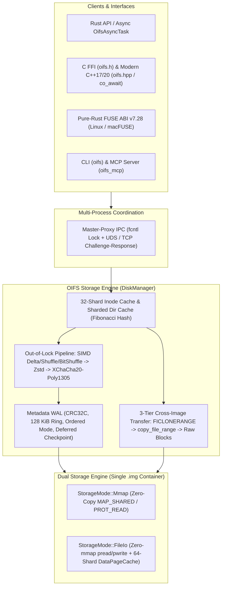

# OIFS (O's Inode File System)

[](https://github.com/ych/oifs/actions/workflows/rust.yml)
[](https://github.com/ych/oifs/releases/tag/1.4.0)
[](LICENSE)
[](Cargo.toml)
[](docs/formal_verification/README.md)

[English](README.md) | [繁體中文](README_zh.md) | [📖 Online Documentation](https://ych.github.io/oifs/)

**OIFS** is a high-performance, single-file Unix-like inode filesystem engine written in Rust (Edition 2024). It packs an entire POSIX-style directory tree—with crash-safe WAL journaling, XChaCha20-Poly1305 AEAD encryption, SIMD numerical compression filters, seekable 64 KiB random-access chunks, pure-Rust FUSE mounting, cross-image CoW reflink transfers, C/C++17/20 zero-copy bindings, and an AI MCP server—into one portable `.img` container file.

> 🌐 **Interactive Architecture & Specs**: [https://ych.github.io/oifs/](https://ych.github.io/oifs/)

---

## Why OIFS?

Choose OIFS when you need **real filesystem semantics inside a single portable file** without sacrificing raw throughput, compression ratio, or crash safety:

1. **AI Agent Sandboxes & Portable Workspaces**: Pack an entire project or agent memory into one encrypted `.img` container, fork it in O(1) via CoW (`oifs clone`), mount it via FUSE, or expose it directly to Claude Desktop / Cursor via the built-in `oifs_mcp` server.
2. **Scientific Telemetry & ML Datasets**: Replace bloated HDF5 archives or millions of scattered Zarr/Parquet files—SIMD Delta/Shuffle/BitShuffle + Seekable 64 KiB Zstd achieves up to **390× compression** while keeping microsecond random `read_at` and cross-image `FICLONERANGE` dataset splitting.
3. **Embedded App Asset Packs & Encrypted Vaults**: Unlike read-only ZIP/SquashFS archives, OIFS supports concurrent multi-process read-write, `F_RDLCK` read-only mounts, atomic `rename`, WAL crash recovery, and zero-copy C++17/20 `oifs::PinnableSlice` views over a single OS file descriptor.

### Positioning vs. Alternatives

| Capability | **OIFS** | SQLite (Blob Store) | HDF5 | SquashFS / DwarFS |
| :--- | :---: | :---: | :---: | :---: |
| **Read-Write + Crash-Safe WAL** | ✅ (Ordered WAL + `fsck`) | ✅ (SQLite WAL) | ⚠️ (fragile on crash) | ❌ (read-only) |
| **Multi-Process & OS Mount** | ✅ Master-Proxy IPC + Pure-Rust FUSE + `F_RDLCK` RO | ✅ File locks | ⚠️ SWMR only | ✅ FUSE (RO only) |
| **Built-in AEAD Encryption** | ✅ XChaCha20-Poly1305 + 192-bit SIV filenames | 🔌 Paid / third-party | ❌ | ❌ |
| **Numerical SIMD Filters + Seekable 64K** | ✅ Delta / Shuffle / BitShuffle + 64K Zstd | ❌ | ✅ Chunked filters | ⚠️ Generic / dedup |
| **POSIX Hierarchy & Cross-Image Reflink** | ✅ Directories, `rename`, `FICLONERANGE`, 1 OS FD | ❌ SQL tables | ⚠️ Group tree | ✅ Read-only tree |

---

## Architecture Overview



---

## Quick Start

### Install CLI & Build Shared Library

```bash
# Install `oifs` and `oifs_mcp` binaries to ~/.cargo/bin
cargo install --path .

# Or build release binaries & shared library (target/release/liboifs.{so,dylib})
cargo build --release
```

### Everyday CLI Workflows

```bash
# 1. Create a 64 MiB journaled image (or add --encrypt for Argon2id + XChaCha20-Poly1305)
oifs -i dataset.img create --size 64 --journal
oifs -i vault.img create --size 64 --journal --encrypt

# 2. Import/export files with automatic SIMD numerical filter selection & 64K seekable chunks
oifs filter-analyze telemetry.bin
oifs -i dataset.img put telemetry.bin --filter auto --chunked
oifs -i dataset.img get telemetry.bin restored.bin

# 3. Directories, read-only inspection (--read-only acquires shared F_RDLCK, zero writes)
oifs -i dataset.img mkdir models
oifs -i dataset.img ls -r
oifs -i dataset.img --read-only stat telemetry.bin
oifs -i dataset.img --read-only --no-mmap cat README.txt

# 4. Mount natively via Pure-Rust FUSE (Linux /dev/fuse or macOS macFUSE)
oifs -i dataset.img mount ./mnt --foreground
oifs -i dataset.img --read-only mount ./mnt_ro --foreground

# 5. Instant O(1) CoW image fork & 3-tier cross-image fast transfer / sub-range splice
oifs clone dataset.img sandbox_fork.img
oifs -i dataset.img transfer --to train.img telemetry.bin --dest /train/telemetry.bin
oifs -i dataset.img transfer --to shard.img telemetry.bin --offset 0 --len 65536 --trim-mode punch-hole

# 6. Integrity check (FSCK), online defrag & legacy v1 -> v2 inode format migration
oifs -i dataset.img fsck --json
oifs -i dataset.img defrag
oifs -i legacy_v1.img migrate    # Upgrades legacy v1 bincode inodes in place to fixed 256B v2 records
```

> **Format v2 vs. v3 Note**: Newly created images use **Format v3** (dynamic multi-block bitmaps scaling well beyond 128 MiB + fixed 256-byte **v2 inode records**). Legacy v1 images remain 100% readable/writable and can upgrade their inode table in place via `oifs migrate`.

---

## MCP Server for AI Agents 🤖

`oifs_mcp` (`--features mcp`, enabled by default) exposes an OIFS `.img` container over stdio JSON-RPC so Claude Desktop, Cursor, or custom AI agents get an isolated, persistent single-file sandbox.

Add to `claude_desktop_config.json` or `.mcp.json`:

```json
{
  "mcpServers": {
    "oifs-sandbox": {
      "command": "oifs_mcp",
      "args": ["/path/to/agent_workspace.img", "--size", "64"],
      "env": {
        "OIFS_PASSWORD": "optional-vault-password"
      }
    }
  }
}
```

**Exposed MCP Tools**: `read_file`, `write_file`, `append_file`, `list_dir`, `mkdir`, `delete_file`, `truncate_file`, and `status`.

---

## Code Examples

### Self-Contained Rust API Example

```rust
use oifs::disk::{CompressionMode, DiskManager};
use oifs::filters::FilterConfig;
use oifs::storage::StorageMode;

fn main() -> Result<(), Box<dyn std::error::Error>> {
    // Creates a fresh 16 MiB journaled image (or opens existing) using Mmap or FileIo
    let dm = DiskManager::open_with_options(
        "demo.img",
        16 * 1024 * 1024,
        None,               // Some("secret") for encrypted container
        true,               // Enable CRC32C Metadata WAL
        StorageMode::Mmap,  // Or StorageMode::FileIo (zero mmap)
    )?;

    // Single-transaction create + SIMD Delta/Shuffle + Seekable 64 KiB Zstd write
    let payload: Vec<u8> = (0u32..32_768).flat_map(u32::to_le_bytes).collect();
    let file_id = dm.create_file_with_data_with_filters(
        0,
        "telemetry.bin",
        &payload,
        CompressionMode::Seekable64K { level: 3 },
        FilterConfig::numeric(4),
    )?;

    // Amortized lock-free batch reading via ReadSession + pinned FileReadHandle
    let session = dm.begin_read();
    let handle = session.open_inode(file_id)?;
    let mut slice = vec![0u8; 4096];
    let n = handle.read_at(65_536, &mut slice)?;
    assert_eq!(&slice[..n], &payload[65_536..65_536 + n]);
    drop(handle);
    drop(session);

    // Atomic metadata-only rename & full consistency check (fsck)
    let dir_id = dm.create_directory(0, "archive")?;
    dm.rename(0, "telemetry.bin", dir_id, "run_01.bin")?;
    assert!(dm.verify_integrity()?.is_clean);
    Ok(())
}
```

### Modern C++17 / C++20 Zero-Copy API (`include/oifs.hpp`)

```cpp
#include "oifs.hpp"
#include <cassert>
#include <vector>

int main() {
    assert(oifs::check_version() == OIFS_VERSION_COMPAT_OK);

    oifs::OpenOptions opts;
    opts.size = 16ULL * 1024 * 1024;
    opts.journaled = true;
    auto fs = oifs::FileSystem::open_with_options("cpp_demo.img", opts);

    // Typed span write with SIMD Delta+Shuffle numerical filter
    std::vector<float> weights(16384, 1.25f);
    fs.create_file_with_span("weights.f32", weights,
                             oifs::WritePolicy::Seekable64K, 3,
                             oifs::FilterConfig::numeric(4));

    // RocksDB-style PinnableSlice: 0-copy mmap pin or automatic 1-copy fallback
    auto session = fs.begin_read();
    auto handle = session.open_file("weights.f32");
    auto slice = handle.read_pinnable(0, 4096);
    auto view = slice.as_span<float>();
    assert(view[0] == 1.25f);

    // C++20 also supports `co_await fs.read_at_async(...)` with Inline Fast-Path zero-suspend!
    assert(fs.verify_integrity().is_clean);
}
```

---

## Core Capabilities & Engineering Highlights

*   **Dual Storage Engine (`Mmap` & `FileIo`)**: Defaults to zero-copy `MAP_SHARED` mmap, with an opt-in 100% `mmap`-free positional `pread`/`pwrite` engine (`--no-mmap` / `OIFS_STORAGE_MODE=pread`) backed by write-through bitmap/WAL mirrors, a 16-shard 4 MiB `MetadataBlockCache`, and a configurable 64-shard 32 MiB Second-Chance Clock `DataPageCache`.
*   **Strict Read-Only Mode (`F_RDLCK` + `PROT_READ`)**: Opens `0444` images with `O_RDONLY`, acquires shared OS read locks for concurrent multi-process inspection, preserves 0-copy `mmap_slice()`, verifies WAL cleanliness with zero writes, and suppresses all `Drop` flushes.
*   **Pure-Rust Cross-Platform FUSE (ABI v7.28)**: Zero external C library dependencies; single-FD open-handle multiplexing (1,000+ FUSE handles on 1 `.img` OS FD), dynamic `max_write` negotiation (`1 MiB` default, Linux `FUSE_MAX_PAGES` & `/sys/module/fuse/parameters/max_pages_limit`, macOS `-o iosize`), `FUSE_RENAME`/`RENAME2`, Finder metadata filtering, and UTF-8 NFD→NFC normalization.
*   **Atomic POSIX `rename` & 3-Tier Cross-Image Transfer / Sub-Range Splice**:
    *   Single-WAL-transaction `DiskManager::rename` with SIV filename re-encryption and cycle prevention.
    *   `clone_image` (APFS `clonefile` / Linux `FICLONE`), `transfer_file_to`, and `splice_range_to` (`FICLONERANGE` → `copy_file_range` → raw compressed block copy) with encryption/AAD fast-path gating, `(src_dev, dst_dev)` negative reflink cache, WAL ordered-mode `fdatasync`, Seekable 64K `ChunkEntry` rebasing, sparse zero-subtree skipping, `Head/Body/Tail` sandwich partitioning, and `SpliceTrimMode::{Keep, PunchHole, CollapseRange}`.
*   **Transactional Metadata WAL & Configurable Durability**: Opt-in 33-block (1 header + 128 KiB ring) CRC32C WAL with `Lazy`, `RangeAsync`, and `Strict` modes, single-transaction `create_file_with_data` (inline data-journaling payloads `<= 8 KiB`), and async Group-Commit writes.
*   **32-Shard Concurrency & Out-of-Lock Pipeline**: 32-shard Fibonacci-hashed `BoundedInodeCache` & `ShardedDirCache`, out-of-lock SIMD filter / Zstd / AEAD execution, and non-blocking `flush()`.
*   **Hardened Cryptography & Defense-in-Depth**: OWASP/RFC 9106 Argon2id (`64 MiB`, `t=3`, `p=4`), BLAKE2b-512 domain-separated subkeys, context-bound XChaCha20-Poly1305 AEAD (`inode_id` + `chunk_idx` + `flags` in AAD; AArch64 NEON / x86_64 AVX2 payloads + 1-block scalar short-filename fast path), 192-bit SIV filenames, zeroed block reuse, owner-only `0600` files, bounded OOM/bomb protections, and loopback-only default TCP IPC (`--allow-remote-ipc` opt-in).
*   **Formal Verification & Quality Assurance**: **109 AWS Kani (CBMC) formal proofs**, Bolero property/fuzz testing, Shuttle DPOR concurrency testing, and **73 integration test suites**.

---

## Platform Support & Feature Flags

| Feature / Subsystem | Linux (`x86_64` / `aarch64`) | macOS (Apple Silicon / Intel) | Windows |
| :--- | :---: | :---: | :---: |
| Core Engine (`Mmap` / `FileIo`, WAL, Encryption, Filters, C/C++ FFI) | ✅ Full | ✅ Full | ⚠️ Experimental (`fcntl` locks & Unix IPC are Unix-only) |
| Native Kernel FUSE Mount (`oifs mount`) | ✅ `/dev/fuse` + `fusermount3` | ✅ `macFUSE 5.x` (`SCM_RIGHTS`) | ❌ Userspace `dispatch_frame` only |
| Cross-Image Zero-Copy Reflink (`FICLONERANGE` / `clonefile`) | ✅ Btrfs / XFS / bcachefs / Lustre Lreflink | ✅ Whole-image APFS `clonefile`; sub-range raw fallback | ❌ Raw block fallback |
| `IoBackend::IoUring` | ✅ (`--features io_uring`, default) | ↩️ Falls back to `Pread` | ↩️ Falls back to `Pread` |
| Master-Proxy Multi-Process IPC | ✅ UDS & TCP | ✅ UDS & TCP | ❌ Standalone only |

| Cargo Feature Flag | Default | Description |
| :--- | :---: | :--- |
| `mcp` | ✅ On | Builds the `oifs_mcp` JSON-RPC server (`rmcp`, `tokio`, `schemars`). |
| `io_uring` | ✅ On (Linux only) | Enables Linux `io_uring` async payload-read backend (`io-uring`). |
| `blosc2` | ❌ Off | Enables optional native C-Blosc2 interop wrappers (`filters::blosc2_*`). |

---

## Performance Benchmarks

Measured on **Apple M5 Pro, 64 GiB RAM, macOS (`aarch64`, `--release`)**, operating on warm OS page cache (`Mmap` / `FileIo` + WAL where noted):

| Benchmark Scenario | Workload / Configuration | Result / Throughput | Notes / Comparison |
| :--- | :--- | :--- | :--- |
| **Dense Indirect `read_at`** | 1,000 × 1 MiB double-indirect reads (`Mmap`, warm cache) | **58.2 GB/s** (`16.8 ms`) | **2.63× faster** via batch leaf resolution + extent coalescing |
| **Sparse Subtree Hole-Skip** | 200 × 4 MiB unallocated subtrees (logical zero-fill) | **232.5 GB/s** (`3.36 ms`) | Logical throughput (skips unallocated subtrees without disk I/O; **4.55× faster**) |
| **Seekable 64K `read_at`** | 16 MiB seekable file (`1 MiB` / `4 KiB` seq reads) | **12.6 GB/s** (`1.27 ms`) / **3.32 GB/s** (`4.82 ms`) | **2.70× / 1.47× faster** via persistent worker pool + 4-chunk read-ahead |
| **Cross-Image Fast Transfer** | 16 MiB `Delta+Shuffle+Zstd` / 64 MiB Sparse (`64 KiB` alloc) | **0.04 ms** / **0.23 ms** (`RawBlockCopy`) | **137.7× / 104.0× faster** vs logical decompress+recompress (`6.14 ms` / `24.43 ms`) |
| **Cross-Image Zstd & Splice** | 16 MiB Zstd stream / 8 MiB Seekable Splice+Collapse | **0.47 ms** / **0.79 ms** | **16.3× / 2.81× faster** vs logical re-encode |
| **Whole-Image CoW Clone** | 64 MiB `.img` fork (`oifs clone`, APFS `clonefile`) | **0.09 ms** | **2.19× faster** than `std::fs::copy`, 0 extra disk space |
| **C++ Zero-Copy `PinnableSlice`** | Random 4 KiB reads (`Mmap`, `FileReadHandle`) | **4.5–6.1 ns/op** | **23×–27× faster** than path-based C `oifs_read_at` (`106–167 ns/op`) |
| **32-Shard Directory Cache** | 16 threads × 10k ops (97% lookup + 3% build) | **8.60M lookups/sec** (`3.24 ms`) | **9.97× faster** vs single `RwLock` |
| **Journal Durability Modes** | 500 × 512 B `create` + `write` (WAL, `Mmap`) | Lazy **626k/s** \| RangeAsync **234k/s** \| Strict **10.9k/s** | `Strict` **2.31× faster** via deferred metadata checkpointing |
| **Live macFUSE 5.5.0 Mount** | 16 MiB seq write (`Mmap+WAL` / `FileIo+WAL`) | **2.13 GB/s** / **1.09 GB/s** (warm peak) | Full OS VFS + kernel FUSE round-trip; UBC reads **19.5–20.7 GB/s** |
| **Numerical Data Compression** | 4-byte structured telemetry (`Delta` + Zstd) | **390.1× ratio** (99.7% savings) | **200× better** than raw Zstd (`1.95×`) |

---

## Build, Test & Formal Verification

```bash
# Run all 73 integration suites + unit tests (77 total targets)
cargo test --release

# Run key suites under pure pread/pwrite StorageMode::FileIo (zero mmap)
OIFS_STORAGE_MODE=pread cargo test --release --test transfer_test --test rename_test --test fuse_test --test cpp_api_test --test read_only_mode_test

# Run live kernel FUSE mount E2E tests & APFS benchmark (requires macFUSE or /dev/fuse)
cargo test --release --test fuse_live_mount_test -- --ignored --nocapture --test-threads=1

# Run all 109 Kani formal verification proofs in parallel
cargo kani -j 8 --output-format=terse

# One-click pre-release verification (fmt, clippy, build, test, shuttle, kani, coverage)
./scripts/release_check.sh --quick
```

---

## License

Copyright (c) 2026 Yu-Chun Huang <ych@ychuang.org>

Licensed under the Apache License, Version 2.0 (the "License"); you may not use this file except in compliance with the License. You may obtain a copy of the License at [http://www.apache.org/licenses/LICENSE-2.0](http://www.apache.org/licenses/LICENSE-2.0).
