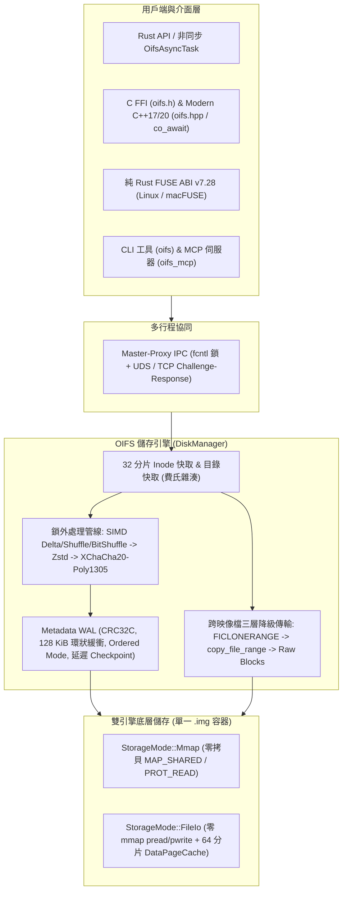

# OIFS (O's Inode File System)

[](https://github.com/ych/oifs/actions/workflows/rust.yml)
[](https://github.com/ych/oifs/releases/tag/1.4.0)
[](LICENSE)
[](Cargo.toml)
[](docs/formal_verification/README.md)

[English](README.md) | [繁體中文](README_zh.md) | [📖 線上官方文件](https://ych.github.io/oifs/)

**OIFS** 是以 Rust（Edition 2024）打造的單檔、類 Unix Inode 嵌入式檔案系統引擎。它將完整的階層式檔案系統——包含斷電自癒 WAL、XChaCha20-Poly1305 加密、SIMD 科學數值壓縮濾鏡、可隨機存取的 64 KiB 分塊壓縮、純 Rust 跨平台 FUSE 掛載、跨映像檔 CoW Reflink 搬移、C/C++17/20 零拷貝介面與 AI MCP 伺服器——全部封裝在單一可攜的 `.img` 容器檔中。

> 🌐 **線上官方文件與架構視覺化網站**：[https://ych.github.io/oifs/](https://ych.github.io/oifs/)

---

## 為什麼選擇 OIFS？（Why OIFS?）

當你需要**在單一可攜檔案裡擁有真正的檔案系統語意**，同時兼顧極致吞吐、壓縮率與崩潰一致性時：

1. **AI Agent 沙盒與狀態封裝**：把整個專案工作區或代理人記憶打包成單一加密 `.img`，透過 CoW（`oifs clone`）在毫秒內建立獨立分支、用 FUSE 直接掛載，或透過內建 `oifs_mcp` 直接對接 Claude Desktop / Cursor。
2. **科學計算遙測與 ML 資料集**：取代肥大易損的 HDF5 或數百萬個散落小檔的 Zarr/Parquet——SIMD Delta/Shuffle/BitShuffle 搭配 64 KiB Seekable Zstd 可達 **390× 壓縮比**，同時維持微秒級隨機 `read_at` 與跨 `.img` `FICLONERANGE` 資料集秒級切分。
3. **應用程式內嵌資源包與安全儲存艙**：相較唯讀的 ZIP / SquashFS，OIFS 具備多行程併發讀寫、`F_RDLCK` 嚴格唯讀掛載、原子 `rename`、WAL 防崩潰與 C++17/20 `oifs::PinnableSlice` 零拷貝視圖，且全系統僅佔用單一 OS 檔案描述符（FD）。

### 競品定位比較

| 核心維度 | **OIFS** | SQLite（Blob 儲存） | HDF5 | SquashFS / DwarFS |
| :--- | :---: | :---: | :---: | :---: |
| **可讀寫＋崩潰安全 WAL** | ✅（Ordered WAL + `fsck`） | ✅（SQLite WAL） | ⚠️（崩潰易損壞） | ❌（唯讀） |
| **多行程併發與系統掛載** | ✅ Master-Proxy IPC + 純 Rust FUSE + `F_RDLCK` 唯讀 | ✅ 檔案鎖 | ⚠️ 僅 SWMR | ✅ FUSE（僅唯讀） |
| **內建 AEAD 加密** | ✅ XChaCha20-Poly1305 + 192-bit SIV 檔名 | 🔌 需付費／外掛 | ❌ | ❌ |
| **數值 SIMD 濾鏡＋隨機 64K 壓縮** | ✅ Delta / Shuffle / BitShuffle + 64K Zstd | ❌ | ✅ 分塊濾鏡 | ⚠️ 通用壓縮／去重 |
| **POSIX 目錄語意與跨檔 Reflink** | ✅ 目錄樹、`rename`、`FICLONERANGE`、單一 FD | ❌ SQL 資料表 | ⚠️ Group 樹 | ✅ 唯讀目錄樹 |

---

## 系統架構總覽



---

## 快速開始 (Quick Start)

### 安裝執行檔與建置動態函式庫

```bash
# 方式一：一行免 Clone 直接從 GitHub Release Tag 安裝
cargo install --git https://github.com/ych/oifs --tag 1.4.0

# 方式二：直接下載預編譯執行檔（Linux x86_64/arm64 與 macOS Intel/Apple Silicon）
#   https://github.com/ych/oifs/releases

# 方式三：從本機原始碼安裝或建置動態函式庫 (target/release/liboifs.{so,dylib})
cargo install --path .
cargo build --release
```

### 常用 CLI 操作

```bash
# 1. 建立 64 MiB 具 WAL 保護的映像檔（加 --encrypt 啟用 Argon2id + XChaCha20-Poly1305）
oifs -i dataset.img create --size 64 --journal
oifs -i vault.img create --size 64 --journal --encrypt

# 2. 自動分析並以 SIMD 數值濾鏡 + 64K Seekable 分塊匯入／匯出
oifs filter-analyze telemetry.bin
oifs -i dataset.img put telemetry.bin --filter auto --chunked
oifs -i dataset.img get telemetry.bin restored.bin

# 3. 目錄與嚴格唯讀檢視（--read-only 取得共享 F_RDLCK 鎖，零寫入）
oifs -i dataset.img mkdir models
oifs -i dataset.img ls -r
oifs -i dataset.img --read-only stat telemetry.bin
oifs -i dataset.img --read-only --no-mmap cat README.txt

# 4. 透過純 Rust FUSE 掛載（Linux /dev/fuse 或 macOS macFUSE）
oifs -i dataset.img mount ./mnt --foreground
oifs -i dataset.img --read-only mount ./mnt_ro --foreground

# 5. O(1) 整顆映像檔 CoW 分支與跨映像檔三層快速搬移／子區段剪接
oifs clone dataset.img sandbox_fork.img
oifs -i dataset.img transfer --to train.img telemetry.bin --dest /train/telemetry.bin
oifs -i dataset.img transfer --to shard.img telemetry.bin --offset 0 --len 65536 --trim-mode punch-hole

# 6. 結構檢查 (FSCK)、線上磁碟重組與舊版 v1 遷移
oifs -i dataset.img fsck --json
oifs -i dataset.img defrag
oifs -i legacy_v1.img migrate    # 將舊版 v1 bincode Inode 原地升級為固定 256B v2 記錄
```

> **Format v2 與 v3 說明**：新建映像檔一律採用 **Format v3**（可突破 128 MiB 的動態多區塊 Bitmap＋固定 256-byte **v2 Inode 記錄**）；舊版 v1 映像檔維持 100% 相容並可透過 `oifs migrate` 原地升級 Inode 記錄格式。

---

## AI Agent 專用 MCP 伺服器設定 🤖

`oifs_mcp`（預設啟用 `mcp` feature）透過 stdio JSON-RPC 將單一 `.img` 沙盒直接暴露給 Claude Desktop、Cursor 或自訂 AI Agent。

在 `claude_desktop_config.json` 或 Cursor `.mcp.json` 加入：

```json
{
  "mcpServers": {
    "oifs-sandbox": {
      "command": "oifs_mcp",
      "args": ["/path/to/agent_workspace.img", "--size", "64"],
      "env": {
        "OIFS_PASSWORD": "optional-vault-password"
      }
    }
  }
}
```

**提供之 MCP Tools**：`read_file`、`write_file`、`append_file`、`list_dir`、`mkdir`、`delete_file`、`truncate_file`、`status`。

---

## 程式碼範例

### 可獨立執行的 Rust API 範例

```rust
use oifs::disk::{CompressionMode, DiskManager};
use oifs::filters::FilterConfig;
use oifs::storage::StorageMode;

fn main() -> Result<(), Box<dyn std::error::Error>> {
    // 建立（或開啟）16 MiB 啟用 WAL 的映像檔，可選 Mmap 或純 FileIo
    let dm = DiskManager::open_with_options(
        "demo.img",
        16 * 1024 * 1024,
        None,               // 傳入 Some("secret") 即啟用加密容器
        true,               // 啟用 CRC32C Metadata WAL
        StorageMode::Mmap,  // 或 StorageMode::FileIo（完全免 mmap）
    )?;

    // 單交易建檔＋SIMD Delta/Shuffle＋Seekable 64 KiB Zstd 壓縮寫入
    let payload: Vec<u8> = (0u32..32_768).flat_map(u32::to_le_bytes).collect();
    let file_id = dm.create_file_with_data_with_filters(
        0,
        "telemetry.bin",
        &payload,
        CompressionMode::Seekable64K { level: 3 },
        FilterConfig::numeric(4),
    )?;

    // 透過 ReadSession + FileReadHandle 攤銷鎖與查表開銷做隨機讀取
    let session = dm.begin_read();
    let handle = session.open_inode(file_id)?;
    let mut slice = vec![0u8; 4096];
    let n = handle.read_at(65_536, &mut slice)?;
    assert_eq!(&slice[..n], &payload[65_536..65_536 + n]);
    drop(handle);
    drop(session);

    // 原子純 metadata 更名與一致性檢查 (fsck)
    let dir_id = dm.create_directory(0, "archive")?;
    dm.rename(0, "telemetry.bin", dir_id, "run_01.bin")?;
    assert!(dm.verify_integrity()?.is_clean);
    Ok(())
}
```

### Modern C++17 / C++20 零拷貝 API（`include/oifs.hpp`）

```cpp
#include "oifs.hpp"
#include <cassert>
#include <vector>

int main() {
    assert(oifs::check_version() == OIFS_VERSION_COMPAT_OK);

    oifs::OpenOptions opts;
    opts.size = 16ULL * 1024 * 1024;
    opts.journaled = true;
    auto fs = oifs::FileSystem::open_with_options("cpp_demo.img", opts);

    // 型別安全 Span 寫入＋SIMD Delta+Shuffle 數值濾鏡
    std::vector<float> weights(16384, 1.25f);
    fs.create_file_with_span("weights.f32", weights,
                             oifs::WritePolicy::Seekable64K, 3,
                             oifs::FilterConfig::numeric(4));

    // RocksDB 風格 PinnableSlice：Mmap 下零拷貝 pin，壓縮／FileIo 自動 1-copy 降級
    auto session = fs.begin_read();
    auto handle = session.open_file("weights.f32");
    auto slice = handle.read_pinnable(0, 4096);
    auto view = slice.as_span<float>();
    assert(view[0] == 1.25f);

    // C++20 另支援 `co_await fs.read_at_async(...)`（命中快取零 suspend）
    assert(fs.verify_integrity().is_clean);
}
```

---

## 核心工程亮點

*   **雙儲存引擎（`Mmap` 與 `FileIo`）**：預設零拷貝 `MAP_SHARED`，另提供完全免 `mmap` 的純 `pread`/`pwrite` 引擎（`--no-mmap` / `OIFS_STORAGE_MODE=pread`），內建 16 分片 4 MiB Metadata 快取與 64 分片 32 MiB Second-Chance Clock `DataPageCache`。
*   **嚴格唯讀模式（`F_RDLCK` + `PROT_READ`）**：以 `O_RDONLY` 開啟 `0444` 映像檔、支援多行程共享唯讀鎖、保留 `mmap_slice()` 零拷貝，零寫入驗證 WAL 並於 `Drop` 抑制 flush。
*   **純 Rust 跨平台 FUSE（ABI v7.28）**：零外部 C 函式庫依賴、單一 OS FD 複用千個開檔 handle、動態 `max_write` 協商（預設 `1 MiB`，自動偵測 Linux `FUSE_MAX_PAGES` 與 `/sys/module/fuse/parameters/max_pages_limit`、macOS `-o iosize`）、`FUSE_RENAME`/`RENAME2`、macOS Finder 過濾與 UTF-8 NFD→NFC 正規化。
*   **POSIX 原子 `rename` 與跨 `.img` 三層降級搬移／子區段剪接**：
    *   `DiskManager::rename` 以單筆 WAL 交易完成純 metadata 搬移、SIV 檔名重算與目錄循環防護。
    *   `clone_image`（APFS `clonefile` / Linux `FICLONE`）、`transfer_file_to` 與 `splice_range_to`（`FICLONERANGE` → `copy_file_range` → Raw Compressed Block Copy），具備加密／AAD 閘門、`(src_dev, dst_dev)` 負向 Reflink 快取、Ordered-mode `fdatasync`、Seekable 64K `ChunkEntry` Rebase、稀疏跳洞、三明治 `Head/Body/Tail` 切分與 `SpliceTrimMode::{Keep, PunchHole, CollapseRange}`。
*   **交易式 Metadata WAL 與 Group-Commit 非同步引擎**：33 區塊（1 Header + 128 KiB Ring）CRC32C WAL，支援 `Lazy` / `RangeAsync` / `Strict` 模式、單交易 `create_file_with_data`（`<= 8 KiB` WAL inline data-journaling）與並發 `Strict` 寫入 Group-Commit。
*   **32 分片並行與密碼學縱深防禦**：OWASP Argon2id（`64 MiB`, `t=3`, `p=4`）、BLAKE2b-512 子金鑰隔離、Context-Bound XChaCha20-Poly1305 AEAD（NEON/AVX2＋短檔名 1-block scalar fast path）、192-bit SIV 檔名加密、新區塊清零、OOM/解壓炸彈邊界防護與預設僅綁 loopback 的 TCP IPC（`--allow-remote-ipc`）。
*   **形式化驗證與測試覆蓋**：**109 項 AWS Kani (CBMC) 數學證明**、Bolero 模糊測試、Shuttle 並行排程驗證與 **73 組整合測試套件**。

---

## 平台支援矩陣與 Feature Flags

| 功能／子系統 | Linux (`x86_64` / `aarch64`) | macOS (Apple Silicon / Intel) | Windows |
| :--- | :---: | :---: | :---: |
| 核心儲存引擎（`Mmap`/`FileIo`、WAL、加密、濾鏡、C/C++ FFI） | ✅ 完整支援 | ✅ 完整支援 | ⚠️ 實驗性（`fcntl` 鎖與 UDS 僅限 Unix） |
| 原生 FUSE 核心掛載（`oifs mount`） | ✅ `/dev/fuse` + `fusermount3` | ✅ `macFUSE 5.x`（`SCM_RIGHTS`） | ❌ 僅使用者態 `dispatch_frame` |
| 跨映像檔零拷貝 Reflink（`FICLONERANGE` / `clonefile`） | ✅ Btrfs / XFS / bcachefs / Lustre Lreflink | ✅ 整檔 APFS `clonefile`；子區段自動降級 Raw | ❌ 降級 Raw 區塊直搬 |
| `IoBackend::IoUring` | ✅（`--features io_uring`，預設開啟） | ↩️ 自動退回 `Pread` | ↩️ 自動退回 `Pread` |
| Master-Proxy 多行程 IPC | ✅ UDS 與 TCP | ✅ UDS 與 TCP | ❌ 僅單行程模式 |

| Cargo Feature Flag | 預設 | 說明 |
| :--- | :---: | :--- |
| `mcp` | ✅ 開啟 | 建置 `oifs_mcp` JSON-RPC 伺服器（`rmcp`, `tokio`, `schemars`）。 |
| `io_uring` | ✅ 開啟（僅 Linux） | 啟用 Linux `io_uring` 非同步讀取後端（`io-uring`）。 |
| `blosc2` | ❌ 關閉 | 啟用可選的原生 C-Blosc2 互通包裝（`filters::blosc2_*`）。 |

---

## 效能實測基準

測試環境：**Apple M5 Pro、64 GiB RAM、macOS（`aarch64`、`--release`）**，除註明外皆於熱 OS Page Cache 下實測（`Mmap` / `FileIo` + WAL）：

| 評測場景 | 負載與條件 | 實測結果 / 吞吐量 | 備註／對比 |
| :--- | :--- | :--- | :--- |
| **密集雙重間接 `read_at`** | 1,000 × 1 MiB 雙重間接讀取（`Mmap` 熱頁快取） | **58.2 GB/s** (`16.8 ms`) | 批次葉節點解析＋連續區段合併，**提速 2.63×** |
| **稀疏子樹跳洞讀取** | 200 × 4 MiB 未配置子樹（邏輯補零吞吐） | **232.5 GB/s** (`3.36 ms`) | 邏輯吞吐（直接跳過空子樹免實體 I/O，**提速 4.55×**） |
| **Seekable 64K `read_at`** | 16 MiB 分塊檔（`1 MiB` / `4 KiB` 順序讀） | **12.6 GB/s** (`1.27 ms`) / **3.32 GB/s** (`4.82 ms`) | 常駐 Worker Pool＋4-chunk 預取，**提速 2.70× / 1.47×** |
| **跨 `.img` 快速搬移** | 16 MiB `Delta+Shuffle+Zstd` / 64 MiB Sparse（64K 已配置） | **0.04 ms** / **0.23 ms** (`RawBlockCopy`) | 較邏輯解壓重壓（`6.14 ms` / `24.43 ms`）**提速 137.7× / 104.0×** |
| **跨 `.img` Zstd 與子區段剪接** | 16 MiB Zstd 整檔 / 8 MiB Seekable Splice+Collapse | **0.47 ms** / **0.79 ms** | 較邏輯重編碼 **提速 16.3× / 2.81×** |
| **整顆映像檔 CoW Clone** | 64 MiB `.img` 分支（`oifs clone`，APFS `clonefile`） | **0.09 ms** | 較 `std::fs::copy` **快 2.19×**，0 額外磁碟空間 |
| **C++ 零拷貝 `PinnableSlice`** | 隨機 4 KiB 讀取（`Mmap`, `FileReadHandle`） | **4.5–6.1 ns/op** | 較路徑查詢版 C `oifs_read_at`（`106–167 ns/op`）**快 23×–27×** |
| **32 分片目錄快取** | 16 執行緒 × 10k 次操作（97% 查詢＋3% 建索引） | **8.60M lookups/sec** (`3.24 ms`) | 較單一 `RwLock` **提速 9.97×** |
| **Journal 持久化模式** | 500 × 512 B `create` + `write`（WAL, `Mmap`） | Lazy **626k/s** \| RangeAsync **234k/s** \| Strict **10.9k/s** | 延遲 Metadata Checkpoint 使 `Strict` **提速 2.31×** |
| **實機 macFUSE 5.5.0 掛載** | 16 MiB 順序寫（`Mmap+WAL` / `FileIo+WAL`） | **2.13 GB/s** / **1.09 GB/s**（熱頁峰值） | 完整經過 macOS Kernel VFS；UBC 讀取達 **19.5–20.7 GB/s** |
| **數值資料壓縮效益** | 4-byte 結構化遙測資料（`Delta` + Zstd） | **390.1× 壓縮比**（省 99.7%） | 較原生 Zstd（`1.95×`）**優化 200×** |

---

## 建置、測試與形式化驗證

```bash
# 執行全部 73 組整合測試與單元測試（共 77 targets）
cargo test --release

# 於純 pread/pwrite（零 mmap）模式執行核心套件
OIFS_STORAGE_MODE=pread cargo test --release --test transfer_test --test rename_test --test fuse_test --test cpp_api_test --test read_only_mode_test

# 執行真實核心 FUSE 掛載端對端測試與 APFS 對照 benchmark（需 macFUSE 或 /dev/fuse）
cargo test --release --test fuse_live_mount_test -- --ignored --nocapture --test-threads=1

# 平行執行全部 109 項 Kani 數學形式化證明
cargo kani -j 8 --output-format=terse

# 一鍵發布前檢查（fmt、clippy、build、test、shuttle、kani、coverage）
./scripts/release_check.sh --quick
```

---

## 授權條款 (License)

Copyright (c) 2026 Yu-Chun Huang <ych@ychuang.org>

本專案採用 Apache License 2.0 條款授權。詳細內容請參閱 [LICENSE](http://www.apache.org/licenses/LICENSE-2.0)。
