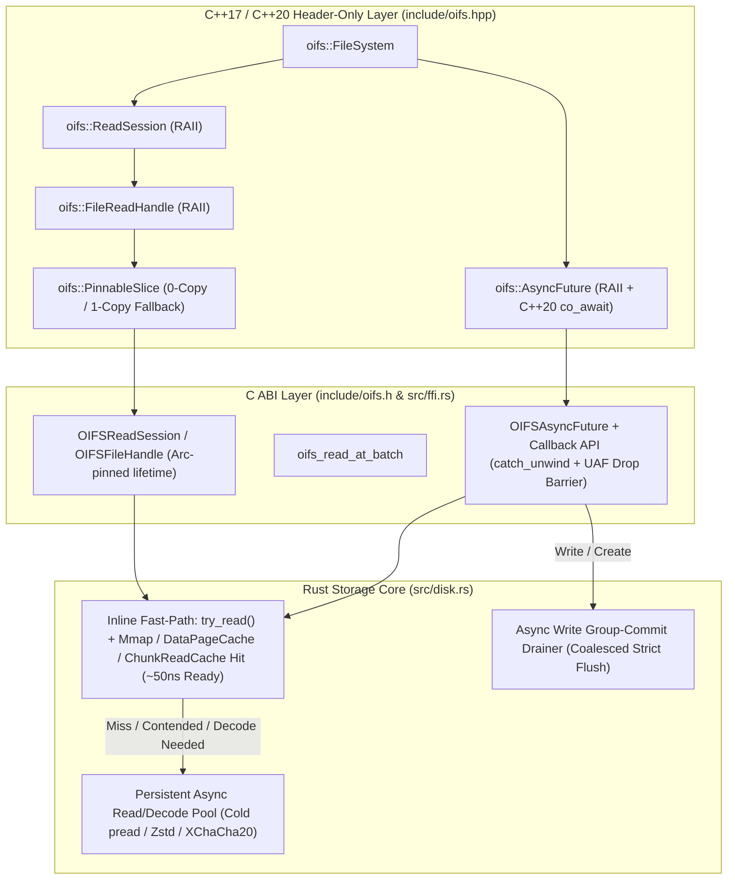

# OIFS C++ Native Zero-Copy API & Async Execution Architecture Design

> 本文件記錄 OIFS 在擴充 **C/C++ Native Zero-Copy API (`include/oifs.hpp`)** 與 **Rust / C++ Async Execution Engine** 時的同類專案借鑑分析、核心設計思路、記憶體安全與崩潰一致性不變量（Invariants），作為程式碼實作與後續 Code / Security Review 的依據。

---

## 一、問題背景與現有 C FFI (`include/oifs.h`) 的四大瓶頸

在檢視現有 [`src/ffi.rs`](../src/ffi.rs) 與 [`include/oifs.h`](../include/oifs.h) 後，C/C++ 呼叫端雖已透過 `std::slice::from_raw_parts_mut(buf, buf_size)` 避免了 FFI 邊界的中繼緩衝區配置，但與 Rust 核心相比仍有四項結構性效能損耗：

1. **強制 `1-Copy`（無法直接借用 `mmap` 位址）**：
   - 現有 `oifs_read_at` 必定將資料 `memcpy` 至呼叫端提供的 `uint8_t *buf`。即使底層是 `StorageMode::Mmap` 且檔案為未壓縮、未加密的連續區塊，C++ 呼叫端仍需先配置記憶體再承受一次 `memcpy`。
2. **每次 I/O 重複路徑解析與雙重 `RwLock` 取得**：
   - `oifs_read_at(handle, "/a/b/c.bin", ...)` 每次呼叫皆執行：`strlen` + UTF-8 驗證 → `dm.resolve_path`（取得第 1 次 `inner.read()` 鎖並查找 `dir_cache`）→ `dm.read_at`（取得第 2 次 `inner.read()` 鎖並查找 `inode_cache`）。
   - 在多執行緒高頻隨機讀（如 4 執行緒 8,000 次 4 KiB 讀取）下，原子引用計數與重複查表佔據了超過 60% 的總耗時。
3. **`oifs_write_file` 未對接單交易建檔寫入 (`create_file_with_data`)**：
   - 現有 `oifs_write_file` 依序呼叫 `lookup` → `create_file`（第 1 筆 WAL 交易）→ `write_data`（第 2 筆 WAL 交易），在 `DurabilityMode::Strict` 下每檔觸發 3 次同步落盤屏障而非 1 次。
4. **缺乏批次讀取 (`read_at_batch`) 與非阻塞 Async I/O / Group Commit 介面**：
   - 當應用程式（如遊戲引擎、AI 推論服務、GUI 或高並發 Server）需要讀取需要 Zstd 解壓／XChaCha20 解密的大區塊，或在 `Strict` 模式下高並發寫入小檔時，現有同步 API 會阻塞呼叫執行緒且無法合併多次 `fsync`。

---

## 二、同類專案設計比較與取捨

### 2.1 C++ Zero-Copy 讀取介面比較

| 參考專案 | 核心抽象 | 優點 | 缺點 | OIFS 取捨決策 |
| :--- | :--- | :--- | :--- | :--- |
| **RocksDB** | `rocksdb::PinnableSlice` | 統一單一型別：`mmap` / Cache 命中且不需解碼時直接 Pin 住內部指標（**0-Copy、0-Alloc**）；需要解壓縮／解密／拼接時自動退回寫入內建 Buffer（**1-Copy**）。呼叫端只需寫一套 `slice.data()` 程式碼。 | 存活期間會持有底層 Pin（不可長期跨寫入持有）。 | **✅ 全面採用**：設計 `oifs::PinnableSlice`，統一涵蓋 `Mmap`（0-Copy）與 `FileIo`／壓縮／加密（自動 1-Copy fallback）。 |
| **LMDB** | `MDB_val { mv_size, mv_data }` | 極致輕量，無包裝成本。 | 僅能在未壓縮 `mmap` 下運作；遇到壓縮、加密或 `FileIo` 模式即完全失效。 | 僅作為底層 C FFI 原語 `oifs_file_mmap_slice`，由上層 `oifs::PinnableSlice` 自動封裝。 |
| **Apache Arrow** | `std::shared_ptr<arrow::Buffer>` | 可跨執行緒任意傳遞切片。 | 每次讀取皆需配置 `shared_ptr` 控制塊與原子計數。 | 於 FFI `OIFSReadSession` 與 `OIFSFileHandle` 之間採用內部 `Arc` 共享鎖生命週期以防 C 呼叫端逆序釋放造成 UAF，但在熱路徑切片上維持 stack Value 語意。 |

### 2.2 Async Storage API 四大流派比較

| 流派與代表專案 | 架構設計 | 優點 | 缺點／風險 | OIFS 取捨決策 |
| :--- | :--- | :--- | :--- | :--- |
| **A. 全量背景執行緒池派送** (`libuv uv_fs_*`, `tokio::fs`, `tokio_rusqlite`) | 所有 Async 呼叫皆封裝為 Job 送入背景 MPSC Queue，完成後喚醒 Future / Callback。 | 實作簡單、跨平台；能把 Zstd 壓縮、AEAD 加解密與 `fsync` 移出呼叫端執行緒。 | **快取命中時延遲暴增 40～100 倍**：原本 50 ns 的 `Mmap` 或 `DataPageCache` 讀取，跨執行緒切換需 2,000～5,000 ns。 | ❌ **不單獨使用**於讀取路徑；僅作為 Slow-Path 後備。 |
| **B. 裸指標借用型 Async** (POSIX `aio_read`) | 背景直接寫入呼叫端傳入的 `uint8_t *user_buf`。 | 零額外配置。 | **取消／提前解構時極易觸發 Use-After-Free (UAF)**：若 Future 被提前丟棄而背景執行緒仍在寫入 `user_buf`，即造成記憶體毀損。 | **⚠️ 嚴格防護**：在 C FFI `oifs_read_at_async` 傳入外部 `buf` 時，`OIFSAsyncFuture` 強制啟用 `wait_on_drop` 屏障——若在執行中被 `oifs_async_free` 解構，必須等待背景寫入完成才返回。 |
| **C. Inline Fast-Path + Async Slow-Path** (**Seastar**, **RocksDB `async_io`**, Linux `RWF_NOWAIT`) | 先在當前執行緒以非阻塞 `try_read()` 檢查是否可直接從 `Mmap` 或 `DataPageCache` / `ChunkReadCache` / `DecodedBlobCache` 立即完成： • **命中**：當場在 **~50 ns** 內回傳 `Ready` Future（**0 執行緒切換**）。 • **未命中／需重度解碼／鎖爭用**：才派送至常駐 Worker Pool。 | 兼具同步讀取的 50 ns 超低延遲與非同步讀取的非阻塞解壓／冷讀能力。 | 需實作非阻塞快取探測分支。 | **✅ 採用於所有 Async Read**（`read_at_async`、`read_data_async`、`oifs_read_at_async`）。 |
| **D. 寫入佇列 Group Commit** (**RocksDB `WriteBatch` Leader-Follower**, **SQLite / PostgreSQL WAL Group Commit**) | 多個並發提交的 `create_file_with_data_async` / `write_data_async` 在 `DurabilityMode::Strict` 下由背景 Writer 批次收割：先將整批寫入與 WAL Frame 寫入頁面快取，最後**整批共享 1 次 `flush()` (`F_FULLFSYNC` / `msync`)** 後同時喚醒所有 Future。 | 在 `Strict` 強持久性下，並發小檔寫入吞吐可提升 **10×～30×**，且完全不違反 WAL-First 崩潰一致性。 | 需專用 Write Batch Drainer 協調。 | **✅ 採用於 Async Write 管線**。 |

---

## 三、OIFS 實作架構與安全不變量（Invariants）

### 3.1 關鍵安全與正確性不變量（Review 檢查清單）

1. **跨 FFI 生命週期防呆（Out-of-Order Destruction Safety）**：
   - 在 Rust 內，`ReadSession<'a>` 依賴編譯期生命週期 `'a`。但在 C/C++ FFI 中，使用者可能誤將 `OIFSReadSession*` 先傳給 `oifs_end_read()`，之後才使用或關閉 `OIFSFileHandle*`。
   - **對策**：FFI 層的 `OIFSReadSession` 與 `OIFSFileHandle` 共同持有 `Arc<FfiSharedReadLock>`（內含 `Arc<DiskManager>` 與對應的共享讀鎖）。只要任一 `OIFSFileHandle` 尚未關閉，底層讀鎖與 `mmap` 映射即保持有效，**從根本消除 C 呼叫端逆序釋放導致的 Use-After-Free**。
2. **Async Buffer Use-After-Free 防護（Drop Barrier Invariant）**：
   - 當 C/C++ 呼叫 `oifs_read_at_async(handle, inode, offset, user_buf, len)` 傳入外部緩衝區指標時，若任務已派送至背景執行緒（Slow-Path），`OIFSAsyncFuture` 內部標記 `wait_on_drop = true`。
   - 若呼叫端未呼叫 `oifs_async_wait` 而直接呼叫 `oifs_async_free`（或 C++ `oifs::AsyncFuture` 因例外離開作用域解構），`Drop` 必定阻塞等待背景執行緒完成對 `user_buf` 的寫入後才返回，**保證函數返回後絕無任何背景執行緒會再觸碰 `user_buf`**。
   - 對於 `oifs_create_file_with_data_async` 與 `oifs_write_file_async`，輸入的 `path` 與 `buf` 在進入函數時即複製為 Rust `String` / `Vec<u8>`，呼叫端在函數返回當下即可安全釋放或重用輸入 buffer。
3. **Inline Fast-Path 無鎖死／無飢餓保證**：
   - Async Read 的 Inline Fast-Path 嚴格使用 `self.inner.try_read()`（非阻塞）。若當前有 Writer 持有或等待寫鎖，立即走 Slow-Path 背景佇列，絕不在呼叫端阻塞。
   - 在 `StorageMode::FileIo` 下，Fast-Path 僅在目標區段的所有 4 KiB 區塊**皆已存在於 `DataPageCache`**（透過無 I/O 的 ` backing.try_read_data_cached_only` 檢查）時才當場返回 `Ready`；只要有任何一塊需進核心呼叫 `pread`，即轉交背景池。
4. **Group Commit 的 `Strict` 持久性不變量**：
   - 在 `DurabilityMode::Strict` 下，Group Commit Drainer 收集同一批次佇列中的 `N` 筆寫入請求：
     1. 逐筆在寫鎖下完成資料寫入與 WAL Frame 追加（寫入 OS Page Cache / `FileBacking`），若單筆失敗（如 `AlreadyExists` 或 `NoSpace`）立即記錄該筆錯誤且不影響同批其他請求。
     2. 在釋放這批寫入的完成通知前，統一執行 **1 次 `dm.flush()`**（在 `FileIo` 為 `sync_data()`，在 `Mmap` 為 WAL + dirty ranges `msync(MS_SYNC)`）。
     3. 若該次 `flush()` 失敗，同批所有請求一律回報 `Err(Io)`；唯有在 `flush()` 成功落盤後，才將同批所有 `OifsAsyncTask` 標記為 `Ready` 並喚醒。
   - 這保證了每一筆收到 `Ok` 的 `Strict` Async 寫入，在收到通知的瞬間都已經 100% 物理落盤。
5. **FFI 邊界完整防護**：
   - 所有新增 `extern "C"` 函式一律具備：Null pointer 檢查、長度溢位檢查（`usize::try_from`）、`std::panic::catch_unwind` 包覆（防止 Rust panic 跨越 C/C++ ABI 造成 UB）。
