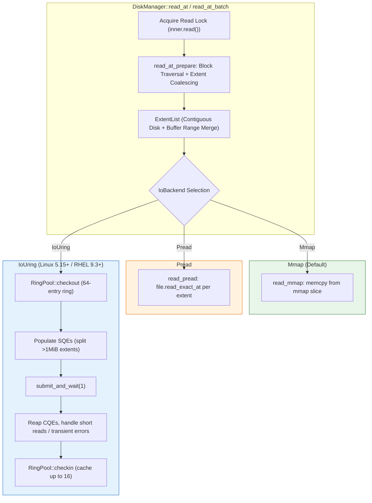
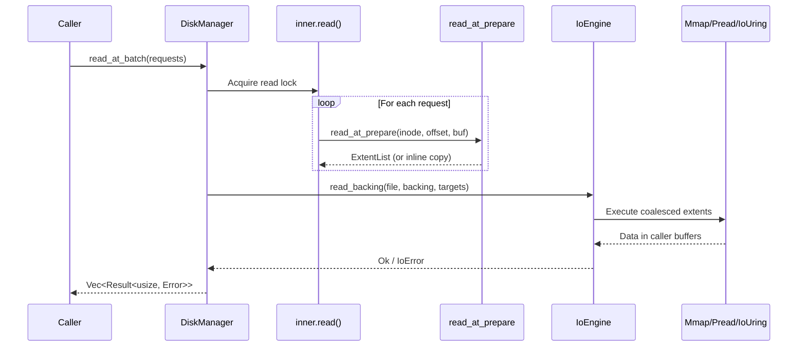
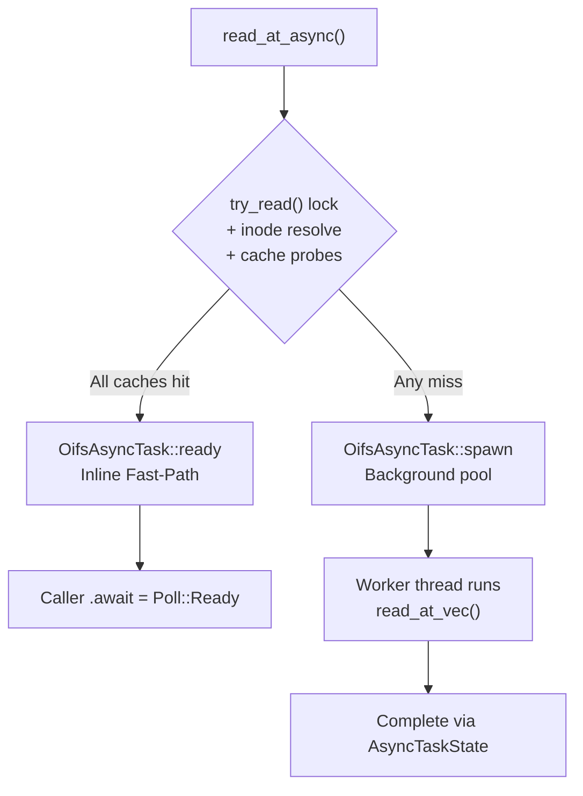
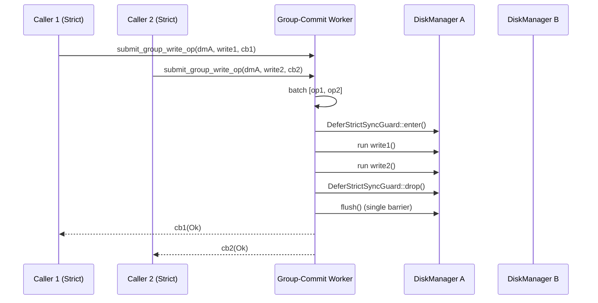

# Async I/O & Pluggable Engines

OIFS separates metadata operations from payload data reading. Filesystem metadata (superblocks, bitmaps, inodes, indirect pointer blocks, and directory indices) resides on the shared `MAP_SHARED` memory map for zero-copy, low-overhead access. File payloads can be large, cold, and scattered across physical blocks—reading them through the mmap means every uncached page is a synchronous page fault, one fault at a time.

P3.2 introduced a pluggable data-block read engine (`src/io_engine.rs`) that decouples physical payload I/O from memory-mapped page faults, enabling applications to select between three backends: **Mmap**, **Pread**, and **IoUring**. In v1.4.0 the async write pipeline adds a dedicated group-commit thread that merges concurrent `DurabilityMode::Strict` operations behind a single `flush()` barrier.



---

## 1. IoBackend Architecture and Selection

The `IoBackend` enum defines three distinct data-block retrieval strategies ([src/io_engine.rs#L36-L51](repo://src/io_engine.rs#L36-L51)):

| Backend | Value | Mechanism | Platforms |
| :--- | :--- | :--- | :--- |
| `IoBackend::Mmap` (Default) | 0 | `memcpy` directly from the shared memory mapping | All |
| `IoBackend::Pread` | 1 | Positional `pread(2)` syscall per coalesced extent | All Unix |
| `IoBackend::IoUring` | 2 | Batched async submission to a pooled `io_uring` ring | Linux ≥ 5.6, `io_uring` cargo feature |

All backends read through the standard OS page cache without `O_DIRECT`, ensuring that recently written dirty pages (including uncommitted mutations under `DurabilityMode::Lazy`) are immediately visible across all backends ([src/io_engine.rs#L1-L25](repo://src/io_engine.rs#L1-L25)).

Backend selection is configurable via:

- **Environment variable**: `OIFS_IO_BACKEND=mmap|pread|io_uring` (case-insensitive; aliases: `uring`, `iouring`, `io-uring`). Read once at `DiskManager` construction via `IoBackend::from_env()` ([src/io_engine.rs#L34-L35](repo://src/io_engine.rs#L34-L35)).
- **Programmatic Rust API**: `DiskManager::set_io_backend(backend)` or builder-style `DiskManager::with_io_backend(backend)` ([src/disk.rs#L1974-L1985](repo://src/disk.rs#L1974-L1985)).
- **FFI**: `oifs_set_io_backend(handle, backend_u8)` and `oifs_get_io_backend(handle)` ([src/ffi.rs#L740-L775](repo://src/ffi.rs#L740-L775)).

```rust
// Querying and configuring the backend
let dm = DiskManager::open("data.oifs", 10 * 1024 * 1024)?;
let effective = dm.set_io_backend(IoBackend::IoUring);
assert_eq!(dm.io_backend(), effective);        // effective backend after gating
assert_eq!(dm.requested_io_backend(), IoBackend::IoUring); // what was asked for
```

Requesting `IoUring` where it is unavailable never fails; `IoBackend::resolve()` transparently falls back to `Pread`, and the effective backend is reported separately from the requested one ([src/io_engine.rs#L60-L68](repo://src/io_engine.rs#L60-L68)).

---

## 2. ExtentList Block Coalescing

Non-contiguous files incur high syscall or SQE overhead if dispatched one 4 KiB block at a time. OIFS solves this through `ExtentList`, which merges contiguous physical disk runs **and** destination buffer offsets on `push` ([src/io_engine.rs#L232-L287](repo://src/io_engine.rs#L232-L287)):

```rust
pub fn push(&mut self, disk_offset: u64, buf_offset: usize, len: usize) {
    if len == 0 { return; }
    if let Some(last) = self.extents.last_mut()
        && last.disk_offset.checked_add(last.len as u64) == Some(disk_offset)
        && last.buf_offset.checked_add(last.len) == Some(buf_offset)
        && let Some(new_len) = last.len.checked_add(len)
    {
        last.len = new_len;
        return;
    }
    self.extents.push(ReadExtent { disk_offset, buf_offset, len });
}
```

A file whose blocks were allocated contiguously therefore collapses into a single extent, i.e. a single `pread` / single SQE regardless of its size in blocks. This applies uniformly to all three backends.

### Coalescing in Read Paths

The read path builds extents via `read_at_with_inode` ([src/disk.rs#L5451-L5650](repo://src/disk.rs#L5451-L5650)) which uses a `ReadAtSink` helper. When `extents = None` (Mmap path), contiguous runs are coalesced in a local `pending_mmap_run` and copied via a single `memcpy`. When `extents = Some`, each `emit_block` appends to the shared `ExtentList`, which merges on `push`. Sparse holes are zero-filled directly into the output buffer without creating extents.

### Coalescing in Write Paths

Write paths similarly benefit: contiguous fresh-file allocations use a single bitmap allocation and one `write_all_at` ([src/disk.rs#L5652-L5850](repo://src/disk.rs#L5652-L5850)). General writes traverse the block tree and issue one `write_at` per extent; indirect pointer blocks are written once after all their children are written.

---

## 3. IoUring Capability Gating

The `IoUring` backend is only enabled when all conditions hold ([src/io_engine.rs#L115-L210](repo://src/io_engine.rs#L115-L210)):

- Running on Linux (`target_os = "linux"`).
- Crate compiled with the `io_uring` cargo feature.
- Kernel version ≥ 5.15 **or** RHEL 9.3+ backport (kernel `5.14.0-362+` with `el9` in release string).
- `io_uring` syscall permitted (not blocked by `kernel.io_uring_disabled` sysctl or seccomp).

The probe runs once per process via `OnceLock`. If any check fails, `IoEngine::new()` quietly falls back to `Pread`. The fallback is reported through `DiskManager::io_backend()` (effective) vs `DiskManager::requested_io_backend()` (requested). An environment variable `OIFS_ALLOW_PRE_5_15=1` can override the kernel version check for testing.

---

## 4. RingPool and Safe Completion Loop

Each `IoEngine` with `effective() == IoUring` owns a `RingPool` ([src/io_engine.rs#L512-L589](repo://src/io_engine.rs#L512-L589)):

- **Pool size**: Up to 16 idle rings cached; additional rings created under contention are dropped after use.
- **Ring parameters**: 64 submission queue entries, 1 MiB max per `IORING_OP_READ` SQE (larger extents are split).
- **Checkout/Checkin**: `RingPool::checkout()` reuses an idle ring or creates a fresh one; `RingPool::checkin()` returns it to the pool.

The per-request read loop ([src/io_engine.rs#L620-L707](repo://src/io_engine.rs#L620-L707)) guarantees **memory safety** by never returning while any SQE is in flight:

```text
1. Populate SQEs from pending ops until ring depth (64) or ops exhausted.
2. ring.submit_and_wait(1) – blocks until ≥1 CQE available.
3. Reap completions: on short read, advance pointer and resubmit remainder;
   on transient error (EINTR/EAGAIN/EBUSY), requeue; on hard error, abort process
   (kernel may still be writing into caller buffers).
4. Repeat until inflight == 0.
5. Checkin ring, return result.
```

This invariant prevents use-after-free of the caller's buffers.

---

## 5. Read Path: read_at / read_at_batch

`DiskManager::read_at_batch` processes multiple `ReadRequest` items under a single read lock, planning extents for each, then submitting the batch to the I/O engine ([src/disk.rs#L5254-L5350](repo://src/disk.rs#L5254-L5350)):



`read_at_prepare` traverses the inode's block pointers (direct, single/double/triple indirect) and either:

- Copies directly from mmap when `extents = None` and `StorageMode::Mmap`.
- Appends to `ExtentList` (coalescing contiguous runs) when `extents = Some`.
- Zero-fills holes (unallocated blocks).

---

## 6. ReadSession and FileReadHandle: Lock-Free Concurrent Reads

For workloads that issue many reads against the same `DiskManager`, per-call `inner.read()` acquisition and `BoundedInodeCache` lookups create contention. `ReadSession` and `FileReadHandle` eliminate both.

### ReadSession

Created via `DiskManager::begin_read()` ([src/disk.rs#L5088-L5092](repo://src/disk.rs#L5088-L5092)), a `ReadSession<'a>` holds the filesystem's shared `RwLockReadGuard<'a, DiskManagerInner>` for its entire lifetime. While held:

- All lookup, stat, directory listing, and positional read methods operate **without re-acquiring the outer lock**.
- Concurrent writers wait until all active `ReadSession`s are dropped.
- Sessions should be scoped to bounded read batches to avoid starving writers.

```rust
let session = dm.begin_read();
let root = session.root_inode();
let inode = session.read_inode(42)?;
let data = session.read_at(42, 0, &mut buf)?;
let entries = session.list_dir(root)?;
```

### FileReadHandle

Created via `ReadSession::open_file(inode_id)` ([src/disk.rs#L9227-L9258](repo://src/disk.rs#L9227-L9258)), a `FileReadHandle<'s, 'a>` pins a validated regular file inode, eliminating:

1. Outer `RwLock` acquisition per read.
2. `BoundedInodeCache` lookups per read.

It additionally detects **raw fast-path** eligibility: uncompressed, unencrypted, non-seekable, no active filters, and either Mmap-backed or FileIo with no mmap slice. When eligible:

- `FileReadHandle::read_at()` uses a single-block fast path: resolves the physical block, then copies from mmap or `DataPageCache` without any lock or cache lookup ([src/disk.rs#L9395-L9450](repo://src/disk.rs#L9395-L9450)).
- `FileReadHandle::mmap_slice()` returns a zero-copy `&'s [u8]` into the mmap when the range is physically contiguous ([src/disk.rs#L9335-L9380](repo://src/disk.rs#L9335-L9380)).

```rust
let session = dm.begin_read();
let handle = session.open_file(file_inode)?;
let slice = handle.mmap_slice(0, 1_000_000)?; // Option<&[u8]>, zero-copy if contiguous
handle.read_at(4096, &mut buf)?;               // single-block fast path
```

Both types are exposed through FFI as `OIFSReadSession` and `OIFSFileHandle` with `Arc`-pinned lifetimes to prevent use-after-free from out-of-order destruction ([src/ffi.rs#L1461-L1510](repo://src/ffi.rs#L1461-L1510)).

---

## 7. Async Read Engine: Inline Fast-Path

`DiskManager::read_at_async` and `read_data_async` return an `OifsAsyncTask<T>` ([src/disk.rs#L10134-L10330](repo://src/disk.rs#L10134-L10330)). The task first probes the **Inline Fast-Path** on the calling thread:

1. Acquire `inner.try_read()` (non-blocking). If a writer holds or waits for the lock, fall back immediately.
2. Look up inode (cache or mmap decode).
3. If `Seekable64K` chunked: check `ChunkReadCache`.
4. If compressed/encrypted/filtered: check `DecodedBlobCache`.
5. If raw file: try `DataPageCache` (FileIo mode) via `try_read_data_cached_only` ([src/storage.rs#L1178-L1225](repo://src/storage.rs#L1178-L1225)) or mmap via `try_read_at_inline_vec` ([src/disk.rs#L10019-L10160](repo://src/disk.rs#L10019-L10160)).

If **all** needed bytes are resident, `OifsAsyncTask::ready(Ok(buf))` is returned instantly (~50 ns, zero heap allocation, no thread hop). Only on cache miss, lock contention, or cold decode is `OifsAsyncTask::spawn()` used to dispatch to the background async pool (2–8 worker threads, `oifs-async-N` naming).



### Cache Probing Detail

| File Type | Inline Probe Sequence |
| :--- | :--- |
| **Seekable 64K** | `ChunkReadCache.copy_slice_to_vec_if_hit()` for the single affected chunk |
| **Compressed / Encrypted / Filtered** | `DecodedBlobCache.get()` for fully decoded blob (≤ 16 MiB) |
| **Raw (FileIo)** | `ImageBacking::try_read_data_cached_only()` on first block; if resident, allocate output vec and fill block-by-block from cache |
| **Raw (Mmap)** | Direct mmap copy via `try_read_at_inline_vec` (no cache involved) |

---

## 8. OifsAsyncTask: Fast-Path, Future, and Completion

`OifsAsyncTask<T>` ([src/disk.rs#L9495-L9700](repo://src/disk.rs#L9495-L9700)) is the unified handle for all async operations.

### Construction

```rust
// Inline completion (zero allocation)
OifsAsyncTask::ready(value) -> OifsAsyncTask<T>

// Background dispatch
OifsAsyncTask::spawn(work) -> OifsAsyncTask<T>
OifsAsyncTask::spawn_with_drop_policy(work, wait_on_drop) -> OifsAsyncTask<T>
```

### Interface

| Method | Behavior |
| :--- | :--- |
| `is_ready()` | `true` if inline or background state `done == true` |
| `try_take()` | Returns `Some(T)` if complete (inline or background), else `None` |
| `wait_for_completion()` | Blocks without consuming result |
| `wait(self)` | Blocks and returns `T` (consumes task) |
| `Future::poll()` | Returns `Poll::Ready(T)` when complete; registers waker otherwise |

### Fields

- `inline_ready: Option<T>` — populated by `ready()`, indicates inline completion.
- `state: Option<Arc<AsyncTaskState<T>>>` — background coordination (slot + condvar + atomic).
- `wait_on_drop: bool` — when `true`, `Drop` blocks on `wait_for_completion()`. Used by FFI read tasks to prevent use-after-free on caller buffers.

### FFI Drop Barrier

The C FFI `oifs_read_at_async` creates a task with `wait_on_drop = true` ([src/ffi.rs#L1735-L1760](repo://src/ffi.rs#L1735-L1760)). If the caller destroys the future before completion, `OIFSAsyncFuture::drop` → `OifsAsyncTask::drop` → `wait_for_completion()` blocks until the background write into the caller's buffer finishes.

---

## 9. Async Write Engine: Group Commit

`DiskManager` exposes async write operations that route through a **dedicated group-commit worker thread** ([src/disk.rs#L9701-L9850](repo://src/disk.rs#L9701-L9850)):

- `create_file_with_data_async`
- `write_data_async`
- `flush_async_task`

### Group-Commit Protocol

1. Each async write submits a `GroupWriteOp` containing `(DiskManager, run_fn, complete_fn)` to an MPSC queue (`oifs-group-commit` thread).
2. Worker wakes, drains up to 128 ops into a local `batch` vec.
3. Enters `DeferStrictSyncGuard::enter()` (thread-local flag).
4. Executes each `run_fn(&dm)` **without** individual `flush()` calls.
5. After batch execution (and harvesting newly arrived ops up to 128 total), exits the guard.
6. **Deduplicates** `DiskManager` inner `Arc` pointers among successful `Strict` ops; issues **one `flush()` per distinct DiskManager**.
7. Propagates any flush error to all ops sharing that DiskManager.
8. Invokes each `complete_fn(Result)`.



**Result**: Concurrent `Strict` writers to the same image share one physical `msync`/`fdatasync`, preserving strict durability with minimal I/O amplification.

---

## 10. FFI Async API Surface

The C FFI exposes both **polling** and **callback-based** async interfaces ([src/ffi.rs#L1583-L1880](repo://src/ffi.rs#L1583-L1880)):

| Function | Mode | Purpose |
| :--- | :--- | :--- |
| `oifs_read_at_async_cb` | Callback | Async positional read with completion callback |
| `oifs_create_file_with_data_async_cb` | Callback | Async file creation + initial write (group-commit) |
| `oifs_write_file_async_cb` | Callback | Async file write (group-commit) |
| `oifs_async_poll` / `oifs_async_wait` | Polling | Manual future polling / blocking wait |
| `oifs_async_free` | Cleanup | Blocks on `wait_on_drop` barrier for read tasks |

The `OIFSAsyncFuture` wrapper around `OifsAsyncTask` sets `wait_on_drop = true` for read tasks, ensuring `oifs_async_free` does not return until the background read finishes writing into the caller's buffer—preventing use-after-free.

---

## 11. Configuration Summary

| Setting | Mechanism | Scope |
| :--- | :--- | :--- |
| Backend selection | `OIFS_IO_BACKEND` env var / `DiskManager::set_io_backend` | Process / Instance |
| Kernel override | `OIFS_ALLOW_PRE_5_15=1` | Process (testing) |
| Async read pool size | `available_parallelism().clamp(2, 8)` | Process (auto) |
| Group-commit batch cap | 128 ops | Per worker wake |
| Ring pool idle cap | 16 rings | Per IoEngine |

---

## 12. Key Invariants

- **Metadata never uses pluggable backends**: Superblock, bitmaps, inodes, indirect blocks, directories always use the shared mmap.
- **All backends are cache-coherent**: No `O_DIRECT`; dirty pages from `Lazy` writes visible to `Pread`/`IoUring` immediately.
- **Extent coalescing is lossless**: `ExtentList::push` preserves exact byte ranges; `total_bytes()` equals sum of inputs.
- **IoUring never leaks in-flight SQEs**: The read loop aborts the process on hard `io_uring_enter` failure with pending SQEs.
- **Inline Fast-Path is zero-allocation**: `OifsAsyncTask::ready` uses stack-only `inline_ready` field.
- **Group commit deduplicates by DiskManager identity**: `Arc::as_ptr(&dm.inner)` used as key; one `flush()` per distinct image.
- **ReadSession / FileReadHandle lifetime safety**: FFI wrappers use `Arc<FfiSharedReadLock>` to prevent out-of-order destruction UAF.
- **Async read drop barrier**: `wait_on_drop = true` ensures background writes to caller buffers complete before future destruction.
