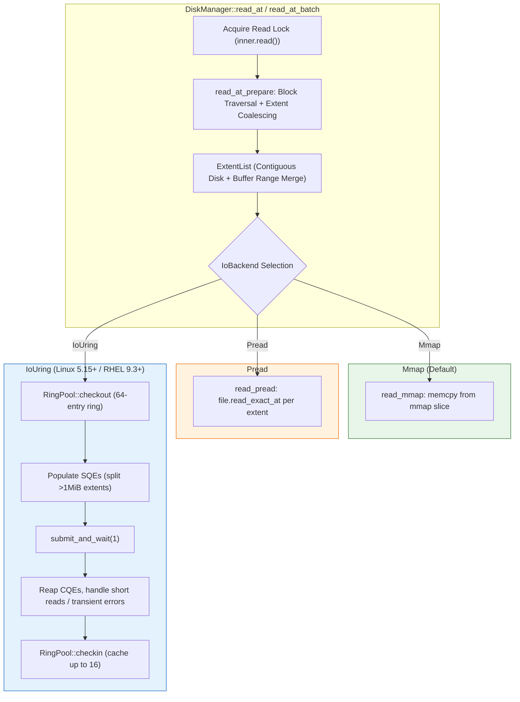
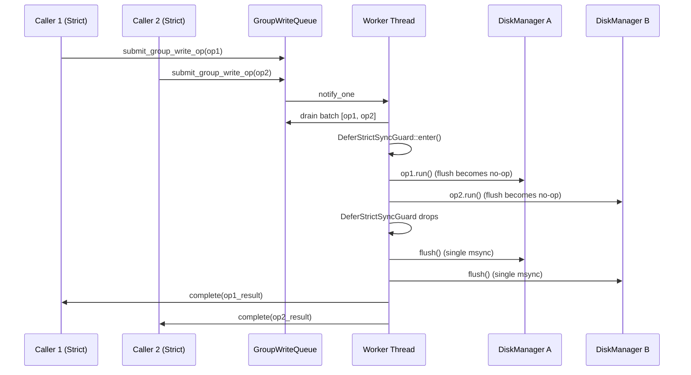

# Async I/O Engine and Group Commit

OIFS separates metadata operations from payload data reading. Filesystem metadata (superblocks, bitmaps, inodes, indirect pointer blocks, and directory indices) resides on the shared `MAP_SHARED` memory map for zero-copy, low-overhead access. File payloads can be large, cold, and scattered across physical blocks—reading them through the mmap means every uncached page is a synchronous page fault, one fault at a time.

P3.2 introduced a pluggable data-block read engine (`src/io_engine.rs`) that decouples physical payload I/O from memory-mapped page faults, enabling applications to select between three backends: **Mmap**, **Pread**, and **IoUring**. In v1.4.0 the async write pipeline adds a dedicated group-commit thread that merges concurrent `DurabilityMode::Strict` operations behind a single `flush()` barrier.



---

## 1. IoBackend Architecture and Selection

The `IoBackend` enum defines three distinct data-block retrieval strategies ([src/io_engine.rs#L36-L51](repo://src/io_engine.rs#L36-L51)):

| Backend | Value | Mechanism | Platforms |
| :--- | :--- | :--- | :--- |
| `IoBackend::Mmap` (Default) | 0 | `memcpy` directly from the shared memory mapping | All |
| `IoBackend::Pread` | 1 | Positional `pread(2)` syscall per coalesced extent | All Unix |
| `IoBackend::IoUring` | 2 | Batched async submission to a pooled `io_uring` ring | Linux ≥ 5.6, `io_uring` cargo feature |

All backends read through the standard OS page cache without `O_DIRECT`, ensuring that recently written dirty pages (including uncommitted mutations under `DurabilityMode::Lazy`) are immediately visible across all backends ([src/io_engine.rs#L1-L25](repo://src/io_engine.rs#L1-L25)).

Backend selection is configurable via:

- **Environment variable**: `OIFS_IO_BACKEND=mmap|pread|io_uring` (case-insensitive; aliases: `uring`, `iouring`, `io-uring`). Read once at `DiskManager` construction via `IoBackend::from_env()` ([src/io_engine.rs#L34-L35](repo://src/io_engine.rs#L34-L35)).
- **Programmatic Rust API**: `DiskManager::set_io_backend(backend)` or builder-style `DiskManager::with_io_backend(backend)` ([src/disk.rs#L1615-L1624](repo://src/disk.rs#L1615-L1624)).
- **FFI**: `oifs_set_io_backend(handle, backend_u8)` and `oifs_get_io_backend(handle)` ([src/ffi.rs#L726-L755](repo://src/ffi.rs#L726-L755)).

```rust
// Querying and configuring the backend
let dm = DiskManager::open("data.oifs", 10 * 1024 * 1024)?;
let effective = dm.set_io_backend(IoBackend::IoUring);
assert_eq!(dm.io_backend(), effective);        // effective backend after gating
assert_eq!(dm.requested_io_backend(), IoBackend::IoUring); // what was asked for
```

Requesting `IoUring` where it is unavailable never fails; `IoBackend::resolve()` transparently falls back to `Pread`, and the effective backend is reported separately from the requested one ([src/io_engine.rs#L60-L68](repo://src/io_engine.rs#L60-L68)).

---

## 2. ExtentList Block Coalescing

Non-contiguous files incur high syscall or SQE overhead if dispatched one 4 KiB block at a time. OIFS solves this through `ExtentList`, which merges contiguous physical disk runs **and** destination buffer offsets on `push` ([src/io_engine.rs#L232-L287](repo://src/io_engine.rs#L232-L287)):

```rust
pub fn push(&mut self, disk_offset: u64, buf_offset: usize, len: usize) {
    if len == 0 { return; }
    if let Some(last) = self.extents.last_mut()
        && last.disk_offset.checked_add(last.len as u64) == Some(disk_offset)
        && last.buf_offset.checked_add(last.len) == Some(buf_offset)
        && let Some(new_len) = last.len.checked_add(len)
    {
        last.len = new_len;          // merge into previous extent
        return;
    }
    self.extents.push(ReadExtent {
        disk_offset,
        buf_offset,
        len,
    });
}
```

A file whose blocks were allocated contiguously therefore collapses into a single extent—i.e., a single `pread` / single SQE regardless of its size in blocks. This applies to both `read_at` and `read_at_batch` paths.

---

## 3. io_uring Capability Gating

The `IoUring` backend is not available everywhere. The engine performs a one-time, cached probe at first `IoEngine` construction ([src/io_engine.rs#L497-L502](repo://src/io_engine.rs#L497-L502)) and rejects `IoUring` when any of the following conditions hold:

| Condition | Details |
| :--- | :--- |
| **Non-Linux** | `io_uring` is a Linux-only interface. |
| **Cargo feature disabled** | The `io_uring` feature must be enabled at compile time. |
| **Kernel too old** | Mainline Linux ≥ 5.15 required (via `MIN_RECOMMENDED_KERNEL = (5, 15)`) ([src/io_engine.rs#L115](repo://src/io_engine.rs#L115)). |
| **RHEL 9 backport missing** | RHEL 9.0–9.2 shipped with `CONFIG_IO_URING=n`. RHEL 9.3+ (kernel `5.14.0-362+`, build ≥ 362 on `.el9` kernels) backports `io_uring` as a Technology Preview ([src/io_engine.rs#L118-L128](repo://src/io_engine.rs#L118-L128)). |
| **Sysctl disabled** | RHEL 9.4+ adds `kernel.io_uring_disabled` (0 = allow all, 1 = privileged/group only, 2 = disabled). If the sysctl blocks ring creation, the probe fails and the engine falls back to `Pread`. |
| **seccomp / container** | The `io_uring_enter(2)` syscall may be filtered; the probe catches `EPERM`/`EACCES` as unsupported. |
| **Kernel lacks `IORING_OP_READ`** | The probe registers a `Probe` and verifies `opcode::Read::CODE` is supported ([src/io_engine.rs#L535-L537](repo://src/io_engine.rs#L535-L537)). |

The `OIFS_ALLOW_PRE_5_15` environment variable bypasses the kernel-version gate (but not the probe) for testing on older kernels.

---

## 4. Async Read Engine: Inline Fast-Path + Background Pool

The Rust API exposes `DiskManager::read_at_async`, `read_data_async`, and `read_at_batch_async`, all returning `OifsAsyncTask<T>` ([src/disk.rs#L9231-L9249](repo://src/disk.rs#L9231-L9249)). The FFI layer provides `oifs_read_at_async`, `oifs_read_at_async_cb`, and corresponding futures ([src/ffi.rs#L1583-L1880](repo://src/ffi.rs#L1583-L1880)).

### Inline Fast-Path (Zero Thread Hop)

When the read can be satisfied entirely from cached data, the operation completes synchronously on the calling thread:

- **Mmap hits**: The requested range is raw, uncompressed, unencrypted, and the backing is `StorageMode::Mmap`.
- **DataPageCache hits**: `StorageMode::FileIo` with the range resident in the internal page cache (≤ 16 MiB per extent).
- **ChunkReadCache hits**: Seekable 64K chunked files where the single target chunk is cached.
- **DecodedBlobCache hits**: Compressed/encrypted files (≤ 16 MiB total) with a decoded blob already cached.

The fast-path is implemented in `try_read_at_inline_into` ([src/disk.rs#L9015-L9170](repo://src/disk.rs#L9015-L9170)). On success, `OifsAsyncTask::ready` returns an immediately resolved future—no heap allocation, no background thread wake-up.

### Background Pool Dispatch

On cache miss, lock contention, or cold decode (compressed/encrypted files exceeding cache limits), the read is submitted to a persistent background thread pool via `OifsAsyncTask::spawn`. The pool uses a bounded queue with a condition variable; workers execute the full `read_at` path including indirect block traversal, decompression, decryption, and filter unapplication.

---

## 5. Async Write Engine: Group Commit for Strict Durability

Writes under `DurabilityMode::Strict` require a durable `flush()` (metadata + payload `msync`) after every mutation. To avoid serializing flushes when many writers operate concurrently, OIFS v1.4.0 introduces a **group-commit** thread that batches multiple operations behind a single barrier.

### Architecture

1. **Submission**: Async write APIs (`create_file_with_data_async`, `write_data_async`, and FFI equivalents `oifs_create_file_with_data_async`, `oifs_write_file_async`) call `submit_group_write_op` ([src/disk.rs#L8830](repo://src/disk.rs#L8830)), which enqueues a `GroupWriteOp` containing:
   - A cloned `DiskManager` (Arc).
   - The closure to execute under the write lock (`run`).
   - A completion callback (`complete`).

2. **Single Worker Thread**: A dedicated thread named `"oifs-group-commit"` ([src/disk.rs#L8835-L8845](repo://src/disk.rs#L8835-L8845)) wakes on the condition variable, drains up to 128 ops from the queue, and processes them in a batch.

3. **Deferred Strict Sync**: Inside the batch, a thread-local guard `DeferStrictSyncGuard::enter()` ([src/disk.rs#L8538-L8547](repo://src/disk.rs#L8538-L8547)) sets a flag that causes `DiskManager::flush` (invoked internally by strict write paths) to **defer** its `msync` and return immediately.

4. **Execution Phase**: Each operation’s `run` closure executes under the exclusive write lock sequentially (one at a time to preserve ACID ordering). The `run` closures may include multiple internal `flush()` calls that become no-ops while the guard is active.

5. **Harvest Window**: While the batch is running, newly arriving ops are appended up to the 128-op limit ([src/disk.rs#L8873-L8883](repo://src/disk.rs#L8873-L8883)).

6. **Group Flush**: After all `run` closures complete, the guard drops, the thread iterates over the **unique** `DiskManager` inner pointers that participated, and issues one `flush()` per distinct manager ([src/disk.rs#L8885-L8895](repo://src/disk.rs#L8885-L8895)).

7. **Completion**: Each operation’s `complete` callback is invoked with the result (or the group-flush error if its manager was in the strict set) ([src/disk.rs#L8897-L8905](repo://src/disk.rs#L8897-L8905)).



### Effect

If 100 concurrent threads call `write_data_async` with `DurabilityMode::Strict` on the same filesystem, they incur **one** `msync` instead of 100. Latency scales with the slowest operation in the batch, not the sum.

### Other Durability Modes

- `RangeAsync`: Uses the existing `PendingAsyncRanges` accumulator + `async_drain_ready` flag; no group-commit thread involvement.
- `LegacyWholeMmapAsync`: Defers to the legacy whole-mmap async path.
- `Lazy`: No implicit sync; caller controls durability explicitly.

---

## 6. FFI Async Surface: OIFSAsyncFuture, Polling, Callbacks

The FFI layer wraps `OifsAsyncTask` into `OIFSAsyncFuture` ([src/ffi.rs#L1586](repo://src/ffi.rs#L1586)), adding a drop barrier that waits for background reads still writing into caller buffers.

### Future-based API

| Function | Purpose |
| :--- | :--- |
| `oifs_read_at_async` | Async positional read; inline fast-path returns immediately ready future. |
| `oifs_create_file_with_data_async` | Async file create + write via group-commit pipeline. |
| `oifs_write_file_async` | Async file write via group-commit pipeline. |
| `oifs_flush_async` | Async flush on background pool. |

All return `*mut OIFSAsyncFuture` (or null on invalid args). The future owns the task; callers **must** eventually call `oifs_async_free`.

### Poll / Wait / Error

```c
int oifs_async_poll(const OIFSAsyncFuture* fut);    // 1=ready, 0=pending, -1=invalid
int64_t oifs_async_wait(OIFSAsyncFuture* fut);      // blocks, returns result or -1
int oifs_async_last_error(const OIFSAsyncFuture* fut, char* buf, uint32_t buf_size);
void oifs_async_free(OIFSAsyncFuture* fut);         // waits if background read in progress
```

### Callback-based API

For environments without polling infrastructure:

```c
typedef void (*OifsAsyncStatusCallback)(int64_t status, void* user_data);
typedef void (*OifsAsyncReadCallback)(int64_t status, const uint8_t* buf, uint64_t len, void* user_data);

int oifs_read_at_async_cb(... OifsAsyncReadCallback cb, void* user_data);
int oifs_create_file_with_data_async_cb(... OifsAsyncStatusCallback cb, void* user_data);
int oifs_write_file_async_cb(... OifsAsyncStatusCallback cb, void* user_data);
```

Callbacks execute on the background pool thread; they must not block.

---

## 7. Configuration Summary

| Setting | Mechanism | Default |
| :--- | :--- | :--- |
| **Read backend** | `OIFS_IO_BACKEND=mmap\|pread\|io_uring` | `mmap` |
| **Kernel version gate bypass** | `OIFS_ALLOW_PRE_5_15=1` | Enforced |
| **Durability** | `DiskManager::set_durability_mode(Strict \| RangeAsync \| LegacyWholeMmapAsync \| Lazy)` | `Lazy` |
| **Max cached extent** | `MAX_CACHED_EXTENT = 16 MiB` (inline fast-path threshold) | Constant |

---

## 8. Invariants and Failure Semantics

- **io_uring fallback is silent**: `IoBackend::IoUring` requested → unsupported → `effective()` returns `Pread`; no error is raised.
- **ExtentList never wraps**: `checked_add` guards against integer overflow; a run that would overflow `usize` splits into a new extent ([src/io_engine.rs#L242-L247](repo://src/io_engine.rs#L242-L247)).
- **Background reads never UAF**: `OIFSAsyncFuture`’s `wait_on_drop=true` forces `oifs_async_free` to block until the background read finishes writing into the caller’s buffer.
- **Group commit is per-DiskManager**: Two distinct `DiskManager` instances (different image files) each get their own flush barrier; the worker deduplicates by `Arc::as_ptr(&dm.inner)`.
- **Strict writes in group commit are atomic w.r.t durability**: If the group flush fails, every strict op in the batch surfaces the same I/O error via its completion callback.
- **Inline fast-path is best-effort**: Any lock contention, cache miss, or decode requirement falls back to the background pool without surfacing an error to the caller.

---

## 9. Related Pages

- [DiskManager & Persistence](disk_manager_and_persistence.md) — Core storage manager, durability modes, write pipeline
- [FFI Interface](ffi_interface.md) — Complete FFI surface including async APIs
- [Testing & Verification](../operations/testing_and_verification.md) — Kani proofs for kernel version gating, extent coalescing, backend agreement
- [FFI Workflow](../workflows/ffi_workflow.md) — Example async read/write patterns from C/C++
