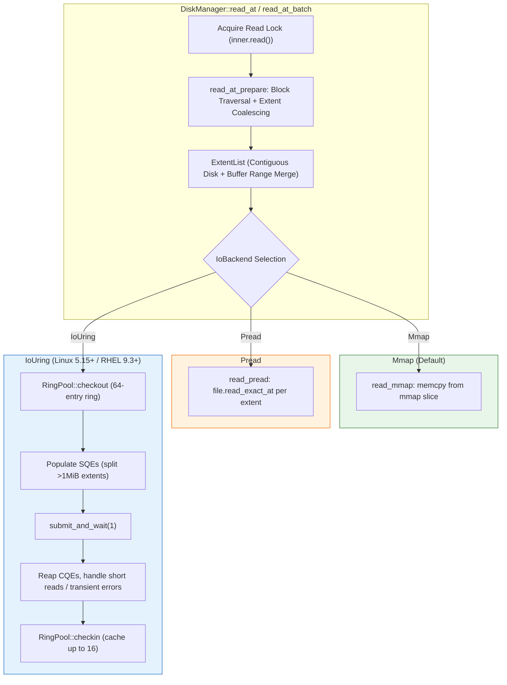

# Async I/O & Read Engines

OIFS separates metadata operations from payload data reading. Filesystem metadata (superblocks, bitmaps, inodes, indirect pointer blocks, and directory indices) resides on the shared `MAP_SHARED` memory map for zero-copy, low-overhead access. File payloads can be large, cold, and scattered across physical blocks—reading them through the mmap means every uncached page is a synchronous page fault, one fault at a time.

P3.2 introduced a pluggable data-block read engine ([src/io_engine.rs]()) that decouples physical payload I/O from memory-mapped page faults, enabling applications to select between three backends: **Mmap**, **Pread**, and **IoUring**.



## 1. IoBackend Architecture and Selection

The `IoBackend` enum defines three distinct data-block retrieval strategies ([src/io_engine.rs#L36-L51]()):

| Backend | Value | Mechanism | Platforms |
| :--- | :--- | :--- | :--- |
| `IoBackend::Mmap` (Default) | 0 | `memcpy` directly from the shared memory mapping | All |
| `IoBackend::Pread` | 1 | Positional `pread(2)` syscall per coalesced extent | All Unix |
| `IoBackend::IoUring` | 2 | Batched async submission to a pooled `io_uring` ring | Linux ≥ 5.6, `io_uring` cargo feature |

All backends read through the standard OS page cache without `O_DIRECT`, ensuring that recently written dirty pages (including uncommitted mutations under `DurabilityMode::Lazy`) are immediately visible across all backends ([src/io_engine.rs#L1-L25]()).

Backend selection is configurable via:

- **Environment variable**: `OIFS_IO_BACKEND=mmap|pread|io_uring` (case-insensitive; aliases: `uring`, `iouring`, `io-uring`). Read once at `DiskManager` construction via `IoBackend::from_env()` ([src/io_engine.rs#L34-L35]()).
- **Programmatic Rust API**: `DiskManager::set_io_backend(backend)` or builder-style `DiskManager::with_io_backend(backend)` ([src/disk.rs#L1615-L1624]()).
- **FFI**: `oifs_set_io_backend(handle, backend_u8)` and `oifs_get_io_backend(handle)` ([src/ffi.rs#L726-L755]()).

```rust
// Querying and configuring the backend
let dm = DiskManager::open("data.oifs", 10 * 1024 * 1024)?;
let effective = dm.set_io_backend(IoBackend::IoUring);
assert_eq!(dm.io_backend(), effective);        // effective backend after gating
assert_eq!(dm.requested_io_backend(), IoBackend::IoUring); // what was asked for
```

Requesting `IoUring` where it is unavailable never fails; `IoBackend::resolve()` transparently falls back to `Pread`, and the effective backend is reported separately from the requested one ([src/io_engine.rs#L60-L68]()).

## 2. ExtentList Block Coalescing

Non-contiguous files incur high syscall or SQE overhead if dispatched one 4 KiB block at a time. OIFS solves this through `ExtentList`, which merges contiguous physical disk runs **and** destination buffer offsets on `push` ([src/io_engine.rs#L232-L287]()):

```rust
pub fn push(&mut self, disk_offset: u64, buf_offset: usize, len: usize) {
    if len == 0 { return; }
    if let Some(last) = self.extents.last_mut()
        && last.disk_offset.checked_add(last.len as u64) == Some(disk_offset)
        && last.buf_offset.checked_add(last.len) == Some(buf_offset)
        && let Some(new_len) = last.len.checked_add(len)
    {
        last.len = new_len;          // merge into previous extent
        return;
    }
    self.extents.push(ReadExtent { disk_offset, buf_offset, len });
}
```

A file whose blocks were allocated contiguously collapses into a single `ReadExtent`—a 100 MiB contiguous read executes as one `pread` or one `io_uring` SQE instead of ~25,600 operations. The logic handles overflow safely: if `checked_add` would wrap, a new extent is created instead ([src/io_engine.rs#L268-L277]()).

This coalescing behavior is **formally proven correct** by Kani model checking ([src/io_engine.rs#L850-L874]()):

```rust
#[kani::proof]
#[kani::unwind(4)]
fn proof_extent_push_preserves_coverage() {
    // ... generates arbitrary extent pairs ...
    let contiguous = d1 + l1 as u64 == d2 && b1 + l1 == b2;
    assert_eq!(list.total_bytes(), l1 + l2);   // no bytes lost or invented
    assert_eq!(list.len() == 1, contiguous);   // merge iff both ranges continue
}
```

## 3. Kernel Gating and Graceful Fallback

Because `io_uring` experienced kernel instability and security restrictions in earlier releases, OIFS implements strict kernel version gating with `OnceLock` caching ([src/io_engine.rs#L115-L210]()):

- **Baseline Requirement**: Mainline Linux kernel version **≥ 5.15** (`MIN_RECOMMENDED_KERNEL = (5, 15)`).
- **Enterprise Linux Support**: Automatically detects **RHEL 9.3+** backports (`5.14.0-362+` on `.el9` kernels) by parsing `utsname.release` via `libc::uname`.
- **Sysctl and Sandbox Protection**: Probes ring creation and checks for `IORING_OP_READ` support. If `io_uring` is disabled by sysctl (`kernel.io_uring_disabled`), seccomp rules, or missing kernel features, `IoBackend::resolve()` automatically falls back to `IoBackend::Pread`.

Applications calling `dm.set_io_backend(IoBackend::IoUring)` receive the effective backend (`IoBackend::Pread` if unsupported), guaranteeing configuration never triggers runtime errors.

An escape hatch exists for development: setting `OIFS_ALLOW_PRE_5_15=1` skips the kernel version check (but still requires `IORING_OP_READ` probe to pass) ([src/io_engine.rs#L434-L454]()).

## 4. IoUring Ring Pooling and Memory Safety

To support concurrent readers under `DiskManager`'s reader-writer lock (`Arc<RwLock<DiskManagerInner>>`), the `io_uring` engine maintains an internal `RingPool` ([src/io_engine.rs#L457-L534]()):

- **Submission Queue Depth**: `RING_ENTRIES = 64` entries per ring (caps in-flight operations).
- **Maximum Single Operation**: `MAX_OP_BYTES = 1 MiB (1 << 20)`. Extents exceeding this are **split across multiple SQEs**, allowing the kernel to service chunks in parallel and keeping `len` within `u32` ([src/io_engine.rs#L495-L502]()).
- **Idle Ring Cache**: Up to `MAX_IDLE_RINGS = 16` pre-initialized rings are cached for reuse, eliminating teardown/initialization overhead under contention.
- **Completion Guarantee**: The read loop **never returns while any SQE remains in-flight**. After a hard `io_uring_enter` error with in-flight operations, the process aborts to prevent memory corruption from kernel writes into freed buffers ([src/io_engine.rs#L565-L652]()).

```rust
// Short-read handling: remainder is resubmitted on the same ring
if n < op.len {
    op.ptr = unsafe { op.ptr.add(n) };
    op.len -= n;
    op.off += n as u64;
    if first_err.is_none() {
        pending.push_back(idx);  // re-queue remainder
    }
}
```

Transient errors (`EINTR`, `EAGAIN`, `EBUSY`) are re-queued; permanent errors short-circuit after all in-flight completions are reaped.

## 5. ReadTarget and the validate() Bounds Check

Every read operation constructs `ReadTarget` structs pairing a mutable buffer slice with its `ExtentList` ([src/io_engine.rs#L300-L310]()):

```rust
pub struct ReadTarget<'a> {
    pub buf: &'a mut [u8],
    pub extents: &'a [ReadExtent],
}
```

Before any backend executes, `validate(targets, image_len)` enforces **two invariants** for every extent ([src/io_engine.rs#L312-L334]()):

1. **Buffer bounds**: `extent.buf_offset + extent.len ≤ target.buf.len()`
2. **Image bounds**: `extent.disk_offset + extent.len ≤ image_len`

This is the safety precondition for the `io_uring` backend (which hands raw pointers to the kernel) and keeps all backends' error behavior identical.

## 6. Batch Reads via `read_at_batch`

`DiskManager::read_at_batch` processes multiple `ReadRequest`s under a **single read lock**, gathering extents into batched `ReadTarget`s for high-throughput parallel execution ([src/disk.rs#L3657-L3720]()):

1. For each request, `read_at_prepare` traverses indirect blocks, emits `ReadExtent`s into an `ExtentList` (or copies directly for `Mmap`/compressed/encrypted files).
2. Valid requests become `ReadTarget`s; failed requests report errors immediately.
3. A single `IoEngine::read` call executes all targets—on `IoUring`, every extent from every request is in-flight simultaneously at queue depth ≤ 64.
4. Errors after submission fail all requests that had pending extents.

This design enables applications to issue hundreds of concurrent reads with minimal lock contention.

## 7. Testing and Verification

- **Functional Equivalence**: `/tests/io_engine_test.rs` runs identical `read_data`, `read_at`, and `read_at_batch` workloads across **all supported backends** (filtered by `IoBackend::is_supported()`), asserting byte-identical results for direct, single/double/triple-indirect, sparse, compressed, encrypted, and filtered files.
- **Coherence**: `test_mmap_writes_visible_to_syscall_backends` verifies that un-`msync`ed `Lazy` writes are immediately readable via `Pread`/`IoUring` (same page cache).
- **Concurrency**: `test_concurrent_readers_on_syscall_backends` spawns 8 threads × 20 iterations per backend.
- **Kani Proofs**: Coverage-preserving coalescing (`proof_extent_push_preserves_coverage`), `IoBackend::from_u8` totality, and other core logic are mechanically verified ([src/io_engine.rs#L844-L887]()).
