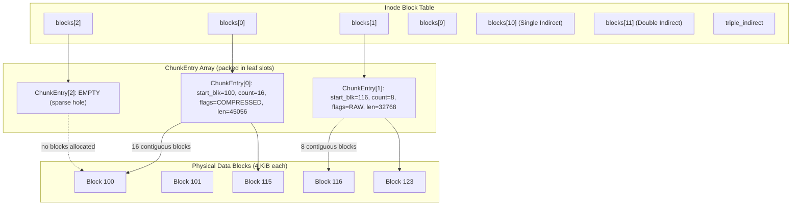

## Responsibility and ownership

The write, read, and filter pipeline live across several modules:

- `write_data_with_filters` ([`src/disk.rs#L4432-L4728`]) orchestrates the full staging sequence — pre-compression filter → zstd compression → encryption.
- `filters.rs` ([`src/filters.rs`]) provides the filter primitives, `FilterConfig` stored on the inode, the native C-Blosc2 wrapper, and entropy analysis.
- `disk/chunked.rs` ([`src/disk/chunked.rs`]) implements the seekable 64KB chunked fast path (random reads/writes, COW extent swap).
- `disk/caches.rs` ([`src/disk/caches.rs`]) provides `DecodedBlobCache` (whole-file decoded blob cache for non-seekable compressed/encrypted files) and `ChunkReadCache` (per-chunk decompression cache for seekable files).
- `zstd_pool.rs` ([`src/zstd_pool.rs`]) manages thread-local Zstd contexts and a persistent scoped worker pool used for parallel chunk compression/decompression.

## The write-stage pipeline

Every initial write (`file_offset == 0`) flows through `plan_write_prepared` ([`src/disk.rs#L881-L1057`]), which applies a fixed, ordered staging pipeline. The reverse order is used on read (decrypt → decompress → unapply filter).

1. **Pre-compression filter** — `apply_filters_cow` transforms the raw payload into a more compressible form. This runs *before* compression so filters can collapse Shannon entropy that a generic LZ77 compressor cannot reuse.
2. **Compression** — governed by `CompressionMode` ([`src/disk.rs#L66-L78`]):
   - `Always`: always zstd (level 0).
   - `Never`: never compress.
   - `Auto` (default): compress only when the filtered data is ≥ 8KB, and only keep the compressed result if it is actually smaller than the working data.
   - `Stream { level }`: full-file stream compression with explicit Zstd level.
   - `Seekable { chunk_size, level }`: fixed 64KB chunked compression with O(1) random access.
3. **Encryption** — if a key is present, the (already compressed) data is encrypted with XChaCha20-Poly1305 and a fresh per-file nonce. Compressing before encrypting preserves compression ratio while keeping ciphertext entropy flat.

The ordering filter→compress→encrypt is why both `inode.compressed_size` (physical) and `inode.size` (logical) are tracked separately, and why the filter flags (`filter_typesize`, `filter_delta`, `filter_shuffle`, `filter_bitshuffle`) must be recorded on the inode to reverse the pipeline on read.

## Zero-copy filter staging

`apply_filters_cow` ([`src/filters.rs#L829-L855`]) returns a `Cow<[u8]>`: `Cow::Borrowed(data)` (zero allocation) when the filter is inactive or the typesize is not one of {1, 2, 4, 8}, and `Cow::Owned` only when a pipeline actually runs. On the common unfiltered/unencrypted path this eliminates every intermediate buffer copy — reported as up to ~28,500x speedup on 1MB payloads — and lets the uncompressed bytes flow straight into the write.

## Compression pipeline flow diagram

```mermaid
flowchart TB
    subgraph WritePath["Write Pipeline (file_offset == 0)"]
        A["Raw Payload"] --> B["apply_filters_cow<br/>(FilterConfig → FilterPipeline)"]
        B --> C{"CompressionMode"}
        C -->|Always/Auto/Stream| D["zstd_pool::compress_frame<br/>(thread-local CCtx)"]
        C -->|Seekable| E["write_chunked_64k_pipeline<br/>(64KB chunks)"]
        C -->|Never| F["Pass through"]
        D --> G["Encryption (XChaCha20-Poly1305)<br/>if key present"]
        E --> G
        F --> G
        G --> H["Write to disk"]
    end

    subgraph ReadPath["Read Pipeline"]
        I["Read from disk"] --> J{"Encrypted?"}
        J -->|Yes| K["Decrypt"]
        J -->|No| L
        K --> L{"Compressed?"}
        L -->|Stream| M["zstd_pool::decompress_frame_into<br/>(thread-local DCtx)"]
        L -->|Seekable 64K| N["read_at_chunked_64k<br/>(single chunk decode)"]
        L -->|None| O["Direct copy"]
        M --> P["unapply_filters_cow<br/>(reverse pipeline)"]
        N --> P
        O --> P
        P --> Q["Caller buffer"]
    end

    subgraph FilterPipeline["FilterPipeline.apply / unapply"]
        direction LR
        FP1["Delta"] --> FP2["ByteShuffle"]
        FP2 --> FP3["BitShuffle"]
        FP3 --> FP4["TruncPrecision"]
        FP4 -.->|Reverse order on read| FP3
    end

    subgraph ZstdPool["zstd_pool.rs"]
        Z1["Thread-local CCtx/DCtx"] --> Z2["Global pool (32 per level / 32 total)"]
        Z3["par_for_index<br/>persistent workers"] --> Z4["oifs-chunk-w{N} threads<br/>(num_cpus-1, clamp 1..15)"]
        Z2 --> Z3
    end

    WritePath -.-> ZstdPool
    ReadPath -.-> ZstdPool
```



## ZstdContextPool and persistent scoped worker pool

`zstd_pool.rs` ([`src/zstd_pool.rs`]) eliminates per-call `CCtx`/`DCtx` allocation overhead through two layers:

### Thread-local context pools

Each thread keeps one compressor per compression level and one decompressor in `thread_local!` storage. On thread exit (or explicit `release_pooled_contexts()`), contexts are returned to a global `Mutex`-protected pool for reuse by other threads:

- **Compressors**: `HashMap<i32, Vec<Compressor>>` capped at `MAX_GLOBAL_COMPRESSORS_PER_LEVEL = 32` per level.
- **Decompressors**: `Vec<Decompressor>` capped at `MAX_GLOBAL_DECOMPRESSORS = 32` total.

The hot-path entry points `compress_frame(data, level)` and `decompress_frame_into(source, destination)` borrow from the thread-local pool first, falling back to the global pool, then to a fresh allocation. This avoids hundreds of kilobytes of internal table initialization per call.

### Persistent scoped worker pool (`par_for_index`)

`par_for_index(total, f)` spawns `num_cpus - 1` worker threads (clamped to 1..15) named `oifs-chunk-w{N}` at first use. Workers park on a `Condvar`; each dispatch increments a generation counter, avoiding `pthread_create` churn and keeping thread-local Zstd contexts warm across calls.

- The calling thread participates via dynamic work-stealing (`next.fetch_add`).
- Falls back to sequential execution when `total <= 1` or another dispatch already holds the pool lock (`dispatch_lock.try_lock()`).
- `workers_to_wake(total, num_workers)` computes the exact number of background workers to wake: `min(total - 1, num_workers)`, never waking redundant threads.
- Kani proof ([`src/zstd_pool.rs#L399-L458`]) guarantees exact-count `notify_one()` wakeups can never deadlock regardless of how many workers are asleep.

Used by:
- Seekable chunked write pipeline (Stage 2 parallel compression/encryption)
- Seekable chunked multi-chunk reads (`read_chunked_64k_internal`, `read_at_chunked_64k` fast path)
- Sequential read-ahead prefetch in `read_at_chunked_64k`

## Compression modes and append behavior

`write_data_with_filters` handles non-offset-0 writes with three distinct strategies for already-compressed files:

### Seekable 64K Chunked Compression (P4.2 fast path)

When `INODE_FLAG_SEEKABLE_64K` is active or `CompressionMode::Seekable` is selected, writes enter the 3-stage out-of-lock pipeline (`write_chunked_64k_pipeline`, [`src/disk/chunked.rs#L1702-L1860`]). Only affected 64KB chunks are re-encoded and swapped via COW extents, eliminating full-file rewrites.

### Zstd Multi-Frame Append (stream fast path)

When appending strictly at EOF (`file_offset == inode.size`) to an *unencrypted* stream-compressed file with *no* active filters, the new chunk is compressed as an independent Zstd frame via `zstd_pool::compress_frame` and appended at `compressed_size`. Because `zstd::stream::decode_all` transparently decodes concatenated frames, no existing block is decompressed or rewritten.

### Read-Modify-Recompress (stream fallback)

For encrypted stream files, random-offset stream writes, or files with active filters, the full payload is decompressed, the change is spliced in, old blocks are freed, and the file is rewritten contiguously from offset 0 with an effective filter config that recovers the inode's stored filter flags.

Raw (uncompressed) files use a plain in-place `write_buffer_at_offset` write that does not participate in the frame pipeline.

## Seekable 64KB Chunked Compression (P4.2)

To avoid $O(N)$ full-payload decompression on random reads and partial writes, OIFS implements **Seekable 64KB Chunked Compression**:

- **Fixed 64KB Logical Chunks**: Files are partitioned into uniform 64KB chunks (`CHUNK_SIZE_64K = 65536`).
- **64-bit ChunkEntry**: Stored directly in the inode block table, each 8-byte entry packs `start_block: u32`, `block_count: u8`, `flags: u8` (`FLAG_RAW` or `FLAG_COMPRESSED`), and `compressed_len: u16` ([`src/inode.rs#L89-L119`]).
- **Copy-on-Write (COW) Extent Swap**: Updating data at any offset (`write_chunked_64k_internal`, [`src/disk/chunked.rs#L1702-L1860`]) allocates new physical contiguous blocks, writes compressed or raw bytes, atomically updates the chunk pointer (`set_logical_chunk_entry`), and then frees the old blocks.
- **Anti-Inflation Fallback**: If a compressed chunk does not strictly save space (or exceeds 64KB), it is stored as uncompressed `FLAG_RAW` blocks, eliminating negative compression overhead.
- **$O(1)$ Random Reads**: `read_at_chunked_64k` ([`src/disk/chunked.rs#L591-L780`]) decodes only the single targeted 64KB chunk directly into the caller's buffer without decompressing the entire file, completely bypassing stateful file offset tracking.
- **Sequential Read-Ahead**: For sequential sub-chunk reads, the read path detects the pattern (current chunk miss + previous chunk hit in cache) and prefetches up to 4 subsequent chunks in parallel via `par_for_index`, inserting them into `ChunkReadCache` under a single write lock acquisition.

### Mermaid diagram: Seekable Chunked Layout



Each logical chunk index maps through the inode's pointer tree (direct → single indirect → double indirect → triple indirect) to a leaf slot holding a `ChunkEntry`. The entry's `start_block` and `block_count` describe a **contiguous run** of physical blocks storing that chunk's compressed or raw payload.

## Read acceleration caches

### DecodedBlobCache (non-seekable files)

`DecodedBlobCache` ([`src/disk/caches.rs#L170-L300`]) is a bounded LRU cache for whole-file decoded payloads of **stream-compressed or whole-file encrypted** files. It eliminates the $O(\text{calls} \times \text{file\_size})$ full-file decode cliff when callers issue sequential or random sub-file `read_at` calls on non-seekable blobs.

- **Capacity**: 4 entries total across 16 shards (`MAX_ENTRIES_PER_SHARD = 2` per shard)
- **Per-entry limit**: 16 MiB (`MAX_ENTRY_BYTES = 16 * 1024 * 1024`)
- **Total cap**: 32 MiB (`MAX_TOTAL_BYTES = 32 * 1024 * 1024`)
- **Key**: `(inode_id, size, compressed_size, first_block, nonce)` — any metadata change invalidates the entry.
- **Lookup**: Under shared read lock in `read_at_with_inode` ([`src/disk.rs#L4986-L5180`]). If present, slices directly from the `Arc<Vec<u8>>` into the caller's buffer. If absent and file ≤ 16 MiB, decodes the full payload, inserts into cache, then slices.
- **Eviction**: LRU by insertion order; evicts from front when either entry count or total bytes would exceed limits. Global cap enforcement crosses shard boundaries without holding two shard locks simultaneously.

### ChunkReadCache (seekable files)

`ChunkReadCache` ([`src/disk/caches.rs#L1-L160`]) is a 16-shard lock-free cache for **individual 64KB chunk** decompressions of seekable chunked files.

- **Capacity**: 8 entries total (`MAX_PER_SHARD = 2` per shard × 16 shards)
- **Key**: `(inode_id, chunk_idx, raw_entry, valid_len)` — any chunk rewrite (new `raw_entry`) invalidates the cached version.
- **Lookup**: `copy_slice_if_hit` copies the requested sub-range directly from the cached `Arc<[u8]>` into the caller's buffer under the shared read lock, avoiding `Arc` clone/drop atomic traffic on hits.
- **Prefetch**: Sequential access detection triggers parallel prefetch of up to 4 subsequent chunks via `par_for_index`, inserting all into the cache under a single write lock.

### Cache invalidation

`invalidate_payload_caches(inode_id)` ([`src/disk.rs#L698-L710`]) clears **both** caches for a given inode. It is invoked on:

| Operation | Location |
|-----------|----------|
| **Write** (any `write_data_with_filters` path, including chunked) | [`src/disk.rs#L4856`], [`src/disk/chunked.rs#L1697`], [`src/disk/chunked.rs#L1815`], [`src/disk/chunked.rs#L1953`], [`src/disk/chunked.rs#L2015`], [`src/disk/chunked.rs#L2033`], [`src/disk/chunked.rs#L2042`], [`src/disk/chunked.rs#L2233`], [`src/disk/chunked.rs#L2363`] |
| **Truncate** (`truncate`, `truncate_chunked_64k`) | [`src/disk.rs#L5841`], [`src/disk/chunked.rs#L1665`] |
| **Delete** (journal replay of `SetInodeBitmap { allocated: false }`) | [`src/disk.rs#L2783`] |
| **Migrate** (inode format v1→v2 rewrite) | [`src/disk/maintenance.rs#L113`] (`guard.clear_payload_caches()`) |
| **Defragment** (safe mode live-reload, in-place defrag) | [`src/disk/maintenance.rs#L314`], [`src/disk/maintenance.rs#L1595`] (`guard.clear_payload_caches()`) |
| **Reload** (after safe defrag atomic swap) | [`src/disk/maintenance.rs#L314`] (`guard.clear_payload_caches()`) |

`clear_payload_caches()` wipes both caches entirely; `invalidate_inode(inode_id)` is the targeted version.

## Blosc2-style pre-compression filters

`filters.rs` ships four composable filters (`FilterType`), each lossless except TruncPrecision:

### FilterType variants

```rust
pub enum FilterType {
    /// First-order delta encoding
    Delta,
    /// Byte-wise shuffle (AoS → SoA transposition)
    ByteShuffle,
    /// Bit-wise shuffle (8×8 bit-matrix transposition per 64-bit word)
    BitShuffle,
    /// Floating point precision truncation (zeros least-significant mantissa bits)
    TruncPrecision { prec_bits: i8 },
}
```

- **Delta** ([`src/filters.rs#L249-L388`]) — first-order difference of typed elements (`delta_encode_inplace`), collapsing linear/temporal sequences into small integers. Optimized with SIMD: NEON (AArch64) and AVX2 (x86_64) carry-propagating prefix-sum for `typesize=1,2,4`.
- **ByteShuffle** ([`src/filters.rs#L390-L478`]) — transposes Array-of-Structures to Structure-of-Arrays, clustering high-order bytes (`shuffle_encode`). Efficient for structured records (e.g., u32/f32 arrays where byte 0 of all elements are similar).
- **BitShuffle** ([`src/filters.rs#L550-L630`]) — 8×8 bit-matrix transposition per 64-bit word using the symmetric Delta-Swap `transpose_8x8_u64` primitive ([`src/filters.rs#L522-L548`]). Effective for sparse/bitfield/boolean data. Involution property: `T(T(x)) == x`, so encode and decode share the exact same primitive.
- **TruncPrecision** ([`src/filters.rs#L632-L695`]) — zeroes least-significant mantissa bits of f32/f64 (`trunc_precision_encode_inplace`); it is lossy, so its inverse is identity.

### FilterPipeline

`FilterPipeline` ([`src/filters.rs#L19-L70`]) chains arbitrary filters in sequence:

```rust
pub struct FilterPipeline {
    pub typesize: u8,
    pub filters: Vec<FilterType>,
}
```

- `apply(data)` runs filters in declaration order (Delta → ByteShuffle → BitShuffle → TruncPrecision).
- `unapply(data)` runs their inverses in reverse order.
- `unapply_in_place(&mut data)` avoids an extra heap allocation when only in-place filters (Delta, TruncPrecision) are active.

### FilterConfig (compact inode representation)

`FilterConfig` ([`src/filters.rs#L99-L186`]) is serialized into the Inode as four dedicated fields ([`src/inode.rs#L33-L65`]):

```rust
pub filter_typesize: u8,    // element size (1,2,4,8) — 0 = no filters
pub filter_delta: bool,     // Delta filter enabled
pub filter_shuffle: bool,   // ByteShuffle filter enabled
pub filter_bitshuffle: bool // BitShuffle filter enabled
```

This avoids any per-inode heap allocation and makes the filter config trivially copyable with the inode.

Factory helpers:
- `FilterConfig::none()` — no filters
- `FilterConfig::numeric(typesize)` — Delta + ByteShuffle (standard numeric pipeline)
- `FilterConfig::delta_only(typesize)` — Delta only
- `FilterConfig::shuffle_only(typesize)` — ByteShuffle only
- `FilterConfig::bitshuffle_only(typesize)` — BitShuffle only
- `FilterConfig::custom(typesize, delta, shuffle)` — arbitrary combination

`FilterConfig::to_pipeline()` builds the corresponding `FilterPipeline` respecting the fixed order: Delta first, then ByteShuffle, then BitShuffle.

### Pipeline ordering

`FilterPipeline::apply` runs filters in declaration order (Delta → ByteShuffle → BitShuffle → TruncPrecision), while `unapply` runs their inverses in reverse. The `FilterConfig::to_pipeline` builder respects the same order.

### Zero-copy application

`apply_filters_cow` and `unapply_filters_cow` ([`src/filters.rs#L829-L855`]) return `Cow<[u8]>`: borrowed when inactive or typesize ∉ {1,2,4,8}, owned only when a pipeline actually runs. `unapply_filters_in_place` ([`src/filters.rs#L857-L865`]) reverses in-place for in-place filters, avoiding an extra allocation.

### Native C-Blosc2 integration

When the `blosc2` feature is enabled, `blosc2_compress` / `blosc2_decompress` ([`src/filters.rs#L73-L95`]) build `CParams` with the compiled C-Blosc2 chunk codec, providing an alternative compression path that can apply Blosc2's internal filters and codecs.

## Entropy analysis and filter recommendation engine

`calculate_entropy` ([`src/filters.rs#L668-L685`]) computes Shannon entropy in bits/byte (0.0–8.0). `recommend_filters` ([`src/filters.rs#L910-L1077`]) evaluates **14 candidate pipelines** against the input data:

| Candidate | Description |
|-----------|-------------|
| Raw | No filter (baseline Zstd) |
| Delta (typesize=1) | u8 delta |
| Delta (typesize=2) | u16 delta |
| Delta (typesize=4) | u32/f32 delta |
| Delta (typesize=8) | u64/f64 delta |
| ByteShuffle (typesize=2) | u16 shuffle |
| ByteShuffle (typesize=4) | u32/f32 shuffle |
| ByteShuffle (typesize=8) | u64/f64 shuffle |
| BitShuffle (typesize=2) | u16 bitshuffle |
| BitShuffle (typesize=4) | u32/f32 bitshuffle |
| BitShuffle (typesize=8) | u64/f64 bitshuffle |
| Delta+ByteShuffle (typesize=2) | "numeric" u16 |
| Delta+ByteShuffle (typesize=4) | "numeric" u32/f32 |
| Delta+ByteShuffle (typesize=8) | "numeric" u64/f64 |

### Evaluation strategy

- For inputs ≤ 256 KB: evaluates on full data.
- For inputs > 256 KB: samples three 64 KB windows (head, middle, tail, each 8-byte aligned) and scales projected compressed sizes by `original_size / sample_size`.
- Each candidate: applies filter → zstd level 0 → measures compressed size, entropy, ratio, space savings.
- Evaluation runs in parallel across CPU cores via `std::thread::scope` (not Rayon) to avoid external dependency, using the persistent `zstd_pool::par_for_index` for warmed Zstd contexts.
- The configuration with the smallest projected zstd size wins.

### CLI integration

Backs the `filter-analyze` CLI command and `put --filter auto` ([`src/bin/oifs.rs#L583`], [`src/bin/oifs.rs#L863`]). Output includes a formatted table, rationale string, and Blosc2 filter equivalents for cross-reference.

### Formal verification (Kani)

The whole filter family is covered by Kani bijectivity proofs ([`src/filters.rs#L1114+`]):
- Round-trip proofs for Delta (u16, u32, u64), Shuffle (2, 4 byte), BitShuffle, composite pipelines.
- Unaligned tail byte handling.
- `transpose_8x8_u64` involution proof: `T(T(x)) == x` for all 2^64 inputs.
- `delta_encode_inplace`/`delta_decode_inplace` with `typesize=0` panic-freedom.
- TruncPrecision zero-bit identity.

## Extension seams

Filters are layered on compression rather than fused into it: any new filter is a new `FilterType` variant plus matching (un)apply functions, and the pipeline applies and reverses them generically. `FilterConfig` is the single seam between the filter layer and the inode, so new filters require no changes to the write or read paths beyond adding the boolean/byte fields only if the compact config needs more independent settings.
