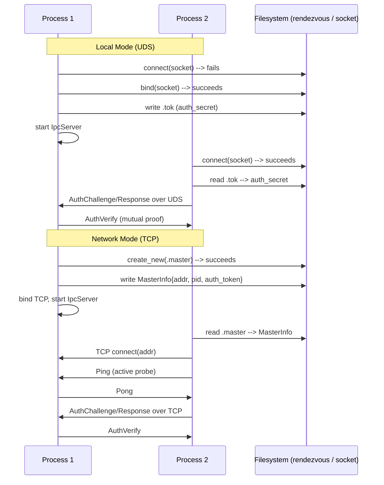
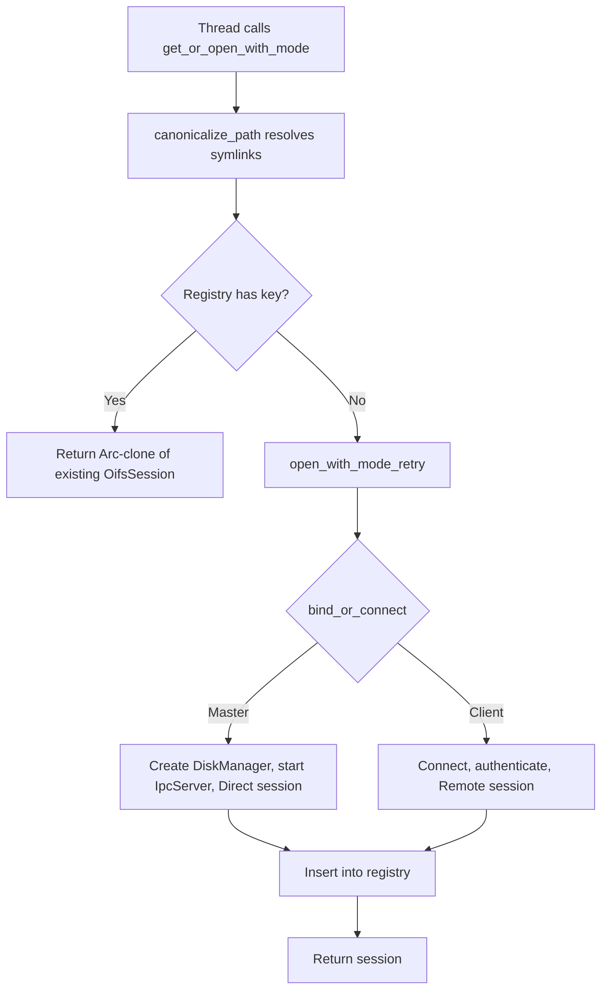
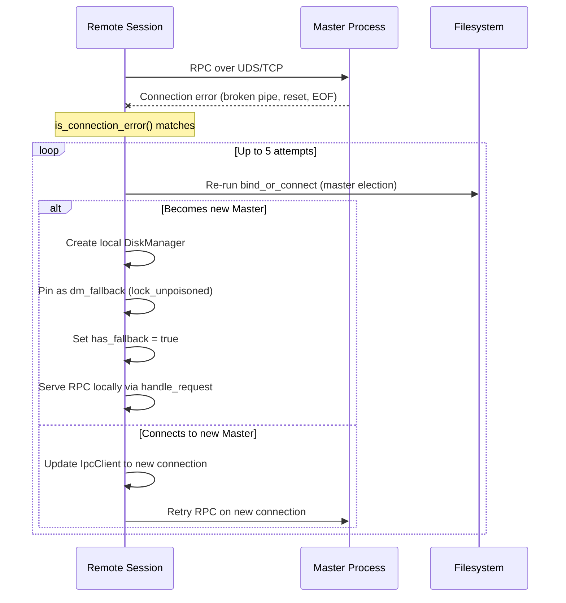

## Responsibility and ownership

The session layer owns the process coordination contract while the IPC layer owns the transport. `OifsSession` (`src/session.rs#L60-L79`) decides whether a given process runs in **Direct (Master)** or **Remote (Proxy)** mode and forwards every operation to the right place. `src/ipc.rs` provides the `bind_or_connect` master election, the `IpcServer` request dispatcher, and the length-prefixed framing used on every hop. The actual mutation of the image happens inside a single Master's `DiskManager` (`Arc<RwLock<DiskManagerInner>>`), which provides shared parallel reader access and exclusive writer serialization with a dedicated `sync_mutex` for physical durability flushes.

## Session mode taxonomy

OIFS supports three **SessionMode** variants (`src/ipc.rs#L39-L52`):

| Mode | Transport | IPC Overhead | Use Case |
|------|-----------|--------------|----------|
| `Standalone` (default) | None — direct `mmap` | Zero sockets, zero background threads | Single-process, CLI, embedded, testing |
| `Local` | Unix Domain Socket in per-user private runtime directory (`$XDG_RUNTIME_DIR/oifs` or `/tmp/oifs-<uid>/oifs`) | One background `IpcServer` thread on the Master; clients forward over UDS | Multi-process on one machine, containers, CI |
| `Network` | TCP + rendezvous `.image.master` file in image directory + **clock-free active Ping/Pong** probe | Master binds TCP; clients connect over TCP | NFS/Lustre, multi-node clusters, remote mounts |

**Standalone** is not a third variant of `OifsSession` — it is simply `SessionMode::Standalone` which produces a `Direct` session **without** starting an `IpcServer`. The `OifsSession` enum itself has only two variants (`src/session.rs#L60-L79`):

```rust
pub enum OifsSession {
    Direct { dm: Arc<DiskManager>, server: Option<Arc<IpcServer>>, ... },
    Remote { client: Arc<IpcClient>, dm_fallback: Arc<Mutex<Option<Arc<DiskManager>>>>, ... },
}
```

- **Direct**: owns the `DiskManager` (and optionally a background `IpcServer`). Used by Master in Local/Network modes, and by **all** processes in Standalone mode.
- **Remote**: holds an `IpcClient` connection pool to the Master, plus a `dm_fallback` slot used during transparent failover.

## Master election: `bind_or_connect`

Master election is transport-specific and implemented in `bind_or_connect` (`src/ipc.rs#L887-L1010`). The function either binds as Master (returning `MasterOrClient::Master`) or connects as Client (returning `MasterOrClient::Client`).

### Local mode (UDS)

1. Deterministic socket path: `get_socket_path` (`src/ipc.rs#L123-L144`) derives `<private_runtime_dir>/oifs_<name>_<hash>.sock` from the canonical image path. The parent directory is created mode `0700`; the socket itself is created mode `0600`. A companion `.tok` file holds the session secret, also `0600`.
2. Process first **tries to connect** to the existing socket (up to 10 attempts, 15 ms apart).
3. If connection fails, it **removes any stale socket/token** and attempts to `bind`.
4. If `bind` fails with `EADDRINUSE`, it retries connecting (up to 15 attempts), then removes the stale socket and retries `bind` once more.
5. On success as Master: generates a fresh 32-byte session secret (`auth_secret`), writes it atomically to the `.tok` file, and starts the `IpcServer`.

### Network mode (TCP + rendezvous file)

1. Rendezvous file path: `get_master_info_path` (`src/ipc.rs#L146-L158`) returns `<image_dir>/.<image_name>.master`.
2. If the file exists, reads `MasterInfo { addr, pid, auth_token }` and runs **clock-free active Ping/Pong probe** (`is_tcp_master_alive`, `src/ipc.rs#L159-L179`): connects to `addr`, sends `IpcRequest::Ping`, expects `Pong` within 500 ms. If probe succeeds, connects as Client.
3. If probe fails or file missing: attempts **atomic `create_new`** on the rendezvous file. Winner becomes Master:
   - Binds TCP listener on `bind_addr` (default `127.0.0.1:0` — loopback only; non-loopback requires explicit opt-in `is_loopback_bind`, `src/ipc.rs#L160-L180`).
   - Generates `auth_secret`, writes `MasterInfo` with hex-encoded token to rendezvous file (mode `0600`).
   - Starts `IpcServer` on the TCP listener.
4. Losers read the rendezvous file, connect to the published `addr`, and authenticate with the published `auth_token`.



## Process-wide session registry

`SESSION_REGISTRY` (`src/session.rs#L77-L81`) is a process-wide `OnceLock<Mutex<HashMap<PathBuf, OifsSession>>>` keyed by the **canonicalized absolute path**. `canonicalize_path` (`src/session.rs#L84-L131`) resolves symlinks (up to 32 hops) so all links pointing at the same image deduplicate to the same registry key.

`get_or_open_with_mode` (`src/session.rs#L195-L215`):
1. Acquires `lock_unpoisoned` on the registry mutex.
2. If a session exists for the canonical key, returns a `Clone` (which clones the inner `Arc` fields — threads share one Master with natural reference counting).
3. Otherwise, constructs a new session via `open_with_mode_retry`, inserts it, and returns the clone.



## IPC frame protocol

Every RPC is a **length-prefixed Bincode frame** (`src/ipc.rs#L306-L335`) with a **128 MiB hard cap** (`MAX_FRAME_BYTES`). Frames larger than this are rejected **before any allocation**.

- **Encoding**: `bincode::DefaultOptions` with fixint encoding, trailing bytes allowed, and a per-frame byte limit (`frame_codec`, `src/ipc.rs#L331-L339`).
- **Thread-local pooled buffers**: Separate read/write buffers (`FRAME_READ_BUF`, `FRAME_WRITE_BUF`) reused across frames; large buffers are shrunk after use (`shrink_frame_buf`, `src/ipc.rs#L354-L358`).
- **Streaming read**: Payload streamed in 64 KiB chunks into the pooled buffer (`FRAME_READ_CHUNK`), never allocating the announced size up front (`read_framed`, `src/ipc.rs#L370-L403`).
- **Single dispatcher**: `IpcServer::handle_request` (`src/ipc.rs#L699-L780`) maps each `IpcRequest` variant to a `DiskManager` call. Logic is **never duplicated** across Direct and Remote arms.

## IPC authentication: challenge-response with mutual proof

Authentication is mandatory for all data operations. Ping is allowed unauthenticated for the active probe.

### Credential types (`src/ipc.rs#L432-L440`)

```rust
pub enum AuthCredential {
    Password(String),      // Filesystem password (encrypted images)
    Secret([u8; 32]),      // Session secret published by Master (plain images)
}
```

### Handshake flow

1. **Client → Master**: `AuthChallenge { client_nonce[32], has_password: bool }`
   - Client sends a fresh random nonce. **Password never travels in cleartext**.
2. **Master → Client**: `AuthChallenge { server_nonce[32], salt[16], encrypted: bool }`
   - Master replies with its nonce, the image's encryption salt, and whether the image is encrypted.
   - If encrypted and client sent `has_password=false`, Master immediately rejects with "Password required".
3. **Client computes MAC**: `client_mac = BLAKE2b-MAC(key, transcript(0, client_nonce, server_nonce, salt))`
   - Key = Argon2id(password, salt) for encrypted images; key = session secret for plain images.
4. **Client → Master**: `AuthResponse { client_mac[32] }`
5. **Master verifies client_mac**, then computes `server_mac = BLAKE2b-MAC(key, transcript(1, ...))` and returns `AuthVerify { server_mac }`.
6. **Client verifies server_mac** — proves Master holds the same key, detecting redirection to a fake Master.

**Domain separation**: transcript includes constant `AUTH_DOMAIN = b"oifs-ipc-auth-v1"`. Direction byte (0/1) prevents tag interchangeability. Constant-time comparison (`ct_eq`) for MACs.

### Where the key comes from

- **Encrypted image**: `DiskManager` derives Argon2id key from password + salt at open time. `auth_key()` returns the 32-byte IPC auth key. Master uses this for all peers.
- **Plain image**: Master generates random 32-byte `auth_secret` at startup, publishes it in `.tok` (Local) or `.master` (Network). Clients read it and use as `AuthCredential::Secret`.

### Security properties

- Password never on wire (even encrypted).
- Mutual authentication — client verifies Master.
- Session secret is owner-readable only (`0600`).
- Per-connection 10 s handshake timeout (`AUTH_HANDSHAKE_TIMEOUT`) prevents Slowloris.
- Max 256 concurrent unauthenticated peers (`MAX_CONCURRENT_PEERS`) bounds resource exhaustion.

## IpcServer architecture

- **Listener thread** (`src/ipc.rs#L1070-L1140`): non-blocking listener fd, `libc::poll` with 50 ms timeout, accepts connections, spawns **one dedicated worker thread per peer**.
- **Worker thread** (`src/ipc.rs#L1142-L1300`): per-connection authentication state machine; after auth, loops reading framed requests, dispatches to `handle_request`, writes framed response. Emits `SessionEvent::PeerConnected`, `RequestHandled`, `PeerDisconnected` via bounded channel (`MAX_PENDING_SESSION_EVENTS = 1024`).
- **Drop**: graceful shutdown — waits up to 1.5 s for active peers, then removes socket/rendezvous file.

## IpcClient connection pool

- **Bounded pool**: up to `MAX_CLIENT_POOL_STREAMS = 8` concurrent authenticated streams (`src/ipc.rs#L1407-L1412`).
- **Checkout protocol**: `CheckedOutStream` RAII guard ensures a stream is either in the pool **or** checked out for one RPC. On panic or I/O error mid-exchange, `Drop` closes the desynchronized socket and decrements `total_streams` — never returns a potentially desynchronized socket to the pool.
- **Lazy secondary streams**: Single-threaded callers use one socket; concurrent callers open additional streams on demand, each re-authenticating using the cached `ClientAuthCache` (Argon2id key or session secret, zeroized on drop).

## Transparent failover (self-healing)

A Remote session survives Master loss (crash, power loss, network partition) without caller intervention. Implemented in `send_request` (`src/session.rs#L768-L848`):



- **Lock-free fast path**: `has_fallback: AtomicBool` checked before acquiring `dm_fallback` mutex (`src/session.rs#L773-L779`).
- **Fallback promotion**: When a Remote process wins election, it pins a local `DiskManager` as `dm_fallback` and continues serving locally — the session **becomes Direct** transparently.
- **Password persistence**: Remote session stores the password in a `Zeroizing<String>` for automatic reconnection (`src/session.rs#L75-L76`, `#L664`).

## Reader parallelism and lock hierarchy

Within the Master process, concurrency is managed by a fine-grained hierarchy (`src/disk.rs`):

1. **Shared Read Lock** (`inner.read()`): Multiple reader threads calling `read_at` or `read_data` acquire a shared `RwLock` read guard concurrently, executing zero-copy memory reads with no reader-reader contention.
2. **Dedicated Flush Mutex** (`sync_mutex: Arc<Mutex<()>>`): Physical disk flushes via `flush_range` / `msync` acquire `sync_mutex` **without holding the inner write lock** (`src/disk.rs#L1560`, `#L5397`, `#L5468`), ensuring durable background writebacks never stall concurrent readers.
3. **Exclusive Write Lock** (`inner.write()`): Allocation, bitmap updates, and inode commits acquire an exclusive lock during the commit phase, ensuring full mutual exclusion.

The `DiskManager` struct holds:
```rust
inner: Arc<RwLock<DiskManagerInner>>,   // guards all on-disk metadata
sync_mutex: Arc<Mutex<()>>,              // serializes msync only
```

## Poison-recovered locks: `lock_unpoisoned` / `read_unpoisoned` / `write_unpoisoned`

Some mutexes guard **reconstructible in-memory state** (registries, caches, coordination flags) where a panic mid-critical-section cannot leave the data inconsistent. For these, propagating poison would permanently brick the subsystem — one unrelated panic anywhere would make every later acquisition fail.

**Helpers in `src/lib.rs#L42-L68`**:

```rust
pub(crate) fn lock_unpoisoned<T>(m: &Mutex<T>) -> MutexGuard<'_, T> {
    m.lock().unwrap_or_else(PoisonError::into_inner)
}
pub(crate) fn read_unpoisoned<T>(r: &RwLock<T>) -> RwLockReadGuard<'_, T> {
    r.read().unwrap_or_else(PoisonError::into_inner)
}
pub(crate) fn write_unpoisoned<T>(r: &RwLock<T>) -> RwLockWriteGuard<'_, T> {
    r.write().unwrap_or_else(PoisonError::into_inner)
}
```

**Where used** (recover from poison):

- `SESSION_REGISTRY` mutex (`src/session.rs#L285`, `#L304`, `#L311`)
- `IpcClient` connection pool mutex (`src/ipc.rs#L1443`, `#L1454`, `#L1480`, `#L1618`, `#L1646`, `#L1758`)
- Auto-defrag config/stats/worker mutexes (`src/auto_defrag.rs#L187-L215`)
- Async flush pending ranges (`src/disk.rs#L555`, `#L580`, `#L1563`, `#L5428`, `#L5471`)
- Decoded blob cache (`src/disk.rs#L3756`, `#L3761`, `#L4840`, `#L4845`, `#L9088`, `#L9221`)
- FUSE handle map, parent map (`src/fuse.rs#L2242-L2272`, `#L2665-L#2670`)
- Sharded directory cache: `read_shard`/`write_shard`/`for_each_mut` (`src/disk/caches.rs#L233`, `#L241`, `#L251`, `#L257`)

**Where NOT used** (poison propagates, as required for on-disk consistency):
- `DiskManagerInner` RwLock — guards bitmap, inode tables, block allocation. A panic here could leave on-disk structures inconsistent; the process must fail fast.
- Inode cache shards use `.unwrap()` directly (`src/disk/caches.rs#L398`, `#L403`, `#L408`, `#L416`, `#L422`)

## 32-shard lock striping for caches

Both the inode cache and directory cache use **32 shards** with **Fibonacci hashing** (`0x517cc1b727220a95`) for uniform distribution, eliminating lock contention across concurrent accesses to different inodes/directories.

### BoundedInodeCache (`src/disk/caches.rs#L354-L423`)

- **32 shards** (`NUM_INODE_CACHE_SHARDS`), each with independent `RwLock<InodeCacheShard>`.
- **Second-Chance (Clock) eviction**: each entry has an atomic `referenced` bit. On cache hit under shared lock, bit is set (`Relaxed`). Eviction walks the queue, gives referenced entries a second chance (clears bit, re-queues), evicts unreferenced.
- **Fibonacci shard index**: `(inode_id * 0x517cc1b727220a95) & 31` — consecutive inode IDs never map to the same shard.
- **Capacity**: `INODE_CACHE_CAPACITY = 2048` total, ~64 per shard.
- **Single-entry eviction**: Reaching capacity evicts only one entry (old behavior wiped entire cache).

### ShardedDirCache (`src/disk/caches.rs#L201-L260`)

- **32 shards** (`NUM_DIR_CACHE_SHARDS`), each `RwLock<FxHashMap<u64, DirIndex>>`.
- **Same Fibonacci hashing**: `(dir_inode_id * 0x517cc1b727220a95) & 31`.
- **DirIndex** caches positive lookups; promotes to `complete` after `DIR_INDEX_BUILD_AFTER_SCANS = 8` cold scans or a negative lookup.
- On encrypted filesystems, maintains both `stored` (ciphertext names) and `plain` (plaintext names) maps to skip re-encryption.
- **Lock striping** ensures `create_file`/`delete_file` on one directory never stalls `lookup`/`resolve_path`/`list_dir` on another.

### FxHasher (`src/lib.rs#L101-L164`)

```rust
const K: usize = 0x517cc1b727220a95usize;
```
Fast non-cryptographic hash for integer keys; processes 8/4/2/1 bytes at a time with rotate-xor-multiply.

## Out-of-lock pipeline: filter → compress → encrypt

Write operations split into three stages so CPU-bound work happens **without holding filesystem locks** (`src/disk.rs#L5671-L5850`):

### Stage 1 — Shared Read Lock (inspection)
- Acquires `inner.read()`.
- Determines write case (FullOverwrite / CompressedAppend / Recompress / Raw).
- Reads existing decompressed content if needed for splice/recompress.
- **Drops read lock immediately** after collecting all metadata.

### Stage 2 — Zero Locks (CPU-bound processing)
- **Filter**: `apply_filters_cow` / `unapply_filters_in_place` (Delta, Shuffle, Bitshuffle).
- **Compress**: Zstd multi-frame via pooled `CCtx` (seekable 64K) or single frame (stream).
- **Encrypt**: XChaCha20-Poly1305 with per-file AAD (inode_id + scheme) — stack-staged, zero allocation.
- Produces a `WritePlan` with final bytes, new sizes, encryption nonce, physical offset.

### Stage 3 — Exclusive Write Lock (commit)
- Acquires `inner.write()`.
- Verifies inode unchanged since Stage 1 (re-plans if raced).
- Allocates/frees blocks, writes payload at `phys_off`.
- Updates inode metadata (size, compressed_size, nonce, filter flags).
- Flushes via `sync_mutex` (range-based or full) **after dropping write lock**.

This three-stage design means:
- Concurrent readers never block on compression/encryption CPU.
- Only the short metadata commit phase holds the exclusive lock.
- `sync_mutex` serializes `msync` without blocking readers.

## Zero-allocation path resolution: `resolve_path_iter` + `resolve_parent`

Path resolution avoids heap allocation by iterating over `&str` slices directly (`src/disk.rs#L6437-L6620`):

```rust
fn resolve_path_iter<'a>(
    guard: &DiskManagerInner,
    parts: impl Iterator<Item = &'a str>,
) -> Result<u64, DiskManagerError> {
    let mut curr = guard.superblock.root_inode;
    for part in parts {
        // validation, '..' rejection
        curr = Self::dir_lookup(guard, curr, part)? ...
    }
    Ok(curr)
}

pub fn resolve_path(&self, path: &str) -> Result<u64, DiskManagerError> {
    let guard = self.inner.read().unwrap();
    Self::resolve_path_iter(
        &guard,
        path.split('/').filter(|s| !s.is_empty() && *s != "."),
    )
}

pub fn resolve_parent(&self, path: &str) -> Result<(u64, String), DiskManagerError> {
    // splits once via rsplit_once('/'), then delegates to resolve_path_iter
}
```

- **No allocation**: `split('/')` yields `&str` views into the original string.
- **Single read lock**: entire resolution holds one `inner.read()` guard.
- **~11.9M lookups/sec** on typical hardware (benchmark: `cargo bench resolve_path`).
- `resolve_parent` reuses the same iterator for the parent portion, returning the final component as an owned `String` only for the filename.

## POSIX OpenMode and race safety

`DiskManager::open_file` and `OifsSession::open_file` provide POSIX-standard file creation semantics (`src/session.rs#L870-L888`):

| OpenMode | Behavior |
|----------|----------|
| `OpenExisting` | Returns existing inode ID or `ENOENT` |
| `CreateNew` | Atomically creates file or returns `EEXIST` (`AlreadyExists`) |
| `CreateOrOpen` | Opens if present, creates if missing |

Under concurrent execution, `create_file` uses **double-checked locking** within directory blocks: even under aggressive multi-threaded races on non-existent files, exactly one thread succeeds while contenders receive `EEXIST`, preventing duplicate directory entries or orphan inodes.

## Block-level merge policy and Copy-on-Write (COW)

All mutations funnel through the **single Master's `DiskManagerInner` mutex** (exclusive write lock). The merge rules are:

- **Disjoint byte offsets in the same block** merge in place — each write modifies only its own byte range.
- **Overlapping offsets** are **Last-Writer-Wins** because the exclusive lock serializes writes into POSIX `pwrite` semantics with no torn writes.
- **Seekable 64K Chunked Compression** uses COW: updating data inside a chunk allocates fresh physical blocks, writes the payload, atomically swaps the inode `ChunkEntry` pointer, and frees the previous blocks. Readers never observe partially updated blocks.
- **Stream compressed files** use zstd multi-frame append at EOF, or transparent read-modify-recompress for random offsets.

This single-writer model (enforced by the Master-Proxy architecture) is the **sole source of write serialization** — there are no per-block locks or finer-grained coordination.
