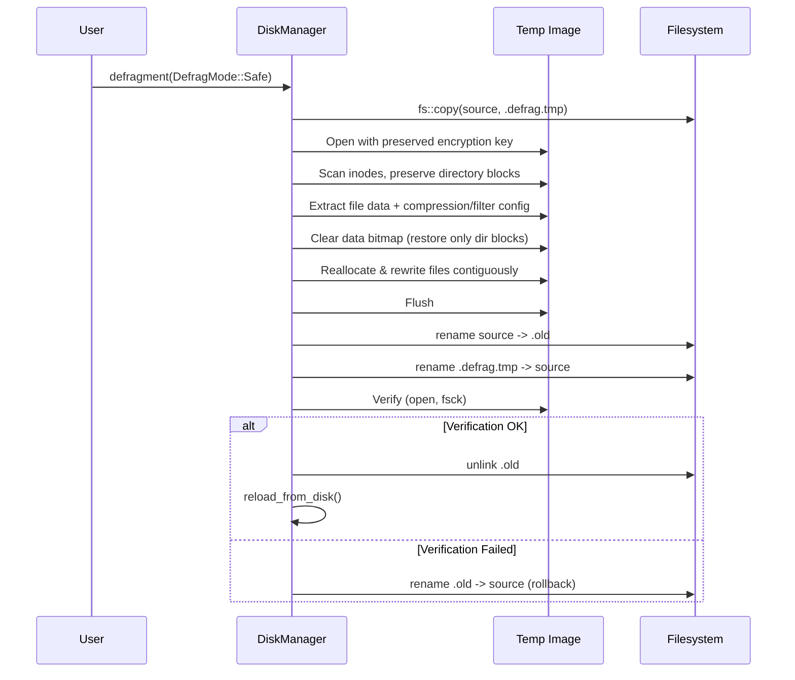
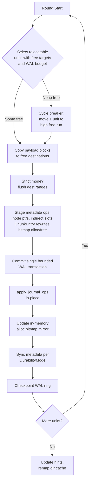

## Responsibility and ownership

Defragmentation and space reorganization logic reside entirely within [`DiskManager`](repo://src/disk.rs). It evaluates disk layout health through [`analyze_fragmentation`](repo://src/disk/maintenance.rs#L137-L166), which measures free-block scattering across physical data space. Defragmentation execution is exposed via [`DiskManager::defragment`](repo://src/disk/maintenance.rs#L460-L480), supporting two operational modes:

- `DefragMode::Safe` (default): An out-of-place reorganization in a temporary image followed by transactional verification and a 3-step atomic rename with rollback.
- `DefragMode::InPlace`: Direct WAL-atomic modification of the existing image using round-based copy-on-write (COW) passes; directories and files are relocated into currently free blocks with metadata updates committed through the journal.

## Fragmentation analysis

Before and after defragmentation, [`DiskManager::analyze_fragmentation`](repo://src/disk/maintenance.rs#L137-L166) inspects the filesystem's `data_bitmap_block` using a read-only [`BitmapRef`](repo://src/bitmap.rs).

### 64-bit word scanning

Instead of checking bit by bit, the analyzer slices the bitmap into 8-byte chunks (`chunks_exact(8)`) and decodes them as little-endian 64-bit words via `u64::from_le_bytes` ([`analyze_fragmentation_internal`](repo://src/disk/maintenance.rs#L150-L255)):

- `word == 0`: All 64 data blocks are completely free. If not already tracking a free run, increments `free_runs` and extends `current_run_len` by 64.
- `word == u64::MAX`: All 64 blocks are fully allocated. Closes any open free run, recording `largest_free_run` and accumulating `total_gap_size`.
- Mixed word: Uses `word.count_ones()` to quickly tabulate allocated blocks, then iterates through each bit (`0..64`) with bitwise masks to track individual block boundaries and transitions.
- Trailing bits: Any leftover bits (`total_blocks % 64`) are checked at the end using `bitmap.get(i)` ([`analyze_fragmentation_internal`](repo://src/disk/maintenance.rs#L235-L250)).

### Metrics and fragmentation ratio

The resulting [`FragmentationStats`](repo://src/disk.rs#L160-L177) tracks:
- `total_blocks`, `used_blocks`, `free_blocks`
- `free_runs`: Number of separate contiguous sequences of free blocks
- `largest_free_run`: The size (in blocks) of the largest contiguous free chunk
- `avg_gap_size`: `total_gap_size / free_runs` (average size of free runs)
- `fragmentation_ratio`: Calculated as:

$$\text{fragmentation\_ratio} = \frac{\text{free\_runs} - 1}{\max(\text{free\_blocks} - 1, 1)}$$

If all free space forms a single contiguous run (`free_runs <= 1`), the ratio is `0.0` (optimal). If every free block is completely isolated (`free_runs == free_blocks`), the ratio approaches `1.0` (maximally fragmented).

## Safe defragmentation pipeline (out-of-place rebuild)

[`defragment_safe`](repo://src/disk/maintenance.rs#L484-L640) reorganizes the filesystem out-of-place to protect against crashes, power failures, or corruption. The process executes across six distinct stages:



### 1. Snapshot creation

The entire active image file is copied via `std::fs::copy(source_path, &temp_path)` ([`defragment_safe`](repo://src/disk/maintenance.rs#L498)). The destination defaults to `{source_path}.defrag.tmp` when no output path is provided. This guarantees that if the defragmentation process is killed mid-stream, the original image file remains untouched and uncorrupted.

### 2. Inode scan and metadata preservation

The temporary image is opened via `DiskManager::open_with_key_and_storage_mode(&temp_path, 0, enc_key, storage_mode)` ([`defragment_safe`](repo://src/disk/maintenance.rs#L501)), preserving the encryption key and storage mode from the original image. Using [`BitmapRef::for_each_set_bit`](repo://src/bitmap.rs#L94-L108), all allocated inode indices are collected from `inode_bitmap_block` ([`defragment_safe`](repo://src/disk/maintenance.rs#L507-L512)):

- **Directories**: Directory blocks cannot simply be moved without updating parent pointer graphs, so directory block addresses are harvested via `collect_inode_block_layout` and staged in `directory_blocks` ([`defragment_safe`](repo://src/disk/maintenance.rs#L514-L517)).
- **Regular Files**: For each file with `size > 0` or any allocated blocks, the file's exact compression status (`CompressionMode::Always`, `CompressionMode::Never`, or `CompressionMode::Seekable`) and pre-compression filter configuration ([`FilterConfig`]: `typesize`, `delta`, `shuffle`, `bitshuffle`) are recorded ([`defragment_safe`](repo://src/disk/maintenance.rs#L519-L526)). **Seekable 64K chunked files** are detected by `INODE_FLAG_SEEKABLE_64K` and their `CompressionMode::Seekable` config is preserved.
- **Inode Reset**: The inode on disk is zeroed out (`size = 0`, `compressed_size = 0`, `blocks = [0; 12]`, `triple_indirect = 0`) via `write_inode` ([`defragment_safe`](repo://src/disk/maintenance.rs#L528-L534)), freeing the blocks for contiguous reassignment.

### 3. Bitmap reset

The entire data bitmap of the temporary image is wiped using `bitmap_slice.fill(0)` ([`defragment_safe`](repo://src/disk/maintenance.rs#L537)). Then, only the preserved directory block IDs (`directory_blocks`) are re-marked as allocated ([`defragment_safe`](repo://src/disk/maintenance.rs#L539-L545)). All other data blocks become completely free and unallocated.

### 4. Contiguous file rewrite

Files are streamed **one by one** from the original image into the temporary image using `read_data` and `write_data_with_filters` ([`defragment_safe`](repo://src/disk/maintenance.rs#L548-L557)). This streaming approach bounds memory usage and prevents OOM on large files. The sequential allocator (`write_data` → `allocate_contiguous_blocks`) places each file's payload blocks contiguously starting at the current `free_block_hint`.

### 5. Flush and verification

The temporary image is flushed (`temp_dm.flush()`) and dropped ([`defragment_safe`](repo://src/disk/maintenance.rs#L559-L560)). The original image is renamed to `{source_path}.old`, then the temporary image is renamed to the original path ([`defragment_safe`](repo://src/disk/maintenance.rs#L563-L567)). The new image is opened and verified via `verify_integrity()` (fsck) ([`defragment_safe`](repo://src/disk/maintenance.rs#L570-L578)).

### 6. Atomic commit or rollback

On success: the `.old` backup is deleted and the active `DiskManager` handle **live-reloads** via `reload_from_disk()` ([`defragment_safe`](repo://src/disk/maintenance.rs#L580-L586)), synchronizing its in-memory state (superblock, bitmaps, caches, hints) with the new file. On any failure: the `.old` backup is renamed back to the original path, restoring the pre-defrag state ([`defragment_safe`](repo://src/disk/maintenance.rs#L588-L597)).

## In-place defragmentation (WAL-atomic COW)

[`defragment_inplace_on`](repo://src/disk/maintenance.rs#L643-L735) performs defragmentation directly within the existing image file. Two implementations exist:

### Legacy non-journaled path (`defragment_inplace_legacy`)

Used when the image has no journal layout. It performs a **cycle-aware block permutation**:

1. **Target computation**: All allocated blocks (directory payload, file payload, indirect blocks, `ChunkEntry` runs) are assigned contiguous target locations starting at `data_block_start` ([`defragment_inplace_legacy`](repo://src/disk/maintenance.rs#L737-L818)).
2. **Cycle resolution**: A `pending` map tracks `old_block → new_block`. Blocks whose targets are already free are moved directly. Cycles are broken by copying the cycle leader to a scratch buffer, rotating the cycle, then writing the scratch buffer to the final destination ([`defragment_inplace_legacy`](repo://src/disk/maintenance.rs#L820-L870)).
3. **Metadata update**: Inode pointers, indirect block pointers, and `ChunkEntry` values are rewritten using the `old_to_new` mapping ([`defragment_inplace_legacy`](repo://src/disk/maintenance.rs#L872-L910)).
4. **Bitmap rebuild**: The data bitmap is reset and `set_range(0, total_used)` marks the new contiguous allocation ([`defragment_inplace_legacy`](repo://src/disk/maintenance.rs#L912-L918)).
5. **Sync**: Metadata ranges are flushed according to `DurabilityMode` ([`defragment_inplace_legacy`](repo://src/disk/maintenance.rs#L920-L926)).

### WAL-atomic round-based COW (`defragment_inplace_journaled_cow`)

Used when the image has a journal layout (`superblock.has_journal_layout()`). This is the **only path that runs under the auto-defrag coordinator** on journaled images. It operates in **rounds**, each committing a single bounded WAL transaction:



**Detailed round steps** ([`defragment_inplace_journaled_cow`](repo://src/disk/maintenance.rs#L928-L1400)):

1. **Unit collection**: All relocatable units are discovered—direct blocks, indirect blocks (SIB/DIB/TIB), and `ChunkEntry` runs—with ownership metadata (`UnitOwner` enum) tracking which inode slot or indirect slot owns each unit. Target locations are assigned sequentially from `data_block_start` ([`defragment_inplace_journaled_cow`](repo://src/disk/maintenance.rs#L930-L1030)).

2. **Free-target selection**: Each round greedily selects units whose target ranges are **currently free** in the in-memory allocation bitmap mirror (`alloc_bm_bytes`) and whose estimated WAL transaction fits within **half the journal ring** (`max_payload_per_tx`) ([`defragment_inplace_journaled_cow`](repo://src/disk/maintenance.rs#L1035-L1080)).

3. **Cycle breaker**: If no unit has a free target, the smallest unit is moved to a high-address free run found by scanning the allocation bitmap backwards ([`defragment_inplace_journaled_cow`](repo://src/disk/maintenance.rs#L1082-L1095)).

4. **Payload copy**: Selected units' blocks are copied to their free destinations via `backing.copy_block`. In `DurabilityMode::Strict`, destination ranges are flushed before WAL commit ([`defragment_inplace_journaled_cow`](repo://src/disk/maintenance.rs#L1097-L1115)).

5. **WAL staging**: Metadata operations are staged into `wal_ops`:
   - Inode pointer updates (`WriteInode` ops)
   - Indirect block slot updates (`WriteBlockSlice` ops)
   - `ChunkEntry` rewrites (packed into inode slots or indirect slots)
   - Data bitmap range alloc/free (`SetDataBitmapRange` ops)
   Operations are coalesced to minimize WAL size ([`defragment_inplace_journaled_cow`](repo://src/disk/maintenance.rs#L1117-L1195)).

6. **Commit & apply**: `commit_journal_tx` writes the transaction; `apply_journal_ops` applies metadata updates in-place using the exact same op applier used during journal recovery ([`defragment_inplace_journaled_cow`](repo://src/disk/maintenance.rs#L1197-L1205)).

7. **State advance**: The in-memory allocation bitmap mirror is updated (clear old, set new). `ChunkEntry` values and indirect block indices in `units` are rewritten to their new locations ([`defragment_inplace_journaled_cow`](repo://src/disk/maintenance.rs#L1207-L1225)).

8. **Metadata sync & WAL checkpoint**: Modified metadata ranges (data bitmap, inodes, indirect blocks, destination payloads in range-based modes) are synced per `DurabilityMode`. The WAL ring is checkpointed (`ring.checkpoint()`) so the next round reuses the freed source blocks ([`defragment_inplace_journaled_cow`](repo://src/disk/maintenance.rs#L1227-L1255)).

### Seekable 64K chunked file handling

Both in-place paths correctly handle **seekable 64K chunked files** (`INODE_FLAG_SEEKABLE_64K`). Their inode pointer slots hold packed `ChunkEntry` values (u64 encoding `start_block`, `block_count`, `flags`, `compressed_len`) instead of raw block IDs. The `collect_inode_block_layout` helper expands `ChunkEntry` runs into individual block IDs for bitmap analysis, while the defragmentation logic rewrites the packed `ChunkEntry` with the new `start_block` ([`collect_inode_block_layout`](repo://src/disk/maintenance.rs#L257-L320), [`defragment_inplace_journaled_cow`](repo://src/disk/maintenance.rs#L1145-L1155)).

## Auto-defragmentation coordinator

The [`AutoDefragController`](repo://src/auto_defrag.rs#L235-L320) runs a **daemon thread** named `oifs-auto-defrag` that holds a `Weak<Arc<InnerLock>>` reference to the `DiskManager` inner state. This ensures the worker exits as soon as the last `DiskManager` clone is dropped, never keeping the image mapped indefinitely.

### Configuration

[`AutoDefragConfig`](repo://src/auto_defrag.rs#L25-L80) controls the coordinator:

| Field | Default | Purpose |
|-------|---------|---------|
| `enabled` | `false` | Opt-in activation |
| `fragmentation_threshold` | `0.25` | Ratio above which a pass triggers (clamped to `[0,1]`, NaN → default) |
| `check_interval` | `300s` | Measurement period (min `10ms`, prevents hot loop) |
| `min_free_blocks` | `0` | Minimum free blocks required to run (guards near-full images) |
| `allow_journaled` | `true` | Permit in-place defrag on WAL-enabled images |

The configuration is **sanitized on install** (`AutoDefragConfig::sanitized`): NaN thresholds are replaced, intervals below `MIN_CHECK_INTERVAL` are raised, and the threshold is clamped ([`auto_defrag.rs`](repo://src/auto_defrag.rs#L60-L78)).

### Worker loop

The worker ([`run_worker`](repo://src/auto_defrag.rs#L330-L385)):

1. Sleeps on a `Condvar` with timeout = `check_interval`, waking early on config change or shutdown.
2. Upgrades the `Weak` reference; exits if the manager is gone.
3. Takes a **read lock** and calls `analyze_fragmentation_on` to measure fragmentation.
4. Evaluates skip conditions via `skip_reason`:
   - Fragmentation ratio below threshold
   - Free blocks below `min_free_blocks`
   - Journaled image with `allow_journaled = false`
5. If not skipped, takes a **write lock** and runs `defragment_inplace_on` (which selects the WAL-atomic path on journaled images).
6. Updates statistics under `stats` mutex.

### Statistics

[`AutoDefragStats`](repo://src/auto_defrag.rs#L82-L95) tracks:

- `checks`: Total fragmentation measurements
- `passes`: Successful defragmentation passes
- `skipped`: Passes skipped (with reason in `last_error`)
- `errors`: Failed passes (with error in `last_error`)
- `last_fragmentation_ratio`: Most recent measurement
- `last_pass`: `Option<DefragStats>` from the last successful pass
- `last_error`: Human-readable skip/failure reason

### Lifecycle integration

- `DiskManager::set_auto_defrag(config)` installs sanitized config and starts/stops the worker ([`disk.rs`](repo://src/disk.rs)).
- `DiskManager::stop_auto_defrag()` and `AutoDefragController::shutdown()` stop the worker; the latter is called from `DiskManager::drop` ([`auto_defrag.rs`](repo://src/auto_defrag.rs#L285-L315)).

## Key invariants and failure semantics

| Invariant | Enforcement |
|-----------|-------------|
| **Original image untouched until commit** | Safe mode copies entire image first; InPlace only modifies after WAL commit |
| **Atomic metadata updates** | InPlace: single WAL transaction per round; Safe: full fsck before rename |
| **No metadata corruption on crash** | Safe: rollback via `.old` rename; InPlace: WAL orders payload before metadata |
| **Live handle consistency** | Safe: `reload_from_disk()` after swap; InPlace: operates under write lock on live handle |
| **Worker never leaks manager** | `Weak` reference + `shutdown()` on `Drop` |
| **No hot loop** | `MIN_CHECK_INTERVAL = 10ms` enforced in config sanitization |

## Extension points

- **Custom defrag modes**: Add variants to `DefragMode` and dispatch in `defragment()`.
- **Allocation policy**: The contiguous allocator (`allocate_contiguous_blocks`) is used by both safe and in-place paths; modifying it changes placement strategy.
- **Auto-defrag policy**: `skip_reason` is a pure function; alternative policies (time-of-day, IO load) can be injected by wrapping the controller.
- **ChunkEntry compaction**: The `shift_table_collapse` logic (used during file truncate/rewrite) is separate from defragmentation but shares `ChunkEntry` rewrite mechanics.

## Configuration and operations

```rust
// Enable auto-defrag with default threshold (0.25), checking every 60s
dm.set_auto_defrag(AutoDefragConfig::new(0.25).with_check_interval(Duration::from_secs(60)));

// Disable auto-defrag
dm.set_auto_defrag(AutoDefragConfig::default());

// Read stats
let stats = dm.auto_defrag_stats();
println!("checks={}, passes={}, skipped={}, errors={}",
    stats.checks, stats.passes, stats.skipped, stats.errors);

// Manual defrag
let stats = dm.defragment(&path, DefragMode::Safe, None)?;
// or
let stats = dm.defragment(&path, DefragMode::InPlace, None)?;
```

## Focused tests

| Test file | Coverage |
|-----------|----------|
| `tests/defrag_test.rs` | Safe & in-place defrag, encrypted images, indirect files, path injection defense, live reload |
| `tests/defrag_seekable_chunk_test.rs` | Seekable 64K chunked file preservation in both defrag modes |
| `tests/auto_defrag_test.rs` | Config sanitization (NaN, zero interval), disabled default, pass execution, data integrity, journaled images, `allow_journaled=false`, `min_free_blocks`, shutdown on disable |
