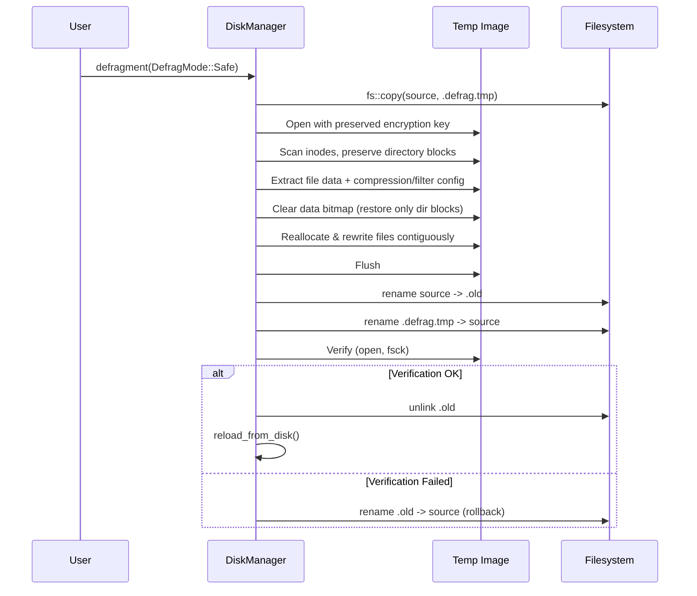
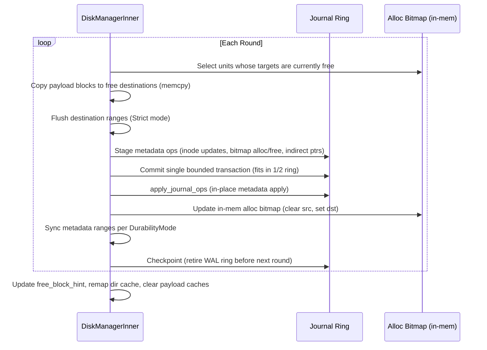
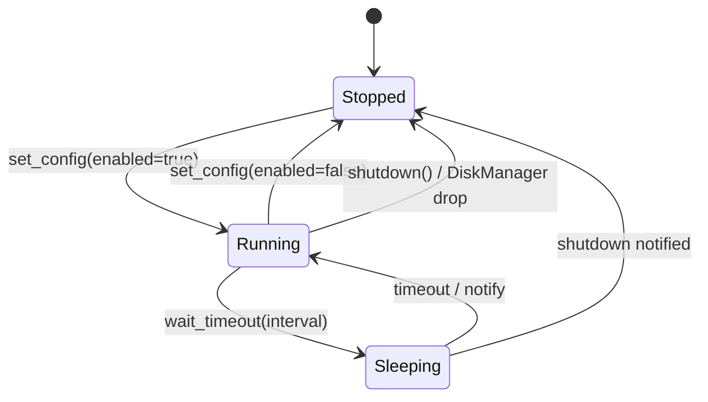

## Responsibility and ownership

Defragmentation and space reorganization logic reside entirely within [`DiskManager`](repo://src/disk.rs). It evaluates disk layout health through [`analyze_fragmentation`](repo://src/disk/maintenance.rs#L137-L166), which measures free-block scattering across physical data space. Defragmentation execution is exposed via [`DiskManager::defragment`](repo://src/disk/maintenance.rs#L460-L480), supporting two operational modes:

- `DefragMode::Safe` (default): An out-of-place reorganization in a temporary image followed by transactional verification and a 3-step atomic rename with rollback.
- `DefragMode::InPlace`: Direct WAL-atomic modification of the existing image using round-based copy-on-write (COW) passes; directories and files are relocated into currently free blocks with metadata updates committed through the journal.

## Fragmentation analysis

Before and after defragmentation, [`DiskManager::analyze_fragmentation`](repo://src/disk/maintenance.rs#L137-L166) inspects the filesystem's `data_bitmap_block` using a read-only [`BitmapRef`](repo://src/bitmap.rs).

### 64-bit word scanning

Instead of checking bit by bit, the analyzer slices the bitmap into 8-byte chunks (`chunks_exact(8)`) and decodes them as little-endian 64-bit words via `u64::from_le_bytes` ([`analyze_fragmentation_internal`](repo://src/disk/maintenance.rs#L150-L255)):

- `word == 0`: All 64 data blocks are completely free. If not already tracking a free run, increments `free_runs` and extends `current_run_len` by 64.
- `word == u64::MAX`: All 64 blocks are fully allocated. Closes any open free run, recording `largest_free_run` and accumulating `total_gap_size`.
- Mixed word: Uses `word.count_ones()` to quickly tabulate allocated blocks, then iterates through each bit (`0..64`) with bitwise masks to track individual block boundaries and transitions.
- Trailing bits: Any leftover bits (`total_blocks % 64`) are checked at the end using `bitmap.get(i)` ([`analyze_fragmentation_internal`](repo://src/disk/maintenance.rs#L235-L250)).

### Metrics and fragmentation ratio

The resulting [`FragmentationStats`](repo://src/disk.rs#L157-L174) tracks:
- `total_blocks`, `used_blocks`, `free_blocks`
- `free_runs`: Number of separate contiguous sequences of free blocks
- `largest_free_run`: The size (in blocks) of the largest contiguous free chunk
- `avg_gap_size`: `total_gap_size / free_runs` (average size of free runs)
- `fragmentation_ratio`: Calculated as:

$$\text{fragmentation\_ratio} = \frac{\text{free\_runs} - 1}{\max(\text{free\_blocks} - 1, 1)}$$

If all free space forms a single contiguous run (`free_runs <= 1`), the ratio is `0.0` (optimal). If every free block is completely isolated (`free_runs == free_blocks`), the ratio approaches `1.0` (maximally fragmented).

## Safe defragmentation pipeline (out-of-place rebuild)

[`defragment_safe`](repo://src/disk/maintenance.rs#L484-L640) reorganizes the filesystem out-of-place to protect against crashes, power failures, or corruption. The process executes across six distinct stages:



### 1. Snapshot creation

The entire active image file is copied via `std::fs::copy(source_path, &temp_path)` ([`defragment_safe`](repo://src/disk/maintenance.rs#L498)). The destination defaults to `{source_path}.defrag.tmp` when no output path is provided. This guarantees that if the defragmentation process is killed mid-stream, the original image file remains untouched and uncorrupted.

### 2. Inode scan and metadata preservation

The temporary image is opened via `DiskManager::open_with_key(&temp_path, 0, enc_key)` ([`defragment_safe`](repo://src/disk/maintenance.rs#L501)), preserving the encryption key from the original image. Using [`BitmapRef::for_each_set_bit`](repo://src/bitmap.rs#L94-L108), all allocated inode indices are collected from `inode_bitmap_block` ([`defragment_safe`](repo://src/disk/maintenance.rs#L507-L512)):

- **Directories**: Directory blocks cannot simply be moved without updating parent pointer graphs, so directory block addresses are harvested via `collect_inode_blocks` and staged in `directory_blocks` ([`defragment_safe`](repo://src/disk/maintenance.rs#L514-L517)).
- **Regular Files**: For each file with `size > 0`, the file's exact compression status (`is_compressed = inode.compressed_size > 0`) and pre-compression filter configuration ([`FilterConfig`]: `typesize`, `delta`, `shuffle`, `bitshuffle`) are recorded ([`defragment_safe`](repo://src/disk/maintenance.rs#L519-L526)). **Seekable 64K chunked files** are detected by `INODE_FLAG_SEEKABLE_64K` and their `CompressionMode::Seekable` config is preserved.
- **Inode Reset**: The inode on disk is zeroed out (`size = 0`, `compressed_size = 0`, `blocks = [0; 12]`, `triple_indirect = 0`) via `write_inode` ([`defragment_safe`](repo://src/disk/maintenance.rs#L528-L534)), freeing the blocks for contiguous reassignment.

### 3. Bitmap reset

The entire data bitmap of the temporary image is wiped using `bitmap_slice.fill(0)` ([`defragment_safe`](repo://src/disk/maintenance.rs#L537)). Then, only the preserved directory block IDs (`directory_blocks`) are re-marked as allocated ([`defragment_safe`](repo://src/disk/maintenance.rs#L539-L545)). All other data blocks become completely free and unallocated.

### 4. Contiguous file rewrite

For each regular file, `write_data_with_filters` is invoked ([`defragment_safe`](repo://src/disk/maintenance.rs#L557)):
- Because the data bitmap was cleared and allocation starts from `data_block_start` using sequential hint-based allocation, each file receives a strictly contiguous sequence of data blocks.
- The original compression setting (`CompressionMode::Always` if previously compressed, `CompressionMode::Seekable` for chunked files, else `CompressionMode::Never`) and filter configuration are reapplied, preserving space efficiency without altering compression/filter semantics.
- Bytes moved and files processed counters are updated for final reporting.

### 5. Durability flush

`temp_dm.flush()` commits all dirty pages and metadata to disk, and the temporary `DiskManager` handle is explicitly dropped to release memory maps and file descriptors ([`defragment_safe`](repo://src/disk/maintenance.rs#L560-L561)).

### 6. Transactional 3-step atomic rename

The replacement uses a crash-safe three-step rename protocol ([`defragment_safe`](repo://src/disk/maintenance.rs#L563-L605)):

1. `rename(source_path, source_path.old)` — original becomes backup
2. `rename(temp_path, source_path)` — new defragged image becomes active
3. Verify by opening the new image and running `verify_integrity()` (fsck)

**Rollback on failure**: If either rename fails, or verification fails (fsck not clean, or cannot open), the backup `.old` is renamed back to `source_path`, restoring the original image atomically. On success, the `.old` backup is deleted and the active `DiskManager` handle is live-reloaded via `reload_from_disk()` to synchronize with the new file.

## In-place defragmentation (WAL-atomic COW)

[`defragment_inplace`](repo://src/disk/maintenance.rs#L643-L735) directly compacts and reorganizes physical data blocks within the existing image without allocating duplicate temporary files. It operates in two variants depending on whether the image has journaling enabled.

### Common phases (both variants)

1. **Fragmentation analysis** — captures `stats_before` via `analyze_fragmentation_internal`.
2. **Short-circuit** — if already perfectly compacted (`free_runs == 1` and final block is free), returns zero-work `DefragStats`.
3. **Inode collection** — single pass collects all allocated inodes into `dir_inodes`, `file_inodes`, `other_inodes` without thrashing `inode_cache` ([`defragment_inplace_on`](repo://src/disk/maintenance.rs#L660-L685)).
4. **Journal quiesce (journaled only)** — drains pending async ranges, flushes mmap, checkpoints WAL to head so the ring is clean ([`defragment_inplace_on`](repo://src/disk/maintenance.rs#L687-L698)).
5. **Defragmentation core** — dispatches to either `defragment_inplace_journaled_cow` or `defragment_inplace_legacy` ([`defragment_inplace_on`](repo://src/disk/maintenance.rs#L700-L725)).
6. **Post-defrag verification** — runs `verify_integrity`; fails the operation if not clean.

### Legacy (non-journaled) in-place defragmentation

[`defragment_inplace_legacy`](repo://src/disk/maintenance.rs#L754-L975) uses a cycle-aware block permutation algorithm:

1. **Target layout planning** — computes contiguous target locations for all blocks (`old_to_new` map) starting from `data_block_start`. Directories first, then regular files (including `ChunkEntry` runs expanded to individual blocks), then indirect blocks (SIB, DIB, TIB).
2. **ChunkEntry handling** — for seekable 64K files, `collect_inode_block_layout` expands packed `ChunkEntry` values into their constituent contiguous block runs ([`collect_inode_block_layout`](repo://src/disk/maintenance.rs#L170-L200)). A parallel `old_entry_to_new` map rewrites the packed pointer values after permutation.
3. **Cycle-aware permutation** — moves blocks using a scratch buffer only when cycles are detected; free targets are consumed first to avoid unnecessary copies ([`defragment_inplace_legacy`](repo://src/disk/maintenance.rs#L900-L960)).
4. **Pointer updates** — inode direct/SIB/DIB/TIB slots and indirect block pointer tables are rewritten to new locations via `lookup_new` ([`defragment_inplace_legacy`](repo://src/disk/maintenance.rs#L962-L1010)).
5. **Bitmap rebuild** — data bitmap is cleared and `set_range(0, total_used)` marks the new contiguous prefix as allocated ([`defragment_inplace_legacy`](repo://src/disk/maintenance.rs#L1012-L1020)).
6. **Hints & cache remap** — `free_block_hint` updated; `ShardedDirCache` entries remapped in place; payload caches cleared ([`defragment_inplace_legacy`](repo://src/disk/maintenance.rs#L1022-L1030)).

### Journaled in-place defragmentation (round-based COW)

[`defragment_inplace_journaled_cow`](repo://src/disk/maintenance.rs#L977-L1255) is a fully WAL-atomic, round-based copy-on-write algorithm designed to never lose data even on mid-round crashes.



#### Data structures

- **`RelocUnit`**: Describes one contiguous relocation (payload run or indirect block). Fields: `curr_start`, `block_count`, `target_start`, `owner` (enum: `InodeDirect`, `InodeSib`, `InodeDib`, `InodeTib`, `IndirectSlot`), optional `chunk_entry` (for seekable files), optional `self_ind_idx` (if this unit is itself an indirect block).
- **`UnitOwner`**: Traces each unit back to its owning inode slot or indirect block entry, enabling precise metadata updates.
- **In-memory allocation mirror** (`alloc_bm_bytes`): Compact byte vector mirroring the on-disk data bitmap, updated each round to track which blocks are free for subsequent rounds.

#### Round execution

1. **Batch selection** — Greedily picks a set of pending units whose `target_start..target_start+block_count` are free in `alloc_bm_bytes` and whose estimated WAL transaction size fits within half the journal ring (`max_payload_per_tx`) ([`defragment_inplace_journaled_cow`](repo://src/disk/maintenance.rs#L1095-L1135)).
2. **Cycle breaker** — If no units have free targets (all targets occupied by other pending units), picks the smallest blocking unit and moves it to a high-address free scratch run found by reverse-scan ([`find_free_run_high_to_low`](repo://src/disk/maintenance.rs#L1080-L1093)).
3. **Payload copy & flush** — `mmap.copy_within` copies source blocks to destinations; in `Strict` durability mode, destination ranges are flushed via `flush_range` before WAL commit ([`defragment_inplace_journaled_cow`](repo://src/disk/maintenance.rs#L1137-L1155)).
4. **WAL staging** — Builds a transaction containing:
   - `SetDataBitmapRange` ops: allocate destination run, free source run
   - `WriteInode` ops: post-image inodes for all touched inodes (with updated direct/SIB/DIB/TIB pointers)
   - `WriteBlockSlice` ops: updated pointer slots in indirect blocks (using new indirect block addresses from `round_ind_new_block`)
   - `ChunkEntry` values are rewritten with new `start_block` while preserving `block_count`, `flags`, `compressed_len` ([`defragment_inplace_journaled_cow`](repo://src/disk/maintenance.rs#L1175-L1182)).
5. **Commit & apply** — `commit_journal_tx` (WAL durability), then `apply_journal_ops` (in-place metadata apply). Both are idempotent redo operations.
6. **In-memory state advance** — Updates `alloc_bm_bytes` (clear old, set new), advances `units[idx].curr_start = dst_start`, rewrites `chunk_entry` if present, updates `indirect_blocks[ind_idx]` for self-moved indirect blocks ([`defragment_inplace_journaled_cow`](repo://src/disk/maintenance.rs#L1217-L1240)).
7. **Metadata sync & WAL retirement** — `sync_mutation_ranges` per `DurabilityMode`; `JournalRing::checkpoint()` retires the ring so the next round reuses the full capacity ([`defragment_inplace_journaled_cow`](repo://src/disk/maintenance.rs#L1242-L1255)).

#### Crash recovery guarantees

- **Before WAL commit**: Source blocks are intact; destinations are in free space and ignored by metadata. Recovery sees clean pre-defrag state.
- **After WAL commit, before apply**: WAL contains full redo log. Mount recovery replays transactions, advancing metadata to post-round state. Source blocks become free, destinations allocated.
- **After apply**: Metadata matches WAL. Subsequent rounds reuse freed source blocks as new free space.
- Tests in [`test_journaled_defragment_inplace_and_redo_replay`](repo://tests/journal_test.rs#L1791-L1860) and [`test_journaled_defragment_crash_midway_with_stale_disk_metadata`](repo://tests/journal_test.rs#L1862-L1960) verify clean fsck after simulated crashes at commit and pre-commit boundaries.

#### ChunkEntry relocation (seekable 64K files)

Seekable 64K chunked files store packed `ChunkEntry` values in pointer slots instead of raw block IDs. Both defragmentation paths handle this correctly:

- **Safe mode**: `collect_inode_block_layout` expands `ChunkEntry` into individual block runs for bitmap preservation. `write_data_with_filters` is called with `CompressionMode::Seekable`, which re-chunks the data and writes fresh `ChunkEntry` values pointing to the new contiguous run.
- **In-place legacy**: `collect_inode_block_layout` expands entries for target planning. `old_entry_to_new` map rewrites the packed value with new `start_block` after permutation.
- **In-place journaled**: `RelocUnit` carries the original `ChunkEntry`. During WAL staging, a new `ChunkEntry` is constructed with `dst_start` as `start_block` while preserving `block_count`, `flags`, `compressed_len` ([`defragment_inplace_journaled_cow`](repo://src/disk/maintenance.rs#L1175-L1182)). The `WriteInode` or `WriteBlockSlice` op installs the updated packed value.

### `collect_inode_block_layout` — handling `ChunkEntry` vs raw pointers

[`collect_inode_block_layout`](repo://src/disk/maintenance.rs#L317-L410) is the central routine that decodes an inode's block graph into two lists: `payload_blocks` (data/directory blocks in logical order) and `indirect_blocks` (SIB/DIB/TIB pointer tables). Its logic for seekable files:

```rust
let is_seekable = inode.flags & crate::inode::INODE_FLAG_SEEKABLE_64K != 0;

let push_leaf = |raw: u64, payload_blocks: &mut Vec<u64>| {
    if raw == 0 { return; }
    if is_seekable {
        let entry = crate::inode::ChunkEntry(raw);
        if entry.is_empty() { return; }
        let start = entry.start_block() as u64;
        let count = entry.block_count() as u64;
        for i in 0..count {
            payload_blocks.push(start + i);
        }
    } else {
        payload_blocks.push(raw);
    }
};
```

For each direct slot (0..9), SIB, DIB, TIB, the routine expands `ChunkEntry` into the actual contiguous block runs they reference, ensuring defragmentation relocates the *physical payload blocks* rather than treating the packed `ChunkEntry` value as a block ID. This is used by both legacy and journaled in-place paths for target layout planning.

### `shift_table_collapse` — seekable chunk table compaction

For seekable 64K files, the logical chunk table (stored in indirect blocks) may develop holes when chunks are deleted or overwritten. [`shift_table_collapse`](repo://src/disk/transfer.rs#L381-L431) compacts these tables by removing a range of entries and shifting trailing entries left, returning the removed non-zero `ChunkEntry` values so their physical blocks can be freed.

```rust
pub fn shift_table_collapse(
    table: &mut Vec<u64>,
    start_unit: usize,
    remove_units: usize,
) -> Vec<u64>
```

- Operates on the slice of packed `ChunkEntry` values (`u64` each).
- Removes `[start_unit .. start_unit + remove_units)`.
- Shifts remaining entries left, truncates the table.
- Returns the freed entries (non-zero) for subsequent bitmap deallocation.
- Zero-allocation slice core `shift_table_collapse_slice` is used internally for performance ([`shift_table_collapse_slice`](repo://src/disk/transfer.rs#L387-L419)).
- Proven bijection in Kani proofs ([`shift_table_collapse`](repo://tests/chunked_test.rs#L3663-L3697)).

While not directly invoked during the defragmentation passes themselves, `shift_table_collapse` is the canonical mechanism for compacting seekable file chunk tables during truncation and hole-punching, keeping the logical chunk index dense. Defragmentation's block-level relocation makes the physical layout contiguous, while `shift_table_collapse` ensures the logical index remains compact.

## Auto-defrag coordinator (background daemon)

[`AutoDefragController`](repo://src/auto_defrag.rs#L235-L310) is a daemon thread that periodically measures fragmentation and runs in-place defragmentation when it exceeds a configured threshold. It runs **only on the Master** `DiskManager` instance and is **disabled in read-only mode** (returns `ReadOnly` error if attempted).

### Configuration

[`AutoDefragConfig`](repo://src/auto_defrag.rs#L22-L58):

| Field | Default | Purpose |
|-------|---------|---------|
| `enabled` | `false` | Master switch |
| `fragmentation_threshold` | `0.25` | Trigger ratio (clamped `0.0..=1.0`, `NaN` → default) |
| `check_interval` | `300s` | Period between checks (min `10ms`) |
| `min_free_blocks` | `0` | Skip if fewer free blocks (guards near-full images) |
| `allow_journaled` | `true` | Allow on WAL-enabled images |

`sanitized()` normalizes the config: clamps threshold, replaces `NaN` with default, raises sub-minimum intervals ([`AutoDefragConfig::sanitized`](repo://src/auto_defrag.rs#L84-L100)). The fragmentation threshold uses the same formula as `analyze_fragmentation`: `(free_runs - 1) / (free_blocks - 1)`.

### Worker lifecycle



- The worker is spawned by `ensure_worker()` when `enabled=true` ([`AutoDefragController::ensure_worker`](repo://src/auto_defrag.rs#L285-L300)).
- Thread name: `oifs-auto-defrag`.
- Holds only a `Weak<RwLock<DiskManagerInner>>` — when the last `DiskManager` clone is dropped, `inner.upgrade()` fails and the thread exits cleanly ([`run_worker`](repo://src/auto_defrag.rs#L380-L414)).
- `shutdown()` (called from `DiskManager::drop`) sets the stop flag, notifies the condvar, and joins the thread ([`AutoDefragController::shutdown`](repo://src/auto_defrag.rs#L310-L320)).

### Evaluation cycle (`run_once`)

1. Acquire sanitized config; return if disabled.
2. `analyze_fragmentation_on` (read lock) → `FragmentationStats` ([`run_once`](repo://src/auto_defrag.rs#L330-L360)).
3. Update `checks`, `last_fragmentation_ratio`.
4. `skip_reason` checks:
   - `fragmentation_ratio < threshold` → "below threshold"
   - `free_blocks < min_free_blocks` → "too full"
   - Journaled image + `!allow_journaled` → "WAL disabled" ([`skip_reason`](repo://src/auto_defrag.rs#L362-L385)).
5. If not skipped: `defragment_inplace_on` (write lock) → `DefragStats`; update `passes`, `last_pass`, clear `last_error`; on error increment `errors`, store message.

### Statistics

[`AutoDefragStats`](repo://src/auto_defrag.rs#L107-L122):

- `checks`, `passes`, `skipped`, `errors`
- `last_fragmentation_ratio`
- `last_pass: Option<DefragStats>` — includes `files_processed`, `bytes_moved`, `blocks_freed`, `frag_before`, `frag_after`
- `last_error: Option<String>` — reason for most recent skip or failure

## DefragStats output

Both safe and in-place defragmentation return [`DefragStats`](repo://src/disk.rs#L186-L196):

| Field | Meaning |
|-------|---------|
| `files_processed` | Number of regular files relocated (directories excluded in safe mode, included as block moves in in-place) |
| `bytes_moved` | Total payload bytes copied (in-place: `blocks_moved * BLOCK_SIZE`; safe: sum of file sizes) |
| `blocks_freed` | `frag_before.free_runs - frag_after.free_runs` (reduction in free-run count, proxy for consolidation) |
| `frag_before` | Fragmentation ratio before defrag |
| `frag_after` | Fragmentation ratio after defrag (typically `0.0` for fully compacted result) |

## Testing highlights

- **Midway crash recovery** — [`test_journaled_defragment_crash_midway_with_stale_disk_metadata`](repo://tests/journal_test.rs#L1862-L1960) simulates crashes before WAL commit (data area post-defrag, metadata pre-defrag) and after commit (WAL has tx, metadata not applied). Both mount cleanly and replay to consistent state.
- **Seekable chunk preservation** — [`test_in_place_defrag_preserves_seekable_chunked_files`](repo://tests/defrag_seekable_chunk_test.rs#L55-L90) and [`test_safe_defrag_preserves_seekable_chunked_files`](repo://tests/defrag_seekable_chunk_test.rs#L100-L135) verify content and flag integrity across both defrag modes.
- **Large transaction spanning WAL ring** — [`test_journaled_defragment_large_exceeding_wal_ring`](repo://tests/journal_test.rs#L1961-L2004) validates multi-round COW with thousands of files.
- **Auto-defrag integration** — [`test_journaled_defragment_inplace_and_redo_replay`](repo://tests/journal_test.rs#L1791-L1860) covers full redo replay after defrag commit.
- **Path injection defense** — [`test_defragment_path_injection_defense`](repo://tests/defrag_test.rs#L418-L445) rejects output paths that escape or overwrite the source.
- **`shift_table_collapse` proofs** — Kani proofs verify bijection between original and collapsed entries ([`shift_table_collapse`](repo://tests/chunked_test.rs#L3663-L3697)).

## Relationships to other subsystems

- **Block allocation** — Defragmentation is the only operation that globally rewrites the data bitmap and resets `free_block_hint` to the first free block after the compacted prefix. See [Block Allocation](../architecture/block_allocation.md).
- **Journal (WAL)** — In-place journaled defrag is the largest WAL consumer; it depends on `commit_journal_tx` / `apply_journal_ops` idempotency, `checkpoint()`, and ring capacity governance. See [Journal](../architecture/journal.md).
<!-- openwiki: broken internal link [../architecture/filters_and_compression.md] file "../architecture/filters_and_compression.md" does not exist. Fix the href or restore the target, then delete this comment. -->
- **Filters & compression** — Safe mode reuses original `CompressionMode` and `FilterConfig` per file. In-place preserves them by moving raw payload blocks unchanged. See [Filters & Compression](../architecture/filters_and_compression.md).
- **Testing & verification** — `verify_integrity` (fsck) is invoked after every defragmentation pass (both modes) and after WAL recovery in tests. See [Testing and Verification](../operations/testing_and_verification.md).

## Extension points

- **DefragMode::InPlace** could be extended with a `DefragMode::Online` that yields the write lock between rounds for better concurrency.
- **AutoDefragConfig** could add `max_pass_duration` or `io_priority` knobs.
- **ChunkEntry** relocation logic is centralized in `collect_inode_block_layout`, `defragment_inplace_legacy`, and `defragment_inplace_journaled_cow`; any new pointer encoding would need updates in all three.
