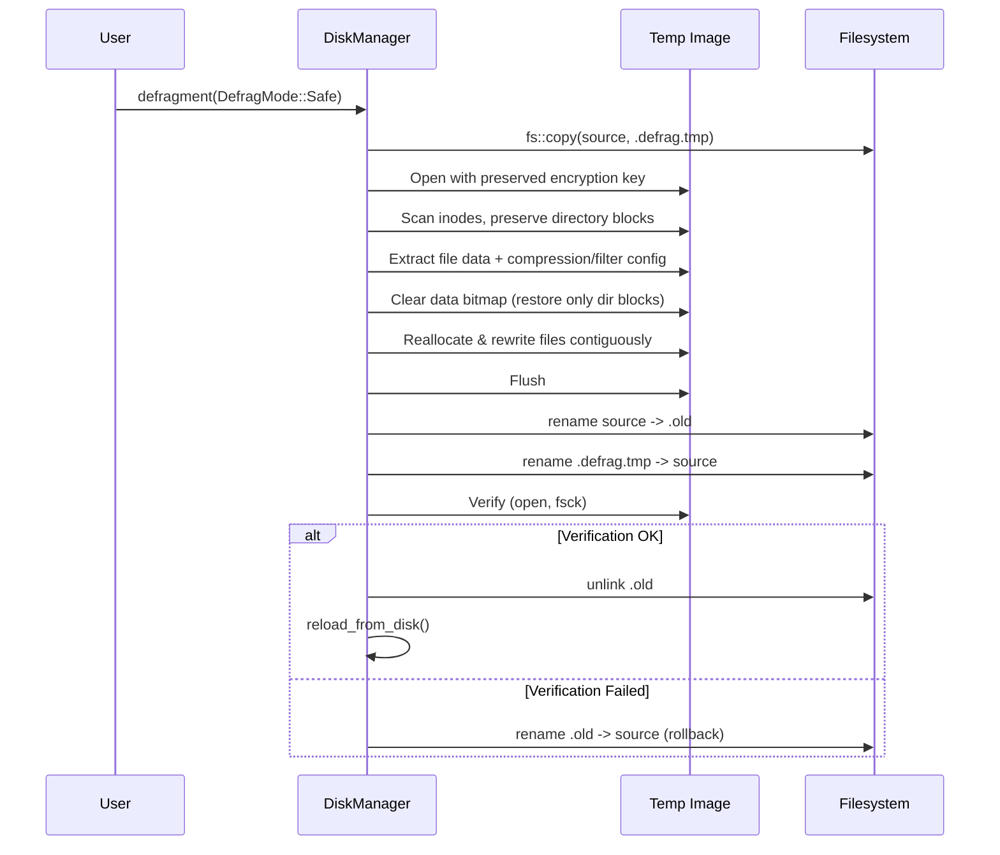
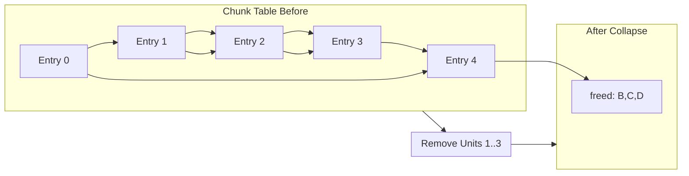
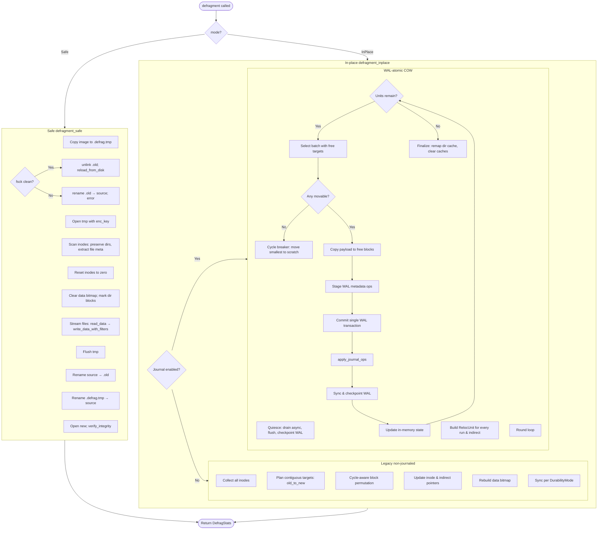

## Responsibility and ownership

Defragmentation and space reorganization logic reside entirely within [`DiskManager`](repo://src/disk.rs). It evaluates disk layout health through [`analyze_fragmentation`](repo://src/disk/maintenance.rs#L137-L166), which measures free-block scattering across physical data space. Defragmentation execution is exposed via [`DiskManager::defragment`](repo://src/disk/maintenance.rs#L460-L480), supporting two operational modes:

- `DefragMode::Safe` (default): An out-of-place reorganization in a temporary image followed by transactional verification and a 3-step atomic rename with rollback.
- `DefragMode::InPlace`: Direct WAL-atomic modification of the existing image using round-based copy-on-write (COW) passes; directories and files are relocated into currently free blocks with metadata updates committed through the journal.

## Fragmentation analysis

Before and after defragmentation, [`DiskManager::analyze_fragmentation`](repo://src/disk/maintenance.rs#L137-L166) inspects the filesystem's `data_bitmap_block` using a read-only [`BitmapRef`](repo://src/bitmap.rs).

### 64-bit word scanning

Instead of checking bit by bit, the analyzer slices the bitmap into 8-byte chunks (`chunks_exact(8)`) and decodes them as little-endian 64-bit words via `u64::from_le_bytes` ([`analyze_fragmentation_internal`](repo://src/disk/maintenance.rs#L150-L255)):

- `word == 0`: All 64 data blocks are completely free. If not already tracking a free run, increments `free_runs` and extends `current_run_len` by 64.
- `word == u64::MAX`: All 64 blocks are fully allocated. Closes any open free run, recording `largest_free_run` and accumulating `total_gap_size`.
- Mixed word: Uses `word.count_ones()` to quickly tabulate allocated blocks, then iterates through each bit (`0..64`) with bitwise masks to track individual block boundaries and transitions.
- Trailing bits: Any leftover bits (`total_blocks % 64`) are checked at the end using `bitmap.get(i)` ([`analyze_fragmentation_internal`](repo://src/disk/maintenance.rs#L235-L250)).

### Metrics and fragmentation ratio

The resulting [`FragmentationStats`](repo://src/disk.rs#L157-L174) tracks:
- `total_blocks`, `used_blocks`, `free_blocks`
- `free_runs`: Number of separate contiguous sequences of free blocks
- `largest_free_run`: The size (in blocks) of the largest contiguous free chunk
- `avg_gap_size`: `total_gap_size / free_runs` (average size of free runs)
- `fragmentation_ratio`: Calculated as:

$$\text{fragmentation\_ratio} = \frac{\text{free\_runs} - 1}{\max(\text{free\_blocks} - 1, 1)}$$

If all free space forms a single contiguous run (`free_runs <= 1`), the ratio is `0.0` (optimal). If every free block is completely isolated (`free_runs == free_blocks`), the ratio approaches `1.0` (maximally fragmented).

## Safe defragmentation pipeline (out-of-place rebuild)

[`defragment_safe`](repo://src/disk/maintenance.rs#L484-L640) reorganizes the filesystem out-of-place to protect against crashes, power failures, or corruption. The process executes across six distinct stages:



### 1. Snapshot creation

The entire active image file is copied via `std::fs::copy(source_path, &temp_path)` ([`defragment_safe`](repo://src/disk/maintenance.rs#L498)). The destination defaults to `{source_path}.defrag.tmp` when no output path is provided. This guarantees that if the defragmentation process is killed mid-stream, the original image file remains untouched and uncorrupted.

### 2. Inode scan and metadata preservation

The temporary image is opened via `DiskManager::open_with_key(&temp_path, 0, enc_key)` ([`defragment_safe`](repo://src/disk/maintenance.rs#L501)), preserving the encryption key from the original image. Using [`BitmapRef::for_each_set_bit`](repo://src/bitmap.rs#L94-L108), all allocated inode indices are collected from `inode_bitmap_block` ([`defragment_safe`](repo://src/disk/maintenance.rs#L507-L512)):

- **Directories**: Directory blocks cannot simply be moved without updating parent pointer graphs, so directory block addresses are harvested via `collect_inode_blocks` and staged in `directory_blocks` ([`defragment_safe`](repo://src/disk/maintenance.rs#L514-L517)).
- **Regular Files**: For each file with `size > 0`, the file's exact compression status (`is_compressed = inode.compressed_size > 0`) and pre-compression filter configuration ([`FilterConfig`]: `typesize`, `delta`, `shuffle`, `bitshuffle`) are recorded ([`defragment_safe`](repo://src/disk/maintenance.rs#L519-L526)). **Seekable 64K chunked files** are detected by `INODE_FLAG_SEEKABLE_64K` and their `CompressionMode::Seekable` config is preserved.
- **Inode Reset**: The inode on disk is zeroed out (`size = 0`, `compressed_size = 0`, `blocks = [0; 12]`, `triple_indirect = 0`) via `write_inode` ([`defragment_safe`](repo://src/disk/maintenance.rs#L528-L534)), freeing the blocks for contiguous reassignment.

### 3. Bitmap reset

The entire data bitmap of the temporary image is wiped using `bitmap_slice.fill(0)` ([`defragment_safe`](repo://src/disk/maintenance.rs#L537)). Then, only the preserved directory block IDs (`directory_blocks`) are re-marked as allocated ([`defragment_safe`](repo://src/disk/maintenance.rs#L539-L545)). All other data blocks become completely free and unallocated.

### 4. Contiguous file rewrite

Files are streamed **one by one** from the original image into the temporary image using `read_data` / `write_data_with_filters` ([`defragment_safe`](repo://src/disk/maintenance.rs#L547-L559)). The first free block is always allocated for each file because the data bitmap is empty (except for directory blocks). This produces perfectly contiguous allocation for every file payload, all indirect blocks, and all seekable chunk runs.

### 5. Flush and atomic replacement

After all files are rewritten, `temp_dm.flush()` ensures all data is on disk ([`defragment_safe`](repo://src/disk/maintenance.rs#L561)). The active `DiskManager` then executes a 3-step atomic rename:
1. `rename(source_path, source_path.old)` — original becomes backup
2. `rename(temp_path, source_path)` — new image becomes active
3. Open the new image and run `verify_integrity` (full fsck). If clean, `unlink(source_path.old)`. If verification fails, `rename(source_path.old, source_path)` rolls back.

### 6. Live handle reload

The original `DiskManager` calls `reload_from_disk(source_path)` ([`defragment_safe`](repo://src/disk/maintenance.rs#L628)) to swap its backing file, superblock, bitmaps, and caches to the new image without requiring the caller to reopen.

## In-place defragmentation

[`defragment_inplace`](repo://src/disk/maintenance.rs#L642-L720) operates directly on the live image. It has two implementations selected by the superblock's journal layout flag:

### Legacy non-journaled in-place ([`defragment_inplace_legacy`](repo://src/disk/maintenance.rs#L722-L817))

1. **Collect inodes**: Scans inode bitmap, decodes all allocated inodes into `dir_inodes`, `file_inodes`, `other_inodes`.
2. **Plan target layout**: Computes contiguous target block for every payload block, indirect block, and seekable `ChunkEntry` run. Builds `old_to_new: FxHashMap<u64, u64>` and `old_entry_to_new` (packed ChunkEntry → new packed ChunkEntry).
3. **Cycle-aware permutation**: Relocates blocks using a cycle-detection algorithm that avoids overwriting source blocks still needed. Uses a single scratch block when cycles are encountered.
4. **Update pointers**: Rewrites inode direct/indirect/triple-indirect pointers and all indirect block contents via `old_to_new` / `old_entry_to_new` lookups.
5. **Rebuild data bitmap**: Marks `[0..total_used)` allocated.
6. **Sync**: Flushes according to `DurabilityMode` (Lazy/RangeAsync/Strict).

### WAL-atomic in-place ([`defragment_inplace_journaled_cow`](repo://src/disk/maintenance.rs#L819-L1366))

This mode is used when the image has a metadata WAL (journal). It organizes work into **rounds**, each committing a single bounded WAL transaction:

1. **Pre-defrag quiesce**: Drains pending async ranges, flushes dirty pages, checkpoints WAL to head (`used() == 0`).
2. **Build relocation units**: Creates `RelocUnit` for every payload run (including seekable `ChunkEntry` runs) and every indirect block. Each unit knows its current location, target location, owner (inode slot, indirect slot), and whether it carries a `ChunkEntry`.
3. **Round loop**: While units remain unrelocated:
   - **Select batch**: Picks a subset of units whose target blocks are currently free and whose WAL metadata ops fit within half the journal ring.
   - **Cycle breaker**: If no unit can move (circular dependency), moves the smallest blocking unit to a high-address free scratch run.
   - **Copy payload**: Copies block(s) to free destination(s); flushes destinations in Strict mode.
   - **Stage WAL ops**: Builds metadata ops (updated inode slots, indirect block pointer slices, data bitmap range alloc/free) without touching live metadata.
   - **Commit WAL transaction**: Single bounded transaction governed by `DurabilityMode`.
   - **Apply metadata**: Uses the exact same WAL op applier (`apply_journal_ops`) to update inodes, indirect blocks, and bitmap in-place.
   - **Sync & checkpoint**: Flushes metadata ranges (and payload in non-Strict modes), then checkpoints WAL (retires ring, allowing freed source blocks to be reused next round).
   - **Update in-memory state**: Adjusts `alloc_bm_bytes`, `units`, `indirect_blocks`, `old_to_new`, `free_block_hint`.
4. **Finalize**: Remaps directory cache block IDs, clears payload caches, updates `free_block_hint`.

Both in-place variants run `verify_integrity` after completion and return [`DefragStats`](repo://src/disk.rs#L177-L184).

## Seekable 64K chunked file handling (`ChunkEntry`)

Seekable files (created with `CompressionMode::Seekable`) store packed [`ChunkEntry`](repo://src/inode.rs) values in their pointer slots instead of raw block IDs. A `ChunkEntry` encodes:
- `start_block` (24 bits)
- `block_count` (8 bits)
- `flags` (8 bits)
- `compressed_len` (24 bits)

Both defragmentation pipelines correctly preserve this encoding:

- **Safe mode**: Reads the file's logical payload via `read_data` (which decodes chunks), then rewrites it via `write_data_with_filters(CompressionMode::Seekable{...})`, which re-encodes fresh `ChunkEntry` values pointing to the new contiguous run.
- **In-place legacy**: `collect_inode_block_layout` expands `ChunkEntry` into its constituent blocks for permutation planning; `old_entry_to_new` maps the old packed value to a new packed value with updated `start_block`.
- **In-place journaled**: `RelocUnit` carries `chunk_entry: Option<ChunkEntry>`; when staging WAL ops, the new packed value is constructed with the relocated `start_block` and original `block_count`, `flags`, `compressed_len`.

Tests in [`tests/defrag_seekable_chunk_test.rs`](repo://tests/defrag_seekable_chunk_test.rs) verify content preservation across both modes.

## `shift_table_collapse` for chunk table compaction

When a seekable file is truncated or has chunks removed, the logical chunk table (a `Vec<u64>` of packed `ChunkEntry` values) must be compacted without leaving holes. [`shift_table_collapse`](repo://src/disk/transfer.rs#L381-L420) removes a half-open range `[start_unit..start_unit + remove_units)` from the table, shifts trailing entries left, and returns all non-zero removed entries so their physical blocks can be freed. It operates in-place on the slice with zero additional allocations beyond the small `freed` output buffer.



Used by [`truncate_path`](repo://src/disk.rs#L2814) and splice operations.

## AutoDefragConfig — background coordinator

[`AutoDefragConfig`](repo://src/auto_defrag.rs#L29-L72) configures the background worker that periodically measures fragmentation and runs in-place defragmentation when needed:

| Field | Purpose |
|-------|---------|
| `enabled: bool` | Opt-in; default `false` |
| `fragmentation_threshold: f64` | Ratio above which a pass triggers (default `0.25`). NaN is sanitized to default. |
| `check_interval: Duration` | How often to measure (default 300s, minimum 10ms). |
| `min_free_blocks: u64` | Pass skipped if free blocks below this (default 0). |
| `allow_journaled: bool` | Allow in-place defrag on WAL-enabled images (default `true`). |

[`sanitized()`](repo://src/auto_defrag.rs#L83-L101) normalizes the config: clamps threshold to `[0.0, 1.0]`, replaces NaN with default, raises interval to `MIN_CHECK_INTERVAL` (10ms).

### AutoDefragController lifecycle

The controller is embedded in [`DiskManagerInner`](repo://src/disk.rs#L409) and owned by `DiskManager`. It holds only a `Weak<RwLock<DiskManagerInner>>` so the worker thread exits automatically when the last `DiskManager` clone is dropped ([`run_worker`](repo://src/auto_defrag.rs#L226-L258)).

**State transitions**:
- `set_config(cfg)` → sanitizes, updates config, notifies worker, starts/stops worker thread.
- Worker thread (`oifs-auto-defrag`) sleeps on `Condvar` with timeout = `check_interval`.
- On wake: upgrades `Weak` to `Arc`; if upgrade fails (manager dropped), exits.
- Runs `run_once`: measures fragmentation via `analyze_fragmentation_on`, checks skip conditions, runs `defragment_inplace_on` if allowed.

### Skip conditions ([`skip_reason`](repo://src/auto_defrag.rs#L186-L208))

A pass is skipped (incrementing `skipped` counter) if:
- `fragmentation_ratio < fragmentation_threshold`
- `free_blocks < min_free_blocks`
- Image is WAL-enabled but `allow_journaled == false`

### Statistics ([`AutoDefragStats`](repo://src/auto_defrag.rs#L104-L117))

- `checks`, `passes`, `skipped`, `errors`
- `last_fragmentation_ratio`
- `last_pass: Option<DefragStats>`
- `last_error: Option<String>`

### CLI integration ([`src/bin/oifs.rs`](repo://src/bin/oifs.rs#L176-L184))

```bash
# Enable with default threshold (0.25) and interval (300s)
oifs --auto-defrag --image disk.img <command>

# Custom threshold
oifs --auto-defrag=0.15 --image disk.img mount /mnt

# Custom interval
oifs --auto-defrag --defrag-interval 60 --image disk.img mount /mnt
```

Auto-defrag is **suppressed in read-only mode** — attempting to enable it logs a warning and leaves it disabled ([`open_session`](repo://src/bin/oifs.rs#L482-L517)).

## DefragStats — operation results

[`DefragStats`](repo://src/disk.rs#L177-L184) returned by both `defragment` modes:

| Field | Meaning |
|-------|---------|
| `files_processed: usize` | Number of regular files relocated |
| `bytes_moved: u64` | Total payload bytes copied |
| `blocks_freed: usize` | Reduction in `free_runs` (before − after) |
| `frag_before: f64` | Fragmentation ratio before |
| `frag_after: f64` | Fragmentation ratio after |

## Defragmentation flow diagram



## Invariants and failure semantics

- **Safe mode** never modifies the original image until the final rename. If the process crashes at any point before the second rename, the original image is intact. If the second rename succeeds but verification fails, the rollback rename restores the original.
- **In-place legacy** has no journal; a crash mid-permutation can leave the filesystem in an intermediate state. `verify_integrity` after completion detects corruption.
- **In-place journaled** is crash-safe: every round commits a complete WAL transaction before source blocks are freed. On recovery, WAL replay reapplies committed rounds; unfinished rounds are discarded (their destination blocks remain free).
- **Auto-defrag worker** holds the inner write lock for the entire pass, serializing against all metadata mutations. It never blocks readers (read lock is not taken).
- **ChunkEntry preservation** is guaranteed: both pipelines treat packed entries as opaque relocation units and reconstruct them with updated `start_block`.
- **Directory blocks** are never moved in safe mode (parent pointers would break); in-place modes move them like any other block because the permutation updates all pointers atomically.

## Extension points

| Extension | Location | Purpose |
|-----------|----------|---------|
| `DefragMode` enum | [`disk.rs`](repo://src/disk.rs#L167-L174) | Add new modes (e.g., tiered, online compaction) |
| `AutoDefragConfig` fields | [`auto_defrag.rs`](repo://src/auto_defrag.rs#L29-L72) | Add triggers (time-of-day, I/O idle, free-space watermarks) |
| `shift_table_collapse` | [`disk/transfer.rs`](repo://src/disk/transfer.rs#L381-L420) | Generalize to other variable-length pointer tables |
| `RelocUnit::owner` | [`maintenance.rs`](repo://src/disk/maintenance.rs#L830-L850) | Track custom metadata relocation units |

## Related pages

- [Disk Manager and Persistence](disk_manager_and_persistence.md) — storage backends, durability modes, journal layout
- [Defragmentation Workflow](../workflows/defragmentation_workflow.md) — operational procedures and CLI usage
