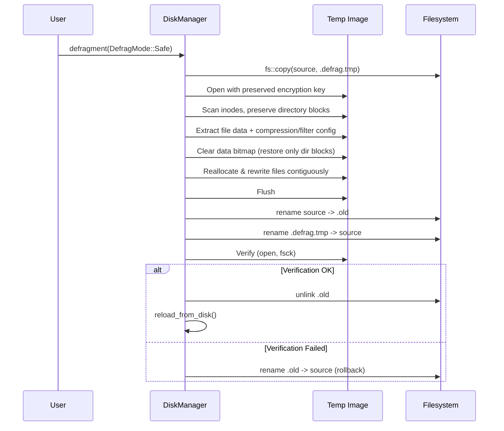

## Responsibility and ownership

Defragmentation and space reorganization logic reside entirely within [`DiskManager`](repo://src/disk.rs). It evaluates disk layout health through [`analyze_fragmentation`](repo://src/disk/maintenance.rs#L137-L166), which measures free-block scattering across physical data space. Defragmentation execution is exposed via [`DiskManager::defragment`](repo://src/disk/maintenance.rs#L460-L480), supporting two operational modes:

- `DefragMode::Safe` (default): An out-of-place reorganization in a temporary image followed by transactional verification and a 3-step atomic rename with rollback.
- `DefragMode::InPlace`: Direct WAL-atomic modification of the existing image using round-based copy-on-write (COW) passes; directories and files are relocated into currently free blocks with metadata updates committed through the journal.

A background [`AutoDefragController`](repo://src/auto_defrag.rs) periodically measures fragmentation and triggers in-place passes when a configurable threshold is exceeded.

## Fragmentation analysis

Before and after defragmentation, [`DiskManager::analyze_fragmentation`](repo://src/disk/maintenance.rs#L137-L166) inspects the filesystem's `data_bitmap_block` using a read-only [`BitmapRef`](repo://src/bitmap.rs).

### 64-bit word scanning

Instead of checking bit by bit, the analyzer slices the bitmap into 8-byte chunks (`chunks_exact(8)`) and decodes them as little-endian 64-bit words via `u64::from_le_bytes` ([`analyze_fragmentation_internal`](repo://src/disk/maintenance.rs#L150-L255)):

- `word == 0`: All 64 data blocks are completely free. If not already tracking a free run, increments `free_runs` and extends `current_run_len` by 64.
- `word == u64::MAX`: All 64 blocks are fully allocated. Closes any open free run, recording `largest_free_run` and accumulating `total_gap_size`.
- Mixed word: Uses `word.count_ones()` to quickly tabulate allocated blocks, then iterates through each bit (`0..64`) with bitwise masks to track individual block boundaries and transitions.
- Trailing bits: Any leftover bits (`total_blocks % 64`) are checked at the end using `bitmap.get(i)` ([`analyze_fragmentation_internal`](repo://src/disk/maintenance.rs#L235-L250)).

### Metrics and fragmentation ratio

The resulting [`FragmentationStats`](repo://src/disk.rs#L160-L177) tracks:
- `total_blocks`, `used_blocks`, `free_blocks`
- `free_runs`: Number of separate contiguous sequences of free blocks
- `largest_free_run`: The size (in blocks) of the largest contiguous free chunk
- `avg_gap_size`: `total_gap_size / free_runs` (average size of free runs)
- `fragmentation_ratio`: Calculated as:

$$\text{fragmentation\_ratio} = \frac{\text{free\_runs} - 1}{\max(\text{free\_blocks} - 1, 1)}$$

If all free space forms a single contiguous run (`free_runs <= 1`), the ratio is `0.0` (optimal). If every free block is completely isolated (`free_runs == free_blocks`), the ratio approaches `1.0` (maximally fragmented).

## Safe defragmentation pipeline (out-of-place rebuild)

[`defragment_safe`](repo://src/disk/maintenance.rs#L484-L640) reorganizes the filesystem out-of-place to protect against crashes, power failures, or corruption. The process executes across six distinct stages:

### 1. Snapshot creation

The entire active image file is copied via `std::fs::copy(source_path, &temp_path)` ([`defragment_safe`](repo://src/disk/maintenance.rs#L498)). The destination defaults to `{source_path}.defrag.tmp` when no output path is provided. This guarantees that if the defragmentation process is killed mid-stream, the original image file remains untouched and uncorrupted.

### 2. Inode scan and metadata preservation

The temporary image is opened via `DiskManager::open_with_key_and_storage_mode(&temp_path, 0, enc_key, storage_mode)` ([`defragment_safe`](repo://src/disk/maintenance.rs#L501)), preserving the encryption key and storage mode from the original image. Using [`BitmapRef::for_each_set_bit`](repo://src/bitmap.rs#L94-L108), all allocated inode indices are collected from `inode_bitmap_block` ([`defragment_safe`](repo://src/disk/maintenance.rs#L507-L512)):

- **Directories**: Directory blocks cannot simply be moved without updating parent pointer graphs, so directory block addresses are harvested via `collect_inode_block_layout` and staged in `directory_blocks` ([`defragment_safe`](repo://src/disk/maintenance.rs#L514-L517)).
- **Regular Files**: For each file with `size > 0` or any allocated blocks, the file's exact compression status (`CompressionMode::Always`, `CompressionMode::Never`, or `CompressionMode::Seekable`) and pre-compression filter configuration ([`FilterConfig`]: `typesize`, `delta`, `shuffle`, `bitshuffle`) are recorded ([`defragment_safe`](repo://src/disk/maintenance.rs#L519-L526)). **Seekable 64K chunked files** are detected by `INODE_FLAG_SEEKABLE_64K` and their `CompressionMode::Seekable` config is preserved.
- **Inode Reset**: The inode on disk is zeroed out (`size = 0`, `compressed_size = 0`, `blocks = [0; 12]`, `triple_indirect = 0`) via `write_inode` ([`defragment_safe`](repo://src/disk/maintenance.rs#L528-L534)), freeing the blocks for contiguous reassignment.

### 3. Bitmap reset

The entire data bitmap of the temporary image is wiped using `bitmap_slice.fill(0)` ([`defragment_safe`](repo://src/disk/maintenance.rs#L537)). Then, only the preserved directory block IDs (`directory_blocks`) are re-marked as allocated ([`defragment_safe`](repo://src/disk/maintenance.rs#L539-L545)). All other data blocks become completely free and unallocated.

### 4. Contiguous file rewrite

Files are streamed **one-by-one** from the original image into the temporary image using `read_data` / `write_data_with_filters` ([`defragment_safe`](repo://src/disk/maintenance.rs#L549-L560)). This bounded-memory approach prevents OOM on large filesystems. Each file receives a fresh contiguous allocation from the allocator's hint-driven `allocate_block` / `allocate_contiguous` path. The compressor and filter pipeline runs identically to a normal write, ensuring bit-identical logical content with physically contiguous blocks.

### 5. Flush and atomic swap

The temporary image is fully flushed (`flush()`). Then a three-step rename executes atomically on POSIX filesystems:

1. `rename(source_path, source_path.old)` — original becomes backup
2. `rename(temp_path, source_path)` — defragged image takes the canonical name
3. Verification: open the new image, run `verify_integrity()` (fsck), then `unlink(.old)` on success; on failure, `rename(.old, source_path)` rolls back.

### 6. Live handle reload

After successful swap, the active `DiskManager` handle calls [`reload_from_disk`](repo://src/disk/maintenance.rs#L255-L300) to re-mmap the new file, re-parse the superblock, and clear all caches (`inode_cache`, `dir_cache`, payload caches) so subsequent operations see the defragmented layout.

## In-place defragmentation (WAL-atomic COW)

[`defragment_inplace_on`](repo://src/disk/maintenance.rs#L707-L812) runs directly on the live image. On journaled images it uses a **round-based copy-on-write (COW) algorithm** ([`defragment_inplace_journaled_cow`](repo://src/disk/maintenance.rs#L1028-L1580)); on non-journaled images it falls back to a **cycle-aware block permutation** ([`defragment_inplace_legacy`](repo://src/disk/maintenance.rs#L819-L1026)). Both paths share the same entry point and produce identical final layouts.

### Shared preparation

1. **Fragmentation baseline**: `analyze_fragmentation_internal` captures `stats_before`.
2. **Short-circuit**: If `free_runs == 1` and the last block is already free (already compacted), returns immediately with zero work.
3. **Inode collection**: All allocated inodes are decoded in one pass without thrashing `inode_cache`. They are partitioned into `dir_inodes`, `file_inodes` (size > 0), and `other_inodes`.
4. **Journal quiesce (journaled only)**: Pending async ranges are drained, dirty pages flushed, and the WAL ring checkpointed to `used() == 0` so the first COW round starts with a clean journal.

### Round-based COW defragmentation (journaled)

Each round copies a batch of relocation units exclusively into **currently free blocks**, flushes the destination payload, commits a single bounded WAL transaction, applies metadata updates via the standard WAL op applier, then checkpoints the WAL before the next round reuses the freed source blocks.

#### Relocation units

A `RelocUnit` represents a contiguous run of blocks that must move together:
- **Regular blocks**: `block_count = 1`, `owner` identifies the pointer slot (direct, SIB, DIB, TIB, or indirect slot).
- **Seekable 64K chunks**: Detected via `INODE_FLAG_SEEKABLE_64K`. The `ChunkEntry` packs `start_block`, `block_count`, `flags`, `compressed_len`. The unit's `block_count` equals the chunk's block count, and `chunk_entry` preserves the packed value so it can be rebased onto the new `target_start` ([`defragment_inplace_journaled_cow`](repo://src/disk/maintenance.rs#L1035-L1200)).

#### Target assignment

Targets are assigned sequentially from `data_block_start`:
- Directory blocks first (payloads then indirect blocks)
- Regular file blocks next (payloads including ChunkEntry runs, then indirect blocks)
- `next_target` advances by `block_count` per unit. The `old_to_new` map records every old→new block mapping.

#### Round selection and WAL budgeting

The worker iterates `pending` units and selects those whose `target_start..target_start+count` are **currently free** in an in-memory bitmap mirror (`alloc_bm_bytes`). Each candidate's estimated WAL payload is accumulated (`est_tx_bytes`); the round stops when adding another unit would exceed half the journal ring (`max_payload_per_tx = (ring_bytes - 128) / 2`).

If **no unit fits** (all targets occupied by other pending units — a cycle), the smallest pending unit is moved to a free **scratch run** found by scanning the bitmap from high addresses downward (`find_free_run_high_to_low`). This breaks the cycle and guarantees progress.

#### Payload copy and flush

For each unit in the round, `copy_block` copies `block_count` blocks from `curr_start` to the selected destination. In `DurabilityMode::Strict`, each destination range is explicitly `flush_range`d before the WAL commit.

#### WAL transaction assembly

Metadata operations are staged into `wal_ops` without modifying live state:
- **Pointer updates**: For inode direct/SIB/DIB/TIB slots, the modified inode is tracked in `touched_inodes` and a `WriteInode` op is emitted at commit time. For indirect slots, a `WriteBlockSlice` op targets the specific 8-byte slot in the indirect block.
- **Bitmap updates**: `SetDataBitmapRange { start, count, allocated: true }` for destinations; `allocated: false` for sources.
- **Indirect block relocation**: When an indirect block itself moves, its new address is recorded in `round_ind_new_block` so child slots reference the correct parent.

The ops are coalesced (`coalesce_ops`) and committed via `commit_journal_tx`. Then `apply_journal_ops` applies them to live metadata, `inode_cache` is updated, and the in-memory bitmap mirror (`alloc_bm_bytes`) is updated to reflect the new allocation state.

#### Checkpoint and next round

`DurabilityMode` dictates which metadata ranges are synced (`sync_mutation_ranges`). The WAL ring is checkpointed (`ring.checkpoint(); ring.persist()`) so the next round starts with a clean journal. Freed source blocks are now available for future rounds. The loop repeats until `pending` is empty.

### Legacy non-journaled defragmentation

[`defragment_inplace_legacy`](repo://src/disk/maintenance.rs#L819-L1026) builds the same `old_to_new` map and then performs a **cycle-aware block permutation** directly on the backing storage:

1. Identify blocks that need to move (`src != dst`).
2. Maintain `occupied` (source blocks) and `incoming` (destination → source) maps.
3. While moves remain:
   - If a source block's destination is free, copy directly and propagate the newly freed source.
   - Otherwise, pick a cycle leader, read its payload into a scratch buffer, rotate the cycle by copying each predecessor into its successor's slot, then write the scratch buffer into the final slot.
4. Update all inode pointers (direct, SIB, DIB, TIB) via `lookup_new` (which also checks `old_entry_to_new` for rebased `ChunkEntry` values).
5. Update indirect block pointer tables in-place.
6. Rebuild the data bitmap as a single contiguous prefix via `bitmap.set_range(0, total_used)`.

This path has no journal safety net; a crash mid-permutation can leave the image inconsistent. It is therefore only used on non-journaled images.

## Seekable 64K chunked files and `ChunkEntry` handling

Seekable files (`INODE_FLAG_SEEKABLE_64K`) store each 64 KiB chunk as a packed `ChunkEntry` (32-bit `start_block`, 20-bit `block_count`, flags, compressed length) in the inode's pointer slots instead of raw block IDs. Both defragmentation paths handle them specially:

- **Collection**: `collect_inode_block_layout` expands each `ChunkEntry` into its constituent block run so the allocator sees the true physical extent ([`maintenance.rs#L301-L360`](repo://src/disk/maintenance.rs#L301-L360)).
- **Target assignment**: The entire run is assigned a new contiguous `target_start` of equal length. The `old_to_new` map is populated for every block in the run.
- **Rebase**: In the COW path, `RelocUnit.chunk_entry` holds the original packed value. At commit time, a new `ChunkEntry` is constructed with `new_start_block = target_start` and identical `block_count`, `flags`, `compressed_len` ([`maintenance.rs#L1501-L1520`](repo://src/disk/maintenance.rs#L1501-L1520)). In the legacy path, `old_entry_to_new` maps the old packed value to the new packed value so inode pointer updates rewrite the slot correctly.
- **Verification**: `defrag_seekable_chunk_test.rs` confirms both safe and in-place modes preserve seekable file content and chunk structure.

## Auto-defragmentation coordinator

The background coordinator ([`AutoDefragController`](repo://src/auto_defrag.rs)) runs a daemon thread that periodically evaluates fragmentation and triggers in-place defragmentation when warranted.

### Configuration (`AutoDefragConfig`)

| Field | Default | Purpose |
|-------|---------|---------|
| `enabled` | `false` | Master switch; `set_auto_defrag` starts/stops the worker. |
| `fragmentation_threshold` | `0.25` | Trigger ratio. NaN is replaced by default; clamped to `[0.0, 1.0]`. |
| `check_interval` | `300s` | Period between measurements. Raised to `10ms` minimum (`MIN_CHECK_INTERVAL`) to prevent hot loops. |
| `min_free_blocks` | `0` | Pass skipped if free blocks < this value (avoids stalling on near-full images). |
| `allow_journaled` | `true` | If `false`, skips passes on WAL-enabled images. |

Configuration is **sanitized** on install: NaN threshold → default, threshold clamped, interval raised ([`AutoDefragConfig::sanitized`](repo://src/auto_defrag.rs#L104-L118)).

### Worker loop (`run_worker`)

1. Read sanitized config; exit if `!enabled`.
2. Wait on `Condvar` with timeout = `check_interval`. Wake on config change or shutdown.
3. Upgrade `Weak<InnerLock>`; exit if manager dropped.
4. Call `run_once`:
   - Measure fragmentation via `DiskManager::analyze_fragmentation_on`.
   - Record `checks++` and `last_fragmentation_ratio`.
   - Evaluate skip reasons (`skip_reason`):
     - Ratio below threshold → "fragmentation X below threshold Y"
     - Free blocks < `min_free_blocks` → "only N free blocks, minimum is M"
     - Journaled && `!allow_journaled` → "image is WAL-enabled; in-place defragmentation was disabled"
   - If not skipped, call `DiskManager::defragment_inplace_on` (WAL-atomic COW on journaled images).
   - On success: `passes++`, store `last_pass` stats, clear `last_error`.
   - On error: `errors++`, store `last_error`.

### Statistics (`AutoDefragStats`)

- `checks`, `passes`, `skipped`, `errors`
- `last_fragmentation_ratio`
- `last_pass: Option<DefragStats>`
- `last_error: Option<String>` (skip reason or failure message)

### Integration with `DiskManager`

- `DiskManager::set_auto_defrag(config)` installs sanitized config and wakes worker.
- `DiskManager::auto_defrag_config()` / `auto_defrag_stats()` / `stop_auto_defrag()` expose control.
- Worker holds only `Weak<InnerLock>` — when the last `DiskManager` clone drops, the upgrade fails and the thread exits cleanly (`shutdown()`).

## Cross-image CoW extent migration (Reflink tier)

While defragmentation itself rewrites blocks within a single image, the **transfer/splice subsystem** ([`src/disk/transfer.rs`](repo://src/disk/transfer.rs)) provides a 3-tier **zero-copy CoW extent cloning** pipeline used by `transfer_file_to`, `splice_range_to`, and `clone_image`:

1. **Tier 1 — Reflink** (`TransferMethod::Reflink`): Linux `ioctl(FICLONERANGE)` clones extents between two `.img` files on Btrfs, XFS (`reflink=1`), bcachefs, NFSv4.2, Lustre Lreflink. Zero-copy, zero-space, CoW semantics.
2. **Tier 2 — CopyFileRange** (`TransferMethod::CopyFileRange`): Linux `copy_file_range(2)` copies data in-kernel without userspace bounce buffers (ext4, cross-OST Lustre).
3. **Tier 3 — RawBlockCopy** (`TransferMethod::RawBlockCopy`): Portable `pread`/`pwrite` of raw compressed extents, skipping Zstd decompression, inverse SIMD filters, and re-compression.

**Encryption boundary**: If either source or destination image is encrypted (independent Argon2id salts, inode-bound AEAD AAD), the pipeline forces `TransferMethod::LogicalReencode` (decrypt + re-encrypt) because raw extents are bound to the source inode's encryption context.

**Negative device-pair cache**: `FICLONERANGE` returning `EOPNOTSUPP`, `ENOTTY`, `EXDEV`, `ENOSYS` caches the `(src_dev, dst_dev)` pair so subsequent extents skip the failing ioctl immediately. Transient `EINVAL`/`EPERM`/`ETXTBSY` falls back per-extent without poisoning the cache.

**Splice partition (Head/Body/Tail)**: `plan_splice_partition` aligns sub-range copies to 4 KiB (uncompressed) or 64 KiB (seekable) boundaries. The aligned `Body` uses the 3-tier fast path; unaligned `Head`/`Tail` use logical read-modify-write. `shift_table_collapse` and `punch_table_slot` implement `CollapseRange` / `PunchHole` trim modes by shifting logical pointer/chunk tables left and freeing removed extents.

**Relevance to defragmentation**: Although the in-place defragmenter copies blocks via `copy_block` (not reflink), the same `ChunkEntry` rebase logic, logical run coalescing (`coalesce_logical_runs`), and indirect block pointer rewriting are shared. A future optimization could use `FICLONERANGE` to clone a file's extents into a temporary image during safe defrag, but the current bounded-memory stream-rewrite is simpler and works on all storage backends.

## Configuration and operational behavior

### Threshold guidance

- **0.10–0.15**: Aggressive; keeps free space highly contiguous, good for seekable 64K workloads that depend on large free runs for `allocate_contiguous`.
- **0.25 (default)**: Balanced; triggers before fragmentation significantly impacts allocation latency.
- **0.40+**: Conservative; only defragments when free space is severely scattered.

### Scheduling considerations

- The worker takes the **inner write lock** for the entire pass, serializing against all metadata mutations exactly like any writer.
- On journaled images, each round commits a WAL transaction; the pass duration scales with `used_blocks` but is broken into bounded transactions.
- `min_free_blocks` should be set to at least the size of the largest file expected to be written contiguously (e.g., `16384` for 64 MiB files at 4 KiB blocks).

### Read-only and safe-mode interaction

- `DefragMode::Safe` is rejected on read-only mounts (returns `ReadOnly` error).
- Auto-defrag is **automatically disabled** on read-only mounts; `set_auto_defrag` returns an error if called on a read-only handle.
- Safe defragmentation preserves the encryption key and storage mode (`FileIo` vs `Mmap`) so the reloaded handle matches the original configuration.

## Invariants and failure semantics

| Invariant | Enforced by |
|-----------|-------------|
| Original image unmodified until atomic rename succeeds | `defragment_safe` copies to temp first; rollback on any failure |
| Journaled in-place defrag never loses data on crash | WAL orders payload copies before metadata commits; checkpoint retires each round |
| Seekable `ChunkEntry` runs stay contiguous | `allocate_contiguous` for new runs; `RelocUnit.block_count` moves whole run atomically |
| Auto-defrag never keeps a `DiskManager` alive | Worker holds `Weak<InnerLock>`; exits on upgrade failure |
| No hot loop regardless of config | `MIN_CHECK_INTERVAL = 10ms` enforced in `sanitized()` |
| `NaN` threshold never reaches worker | Replaced by `DEFAULT_FRAGMENTATION_THRESHOLD` in `sanitized()` |

### Failure modes

- **Safe defrag**: Any I/O error, verification failure, or rename error triggers rollback (`.old` → original). The active handle is **not** reloaded.
- **In-place COW**: A crash mid-round leaves the WAL with a committed transaction for that round only. On replay, the round's metadata updates are reapplied (idempotent) and the next round starts from the new state. Freed source blocks from completed rounds are already reflected in the bitmap.
- **Legacy in-place**: A crash mid-permutation can leave the image inconsistent. Only used on non-journaled images where the administrator accepts this risk.
- **Auto-defrag**: Errors increment `errors` and store `last_error`; the worker continues on the next tick.

## Extension points

- **Custom `DefragMode`**: Add a third mode (e.g., `TieredReflink`) by extending the enum and dispatch in `defragment`.
- **Fragmentation metric plugins**: `analyze_fragmentation_internal` is a pure function of `BitmapRef`; alternative metrics (e.g., file-level fragmentation) can be implemented alongside.
- **Auto-defrag policy hooks**: `skip_reason` is a pure function; additional gating logic (time-of-day, I/O load, SMART health) can be composed before calling `defragment_inplace_on`.
- **Cross-image defrag**: `transfer.rs` pipeline could be used to defragment by cloning extents into a fresh image, then atomic-swap — an alternative to the current stream-rewrite safe path.

## Related architecture

- [Block & Inode Allocation](block_allocation.md) — contiguous allocation, `ChunkEntry`, bitmap scanning, `AllocSim` for WAL.
- [Disk Manager and Persistence](disk_manager_and_persistence.md) — `DiskManagerInner`, `InnerLock`, durability modes, journaling.
- [Defragmentation Workflow](../workflows/defragmentation_workflow.md) — step-by-step operational guide with CLI and programmatic examples.
