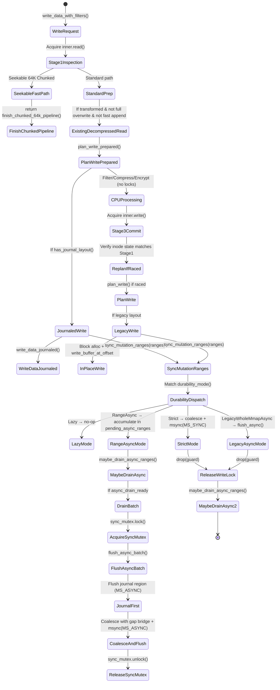

# DiskManager & Persistence

[`DiskManager`](../../src/disk.rs#L324-L327) is the central coordinator of the OIFS storage engine. It provides the single authoritative interface between raw on-disk bytes and high-level filesystem operations (file and directory creation, reads, writes, deletion, path resolution, defragmentation, and integrity checks).

## DiskManagerInner State

Internally, state is maintained by `DiskManagerInner` ([`src/disk.rs#L191-L213`](../../src/disk.rs#L191-L213)), wrapped in an `Arc<RwLock<DiskManagerInner>>` ([`src/disk.rs#L324-L327`](../../src/disk.rs#L324-L327)):

- **`file`**: The underlying host image file handle with an exclusive POSIX advisory lock (`F_SETLK`).
- **`mmap`**: The mutable memory-mapped view (`MmapMut`) spanning the entire filesystem image.
- **`superblock`**: In-memory cached copy of the deserialized `SuperBlock` ([`src/superblock.rs`](../../src/superblock.rs)).
- **`encryption_key`**: Derived cryptographic key (`Option<EncryptionKey>`) used for authenticated AEAD encryption.
- **`free_block_hint`** and **`free_inode_hint`**: Allocation watermarks that convert sequential bitmap scans into amortized $O(1)$ operations.
- **`inode_cache`**: In-memory zero-copy cache (`RwLock<BoundedInodeCache>`) avoiding redundant bincode deserialization.
- **`dir_cache`**: Sharded per-directory name index (`ShardedDirCache`) providing $O(1)$ path queries.
- **`chunk_read_cache`**: `RwLock<ChunkReadCache>` — bounded sub-chunk decompression cache for seekable 64K `read_at`.
- **`decoded_blob_cache`**: `Mutex<DecodedBlobCache>` — bounded decoded-payload cache for non-seekable `read_at` (compressed/encrypted files ≤ 16 MiB).
- **`durability_mode`**: `AtomicU8` durability policy governing `msync` flush behavior on writes.
- **`pending_async_ranges`**: `Mutex<PendingAsyncRanges>` — batched dirty-range accumulator for `DurabilityMode::RangeAsync`.
- **`async_drain_ready`**: `Arc<AtomicBool>` — fast atomic flag set when `pending_async_ranges` reaches its drain threshold.
- **`io_engine`**: Pluggable data-block read engine supporting `Mmap`, `Pread`, and Linux `io_uring` backends.

## Lifecycle, Image Locking, and Initialization

`DiskManager` instances are constructed via `DiskManager::open` ([`src/disk.rs#L331-L333`](../../src/disk.rs#L331-L333)), `open_with_password` ([`src/disk.rs#L336-L342`](../../src/disk.rs#L336-L342)), or `create_encrypted` ([`src/disk.rs#L345-L351`](../../src/disk.rs#L345-L351)), all delegating to the unified `init_or_open_with_key` routine ([`src/disk.rs#L1142-L1341`](../../src/disk.rs#L1142-L1341)):

1. **File Opening and Locking**: Opens the image with read/write permissions. Immediately attempts an exclusive whole-file advisory lock using `libc::F_SETLK` ([`src/disk.rs#L1283-L1302`](../../src/disk.rs#L1283-L1302)). This prevents independent host processes from concurrently accessing the same raw image without going through the Master-Proxy IPC protocol.
2. **Sizing and Memory Mapping**: New images are sized to `total_size` via `file.set_len(total_size)`. The full image is mapped into process address space using `MmapOptions::new().map_mut(&file)` ([`src/disk.rs#L1159`](../../src/disk.rs#L1159)).
3. **Superblock Verification**:
   - For new files: Constructs a fresh `SuperBlock`, configures encryption salt/flags if requested, writes the serialized block to offset 0, and initializes root directory inode 0 ([`src/disk.rs#L1162-L1192`](../../src/disk.rs#L1162-L1192), [`src/disk.rs#L1310-L1331`](../../src/disk.rs#L1310-L1331)).
   - For existing files: Reads and deserializes `SuperBlock` from block 0. Verifies magic bytes (`OIFS`) against `SuperBlock::MAGIC` ([`src/disk.rs#L1194-L1215`](../../src/disk.rs#L1194-L1215)).
4. **Key Derivation**: If `superblock.encrypted` is true, derives the 256-bit AEAD key using Argon2id with `superblock.encryption_salt` ([`src/disk.rs#L1197-L1210`](../../src/disk.rs#L1197-L1210)).
5. **Journal Handling**: For journaled images, formats journal if new or recovers journal if existing before publishing the manager ([`src/disk.rs#L1212-L1230`](../../src/disk.rs#L1212-L1230)).

## Concurrency Model: Reader-Writer Lock

`DiskManager` wraps its inner state in `Arc<RwLock<DiskManagerInner>>` ([`src/disk.rs#L324-L327`](../../src/disk.rs#L324-L327)). This enables high-concurrency workloads:

- **Parallel Read Path**: All read-only methods (`read_data`, `read_at`, `read_at_batch`, `lookup`, `list_dir`, `resolve_path`, `analyze_fragmentation`, and `verify_integrity`) acquire shared `.read()` locks. Arbitrary numbers of threads can read files and traverse directories concurrently without contention.
- **Exclusive Write Path**: Mutating methods (`write_data_with_filters`, `create_file`, `create_directory`, `delete_file`, and `flush`) acquire exclusive `.write()` locks, ensuring ACID isolation for block allocation, inode updates, and directory modifications.

## Pluggable Payload Read Engines and Vector Reads

`DiskManager` decouples file payload block reads from the memory map via [`src/io_engine.rs`](../../src/io_engine.rs):

- **Backend Selection**: `dm.set_io_backend(backend)` ([`src/disk.rs#L538-L543`](../../src/disk.rs#L538-L543)) allows applications to switch between `IoBackend::Mmap` (default), `IoBackend::Pread`, and `IoBackend::IoUring` at runtime.
- **Positional Reads (`read_at`)**: `DiskManager::read_at` ([`src/disk.rs#L1355-L1378`](../../src/disk.rs#L1355-L1378)) directly copies bytes from mmap blocks without heap allocation under `IoBackend::Mmap` for raw files. Under `Pread` and `IoUring`, it coalesces contiguous blocks via `ExtentList` and executes one syscall or one ring submission.
- **Batched Concurrent Reads (`read_at_batch`)**: `DiskManager::read_at_batch` ([`src/disk.rs#L1395-L1465`](../../src/disk.rs#L1395-L1465)) processes multiple `ReadRequest` entries under a single read-lock acquisition, submitting all extents simultaneously to the underlying `IoEngine` to maximize storage queue depth.

## The Read Pipeline and Decryption/Decompression

Complete file reads via `read_data_internal` ([`src/disk.rs#L3329-L3478`](../../src/disk.rs#L3329-L3478)) execute in two phases:

1. **Physical Block Assembly**: `walk_payload_blocks` ([`src/disk.rs#L1070-L1226`](../../src/disk.rs#L1070-L1226)) traverses direct (0..10), single indirect (10..522), double indirect (522..262666), and triple indirect tiers, skipping sparse zero sub-trees lazily. Payload blocks are fetched via `memcpy` or `io_engine.read`.
2. **Reverse Pipeline Execution** ([`src/disk.rs#L3368-L3477`](../../src/disk.rs#L3368-L3477)):
   - **Decryption**: If `inode.encrypted`, decrypts with XChaCha20-Poly1305 using `guard.encryption_key` and `inode.encryption_nonce`.
   - **Decompression**: If `inode.compressed_size > 0`, decompresses with `zstd::stream::decode_all` (supporting multi-frame streams).
   - **Filter Unapplication**: If pre-compression filters are active, reverses transformations via `unapply_filters`.

## The Write Pipeline (`write_data_with_filters`)

File mutation via `write_data_with_filters` ([`src/disk.rs#L4432-L4723`](../../src/disk.rs#L4432-L4723)) uses a three-stage approach to minimize lock contention, with an initial fast path for Seekable 64K Chunked compression:

1. **Seekable 64K Chunked Fast Path**: Checks for and handles Seekable 64K Chunked compression early, returning immediately if applicable ([`src/disk.rs#L4452-L4475`](../../src/disk.rs#L4452-L4475)).
2. **Out-of-Lock Preparation** (shared read lock): Inspects inode state, reads existing data if needed, and prepares a write plan via `plan_write_prepared` ([`src/disk.rs#L881-L999`](../../src/disk.rs#L881-L999)).
3. **CPU-Bound Processing**: Performs filtering, compression, and encryption outside any filesystem lock.
4. **Exclusive Lock Acquisition & Commit**: Acquires exclusive write lock only to verify preconditions, potentially replan via `plan_write` ([`src/disk.rs#L948-L986`](../../src/disk.rs#L948-L986)) if raced, then commit the transaction.

The write plan (from `plan_write_prepared` or `plan_write`) selects among four cases:

1. **FullOverwrite**: Offset-0 rewrite that runs the full filter-compression-encryption staging when rewriting the entire file.
2. **CompressedAppend**: Fast Zstd multi-frame append at EOF for eligible compressed, unencrypted, unfiltered files.
3. **Recompress**: Read-modify-recompress fallback for compressed files when the fast path is unavailable (random writes, encrypted files, or active filters).
4. **Raw**: Direct block writes for uncompressed files, either extending or overwriting in place.

### Payload Cache Invalidation on Every Mutation

Every mutating operation that changes file payload **must** invalidate both payload caches to prevent stale reads:

- `invalidate_payload_caches(inode_id)` ([`src/disk.rs#L656-L661`](../../src/disk.rs#L656-L661)) invalidates both `chunk_read_cache` (seekable 64K chunk cache) and `decoded_blob_cache` (non-seekable decoded-payload cache) for the given inode.
- Called in `write_inode_internal` ([`src/disk.rs#L4856`](../../src/disk.rs#L4856)), `delete_file` ([`src/disk.rs#L2241`](../../src/disk.rs#L2241)), and chunked write paths ([`src/disk/chunked.rs#L1538`](../../src/disk/chunked.rs#L1538), [`src/disk/chunked.rs#L1899`](../../src/disk/chunked.rs#L1899)).

## Durability Policies and Flush Behavior

OIFS provides configurable durability policies through the `DurabilityMode` enum ([`src/disk.rs#L118-L141`](../../src/disk.rs#L118-L141)), balancing machine power-loss resilience against bulk write throughput:

| Mode | Value | Behavior |
|------|-------|----------|
| **`Lazy`** (default) | 0 | Mutations update the shared mmap and OS page cache without issuing per-mutation `msync` syscalls. Changes are immediately visible to all processes and survive process crashes/panics. Persistence across sudden machine power loss is guaranteed on explicit `flush()`, upon `Drop`, or via periodic OS kernel writeback. Delivers up to ~45x faster write throughput in bulk operations. |
| **`RangeAsync`** | 1 | Asynchronously flushes only the modified byte ranges via `msync(MS_ASYNC)` on each mutation, scheduling dirty pages for early writeback without scanning the entire virtual memory address space. |
| **`Strict`** | 2 | Synchronously flushes modified byte ranges via `msync(MS_SYNC)` on every mutation. Guarantees physical media persistence before mutating functions return. |
| **`LegacyWholeMmapAsync`** | 3 | Asynchronously flushes the entire virtual memory map after every mutation (legacy whole-mapping flush behavior). |

Mutating operations (`create_entry_internal`, `write_data_with_filters`, `delete_file`) compute modified ranges and invoke `sync_mutation_ranges` ([`src/disk.rs#L570-L686`](../../src/disk.rs#L570-L686)). The `Drop` implementation for `DiskManagerInner` ([`src/disk.rs#L688-L702`](../../src/disk.rs#L688-L702)) executes a two-phase flush:

1. **Journal region first** (if present): `mmap.flush_range(journal_start, journal_len)` to ensure WAL-before-metadata ordering.
2. **Full mmap**: `mmap.flush()` for any remaining dirty pages.

Explicit synchronous flushing is exposed via `DiskManager::flush` ([`src/disk.rs#L2090-L2093`](../../src/disk.rs#L2090-L2093)).

### DurabilityMode Formal Verification

`DurabilityMode` is a four-valued enum with companion Kani proofs ([`src/disk.rs#L6492-L6509`](../../src/disk.rs#L6492-L6509)):
- `proof_durability_mode_from_u8_soundness`: Guarantees lossless enum round-tripping from `u8`.
- `proof_durability_mode_is_range_based_consistency`: Guarantees consistent `is_range_based()` semantics.

## RangeAsync Deferred Coalescing

Under `DurabilityMode::RangeAsync`, dirty ranges are accumulated in `pending_async_ranges` and drained in coalesced batches **outside** `inner.write()`, eliminating per-op `msync(MS_ASYNC)` syscall overhead while holding the exclusive write lock.

### Batch Thresholds

- **`RANGE_ASYNC_BATCH_OPS = 64`** ([`src/disk.rs#L498`](../../src/disk.rs#L498)): Number of `RangeAsync` mutations buffered before an asynchronous `msync(MS_ASYNC)` batch drain.
- **`RANGE_ASYNC_BATCH_BYTES = 4 MiB`** ([`src/disk.rs#L499`](../../src/disk.rs#L499)): Dirty byte span buffered before an asynchronous batch drain.
- **`RANGE_ASYNC_FALLBACK_INLINE_OPS = 256`** ([`src/disk.rs#L500`](../../src/disk.rs#L500)): Safety cap that forces an inline drain if internal callers bypass public `DiskManager` wrappers.

### Gap Bridging

- **`RANGE_ASYNC_GAP_BRIDGE_BYTES = 1 MiB`** ([`src/disk.rs#L409`](../../src/disk.rs#L409)): Maximum clean-page gap bridged when coalescing ranges for `RangeAsync`. Bridging nearby ranges within 1 MB collapses metadata (`inode_bitmap`, `data_bitmap`, `inode_table`) and nearby data blocks into a single `msync(MS_ASYNC)` syscall per transaction; the OS pager skips clean pages in the bridged gap.
- **`STRICT_GAP_BRIDGE_BYTES = 256 KiB`** ([`src/disk.rs#L417`](../../src/disk.rs#L417)): Maximum clean-page gap bridged when coalescing metadata ranges under `Strict`. Bridges across the 132 KiB journal region between the bitmaps (blocks 1..2) and the low inode table blocks (block 35+), collapsing separate bitmap and inode `msync(MS_SYNC)` syscalls into a single VM call.

### Coalescing Logic

`coalesce_ranges_with_gap` ([`src/disk.rs#L428-L478`](../../src/disk.rs#L428-L478)) performs three steps:
1. Clamp to `mmap_len` and expand to page/block boundaries (`BLOCK_SIZE = 4096`).
2. Sort by start offset.
3. Merge overlapping and contiguous intervals, additionally bridging gaps ≤ `max_gap`.

### Drain Mechanics

- `sync_mutation_ranges` accumulates ranges under `pending_async_ranges` mutex. When thresholds are reached, it sets `async_drain_ready = true` (or takes an inline batch if fallback triggered).
- `maybe_drain_async_ranges` ([`src/disk.rs#L1545-L1550`](../../src/disk.rs#L1545-L1550)) checks the atomic flag after dropping the write lock.
- `drain_pending_async_ranges` ([`src/disk.rs#L1552-L1563`](../../src/disk.rs#L1552-L1563)) acquires `sync_mutex` (serializing `msync` across threads), takes the batch, and calls `flush_async_batch`.
- `flush_async_batch` ([`src/disk.rs#L502-L521`](../../src/disk.rs#L502-L521)) first flushes the journal region (if present), then coalesces with `RANGE_ASYNC_GAP_BRIDGE_BYTES` and issues `msync(MS_ASYNC)` per coalesced range.

## sync_mutex: Serializing msync

`DiskManager` holds an `Arc<Mutex<()>> sync_mutex` ([`src/disk.rs#L327`](../../src/disk.rs#L327)) that serializes all `msync` operations. `drain_pending_async_ranges` acquires it before calling `flush_async_batch`, ensuring concurrent async drains from multiple threads do not issue overlapping `msync` calls.

## Write Path State Diagram

## Inode Caching

`DiskManagerInner` maintains an in-memory inode cache (`RwLock<BoundedInodeCache>`) that:
- Serves as a fast path for `read_inode_internal` hits, avoiding bincode deserialization.
- Is populated on cache misses during inode reads ([`src/disk.rs#L4880-L4881`](../../src/disk.rs#L4880-L4881)).
- Is updated whenever inodes are modified via `write_inode_internal` ([`src/disk.rs#L4855`](../../src/disk.rs#L4855)).
- Does not require explicit invalidation on file deletion; cache entries for deleted inodes are naturally overwritten when those inode IDs are reused for new files.
