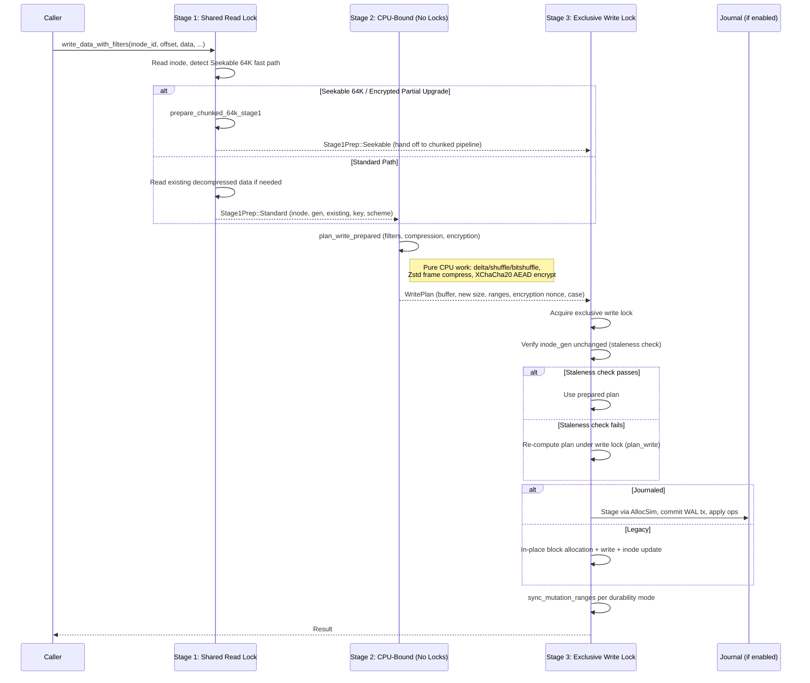

# DiskManager & Persistence

[`DiskManager`](../../src/disk.rs#L324-L327) is the central coordinator of the OIFS storage engine. It provides the single authoritative interface between raw on-disk bytes and high-level filesystem operations (file and directory creation, reads, writes, deletion, path resolution, defragmentation, and integrity checks).

## DiskManagerInner State

Internally, state is maintained by `DiskManagerInner` ([`src/disk.rs#L191-L213`](../../src/disk.rs#L191-L213)), wrapped in an `Arc<RwLock<DiskManagerInner>>` ([`src/disk.rs#L324-L327`](../../src/disk.rs#L324-L327)):

- **`file`**: The underlying host image file handle with an exclusive POSIX advisory lock (`F_SETLK` for read-write, `F_RDLCK` for read-only).
- **`backing`**: The active storage engine (`ImageBacking`) supporting `Mmap` (shared `PROT_READ|PROT_WRITE`), `MmapReadOnly` (shared `PROT_READ`), `Pread`, and `IoUring` backends.
- **`superblock`**: In-memory cached copy of the deserialized `SuperBlock` ([`src/superblock.rs`](../../src/superblock.rs)).
- **`encryption_key`**: Derived cryptographic key (`Option<EncryptionKey>`) used for authenticated AEAD encryption.
- **`password_verifier`**: Keyed BLAKE2b verifier of the mount password for session re-authentication.
- **`free_block_hint`** and **`free_inode_hint`**: Allocation watermarks that convert sequential bitmap scans into amortized $O(1)$ operations.
- **`inode_cache`**: In-memory zero-copy cache (`RwLock<BoundedInodeCache>`) avoiding redundant bincode deserialization.
- **`dir_cache`**: Sharded per-directory name index (`ShardedDirCache`) providing $O(1)$ path queries.
- **`chunk_read_cache`**: `RwLock<ChunkReadCache>` — bounded sub-chunk decompression cache for seekable 64K `read_at`.
- **`decoded_blob_cache`**: `Mutex<DecodedBlobCache>` — bounded decoded-payload cache for non-seekable `read_at` (compressed/encrypted files ≤ 16 MiB).
- **`durability_mode`**: `AtomicU8` durability policy governing `msync` flush behavior on writes.
- **`pending_async_ranges`**: `Mutex<PendingAsyncRanges>` — batched dirty-range accumulator for `DurabilityMode::RangeAsync`.
- **`async_drain_ready`**: `Arc<AtomicBool>` — fast atomic flag set when `pending_async_ranges` reaches its drain threshold.
- **`io_engine`**: Pluggable data-block read engine supporting `Mmap`, `Pread`, and Linux `io_uring` backends.
- **`inode_write_gen`**: Per-inode write generation counters (indexed by `inode_id & 4095`) for lock-free Stage-1 → Stage-3 staleness detection.
- **`read_only`**: `bool` — strictly read-only mount (`F_RDLCK`, zero disk writes).

## Architecture Overview

<!-- openwiki: mermaid parse failed and this diagram was converted to a text fence so it does not break rendering. Fix the diagram source and restore the mermaid fence. Parser error: Parse error on line 4: ...ync_mutex[Arc<Mutex<()>>] async_ Expecting 'SQE', 'DOUBLECIRCLEEND', 'PE', '-)', 'STADIUMEND', 'SUBROUTINEEND', 'PIPE', 'CYLINDEREND', 'DIAMOND_STOP', 'TAGEND', 'TRAPEND', 'INVTRAPEND', 'UNICODE_TEXT', 'TEXT', 'TAGSTART', got 'PS' -->
```text
flowchart TB
    subgraph DM[DiskManager]
        inner[Arc<RwLock<DiskManagerInner>>]
        sync_mutex[Arc<Mutex<()>>]
        async_drain[Arc<AtomicBool>]
        auto_defrag[AutoDefragController]
    end

    subgraph Inner[DiskManagerInner]
        file[(File Handle)]
        backing[ImageBacking]
        sb[SuperBlock]
        enc_key[EncryptionKey?]
        pwd_verifier[PasswordVerifier?]
        free_blk_hint[u64]
        free_ino_hint[u64]
        inode_cache[BoundedInodeCache]
        dir_cache[ShardedDirCache]
        chunk_cache[ChunkReadCache]
        blob_cache[DecodedBlobCache]
        durability[AtomicU8]
        pending_ranges[PendingAsyncRanges]
        async_drain_ready[Arc<AtomicBool>]
        io_engine[IoEngine]
        inode_write_gen[Box<[u64;4096]>]
        read_only[bool]
    end

    subgraph IO[Pluggable I/O Engines]
        mmap[Mmap]
        pread[Pread]
        iouring[IoUring]
    end

    inner --> Inner
    Inner --> file
    Inner --> backing
    Inner --> sb
    Inner --> enc_key
    Inner --> pwd_verifier
    Inner --> free_blk_hint
    Inner --> free_ino_hint
    Inner --> inode_cache
    Inner --> dir_cache
    Inner --> chunk_cache
    Inner --> blob_cache
    Inner --> durability
    Inner --> pending_ranges
    Inner --> async_drain_ready
    Inner --> io_engine
    Inner --> inode_write_gen
    Inner --> read_only

    io_engine --> mmap
    io_engine --> pread
    io_engine --> iouring

    sync_mutex -.->|serializes msync| Inner
    async_drain -.->|signals drain| pending_ranges
```

## Lifecycle, Image Locking, and Initialization

`DiskManager` instances are constructed via factory methods that all delegate to the unified `init_or_open_with_key` routine ([`src/disk.rs#L1475-L1550`](../../src/disk.rs#L1475-L1550)):


### Read-Write Mount (`new`, `open`, `open_with_password`)

1. Open the image file with `O_RDWR|O_CREAT` (no `O_TRUNC` before locking).
2. Acquire an **exclusive non-blocking advisory lock** (`fcntl(F_SETLK, F_WRLCK)` on the whole file). This prevents concurrent read-write mounts and read-only mounts.
3. If the file is new/empty/truncated, create a fresh `SuperBlock` (journaled or legacy layout), generate encryption salt/key if requested, serialize and write block 0.
4. If the file exists, read and validate the superblock (magic, bounds, geometry).
5. Load bitmap mirrors and journal mirrors for `FileIo` mode.
6. **Mount-time journal recovery**: On journaled images, replay all durable-but-unapplied transactions from the WAL ring **before** the manager is published. This ensures no caller ever observes a filesystem mid-replay.
7. If newly created, allocate root inode (0) and root data block; write root inode; flush.
8. If existing, mark journal clean (write a clean-shutdown marker) for fast future mounts.

### Read-Only Mount (`open_read_only*`)

1. Open the image file with `O_RDONLY` (succeeds on `0444` files).
2. Acquire a **shared non-blocking advisory lock** (`fcntl(F_SETLK, F_RDLCK)`). Multiple read-only processes can coexist; a read-write mount (`F_WRLCK`) is rejected.
3. Map the image `PROT_READ` (`MmapReadOnly` backing) — full zero-copy read support.
4. Read and validate superblock; derive encryption key if encrypted.
5. **Journal cleanliness check**: Verify with **zero disk writes** that the WAL ring contains `0` unrecovered transactions. If `pending_txs > 0`, reject the mount and instruct the user to open read-write first to recover.
6. Initialize inner state with `read_only = true`; `Drop` performs **no flushes**.

### Locking Guarantees

| Mount Type | File Mode | Advisory Lock | Allows Concurrent | Blocks |
|------------|-----------|---------------|-------------------|--------|
| Read-Write | `O_RDWR`  | `F_WRLCK` (exclusive) | — | All other mounts |
| Read-Only  | `O_RDONLY`| `F_RDLCK` (shared)    | Other read-only   | Read-write |

The lock is held for the lifetime of the `DiskManager` and released on `Drop`.

## Durability Modes

`DurabilityMode` ([`src/disk.rs#L210-L232`](../../src/disk.rs#L210-L232)) controls when and how `msync` is called on the backing memory map. Shared memory mappings (`MAP_SHARED`) write directly to the OS page cache, ensuring modifications survive application process crashes (e.g. `SIGKILL`). Policies balance power-loss resilience against write throughput.

<!-- openwiki: mermaid parse failed and this diagram was converted to a text fence so it does not break rendering. Fix the diagram source and restore the mermaid fence. Parser error: Parse error on line 13: ...ck] R1[msync(MS_ASYNC) on modifi Expecting 'SQE', 'DOUBLECIRCLEEND', 'PE', '-)', 'STADIUMEND', 'SUBROUTINEEND', 'PIPE', 'CYLINDEREND', 'DIAMOND_STOP', 'TAGEND', 'TRAPEND', 'INVTRAPEND', 'UNICODE_TEXT', 'TEXT', 'TAGSTART', got 'PS' -->
```text
flowchart TD
    subgraph Modes[DurabilityMode enum]
        Lazy[Lazy = 0<br/>default]
        RangeAsync[RangeAsync = 1]
        Strict[Strict = 2]
        Legacy[LegacyWholeMmapAsync = 3]
    end

    subgraph Behavior[Flush Behavior]
        L1[No per-mutation msync]
        L2[Survives process crash]
        L3[Power-loss: explicit flush/Drop/OS writeback]
        R1[msync(MS_ASYNC) on modified byte ranges]
        R2[Batched outside write lock]
        R3[Coalesced with 1 MB gap bridging]
        S1[msync(MS_SYNC) on modified byte ranges]
        S2[Synchronous; data on physical media before return]
        S3[Coalesced with 256 KB gap bridging]
        W1[msync(MS_ASYNC) on ENTIRE mmap]
        W2[Legacy whole-mapping flush]
    end

    Lazy --> L1
    Lazy --> L2
    Lazy --> L3
    RangeAsync --> R1
    RangeAsync --> R2
    RangeAsync --> R3
    Strict --> S1
    Strict --> S2
    Strict --> S3
    Legacy --> W1
    Legacy --> W2
```

### Detailed Semantics

| Mode | Value | Per-Mutation Flush | Syscall | Scope | Ordering Guarantees |
|------|-------|-------------------|---------|-------|---------------------|
| **Lazy** | 0 (default) | None | — | — | Process-crash safe (page cache). Power-loss safe only on explicit `flush()`, `Drop`, or kernel writeback. Up to ~45× faster bulk write throughput. |
| **RangeAsync** | 1 | Async | `msync(MS_ASYNC)` | Modified byte ranges only, coalesced, 1 MB gap bridging | Accumulated in `pending_async_ranges`, drained in batches (64 ops / 4 MiB / 256 ranges) **outside** the exclusive write lock via background thread or inline fallback. Journal region flushed first to preserve WAL-before-metadata ordering. |
| **Strict** | 2 | Sync | `msync(MS_SYNC)` | Modified byte ranges only, coalesced, 256 KB gap bridging | Data reaches physical storage before the mutating function returns. Under **Group Commit** (`DeferStrictSyncGuard`), per-op sync barriers are deferred; the batch drainer issues one flush per involved `DiskManager` after applying all ops in memory. |
| **LegacyWholeMmapAsync** | 3 | Async | `msync(MS_ASYNC)` | Entire virtual memory map | Legacy behavior; kept for compatibility. |

### RangeAsync Batching

- `RANGE_ASYNC_BATCH_OPS = 64` — drain after 64 mutations.
- `RANGE_ASYNC_BATCH_BYTES = 4 MiB` — drain after 4 MiB of dirty data.
- `RANGE_ASYNC_FALLBACK_INLINE_OPS = 256` — safety cap; forces inline drain if internal callers bypass public wrappers.
- `async_drain_ready` (atomic flag) signals the caller to invoke `drain_pending_async_ranges()` (done automatically at the end of public mutating APIs via `maybe_drain_async_ranges()`).
- Coalescing expands ranges to page/block boundaries (4 KiB), sorts, merges overlapping/contiguous, and bridges gaps ≤ 1 MiB.

### Strict Mode Group Commit

When multiple `Strict` mutations are submitted concurrently via `submit_group_write_op()` ([`src/disk.rs#L9323-L9440`](../../src/disk.rs#L9323-L9440)):

1. A dedicated **group-commit worker thread** (`oifs-group-commit`) collects up to 128 operations into a batch.
2. Enters `DeferStrictSyncGuard` (thread-local flag) which causes `is_strict_sync_deferred()` to return `true`, suppressing per-op `msync(MS_SYNC)` inside `sync_mutation_ranges()`.
3. Executes all operations in memory (under each operation's exclusive write lock).
4. After the batch, **deduplicates** `DiskManager` instances by `Arc` pointer and issues **one `flush()` per unique `DiskManager`**.
5. Notifies each caller's completion callback with the result (or flush error).

This amortizes the `msync(MS_SYNC)` syscall across many operations while preserving per-operation durability semantics.

### Kani-Verified Invariants

The durability enum has machine-checked proofs ([`src/disk.rs#L9888-L9910`](../../src/disk.rs#L9888-L9910)):

- `proof_durability_mode_from_u8_soundness`: lossless round-tripping for all `u8` inputs.
- `proof_durability_mode_is_range_based_consistency`: `is_range_based()` is `true` iff `RangeAsync` or `Strict`.

## Write Path: `write_data_with_filters`

The write path uses a **three-stage design** to minimize exclusive lock hold time ([`src/disk.rs#L5879-L6107`](../../src/disk.rs#L5879-L6107)):



### Stage 1 — Shared Read Lock (`inner.read()`)

- Reads the inode and determines the compression/encryption path.
- **Seekable 64K fast path**: If `INODE_FLAG_SEEKABLE_64K` is set or `CompressionMode::Seekable` is requested, or if a non-zero-offset write on an encrypted Format-v2+ file without filters triggers **encrypted partial upgrade** (transparent upgrade to 64 KiB context-bound AEAD chunks), the method delegates to `finish_chunked_64k_pipeline` and returns early.
- Otherwise, captures `initial_inode`, `initial_gen` (from `inode_write_gen`), existing decompressed data (if transformed payload requires read-modify-recompress), encryption key, and encryption scheme. The shared lock is **dropped immediately** after this snapshot.

### Stage 2 — CPU-Bound Processing (Zero Filesystem Locks)

- `plan_write_prepared` executes the full filter→compress→encrypt pipeline on the caller's thread:
  - **Filters**: Delta, Shuffle, Bitshuffle (typesize-aware).
  - **Compression**: Zstd frame (pooled `CCtx` to avoid per-call allocation). Modes: `Always`, `Never`, `Auto` (≥ 8 KiB), `Stream` (explicit level), `Seekable` (64 KiB independent chunks).
  - **Encryption**: XChaCha20-Poly1305 AEAD in-place (nonce generated, AAD bound to `inode_id` and encryption scheme version).
- Produces a `WritePlan` enum with four cases:
  - **FullOverwrite**: Offset 0 rewrite with full filter-compression-encryption pipeline.
  - **CompressedAppend**: Fast Zstd frame append at EOF for eligible compressed files (unencrypted, no filters, appending at EOF).
  - **Recompress**: Read-modify-recompress for compressed files when fast path unavailable.
  - **Raw**: Direct block writes for uncompressed files.

### Stage 3 — Exclusive Lock Acquisition & Commit

- Acquires `inner.write()`.
- Verifies inode still allocated and `inode_gen(inode_id) == initial_gen` (lock-free staleness detection).
- If generation matches, uses the prepared plan; otherwise re-computes under the write lock via `plan_write`.
- **Journaled images**: Stages through `AllocSim`, commits a single CRC32C WAL transaction (`commit_journal_tx` + `apply_journal_ops`), updates hints.
- **Legacy images**: In-place block allocation, payload write, inode update.
- Calls `sync_mutation_ranges` per durability mode; drains `RangeAsync` batch via `maybe_drain_async_ranges`.

### Atomic Rename

`DiskManager::rename` ([`src/disk.rs#L7532-L7930`](../../src/disk.rs#L7532-L7930)) provides POSIX atomic rename with crash safety:

- **Metadata-only**: Never reads, decrypts, re-compresses, or copies file payload blocks. On encrypted images, only the directory entry's SIV-encrypted filename is recomputed for the new parent (payload AEAD is bound to `inode_id`).
- **POSIX overwrite semantics**: Atomic replacement of regular files (target blocks/inode freed), empty directories (removed), mismatch errors (`Is a directory` / `Not a directory`), cycle prevention (moving a directory into itself or descendants rejected).
- **Crash safety**: On journaled images, the entire rename (source unlink, optional target overwrite + block/inode release, destination link, parent inode updates) is committed in a **single atomic CRC32C WAL transaction**.
- Implementation stages post-images of modified directory blocks in a `BTreeMap`, builds journal ops for block writes, inode updates, and bitmap frees, then commits and applies atomically.

## Asynchronous I/O: `OifsAsyncTask` Inline Fast-Path

`OifsAsyncTask<T>` ([`src/disk.rs#L9049-L9210`](../../src/disk.rs#L9049-L9210)) is a lightweight future that implements `std::future::Future` for zero-dependency `.await` in any Rust async runtime, while also supporting synchronous polling (`is_ready`, `try_take`) and blocking wait (`wait`).

### Inline Fast-Path (~50 ns)

Hot cache-hit and `Mmap` reads complete **without spawning or waking background threads**:

<!-- openwiki: mermaid parse failed and this diagram was converted to a text fence so it does not break rendering. Fix the diagram source and restore the mermaid fence. Parser error: Parse error on line 3: ...Guard[inner.try_read()?] Guard -> C Expecting 'SQE', 'DOUBLECIRCLEEND', 'PE', '-)', 'STADIUMEND', 'SUBROUTINEEND', 'PIPE', 'CYLINDEREND', 'DIAMOND_STOP', 'TAGEND', 'TRAPEND', 'INVTRAPEND', 'UNICODE_TEXT', 'TEXT', 'TAGSTART', got 'PS' -->
```text
flowchart TD
    Caller[Caller] --> TryRead[try_read_at_inline_into / try_read_at_inline_vec]
    TryRead --> Guard[inner.try_read()?]
    Guard --> CacheHit{Cache Hit?}
    CacheHit -->|Mmap Raw| MmapCopy[memcpy from mmap slice]
    CacheHit -->|FileIo DataPageCache| PageCacheCopy[copy from page cache]
    CacheHit -->|ChunkReadCache| ChunkCopy[decompressed chunk slice]
    CacheHit -->|DecodedBlobCache| BlobCopy[decoded payload slice]
    CacheHit -->|Miss| None[Return None]
    MmapCopy --> Ready[OifsAsyncTask::ready(Ok(n))]
    PageCacheCopy --> Ready
    ChunkCopy --> Ready
    BlobCopy --> Ready
    None --> Spawn[OifsAsyncTask::spawn(background read)]
```

- `try_read_at_inline_into` probes caches under a non-blocking `try_read()` guard:
  1. **Seekable 64K**: Single-chunk `ChunkReadCache` hit.
  2. **Compressed/Encrypted/Filtered**: `DecodedBlobCache` hit.
  3. **Raw uncompressed/unencrypted**: `Mmap` direct slice or `FileIo` `DataPageCache` hit via `try_read_data_cached_only`.
- On hit, returns `Some(Ok(bytes))` immediately; caller wraps in `OifsAsyncTask::ready`.
- On miss, returns `None`; caller falls back to `OifsAsyncTask::spawn` which submits to a persistent async read/compute thread pool (2–8 workers, `oifs-async-N`).

### Background Pool

- `submit_async_job` enqueues work to a global `AsyncPoolQueue` with a condition variable.
- Workers are spawned once on first use; pool size = `available_parallelism().clamp(2, 8)`.
- `OifsAsyncTask::wait()` blocks synchronously; `poll()` enables async `.await`.

## Journaling and Recovery

The metadata WAL (Write-Ahead Logging) subsystem ([`src/journal.rs`](../../src/journal.rs)) provides crash-safe metadata mutations:

- **Geometry**: Journaled images reserve blocks 3–35 for journal (1 header + 32 ring blocks = 132 KiB). Inode table starts at block 36 (vs. block 3 for non-journaled).
- **Idempotent redo**: Every `MetadataOp` is a post-image write or absolute bit set (never incremental). Replaying any number of times yields the same state.
- **Torn-write detection**: Each frame carries CRC32C (Castagnoli) over header+payload + trailing commit marker (`0xDEAD_BEEF`). Partially written frames fail verification and are discarded.
- **Mount-time recovery**: `recover_journal` replays all durable-but-unapplied transactions **before** the `DiskManager` is published. Zero callers observe mid-replay state.
- **Clean-shutdown marker**: On clean unmount, a marker is written so next mount can distinguish clean vs. crashed without a ring scan.
- **Read-only mount verification**: `is_journal_clean_read_only` checks `pending_txs == 0` with zero disk writes.

## Flush and Drop Semantics

- `DiskManager::flush()`: Explicit synchronous flush of all dirty data (journal region first, then backing).
- `Drop`:
  - **Read-write**: Flushes journal region (if journaled) then backing.
  - **Read-only**: **Zero disk writes** (`should_sync_on_drop` returns `(false, false)`).
- `set_durability_mode`: Switching away from `RangeAsync` drains pending async ranges immediately.

## Configuration & Operations

### Durability Mode API

```rust
dm.durability_mode()            // Get current mode
dm.set_durability_mode(Strict)  // Set mode (drains RangeAsync if leaving it)
dm.with_durability_mode(Strict) // Builder pattern
```

### Read-Only Detection

```rust
dm.is_read_only()  // bool
```

### Storage Mode

```rust
dm.storage_mode()              // StorageMode::Mmap or FileIo
dm.set_file_io_cache_bytes(n)  // User-space page cache budget (FileIo only)
dm.file_io_cache_bytes()       // Configured capacity
dm.file_io_cache_used_bytes()  // Current usage
```

## Invariants & Failure Modes

| Invariant | Enforcement |
|-----------|-------------|
| Exclusive access per image | POSIX advisory lock (`F_SETLK`/`F_RDLCK`) held for `DiskManager` lifetime |
| No mutation on read-only | `read_only` flag checked at start of every mutating public API; returns `DiskManagerError::ReadOnly` |
| Journal replay before publish | `recover_journal` called in `init_or_open_with_key` before returning `DiskManager` |
| Read-only rejects dirty journal | `validate_read_only_journal_state` rejects `pending_txs > 0` |
| WAL-before-metadata ordering | `flush_async_batch` flushes journal region first; Group Commit deduplicates Strict flushes |
| Inode generation staleness detection | `inode_write_gen` per-slot counter; Stage 1 captures `initial_gen`, Stage 3 verifies before commit |
| Crash-safe format migration | `migration_cursor` records progress; readers decode per-slot version; `checkpoint_journal` precedes rewrite |
| Atomic rename on journaled images | Single WAL transaction commits source unlink, target overwrite, dest link, parent updates |

## Extension Points

- **Pluggable I/O backends**: `IoEngine` with `Mmap`, `Pread`, `IoUring` (selected via `OIFS_IO_BACKEND` env var or `StorageMode`).
- **Compression modes**: `CompressionMode` enum with `Auto`, `Always`, `Never`, `Stream`, `Seekable`.
- **Filters**: `FilterConfig` (delta, shuffle, bitshuffle, typesize) applied pre-compression.
- **Encryption**: XChaCha20-Poly1305 AEAD with Argon2id key derivation; scheme versioning (`ENCRYPTION_SCHEME_CONTEXT_BOUND`).
- **Async read pool**: Global `submit_async_job` for CPU-bound decompression/decryption offload.
- **Group commit**: `submit_group_write_op` for batched Strict-mode sync amortization.

## Focused Tests

- **Kani proofs** (`src/disk.rs` verification module):
  - `proof_durability_mode_from_u8_soundness`
  - `proof_durability_mode_is_range_based_consistency`
  - `proof_get_block_checked_arithmetic_prevents_wrap_around`
  - `proof_inode_byte_range_checked_bounds`
  - `proof_write_from_start_size_invariant`
  - `proof_read_only_mount_drop_and_open_mode_invariants`
  - `proof_read_only_storage_access_invariants`
- **Journal recovery tests**: Corrupt frame detection, torn write simulation, clean vs. crashed mount discrimination.
- **Read-only mount tests**: `0444` file open, shared lock concurrency, dirty journal rejection.
- **Durability mode tests**: `RangeAsync` batch coalescing, `Strict` group commit deduplication, `Lazy` no-flush behavior.
- **Rename tests**: Overwrite semantics, cycle prevention, journaled atomicity, encrypted filename recomputation.
- **Write path tests**: Seekable 64K fast path, compressed append, recompress fallback, filter-compress-encrypt pipeline.
