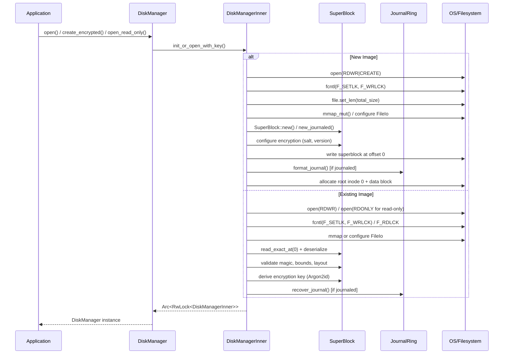
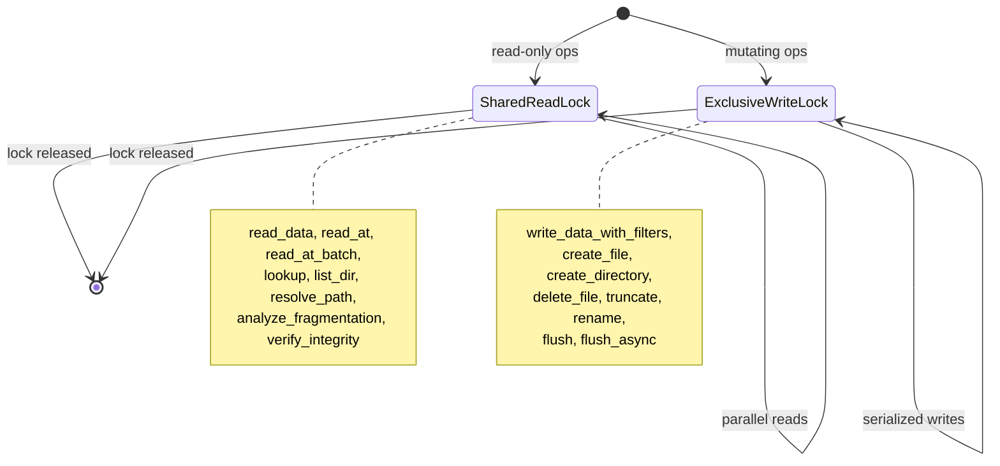
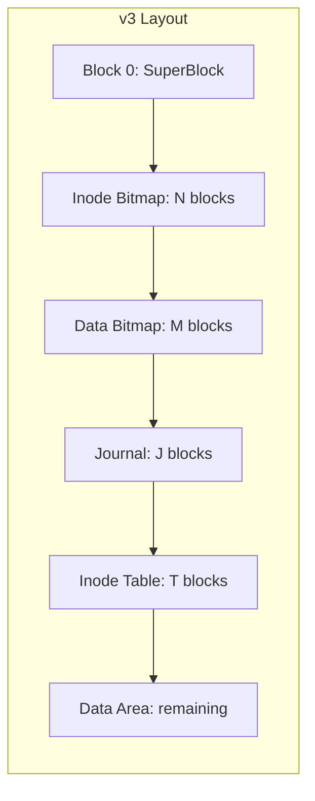
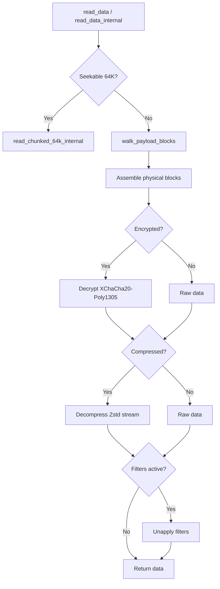
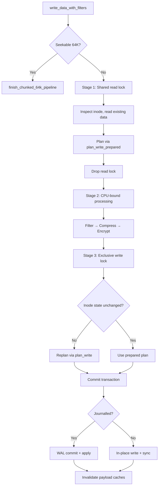
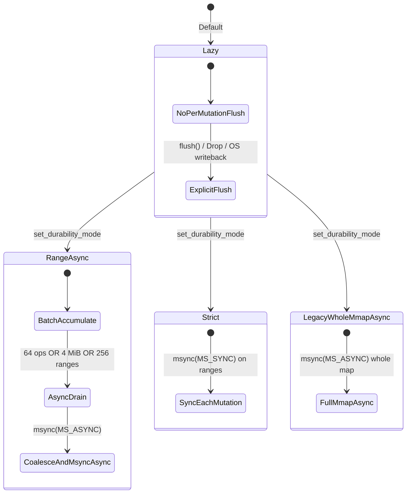
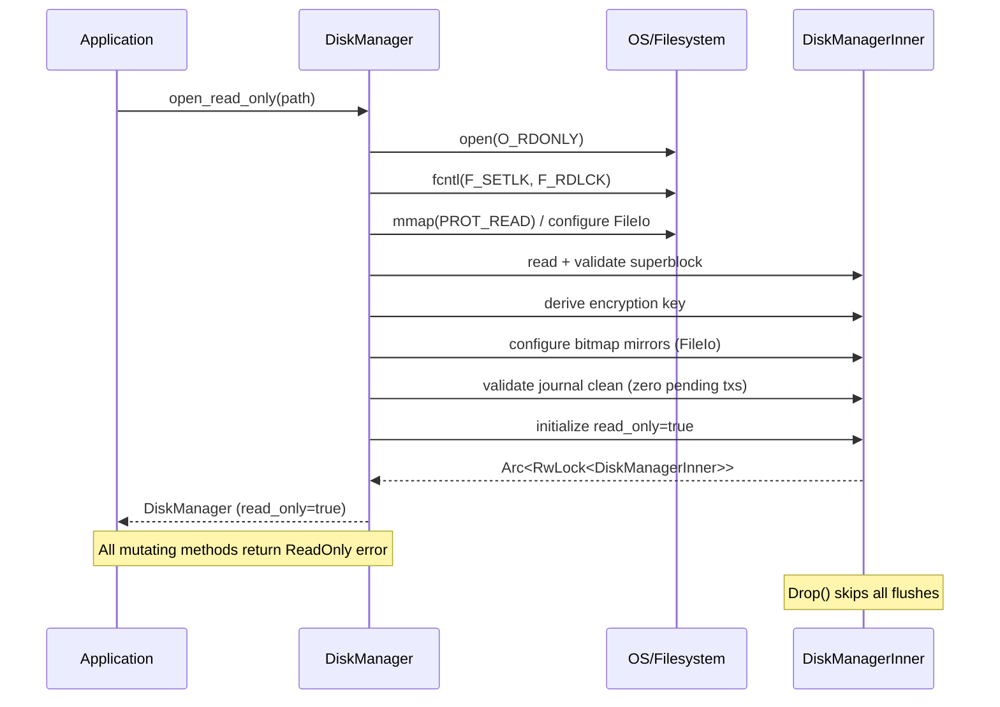
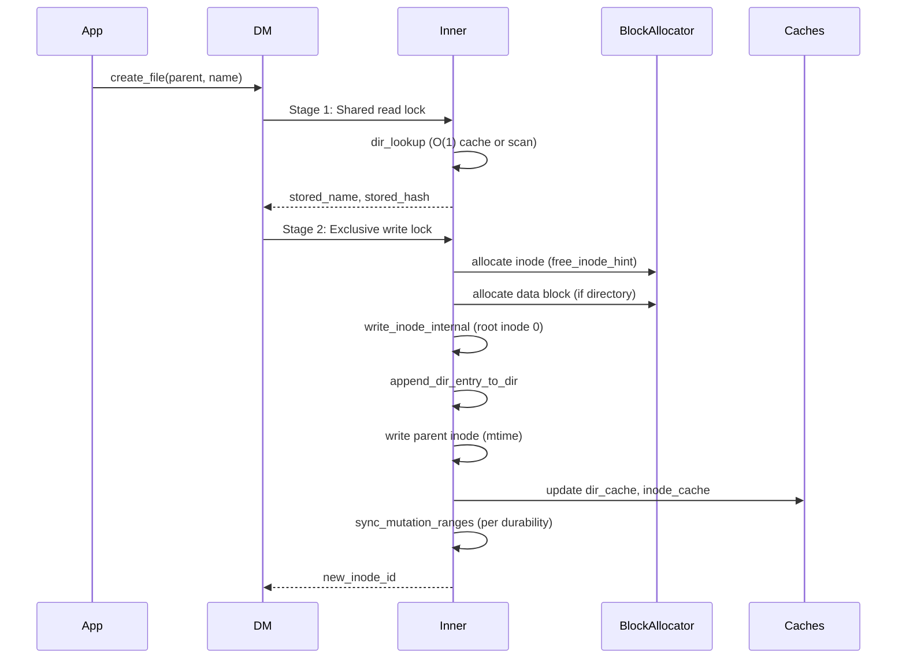
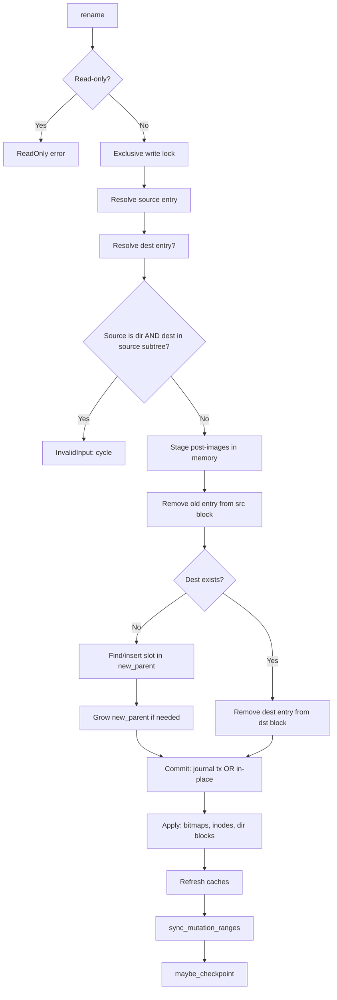
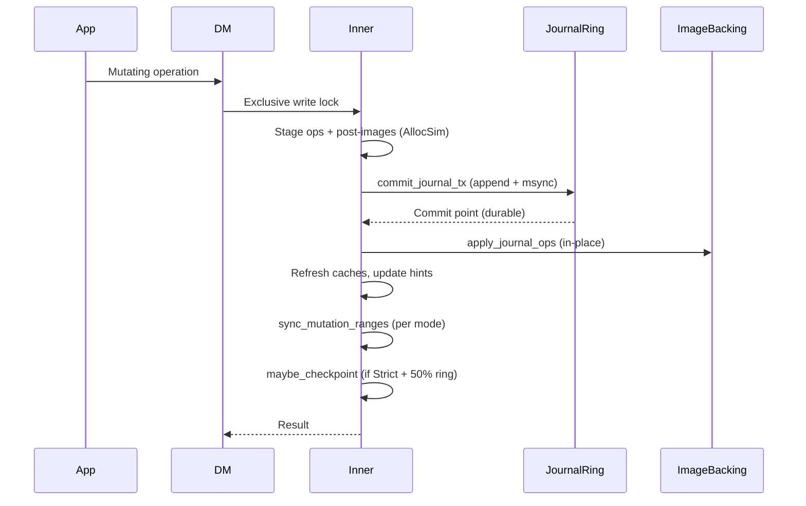

# DiskManager & Persistence

[`DiskManager`](../../src/disk.rs#L324-L327) is the central coordinator of the OIFS storage engine. It provides the single authoritative interface between raw on-disk bytes and high-level filesystem operations (file and directory creation, reads, writes, deletion, path resolution, defragmentation, and integrity checks).

## DiskManagerInner State

Internally, state is maintained by `DiskManagerInner` ([`src/disk.rs#L191-L213`](../../src/disk.rs#L191-L213)), wrapped in an `Arc<RwLock<DiskManagerInner>>` ([`src/disk.rs#L324-L327`](../../src/disk.rs#L324-L327)):

- **`file`**: The underlying host image file handle with an exclusive POSIX advisory lock (`F_SETLK`).
- **`mmap`**: The mutable memory-mapped view (`MmapMut`) spanning the entire filesystem image.
- **`superblock`**: In-memory cached copy of the deserialized `SuperBlock` ([`src/superblock.rs`](../../src/superblock.rs)).
- **`encryption_key`**: Derived cryptographic key (`Option<EncryptionKey>`) used for authenticated AEAD encryption.
- **`free_block_hint`** and **`free_inode_hint`**: Allocation watermarks that convert sequential bitmap scans into amortized $O(1)$ operations.
- **`inode_cache`**: In-memory zero-copy cache (`RwLock<BoundedInodeCache>`) avoiding redundant bincode deserialization.
- **`dir_cache`**: Sharded per-directory name index (`ShardedDirCache`) providing $O(1)$ path queries.
- **`chunk_read_cache`**: `RwLock<ChunkReadCache>` — bounded sub-chunk decompression cache for seekable 64K `read_at`.
- **`decoded_blob_cache`**: `Mutex<DecodedBlobCache>` — bounded decoded-payload cache for non-seekable `read_at` (compressed/encrypted files ≤ 16 MiB).
- **`durability_mode`**: `AtomicU8` durability policy governing `msync` flush behavior on writes.
- **`pending_async_ranges`**: `Mutex<PendingAsyncRanges>` — batched dirty-range accumulator for `DurabilityMode::RangeAsync`.
- **`async_drain_ready`**: `Arc<AtomicBool>` — fast atomic flag set when `pending_async_ranges` reaches its drain threshold.
- **`io_engine`**: Pluggable data-block read engine supporting `Mmap`, `Pread`, and Linux `io_uring` backends.

## Architecture Overview

<!-- openwiki: mermaid parse failed and this diagram was converted to a text fence so it does not break rendering. Fix the diagram source and restore the mermaid fence. Parser error: Parse error on line 4: ...ync_mutex[Arc<Mutex<()>>] async_ Expecting 'SQE', 'DOUBLECIRCLEEND', 'PE', '-)', 'STADIUMEND', 'SUBROUTINEEND', 'PIPE', 'CYLINDEREND', 'DIAMOND_STOP', 'TAGEND', 'TRAPEND', 'INVTRAPEND', 'UNICODE_TEXT', 'TEXT', 'TAGSTART', got 'PS' -->
```text
flowchart TB
    subgraph DM[DiskManager]
        inner[Arc<RwLock<DiskManagerInner>>]
        sync_mutex[Arc<Mutex<()>>]
        async_drain[Arc<AtomicBool>]
        auto_defrag[AutoDefragController]
    end

    subgraph Inner[DiskManagerInner]
        file[(File Handle)]
        backing[ImageBacking]
        sb[SuperBlock]
        enc_key[EncryptionKey?]
        free_blk_hint[u64]
        free_ino_hint[u64]
        inode_cache[BoundedInodeCache]
        dir_cache[ShardedDirCache]
        chunk_cache[ChunkReadCache]
        blob_cache[DecodedBlobCache]
        durability[AtomicU8]
        pending_ranges[PendingAsyncRanges]
        io_engine[IoEngine]
        read_only[bool]
    end

    subgraph IO[Pluggable I/O Engines]
        mmap[Mmap]
        pread[Pread]
        iouring[IoUring]
    end

    inner --> Inner
    Inner --> file
    Inner --> backing
    Inner --> sb
    Inner --> enc_key
    Inner --> free_blk_hint
    Inner --> free_ino_hint
    Inner --> inode_cache
    Inner --> dir_cache
    Inner --> chunk_cache
    Inner --> blob_cache
    Inner --> durability
    Inner --> pending_ranges
    Inner --> io_engine
    Inner --> read_only

    io_engine --> mmap
    io_engine --> pread
    io_engine --> iouring

    sync_mutex -.->|serializes msync| Inner
    async_drain -.->|signals drain| pending_ranges
```

## Lifecycle, Image Locking, and Initialization

`DiskManager` instances are constructed via factory methods that all delegate to the unified `init_or_open_with_key` routine ([`src/disk.rs#L1142-L1341`](../../src/disk.rs#L1142-L1341)):



### Factory Methods

| Method | Use Case | Lock | Storage Mode |
|--------|----------|------|--------------|
| `open(path, size)` | Open existing or create new | `F_WRLCK` | Default (Mmap) |
| `open_with_password(path, size, pwd)` | Encrypted open/create | `F_WRLCK` | Default |
| `create_encrypted(path, size, pwd)` | New encrypted FS | `F_WRLCK` | Default |
| `open_read_only(path)` | Read-only mount | `F_RDLCK` | Default |
| `open_read_only_with_password(path, pwd)` | Encrypted read-only | `F_RDLCK` | Default |
| `open_journaled(path, size)` | Journaled open/create | `F_WRLCK` | Default |
| `open_file_io(path, size)` | Zero-mmap (pread/pwrite) | `F_WRLCK` | `FileIo` |
| `open_with_key(path, size, key)` | Pre-derived key | `F_WRLCK` | Default |

**Exclusive lock (`F_WRLCK`)**: Prevents concurrent read-write access to the same image. Acquired via non-blocking `fcntl(F_SETLK)` ([`src/disk.rs#L1597-L1624`](../../src/disk.rs#L1597-L1624)).

**Shared lock (`F_RDLCK`)**: Read-only mounts acquire a shared advisory lock allowing multiple concurrent readers while rejecting writers ([`src/disk.rs#L1626-L1655`](../../src/disk.rs#L1626-L1655)).

## Concurrency Model



`DiskManager` wraps `DiskManagerInner` in `Arc<RwLock<DiskManagerInner>>` ([`src/disk.rs#L324-L327`](../../src/disk.rs#L324-L327)):
- **Parallel Read Path**: All read-only methods acquire shared `.read()` locks. Arbitrary threads read files and traverse directories concurrently.
- **Exclusive Write Path**: Mutating methods acquire exclusive `.write()` locks, ensuring ACID isolation for block allocation, inode updates, and directory modifications.

## Pluggable Payload Read Engines and Vector Reads

`DiskManager` decouples file payload block reads from the memory map via [`src/io_engine.rs`](../../src/io_engine.rs):

- **Backend Selection**: `dm.set_io_backend(backend)` ([`src/disk.rs#L538-L543`](../../src/disk.rs#L538-L543)) switches between `IoBackend::Mmap` (default), `IoBackend::Pread`, and `IoBackend::IoUring` at runtime.
- **Positional Reads (`read_at`)**: Directly copies bytes from mmap blocks without heap allocation under `IoBackend::Mmap` for raw files. Under `Pread`/`IoUring`, coalesces contiguous blocks via `ExtentList` and executes one syscall or one ring submission ([`src/disk.rs#L1355-L1378`](../../src/disk.rs#L1355-L1378)).
- **Batched Concurrent Reads (`read_at_batch`)**: Processes multiple `ReadRequest` entries under a single read-lock acquisition, submitting all extents simultaneously to the underlying `IoEngine` to maximize storage queue depth ([`src/disk.rs#L1395-L1465`](../../src/disk.rs#L1395-L1465)).

## Superblock Management and Layout Geometry

The `SuperBlock` ([`src/superblock.rs`](../../src/superblock.rs)) is the first block (block 0) and defines the filesystem layout:



### Layout Calculation

For v3 layout (`SuperBlock::new_v3`) ([`src/superblock.rs#L135-L195`](../../src/superblock.rs#L135-L195)):
- **Inode table**: Fixed at up to 1024 blocks (16,384 inodes at 256 bytes/slot)
- **Inode bitmap**: Covers all inodes in the table (`ceil(inode_count / 32768)` blocks)
- **Journal**: 33 blocks reserved when `journaled=true` ([`src/journal.rs`](../../src/journal.rs))
- **Data bitmap**: Covers remaining data blocks (`ceil(data_blocks / 32768)` blocks)
- **Data area**: Starts at `inode_table_block + inode_table_blocks`

### Format Versioning and Migration

- **v1 (legacy)**: Packed bincode inode records
- **v2 (fixed)**: 256-byte fixed-width slots with explicit little-endian fields ([`src/inode_format.rs`](../../src/inode_format.rs))
- **Migration**: `migration_cursor` tracks progress; slots below cursor use v2, above use v1 ([`src/superblock.rs#L45-L68`](../../src/superblock.rs#L45-L68))

## Read Pipeline

Complete file reads via `read_data_internal` ([`src/disk.rs#L3329-L3478`](../../src/disk.rs#L3329-L3478)) execute in two phases:



### Physical Block Assembly

`walk_payload_blocks` ([`src/disk.rs#L3058-L3544`](../../src/disk.rs#L3058-L3544)) traverses:
1. **Direct blocks** (indices 0..9)
2. **Single indirect** (index 10 → 512 pointers)
3. **Double indirect** (index 11 → 512×512 pointers)
4. **Triple indirect** (`triple_indirect` → 512×512×512 pointers)

Sparse holes (zero pointers at any level) are skipped lazily. Payload blocks are fetched via `memcpy` (mmap) or `io_engine.read`.

### Reverse Pipeline Execution

1. **Decryption**: XChaCha20-Poly1305 with `encryption_key` + `inode.encryption_nonce` + AAD bound to `inode_id`
2. **Decompression**: `zstd::stream::decode_all` (handles concatenated multi-frame streams)
3. **Filter unapplication**: Delta, shuffle, bitshuffle reversal ([`src/filters.rs`](../../src/filters.rs))

## Write Pipeline

File mutation via `write_data_with_filters` ([`src/disk.rs#L4432-L4723`](../../src/disk.rs#L4432-L4723)) uses a three-stage approach:



### Write Plan Cases

The plan (from `plan_write_prepared` or `plan_write`) selects among four cases ([`src/disk.rs#L881-L999`](../../src/disk.rs#L881-L999)):

| Case | Trigger | Behavior |
|------|---------|----------|
| **FullOverwrite** | `file_offset == 0` and (new data ≥ old size OR transformed payload) | Full filter-compression-encryption pipeline from offset 0 |
| **CompressedAppend** | Append at EOF to unencrypted, unfiltered compressed file | Fast Zstd multi-frame append (no recompression) |
| **Recompress** | Random write to compressed/encrypted/filtered file | Read-modify-recompress entire file |
| **Raw** | Uncompressed file | Direct block writes (extend or overwrite) |

### Payload Cache Invalidation

Every mutating operation that changes file payload **must** invalidate both caches to prevent stale reads:

```rust
fn invalidate_payload_caches(&mut self, inode_id: u64) {
    self.chunk_read_cache.invalidate_inode(inode_id);
    self.decoded_blob_cache.invalidate_inode(inode_id);
}
```

Called in `write_inode_internal`, `delete_file`, and chunked write paths ([`src/disk.rs#L656-L661`](../../src/disk.rs#L656-L661), [`src/disk.rs#L4856`](../../src/disk.rs#L4856), [`src/disk/chunked.rs`](../../src/disk/chunked.rs)).

## Durability Policies and Flush Behavior

OIFS provides configurable durability via `DurabilityMode` ([`src/disk.rs#L118-L141`](../../src/disk.rs#L118-L141)):



### Detailed Behavior

| Mode | `msync` Behavior | Use Case |
|------|------------------|----------|
| **Lazy (default)** | No per-mutation flush. Changes visible to processes, survive process crash. Persistence on explicit `flush()`, `Drop`, or OS writeback. | Bulk throughput (~45× faster) |
| **RangeAsync** | Accumulates dirty ranges, drains coalesced batches via `msync(MS_ASYNC)` outside write lock. | Balance of durability and throughput |
| **Strict** | `msync(MS_SYNC)` on mutated ranges **every mutation**. Guarantees physical storage before return. | Maximum power-loss resilience |
| **LegacyWholeMmapAsync** | `msync(MS_ASYNC)` entire mmap after every mutation. | Legacy compatibility |

### Sync Implementation

`sync_mutation_ranges` ([`src/disk.rs#L566-L686`](../../src/disk.rs#L566-L686)) handles each mode:
- **RangeAsync**: Coalesces ranges with 1 MiB gap bridging, batches at 64 ops / 4 MiB / 256 ranges
- **Strict**: Coalesces with 256 KiB gap bridging (bridges journal region), issues `msync(MS_SYNC)`
- **LegacyWholeMmapAsync**: Single `flush_async()` call

Journal ordering invariant: WAL flushes before metadata on every sync point ([`src/disk.rs#L700-L720`](../../src/disk.rs#L700-L720)).

## Read-Only Mounts

`open_read_only` variants provide strictly read-only access with zero disk writes:



### Guarantees

1. **`F_RDLCK` shared lock**: Multiple readers coexist; writers (`F_WRLCK`) are rejected
2. **Works on `0444` files**: Opens with `O_RDONLY`
3. **Zero writes on `Drop`**: `should_sync_on_drop(read_only=true)` returns `(false, false)` ([`src/disk.rs#L650-L655`](../../src/disk.rs#L650-L655))
4. **Journal validation**: Mount fails if journaled image has unrecovered transactions ([`src/disk.rs#L1545-L1560`](../../src/disk.rs#L1545-L1560))
5. **Mutation rejection**: All write methods return `DiskManagerError::ReadOnly` immediately

## Inode Lifecycle

### Creation



### Lookup and Read

- `lookup(parent, name)`: Validates name, resolves stored filename (SIV encryption on encrypted FS), checks `dir_cache`, falls back to `locate_entry_in_dir` ([`src/disk.rs#L3100-L3200`](../../src/disk.rs#L3100-L3200))
- `read_inode(inode_id)`: Checks `inode_cache`, reads from inode table slot, decodes per format version ([`src/disk.rs#L5900-L6000`](../../src/disk.rs#L5900-L6000))

### Write Inode

`write_inode_internal` ([`src/disk.rs#L6000-L6050`](../../src/disk.rs#L6000-L6050)):
1. Encodes inode slot (v1 or v2 format)
2. Writes 256-byte slot to inode table
3. Updates `inode_cache`
4. **Invalidates payload caches** for the inode

### Deletion

`delete_file` ([`src/disk.rs#L6900-L7100`](../../src/disk.rs#L6900-L7100)):
1. Stage 1: Resolve target (cached or on-disk scan)
2. Stage 2: Exclusive lock, verify not directory (or empty dir)
3. Remove directory entry (compact block in place)
4. Free data blocks (bitmap + update `free_block_hint`)
5. Free inode (bitmap + update `free_inode_hint`)
6. Update parent mtime
7. Invalidate caches, `sync_mutation_ranges`

## Atomic Rename Implementation

`rename(old_parent, old_name, new_parent, new_name)` ([`src/disk.rs#L7200-L7600`](../../src/disk.rs#L7200-L7600)) provides POSIX atomic rename semantics:



### Semantics

- **Metadata-only**: Never touches file payload blocks
- **POSIX overwrite**: File→file atomic replace; empty dir→dir replace; non-empty dir fails
- **Type mismatch**: File vs directory overwrite fails with `"Is a directory"` / `"Not a directory"`
- **Cycle prevention**: `is_ancestor_dir` BFS rejects moving dir into itself/descendant ([`src/disk.rs#L6900-L7000`](../../src/disk.rs#L6900-L7000))
- **Crash safety**: On journaled FS, entire rename (source unlink + optional dest overwrite + dest link + parent updates) in single WAL transaction

## Journal Integration

Journaled images (`SuperBlock::has_journal_layout()`) use metadata WAL for atomicity:



### Transaction Phases

1. **Compute**: Derive all post-images (directory blocks, inodes, bitmaps) without mutating
2. **Commit**: Append CRC32C transaction to WAL, `msync` (ordering: WAL before metadata)
3. **Apply**: Replay ops in-place, refresh caches
4. **Checkpoint**: Under `Strict` at 50% ring usage, discard applied transactions after full `flush()`

## Flush and Durability API

| Method | Behavior |
|--------|----------|
| `flush()` | Shared read lock, drains `RangeAsync` batch, WAL-first `msync(MS_SYNC)`, checkpoints journal up to snapshot |
| `flush_async()` | `msync(MS_ASYNC)` WAL region + full image, non-blocking |
| `flush_exclusive_legacy()` | Exclusive write lock, full `flush()` (benchmarking) |
| `checkpoint_journal_now()` | Forces journal checkpoint, returns discarded tx count |

## Asynchronous Operations

`OifsAsyncTask<T>` ([`src/disk.rs#L8600-L9200`](../../src/disk.rs#L8600-L9200)) provides zero-dependency async interface:

- **Inline Fast-Path**: Cache hits (`Mmap`, `DataPageCache`, `ChunkReadCache`, `DecodedBlobCache`) complete on calling thread in ~50ns
- **Background Pool**: Cache misses dispatch to persistent thread pool
- **Group Commit**: `submit_group_write_op` batches concurrent writes, shares single `Strict` flush barrier per batch ([`src/disk.rs#L9200-L9500`](../../src/disk.rs#L9200-L9500))

### Async Methods

- `read_at_async(inode_id, offset, len)` → `OifsAsyncTask<Result<Vec<u8>>>`
- `read_data_async(inode_id)` → `OifsAsyncTask<Result<Vec<u8>>>`
- `read_at_batch_async(requests)` → `OifsAsyncTask<Vec<Result<Vec<u8>>>>`
- `create_file_with_data_async(...)` → `OifsAsyncTask<Result<u64>>`
- `write_data_async(...)` → `OifsAsyncTask<Result<()>>`
- `flush_async_task()` → `OifsAsyncTask<Result<()>>`

## ReadSession and FileReadHandle

For high-concurrency read workloads:

<!-- openwiki: mermaid parse failed and this diagram was converted to a text fence so it does not break rendering. Fix the diagram source and restore the mermaid fence. Parser error: Parse error on line 5: ... class ReadSession<'a> { -guar Expecting 'NEWLINE', 'EOF', 'SQS', 'STRUCT_START', 'STRUCT_STOP', 'STYLE_SEPARATOR', 'ANNOTATION_START', got 'DEPENDENCY' -->
```text
classDiagram
    class DiskManager {
        +begin_read() ReadSession
    }
    class ReadSession<'a> {
        -guard: RwLockReadGuard<'a, DiskManagerInner>
        +root_inode() u64
        +lookup(parent, name) Result<u64>
        +read_inode(id) Result<Inode>
        +list_dir(dir) Result<Vec<DirEntry>>
        +read_data(id) Result<Vec<u8>>
        +read_at(id, offset, buf) Result<usize>
        +open_file(id) Result<FileReadHandle>
    }
    class FileReadHandle<'s, 'a> {
        -session: &'s ReadSession<'a>
        -inode_id: u64
        -inode: Inode
        -is_raw_fast: bool
        +inode_id() u64
        +inode() &Inode
        +size() u64
        +read_all() Result<Vec<u8>>
        +mmap_slice(offset, len) Result<Option<&'s [u8]>>
        +read_at(offset, buf) Result<usize>
    }
    DiskManager --> ReadSession
    ReadSession --> FileReadHandle
```

- **`ReadSession`**: Holds shared read lock once, amortizes `RwLock` acquisition across batches
- **`FileReadHandle`**: Pins validated inode, skips `RwLock` + `inode_cache` lookups, zero-copy `mmap_slice` for contiguous raw files

## Invariants and Failure Semantics

| Invariant | Enforcement |
|-----------|-------------|
| **Block pointer validity** | `is_data_block()` checks every pointer before deref ([`src/disk.rs#L240-L245`](../../src/disk.rs#L240-L245)) |
| **Payload cache coherence** | `invalidate_payload_caches()` on every mutation |
| **WAL-before-metadata** | `sync_journal_region()` before `backing.flush()` in `flush()` |
| **No metadata in data area** | `allocate_block` validates against `block_count` |
| **Inode ID bounds** | `inode_slot_range()` rejects IDs ≥ `usable_inode_count()` |
| **Read-only zero writes** | `should_sync_on_drop(read_only=true)` suppresses all flushes |
| **Atomic rename** | Single WAL transaction or in-place with rollback on error |

### Error Handling

- **Corrupted superblock**: `CorruptedSuperblock(&'static str)` with specific validation failure
- **Wrong password**: `DecryptionFailed` (constant-time comparison)
- **Lock contention**: `Locking(io::Error)` from `fcntl`
- **Read-only mutation**: `ReadOnly` error on any write method
- **Allocation failure**: `Allocator(NoSpace)` with hint rollback

## Extension Points

| Extension | Location |
|-----------|----------|
| Custom `IoBackend` | `IoEngine` + `set_io_backend` |
| Pre-compression filters | `FilterConfig` in `write_data_with_filters` |
| Compression modes | `CompressionMode` enum (Stream, Seekable, Auto) |
| Durability policies | `DurabilityMode` + `set_durability_mode` |
| Background defrag | `set_auto_defrag(AutoDefragConfig)` |
| Encryption scheme | `encryption_version` in superblock (legacy vs context-bound) |

## Key Source Locations

| Component | File |
|-----------|------|
| DiskManager / DiskManagerInner | [`src/disk.rs`](../../src/disk.rs) |
| SuperBlock layout | [`src/superblock.rs`](../../src/superblock.rs) |
| Inode definition | [`src/inode.rs`](../../src/inode.rs) |
| Inode on-disk format | [`src/inode_format.rs`](../../src/inode_format.rs) |
| Journal / WAL | [`src/journal.rs`](../../src/journal.rs) |
| Encryption | [`src/encryption.rs`](../../src/encryption.rs) |
<!-- openwiki: broken internal link [../../src/compression.rs] file "../../src/compression.rs" does not exist. Fix the href or restore the target, then delete this comment. -->
| Compression / Filters | [`src/compression.rs`](../../src/compression.rs), [`src/filters.rs`](../../src/filters.rs) |
| I/O Engines | [`src/io_engine.rs`](../../src/io_engine.rs) |
| Storage backends | [`src/storage.rs`](../../src/storage.rs) |
| Directory ops | [`src/directory.rs`](../../src/directory.rs) |
| Allocator | [`src/allocator.rs`](../../src/allocator.rs) |
