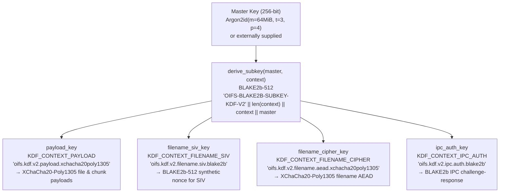

## Responsibility and ownership

The encryption subsystem (`src/encryption.rs`) provides cryptographic privacy and authenticated integrity for stored files, directory entries, and on-disk metadata. It isolates cryptographic primitives into clean layers:

<!-- openwiki: broken internal link [src/encryption.rs#L60-L111] file "src/encryption.rs" does not exist. Fix the href or restore the target, then delete this comment. -->
1. **Key Management and Hygiene**: Passphrase hashing with Argon2id, master-key-to-subkey derivation via BLAKE2b domain separation, and automatic secret erasure via `ZeroizeOnDrop` ([`EncryptionKey`](src/encryption.rs#L60-L111)).
<!-- openwiki: broken internal link [src/encryption.rs#L123-L148] file "src/encryption.rs" does not exist. Fix the href or restore the target, then delete this comment. -->
<!-- openwiki: broken internal link [src/encryption.rs#L150-L176] file "src/encryption.rs" does not exist. Fix the href or restore the target, then delete this comment. -->
2. **File Payload AEAD**: Authenticated payload confidentiality via [`encrypt_data`](src/encryption.rs#L123-L148) / [`decrypt_data`](src/encryption.rs#L150-L176) and in-place variants.
<!-- openwiki: broken internal link [src/encryption.rs#L368-L385] file "src/encryption.rs" does not exist. Fix the href or restore the target, then delete this comment. -->
3. **Seekable Chunk AEAD**: Context-bound encryption for 64 KiB seekable chunks with AAD binding `inode_id`, `chunk_idx`, and `flags` ([`chunk_aad_stack`](src/encryption.rs#L368-L385)).
<!-- openwiki: broken internal link [src/encryption.rs#L688-L780] file "src/encryption.rs" does not exist. Fix the href or restore the target, then delete this comment. -->
<!-- openwiki: broken internal link [src/encryption.rs#L782-L900] file "src/encryption.rs" does not exist. Fix the href or restore the target, then delete this comment. -->
4. **Deterministic Filename Privacy**: SIV construction using BLAKE2b-512 synthetic nonce + XChaCha20-Poly1305 AEAD, parent inode bound in AAD ([`encrypt_filename`](src/encryption.rs#L688-L780), [`decrypt_filename`](src/encryption.rs#L782-L900)).
5. **IPC Authentication**: Dedicated subkey for challenge-response authentication (`ipc_auth_key`).



**Figure**: Encryption key hierarchy — a single 256-bit master key produces four domain-separated 256-bit subkeys via BLAKE2b-512. The master key is never used directly for any cryptographic operation.

## Key derivation and memory hygiene

### Memory hygiene with ZeroizeOnDrop

<!-- openwiki: broken internal link [src/encryption.rs#L60-L111] file "src/encryption.rs" does not exist. Fix the href or restore the target, then delete this comment. -->
Cryptographic keys must never linger in memory or bleed into swap space or crash dumps. The [`EncryptionKey`](src/encryption.rs#L60-L111) struct wraps the master key and all four subkeys with `zeroize` macros:

```rust
#[derive(Clone, Zeroize, ZeroizeOnDrop)]
pub struct EncryptionKey {
    /// Master 256-bit key derived from Argon2id (or supplied directly)
    key: [u8; 32],
    /// Domain-separated 256-bit subkey for file and seekable-chunk XChaCha20-Poly1305 payloads
    payload_key: [u8; 32],
    /// Domain-separated 256-bit subkey for filename SIV BLAKE2b-512 synthetic nonce derivation
    filename_siv_key: [u8; 32],
    /// Domain-separated 256-bit subkey for filename XChaCha20-Poly1305 AEAD encryption
    filename_cipher_key: [u8; 32],
    /// Domain-separated 256-bit subkey for IPC challenge-response authentication
    ipc_auth_key: [u8; 32],
}
```

- When an `EncryptionKey` instance goes out of scope, `ZeroizeOnDrop` automatically executes volatile memory zeroization on all five `[u8; 32]` arrays.
<!-- openwiki: broken internal link [src/encryption.rs#L113-L117] file "src/encryption.rs" does not exist. Fix the href or restore the target, then delete this comment. -->
- The `fmt::Debug` implementation explicitly overrides formatted output with `EncryptionKey([REDACTED])` ([src/encryption.rs#L113-L117](src/encryption.rs#L113-L117)), preventing secrets from accidentally leaking into log outputs or panic strings.

### Argon2id password-based key derivation (PBKDF)

<!-- openwiki: broken internal link [src/encryption.rs#L121-L166] file "src/encryption.rs" does not exist. Fix the href or restore the target, then delete this comment. -->
Keys are derived from user-supplied passphrases using Argon2id via [`derive_key`](src/encryption.rs#L121-L166):

<!-- openwiki: broken internal link [src/encryption.rs#L13-L15] file "src/encryption.rs" does not exist. Fix the href or restore the target, then delete this comment. -->
<!-- openwiki: broken internal link [src/encryption.rs#L13-L15] file "src/encryption.rs" does not exist. Fix the href or restore the target, then delete this comment. -->
<!-- openwiki: broken internal link [src/encryption.rs#L13-L15] file "src/encryption.rs" does not exist. Fix the href or restore the target, then delete this comment. -->
- **Parameters**: `m = 65,536 KiB (64 MiB)`, `t = 3`, `p = 4` (OWASP / RFC 9106 hardened defaults). Constants are [`ARGON2_M_COST_KIB`](src/encryption.rs#L13-L15), [`ARGON2_T_COST`](src/encryption.rs#L13-L15), [`ARGON2_P_COST`](src/encryption.rs#L13-L15).
<!-- openwiki: broken internal link [src/encryption.rs#L276-L282] file "src/encryption.rs" does not exist. Fix the href or restore the target, then delete this comment. -->
<!-- openwiki: broken internal link [src/superblock.rs#L45] file "src/superblock.rs" does not exist. Fix the href or restore the target, then delete this comment. -->
- **Salt Management**: A cryptographically secure 16-byte random salt is generated with `OsRng` via [`generate_salt()`](src/encryption.rs#L276-L282). This salt is permanently stored in plaintext within the filesystem's `SuperBlock::encryption_salt` ([src/superblock.rs#L45](src/superblock.rs#L45)).
- **Rainbow Table and GPU Resistance**: Argon2id combines data-dependent and data-independent memory access passes, providing state-of-the-art resistance against both side-channel cache timing attacks and GPU/ASIC password cracking.
- The 256-bit output hash is copied into `EncryptionKey::from_bytes(key)`, which immediately derives the four domain-separated subkeys via BLAKE2b-512.

### BLAKE2b domain-separated subkey derivation

<!-- openwiki: broken internal link [src/encryption.rs#L20-L57] file "src/encryption.rs" does not exist. Fix the href or restore the target, then delete this comment. -->
[`derive_subkey`](src/encryption.rs#L20-L57) isolates the master key across distinct primitives:

```rust
pub fn derive_subkey(master_key: &[u8; 32], context: &[u8]) -> [u8; 32] {
    let mut hasher = Blake2b512::new();
    hasher.update(b"OIFS-BLAKE2B-SUBKEY-KDF-V2");
    hasher.update([context.len() as u8]);
    hasher.update(context);
    hasher.update(master_key);
    let digest = hasher.finalize();
    let mut subkey = [0u8; 32];
    subkey.copy_from_slice(&digest[..32]);
    subkey
}
```

<!-- openwiki: broken internal link [src/encryption.rs#L17-L27] file "src/encryption.rs" does not exist. Fix the href or restore the target, then delete this comment. -->
Four domain-separation labels (constants in [src/encryption.rs#L17-L27](src/encryption.rs#L17-L27)):

| Subkey | Context Label | Purpose |
|---|---|---|
| `payload_key` | `oifs.kdf.v2.payload.xchacha20poly1305` | File & seekable-chunk XChaCha20-Poly1305 AEAD |
| `filename_siv_key` | `oifs.kdf.v2.filename.siv.blake2b` | BLAKE2b-512 synthetic nonce (SIV) for filenames |
| `filename_cipher_key` | `oifs.kdf.v2.filename.aead.xchacha20poly1305` | Filename XChaCha20-Poly1305 AEAD |
| `ipc_auth_key` | `oifs.kdf.v2.ipc.auth.blake2b` | IPC challenge-response authentication (BLAKE2b) |

The master key is **never** used directly for any encryption, MAC, or authentication operation.

## File payload AEAD: XChaCha20-Poly1305

<!-- openwiki: broken internal link [src/encryption.rs#L123-L148] file "src/encryption.rs" does not exist. Fix the href or restore the target, then delete this comment. -->
File content encryption uses the extended-nonce variant of ChaCha20-Poly1305 (`XChaCha20Poly1305`, [src/encryption.rs#L123-L148](src/encryption.rs#L123-L148)).

### 192-bit per-file nonces

Standard ChaCha20-Poly1305 uses a 96-bit nonce, which risks catastrophic key/nonce reuse collisions if nonces are generated randomly over billions of files. XChaCha20-Poly1305 features an extended **192-bit (24-byte)** nonce:

<!-- openwiki: broken internal link [src/encryption.rs#L272-L278] file "src/encryption.rs" does not exist. Fix the href or restore the target, then delete this comment. -->
- Each encrypted file receives a unique 24-byte nonce generated via [`generate_nonce()`](src/encryption.rs#L272-L278) using system entropy (`OsRng`).
- The 192-bit nonce size eliminates the birthday bound risk for random nonce generation ($2^{96}$ operations required for a 50% collision probability).
<!-- openwiki: broken internal link [src/inode.rs#L36-L37] file "src/inode.rs" does not exist. Fix the href or restore the target, then delete this comment. -->
- The nonce is stored directly in the file's metadata header: `Inode::encryption_nonce` ([src/inode.rs#L36-L37](src/inode.rs#L36-L37)).

### Two encryption schemes (AAD binding)

OIFS supports two encryption scheme versions, selected by `SuperBlock::encryption_version`:

| Scheme | Constant | AAD Behavior |
|---|---|---|
| Legacy | `ENCRYPTION_SCHEME_LEGACY = 1` | Empty AAD (`Vec::new()`) — no binding |
| Context-bound | `ENCRYPTION_SCHEME_CONTEXT_BOUND = 2` | Structured AAD binding `inode_id` (file) or `inode_id`, `chunk_idx`, `flags` (chunk) |

<!-- openwiki: broken internal link [src/encryption.rs#L327-L410] file "src/encryption.rs" does not exist. Fix the href or restore the target, then delete this comment. -->
**Context-bound AAD structure** ([src/encryption.rs#L327-L410](src/encryption.rs#L327-L410)):

```text
File AAD (20 bytes):
  [0]     = 0x01 (AAD_KIND_FILE)
  [1..12] = "OIFS-AAD-v1" (11-byte domain separator)
  [12..20]= inode_id (u64, little-endian)

Chunk AAD (29 bytes):
  [0]     = 0x02 (AAD_KIND_CHUNK)
  [1..12] = "OIFS-AAD-v1"
  [12..20]= inode_id (u64, little-endian)
  [20..28]= chunk_idx (u64, little-endian)
  [28]    = flags (u8: FLAG_EMPTY=0, FLAG_COMPRESSED=1, FLAG_RAW=2)

Filename AAD (20 bytes):
  [0]     = 0x03 (AAD_KIND_FILENAME)
  [1..12] = "OIFS-AAD-v1"
  [12..20]= parent_inode (u64, little-endian)
```

Stack-allocated helpers avoid heap allocations on the hot path:
<!-- openwiki: broken internal link [src/encryption.rs#L412-L425] file "src/encryption.rs" does not exist. Fix the href or restore the target, then delete this comment. -->
- [`file_aad_for_scheme_stack`](src/encryption.rs#L412-L425) → `([u8; 20], usize)`
<!-- openwiki: broken internal link [src/encryption.rs#L427-L440] file "src/encryption.rs" does not exist. Fix the href or restore the target, then delete this comment. -->
- [`chunk_aad_for_scheme_stack`](src/encryption.rs#L427-L440) → `([u8; 29], usize)`

Legacy images (scheme 1) remain readable because `file_aad_for_scheme` / `chunk_aad_for_scheme` return empty AAD for `scheme < ENCRYPTION_SCHEME_CONTEXT_BOUND`.

### Authenticated encryption with associated data (AEAD)

<!-- openwiki: broken internal link [src/encryption.rs#L140] file "src/encryption.rs" does not exist. Fix the href or restore the target, then delete this comment. -->
`encrypt_data` computes a 16-byte Poly1305 Message Authentication Code (MAC) tag appended to the ciphertext ([src/encryption.rs#L140](src/encryption.rs#L140)):
- Any tampering, byte corruption, bit flips, or truncation of the on-disk ciphertext immediately causes `decrypt_data` to fail authentication with `EncryptionError::DecryptionFailed`.
- Plaintext is only returned once the Poly1305 MAC tag is cryptographically verified against the key, nonce, and AAD.

### Pipeline ordering: filter → compress → encrypt

<!-- openwiki: broken internal link [src/disk.rs#L4308-L4372] file "src/disk.rs" does not exist. Fix the href or restore the target, then delete this comment. -->
In [`DiskManager::build_full_overwrite_buffer_pure`](src/disk.rs#L4308-L4372), the write pipeline strictly enforces that **pre-compression filtering and compression execute before encryption**:

```
Plaintext ──> [Filter (Delta/Shuffle)] ──> [Zstd Compress] ──> [XChaCha20 Encrypt] ──> On-Disk Blocks
                                                                        ▲
                                                      Nonce (OsRng) ────┘
```

**Cryptographic rationale**:

1. **Shannon Entropy Flattening**: Secure ciphers like XChaCha20 output ciphertext indistinguishable from pure pseudorandom noise, with Shannon entropy approaching the theoretical maximum ($\approx 8.0$ bits per byte).
2. **Compressibility Destruction**: Lossless compressors (LZ77, Huffman, FSE) rely entirely on recurring byte patterns and non-uniform symbol distributions. If encryption occurred first, compression would achieve 0% reduction or expand in size.
3. **Security Invariance**: Compressing before encryption preserves maximum storage efficiency while the subsequent XChaCha20-Poly1305 pass ensures complete cryptographic confidentiality and integrity across the physical stored blocks.

### NEON SIMD + short-scalar fast path

<!-- openwiki: broken internal link [src/encryption.rs#L507-L512] file "src/encryption.rs" does not exist. Fix the href or restore the target, then delete this comment. -->
On `aarch64`, the `chacha20` crate's NEON implementation (`chacha20_force_neon` feature) computes 4 ChaCha20 blocks (256 B) per `gen_ks_block` call. For short messages (< 256 B) this wastes most of the keystream. The encryption subsystem provides an **exact RFC 8439 + XChaCha20 scalar fast path** for payloads ≤ 192 bytes ([src/encryption.rs#L507-L512](src/encryption.rs#L507-L512)):

```rust
const SHORT_XCHACHA_THRESHOLD: usize = 192;
```

<!-- openwiki: broken internal link [src/encryption.rs#L567-L597] file "src/encryption.rs" does not exist. Fix the href or restore the target, then delete this comment. -->
<!-- openwiki: broken internal link [src/encryption.rs#L599-L644] file "src/encryption.rs" does not exist. Fix the href or restore the target, then delete this comment. -->
The fast path ([`xchacha20_poly1305_encrypt_short`](src/encryption.rs#L567-L597), [`xchacha20_poly1305_decrypt_short`](src/encryption.rs#L599-L644)):
- Computes **only the exact number of 64-byte ChaCha20 blocks** needed for the message length.
- Uses `hchacha20_subkey` to derive the 256-bit subkey from the first 16 bytes of the 24-byte XNonce.
- Generates the Poly1305 key from block 0, then XORs message blocks with keystream blocks 1, 2, ...
- Implements Poly1305 per RFC 8439 (with length padding + length encoding).
- Zeroizes all intermediate state (`subkey`, `poly_key`, keystream blocks) after use.
- Remains **100% byte-for-byte identical** to `XChaCha20Poly1305`, preserving full NEON SIMD speed (+36%) for file and chunk payloads (> 192 B).

This optimization particularly benefits filename encryption (typical length 10–60 bytes) and small chunk payloads.

## Seekable chunk AEAD (64 KiB chunks)

<!-- openwiki: broken internal link [src/inode.rs#L55] file "src/inode.rs" does not exist. Fix the href or restore the target, then delete this comment. -->
<!-- openwiki: broken internal link [src/disk/chunked.rs#L247-L277] file "src/disk/chunked.rs" does not exist. Fix the href or restore the target, then delete this comment. -->
Files with `INODE_FLAG_SEEKABLE_64K` set ([src/inode.rs#L55](src/inode.rs#L55)) store data as independent 64 KiB logical chunks. Each chunk is encrypted independently with its own 24-byte nonce ([src/disk/chunked.rs#L247-L277](src/disk/chunked.rs#L247-L277)):

- **Per-chunk nonce**: Generated via `OsRng`, stored as prefix `[nonce | ciphertext | tag]` in the chunk's block run.
<!-- openwiki: broken internal link [src/encryption.rs#L418-L425] file "src/encryption.rs" does not exist. Fix the href or restore the target, then delete this comment. -->
- **Chunk AAD**: Binds `inode_id`, `chunk_idx` (logical index), and `flags` (compressed/raw/empty) via [`chunk_aad_for_scheme_stack`](src/encryption.rs#L418-L425).
<!-- openwiki: broken internal link [src/disk/chunked.rs#L279-L400] file "src/disk/chunked.rs" does not exist. Fix the href or restore the target, then delete this comment. -->
- **Decryption**: [`read_single_chunk_into`](src/disk/chunked.rs#L279-L400) verifies AAD before returning plaintext, preventing chunk reordering, rollback, or cross-file injection.

This design enables true random-access reads: any 64 KiB chunk can be decrypted independently without touching other chunks.

## Deterministic SIV filename encryption

<!-- openwiki: broken internal link [src/encryption.rs#L688-L900] file "src/encryption.rs" does not exist. Fix the href or restore the target, then delete this comment. -->
Plain directory entry storage exposes sensitive filename patterns, extensions, and directory topologies. To protect directory listings while still allowing $O(1)$ fast lookups without decrypting every entry in a directory block, OIFS implements Synthetic Initialization Vector (SIV) filename encryption ([src/encryption.rs#L688-L900](src/encryption.rs#L688-L900)).

### SIV construction and directory tweak

<!-- openwiki: broken internal link [src/encryption.rs#L688-L780] file "src/encryption.rs" does not exist. Fix the href or restore the target, then delete this comment. -->
[`encrypt_filename`](src/encryption.rs#L688-L780) deterministically generates a synthetic nonce using BLAKE2b-512 over a domain-separated context:

```
Synthetic Nonce (24 bytes) =
  BLAKE2b-512("OIFS_SIV_FILENAME_V2_XCHACHA20" || filename_siv_key || parent_inode || plaintext_filename)[0..24]
```

The parent inode ID is mixed directly into the PRF input, so the same filename in different directories produces unrelated ciphertexts.

### Encryption process

1. **SIV nonce**: Derived as above using `filename_siv_key`.
<!-- openwiki: broken internal link [src/encryption.rs#L387-L397] file "src/encryption.rs" does not exist. Fix the href or restore the target, then delete this comment. -->
2. **AAD**: [`filename_aad_stack(parent_inode)`](src/encryption.rs#L387-L397) binds the ciphertext to its parent directory.
3. **AEAD**: XChaCha20-Poly1305 with `filename_cipher_key`, 24-byte SIV nonce, and AAD.
4. **Encoding**: `[24-byte nonce | ciphertext | 16-byte tag]` → unpadded Base64URL → prefix `_e_`.

Output format: `_e_` + Base64URLUnpadded(`nonce || ciphertext || tag`)

### Decryption and authentication

<!-- openwiki: broken internal link [src/encryption.rs#L782-L900] file "src/encryption.rs" does not exist. Fix the href or restore the target, then delete this comment. -->
[`decrypt_filename`](src/encryption.rs#L782-L900):
1. Strips `_e_` prefix, decodes Base64URL.
2. Splits into `nonce (24)`, `ciphertext`, `tag (16)`.
3. Decrypts with `filename_cipher_key`, SIV nonce, and parent-inode-bound AAD.
<!-- openwiki: broken internal link [src/encryption.rs#L651-L657] file "src/encryption.rs" does not exist. Fix the href or restore the target, then delete this comment. -->
4. **SIV verification**: Re-computes the synthetic nonce from the candidate plaintext and compares in constant time ([`ct_eq_slice`](src/encryption.rs#L651-L657)). This prevents ciphertext manipulation even if the AEAD key were somehow compromised.
5. Legacy fallback: If v2 decryption fails, tries the legacy 12-byte `ChaCha20Poly1305` format (`OIFS_SIV_FILENAME_V1`) for backward compatibility.

### Security properties

- **Deterministic**: Same `(parent_inode, filename)` → same ciphertext, enabling $O(1)$ directory lookups via hash table on encrypted names.
- **Directory isolation**: Parent inode in both SIV nonce derivation and AEAD AAD prevents cross-directory filename correlation.
- **Authentication**: Poly1305 tag + SIV verification ensures ciphertext integrity and origin authentication.
- **Prefix identification**: `_e_` prefix allows instant recognition of encrypted vs. plaintext entries during directory traversal.

## Encryption error taxonomy

<!-- openwiki: broken internal link [src/encryption.rs#L902-L921] file "src/encryption.rs" does not exist. Fix the href or restore the target, then delete this comment. -->
[`EncryptionError`](src/encryption.rs#L902-L921) distinguishes failure modes:

```rust
pub enum EncryptionError {
    KeyDerivationFailed,  // Argon2id parameter error or hash extraction failure
    InvalidKey,           // Key length mismatch (e.g., not 32 bytes for XChaCha20Poly1305)
    EncryptionFailed,     // AEAD encryption error (should not happen with valid inputs)
    DecryptionFailed,     // AEAD authentication failure → wrong password or corrupted ciphertext
}
```

`DecryptionFailed` is the only error that callers typically surface to users ("wrong password or corrupted data"). All other variants indicate programming bugs or unrecoverable system state.

## Integration with DiskManager

<!-- openwiki: broken internal link [src/disk.rs#L1146-L1235] file "src/disk.rs" does not exist. Fix the href or restore the target, then delete this comment. -->
- **Key loading**: `DiskManager::init_or_open_with_key` ([src/disk.rs#L1146-L1235](src/disk.rs#L1146-L1235)) derives or accepts an `EncryptionKey`, stores it in `DiskManagerInner::encryption_key`.
<!-- openwiki: broken internal link [src/disk.rs#L1194] file "src/disk.rs" does not exist. Fix the href or restore the target, then delete this comment. -->
<!-- openwiki: broken internal link [src/disk.rs#L1201] file "src/disk.rs" does not exist. Fix the href or restore the target, then delete this comment. -->
- **Scheme selection**: New encrypted images always use `ENCRYPTION_SCHEME_CONTEXT_BOUND` ([src/disk.rs#L1194](src/disk.rs#L1194), [src/disk.rs#L1201](src/disk.rs#L1201)).
<!-- openwiki: broken internal link [src/disk.rs#L888-L950] file "src/disk.rs" does not exist. Fix the href or restore the target, then delete this comment. -->
- **Write path**: `plan_write_prepared` ([src/disk.rs#L888-L950](src/disk.rs#L888-L950)) builds stack-staged AAD via `file_aad_for_scheme_stack` / `chunk_aad_for_scheme_stack` and passes it to `build_full_overwrite_buffer_pure` or chunk encryption.
- **Read path**: `read_data_internal` and `read_single_chunk_into` reconstruct the same AAD and verify before returning plaintext.

## Related pages

- [Compression & Filters](../architecture/compression_and_filters.md) — pipeline ordering (filter → compress → encrypt)
- [Inode & Directory](../architecture/inode_and_directory.md) — inode encryption fields, seekable chunk layout, directory entry encryption
<!-- openwiki: broken internal link [../architecture/testing_and_verification.md] file "../architecture/testing_and_verification.md" does not exist. Fix the href or restore the target, then delete this comment. -->
- [Testing & Verification](../architecture/testing_and_verification.md) — encryption round-trip tests, AEAD authentication failure tests
- [Encrypted Workflows](../workflows/encrypted_workflows.md) — creating/opening encrypted images, key rotation considerations
