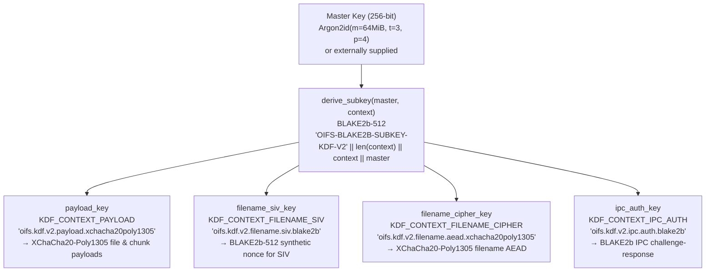
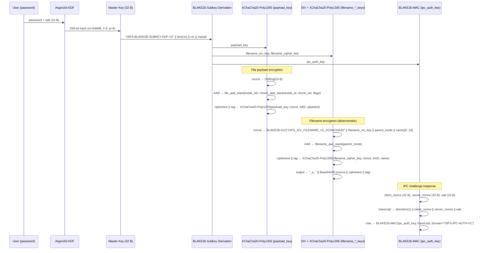

## Responsibility and ownership

The encryption subsystem (`src/encryption.rs`) provides cryptographic privacy and authenticated integrity for stored files, directory entries, and on-disk metadata. It isolates cryptographic primitives into clean layers:

1. **Key Management and Hygiene**: Passphrase hashing with Argon2id, master-key-to-subkey derivation via BLAKE2b domain separation, and automatic secret erasure via `ZeroizeOnDrop` ([`EncryptionKey`](repo://src/encryption.rs#L50-L111)).
2. **File Payload AEAD**: Authenticated payload confidentiality via [`encrypt_data`](repo://src/encryption.rs#L184-L213) / [`decrypt_data`](repo://src/encryption.rs#L215-L241) and in-place variants.
3. **Seekable Chunk AEAD**: Context-bound encryption for 64 KiB seekable chunks with AAD binding `inode_id`, `chunk_idx`, and `flags` ([`chunk_aad_stack`](repo://src/encryption.rs#L358-L375)).
4. **Deterministic Filename Privacy**: SIV construction using BLAKE2b-512 synthetic nonce + XChaCha20-Poly1305 AEAD, parent inode bound in AAD ([`encrypt_filename`](repo://src/encryption.rs#L661-L779), [`decrypt_filename`](repo://src/encryption.rs#L770-L901)).
5. **IPC Authentication**: Dedicated subkey for challenge-response authentication (`ipc_auth_key`).



**Figure**: Encryption key hierarchy — a single 256-bit master key produces four domain-separated 256-bit subkeys via BLAKE2b-512. The master key is never used directly for any cryptographic operation.

## Key derivation and memory hygiene

### Memory hygiene with ZeroizeOnDrop

[`EncryptionKey`](repo://src/encryption.rs#L50-L111) wraps the master key and all four subkeys with `zeroize` macros:

```rust
#[derive(Clone, Zeroize, ZeroizeOnDrop)]
pub struct EncryptionKey {
    /// Master 256-bit key derived from Argon2id (or supplied directly)
    key: [u8; 32],
    /// Domain-separated 256-bit subkey for file and seekable-chunk XChaCha20-Poly1305 payloads
    payload_key: [u8; 32],
    /// Domain-separated 256-bit subkey for filename SIV BLAKE2b-512 synthetic nonce derivation
    filename_siv_key: [u8; 32],
    /// Domain-separated 256-bit subkey for filename XChaCha20-Poly1305 AEAD encryption
    filename_cipher_key: [u8; 32],
    /// Domain-separated 256-bit subkey for IPC challenge-response authentication
    ipc_auth_key: [u8; 32],
}
```

- When an `EncryptionKey` instance goes out of scope, `ZeroizeOnDrop` automatically executes volatile memory zeroization on all five `[u8; 32]` arrays.
- The `fmt::Debug` implementation explicitly overrides formatted output with `EncryptionKey([REDACTED])` ([repo://src/encryption.rs#L128-L130](repo://src/encryption.rs#L128-L130)), preventing secrets from accidentally leaking into log outputs or panic strings.
- `derive_subkey` also zeroizes the intermediate BLAKE2b-512 digest after extracting the 32-byte subkey ([repo://src/encryption.rs#L24-L44](repo://src/encryption.rs#L24-L44)).

### Argon2id password-based key derivation (PBKDF)

Keys are derived from user-supplied passphrases using Argon2id via [`derive_key`](repo://src/encryption.rs#L143-L171):

- **Parameters**: `m = 65,536 KiB (64 MiB)`, `t = 3`, `p = 4` (OWASP / RFC 9106 hardened defaults). Constants are [`ARGON2_M_COST_KIB`](repo://src/encryption.rs#L7-L9), [`ARGON2_T_COST`](repo://src/encryption.rs#L7-L9), [`ARGON2_P_COST`](repo://src/encryption.rs#L7-L9).
- **Salt Management**: A cryptographically secure 16-byte random salt is generated with `OsRng` via [`generate_salt()`](repo://src/encryption.rs#L309-L314). This salt is permanently stored in plaintext within the filesystem's `SuperBlock::encryption_salt` ([repo://src/superblock.rs#L47](repo://src/superblock.rs#L47)).
- **Rainbow Table and GPU Resistance**: Argon2id combines data-dependent and data-independent memory access passes, providing state-of-the-art resistance against both side-channel cache timing attacks and GPU/ASIC password cracking.
- The 256-bit output hash is copied into `EncryptionKey::from_bytes(key)`, which immediately derives the four domain-separated subkeys via BLAKE2b-512.
- The master key buffer is zeroized immediately after subkey derivation ([repo://src/encryption.rs#L168-L170](repo://src/encryption.rs#L168-L170)).

### BLAKE2b-512 domain-separated subkey derivation

The [`derive_subkey`](repo://src/encryption.rs#L24-L44) function ensures the master key is never reused directly across distinct primitives:

```rust
pub fn derive_subkey(master_key: &[u8; 32], context: &[u8]) -> [u8; 32] {
    let mut hasher = Blake2b512::new();
    hasher.update(b"OIFS-BLAKE2B-SUBKEY-KDF-V2");
    hasher.update([context.len() as u8]);
    hasher.update(context);
    hasher.update(master_key);
    let mut digest = hasher.finalize_reset();
    let mut subkey = [0u8; 32];
    subkey.copy_from_slice(&digest[..32]);
    digest.zeroize();
    subkey
}
```

Domain separation labels (constants at [repo://src/encryption.rs#L13-L16](repo://src/encryption.rs#L13-L16)):

| Subkey | Context Label | Purpose |
|--------|---------------|---------|
| `payload_key` | `oifs.kdf.v2.payload.xchacha20poly1305` | File & chunk payload encryption |
| `filename_siv_key` | `oifs.kdf.v2.filename.siv.blake2b` | SIV synthetic nonce derivation |
| `filename_cipher_key` | `oifs.kdf.v2.filename.aead.xchacha20poly1305` | Filename AEAD encryption |
| `ipc_auth_key` | `oifs.kdf.v2.ipc.auth.blake2b` | IPC challenge-response MAC |

Each label is distinct and versioned (`v2`), guaranteeing cryptographic isolation: `payload_key` ≠ `filename_siv_key` ≠ `filename_cipher_key` ≠ `ipc_auth_key` ≠ `master_key`. Tests verify pairwise distinctness ([repo://src/encryption.rs#L1050-L1057](repo://src/encryption.rs#L1050-L1057)).

## Encryption schemes (versioning)

The filesystem records `encryption_version` in the superblock ([repo://src/superblock.rs#L47](repo://src/superblock.rs#L47)). Two schemes exist:

| Scheme | Constant | Value | AAD |
|--------|----------|-------|-----|
| Legacy | `ENCRYPTION_SCHEME_LEGACY` | 1 | Empty (no binding) |
| Context-bound | `ENCRYPTION_SCHEME_CONTEXT_BOUND` | 2 | Binds `inode_id` / `chunk_idx` / `flags` / `parent_inode` |

- New images always use `ENCRYPTION_SCHEME_CONTEXT_BOUND` ([repo://src/disk.rs#L1659](repo://src/disk.rs#L1659), [repo://src/disk.rs#L1669](repo://src/disk.rs#L1669)).
- Legacy images (scheme 1) remain readable; their AAD is empty, so ciphertexts can be moved across files/chunks without authentication failure.
- `file_aad_for_scheme_stack` / `chunk_aad_for_scheme_stack` ([repo://src/encryption.rs#L387-L423](repo://src/encryption.rs#L387-L423)) select the appropriate AAD based on the scheme version.
- Validation rejects unencrypted images with non-zero version, and encrypted images with unknown version ([repo://src/superblock.rs#L462-L467](repo://src/superblock.rs#L462-L467)).

## Context-bound Associated Data (AAD)

AAD construction is stack-allocated (zero heap allocations) and domain-separated by a leading kind byte.

| Kind | Constant | Layout (bytes) | Binds |
|------|----------|----------------|-------|
| File | `AAD_KIND_FILE` (0x01) | `[kind][AAD_DOMAIN(11)][inode_id(8)]` = 20 | `inode_id` |
| Chunk | `AAD_KIND_CHUNK` (0x02) | `[kind][AAD_DOMAIN(11)][inode_id(8)][chunk_idx(8)][flags(1)]` = 29 | `inode_id`, `chunk_idx`, `flags` |
| Filename | `AAD_KIND_FILENAME` (0x03) | `[kind][AAD_DOMAIN(11)][parent_inode(8)]` = 20 | `parent_inode` |

- `AAD_DOMAIN = b"OIFS-AAD-v1"` (11 bytes).
- Functions: `file_aad_stack`, `chunk_aad_stack`, `filename_aad_stack` ([repo://src/encryption.rs#L348-L375](repo://src/encryption.rs#L348-L375)).
- Kani proof verifies domain separation and injectivity ([repo://src/encryption.rs#L1138-L1164](repo://src/encryption.rs#L1138-L1164)).

## XChaCha20-Poly1305 AEAD encryption/decryption

### File/chunk payloads

- **Nonce**: 192-bit (24 bytes) generated via `generate_nonce()` ([repo://src/encryption.rs#L308-L312](repo://src/encryption.rs#L308-L312)) — cryptographically random, unique per encryption.
- **Key**: `payload_key` (256-bit subkey).
- **AAD**: `file_aad_stack(inode_id)` for whole files, `chunk_aad_stack(inode_id, chunk_idx, flags)` for seekable chunks.
- **Operations**: `encrypt_data`, `decrypt_data`, `encrypt_data_in_place`, `decrypt_data_in_place`, `encrypt_with_nonce_prefix`, `decrypt_into_slice` ([repo://src/encryption.rs#L184-L297](repo://src/encryption.rs#L184-L297)).
- **Ciphertext layout**: `[24-byte nonce | ciphertext | 16-byte Poly1305 tag]` (produced by `encrypt_with_nonce_prefix`).

### Short-message scalar fast path

On `aarch64` with NEON, the library's `chacha20` crate computes 4 blocks (256 B) per call and discards 3 for short messages — wasting 75% of work on filenames (`≤ 64 B`). A scalar RFC 8439 + XChaCha20 implementation (`xchacha20_poly1305_encrypt_short` / `xchacha20_poly1305_decrypt_short`, [repo://src/encryption.rs#L446-L560](repo://src/encryption.rs#L446-L560)) computes only the exact 64-byte blocks needed, remaining **byte-for-byte identical** to the reference implementation (proven by exhaustive test up to 192 bytes [repo://src/encryption.rs#L1070-L1115](repo://src/encryption.rs#L1070-L1115)). Threshold: `SHORT_XCHACHA_THRESHOLD = 192` bytes ([repo://src/encryption.rs#L331](repo://src/encryption.rs#L331)).

- Uses `hchacha20` to derive a 256-bit subkey from the 192-bit nonce's first 16 bytes.
- Generates Poly1305 key from ChaCha20 block 0; encrypts with blocks 1..N.
- All intermediate key material (subkey, Poly1305 key, per-block keystream) is zeroized after use ([repo://src/encryption.rs#L525-L555](repo://src/encryption.rs#L525-L555)).
- Used automatically by `encrypt_filename` and `decrypt_filename_authenticated` for payloads ≤ 192 bytes.

## Filename encryption: 192-bit SIV (deterministic, collision-resistant)

### Construction

1. **Synthetic nonce (SIV)**: 24-byte (192-bit) derived via BLAKE2b-512 keyed by `filename_siv_key`:
   ```
   nonce = BLAKE2b-512("OIFS_SIV_FILENAME_V2_XCHACHA20" || filename_siv_key || parent_inode(8) || name)[0..24]
   ```
   ([`derive_filename_siv_nonce`](repo://src/encryption.rs#L629-L639))

2. **AEAD encryption**: XChaCha20-Poly1305 with `filename_cipher_key`, the 24-byte nonce, and `filename_aad_stack(parent_inode)` as AAD.

3. **Output format**: ASCII string `_e_` + Base64URL-unpadded(`nonce(24) || ciphertext || tag(16)`). Prefix `_e_` marks encrypted entries ([repo://src/encryption.rs#L323](repo://src/encryption.rs#L323)).

### Security properties

- **Deterministic**: Same `(key, parent_inode, name)` → identical ciphertext. Enables directory listing without decryption.
- **Tweakable**: Different `parent_inode` → different ciphertext for same name. Prevents cross-directory correlation.
- **Authentication**: Poly1305 tag covers ciphertext + AAD (parent inode). Tampering detected.
- **SIV verification**: On decryption, the derived nonce is recomputed from candidate plaintext and compared in constant time (`ct_eq_slice`). Rejects ciphertexts where nonce was forged ([repo://src/encryption.rs#L815-L825](repo://src/encryption.rs#L815-L825)).
- **Legacy fallback**: Reads v1 12-byte `ChaCha20Poly1305` format (`OIFS_SIV_FILENAME_V1`) for backward compatibility when `encryption_version < ENCRYPTION_SCHEME_CONTEXT_BOUND` ([repo://src/encryption.rs#L735-L779](repo://src/encryption.rs#L735-L779)). Anti-downgrade: v1 tokens rejected on v2+ images.



## Seekable 64 KiB chunk encryption

### Write path

In `DiskManager::prepare_chunk_payload` ([repo://src/disk/chunked.rs#L288-L330](repo://src/disk/chunked.rs#L288-L330)):
1. If compression yields smaller output, use compressed data; otherwise use raw 64 KiB chunk.
2. Generate fresh 24-byte nonce via `generate_nonce()`.
3. Build AAD via `chunk_aad_for_scheme_stack(inode_id, chunk_idx, flags, scheme)` where `flags` is `FLAG_COMPRESSED` (1) or `FLAG_RAW` (2).
4. Encrypt with `encrypt_with_nonce_prefix` → `[nonce | ciphertext | tag]`.
5. Store payload in the chunk's block run; record `compressed_len` and `block_count` in `ChunkEntry`.

### Read path

In `DiskManager::read_single_chunk_into` ([repo://src/disk/chunked.rs#L420-L490](repo://src/disk/chunked.rs#L420-L490)):
1. Read ciphertext from block run (handles both mmap and pread).
2. Extract 24-byte nonce, ciphertext+tag.
3. Rebuild identical AAD via `chunk_aad_for_scheme_stack(inode_id, chunk_idx, flags, scheme)`.
4. Decrypt with `decrypt_into_slice` directly into caller's destination buffer (zero intermediate copy for the happy path).
5. If compressed, decompress with Zstd into destination.

### Security properties

- **Per-chunk unique nonce**: Fresh 24-byte random nonce per encryption.
- **AAD binding**: `inode_id`, `chunk_idx`, and `flags` prevent chunk reordering, rollback, or cross-file injection.
- **Flag authentication**: Compressed vs. raw flag is authenticated; an attacker cannot flip the flag to bypass decompression or cause type confusion.
- **Encrypted inode requirement**: On encrypted filesystems, seekable files must have `inode.encrypted = true`; otherwise reads fail with `DecryptionFailed` ([repo://src/disk/chunked.rs#L384-L387](repo://src/disk/chunked.rs#L384-L387)).

## IPC challenge-response authentication

### Protocol

1. **Client → Server**: `AuthChallenge { client_nonce[32], has_password }`
2. **Server → Client**: `AuthChallenge { server_nonce[32], salt[16], encrypted }`
3. **Client → Server**: `AuthResponse { client_mac[32] }`
4. **Server → Client**: `AuthVerify { server_mac[32] }` (mutual authentication)

### Transcript construction

```rust
transcript = direction(1) || client_nonce(32) || server_nonce(32) || salt(16)
```
- `direction = 0` for client→server, `1` for server→client (prevents tag reflection).
- MAC = `BLAKE2b-MAC(ipc_auth_key, transcript, personal="OIFS-IPC-AUTH-V1")` ([repo://src/ipc.rs#L318-L331](repo://src/ipc.rs#L318-L331)).

### Key source

- **Encrypted images**: Client derives `ipc_auth_key` from password + salt (same Argon2id+BLAKE2b derivation as master). Password never travels on the wire.
- **Unencrypted images**: Master generates a 32-byte session secret via `generate_auth_secret()`, publishes hex-encoded in `.image.master` rendezvous file (`auth_token` field); client reads and uses directly ([repo://src/ipc.rs#L886-L982](repo://src/ipc.rs#L886-L982)).

### Security properties

- **10-second handshake timeout** (`AUTH_HANDSHAKE_TIMEOUT`) prevents Slowloris attacks ([repo://src/ipc.rs#L161](repo://src/ipc.rs#L161)).
- **Authenticated streams are pooled** to avoid repeated handshakes ([repo://src/ipc.rs#L1407-L1412](repo://src/ipc.rs#L1407-L1412)).
- **Constant-time tag comparison** (`ct_eq`) prevents timing side channels ([repo://src/ipc.rs#L333-L340](repo://src/ipc.rs#L333-L340)).
- Password verifier stored in `DiskManagerInner` uses BLAKE2b-512 with domain `OIFS-PWD-VERIFIER-V1` over `ipc_auth_key || password` ([repo://src/disk.rs#L1541-L1553](repo://src/disk.rs#L1541-L1553)).

## Per-filesystem key hierarchy and key rotation considerations

### Current design

- **Single master key per filesystem**: All files, chunks, and filenames derive from the same `EncryptionKey` hierarchy (master + 4 subkeys).
- **Per-object nonces**: Files and chunks use fresh random 192-bit nonces per encryption. Filenames use deterministic SIV nonces derived from `(parent_inode, name)`.
- **AAD binding**: Context-bound scheme binds ciphertexts to their logical location (`inode_id`, `chunk_idx`, `flags`, `parent_inode`), preventing cut-and-paste and rollback attacks.

### Key rotation implications

| Operation | Current support | Notes |
|-----------|----------------|-------|
| Password change | Requires full re-encryption | Master key changes → all subkeys change → all ciphertexts must be rewritten. |
| Subkey rotation | Not supported | No mechanism to rotate individual subkeys without changing master key. |
| Scheme upgrade | Supported (legacy → context-bound) | New files use v2; existing v1 files readable but not automatically upgraded. |
| Master key rotation | Not supported | Would require re-encrypting entire filesystem (all files, chunks, filenames, inodes). |

**Design note**: The filesystem stores `encryption_salt` (16 B) and `encryption_version` (1 B) in the superblock. A key rotation feature would need:
1. A new salt + Argon2id derivation → new master key.
2. Re-encryption of every payload, chunk, and filename.
3. Atomic superblock update with new salt/version.
4. Crash-safe journaling of the re-encryption operation (supported via existing WAL).

## Error handling

[`EncryptionError`](repo://src/encryption.rs#L902-L921) distinguishes:
- `KeyDerivationFailed` — Argon2id parameter error or hash failure.
- `InvalidKey` — Key length mismatch (e.g., not 32 bytes).
- `EncryptionFailed` — AEAD encryption error (should not happen with valid inputs).
- `DecryptionFailed` — AEAD authentication failure (wrong password, corrupted ciphertext, or nonce/AAD mismatch).

Decryption failures are intentionally indistinguishable between "wrong password" and "corrupted data" to avoid oracle attacks.
