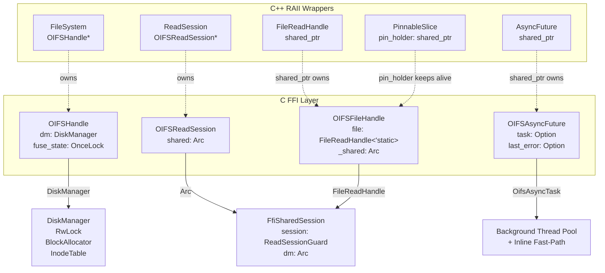

# C FFI and C++17/20 API Surface

The OIFS storage engine exports a **public C FFI** ([`include/oifs.h`](repo://include/oifs.h), [`src/ffi.rs`](repo://src/ffi.rs)) and a **header-only C++17/20 RAII wrapper** ([`include/oifs.hpp`](repo://include/oifs.hpp)). Together they expose the engine to C, C++, Python, Go, Rust, and any language that can call C ABI functions.

This page documents:
- Opaque handle types and ownership model
- Synchronous and asynchronous I/O operations
- `PinnableSlice` zero-copy memory-mapped reads
- `co_await` integration for C++20 coroutines
- C++ RAII wrappers with move semantics
- Error code conventions
- Ownership/lifetime diagrams for FFI handles

---

## Opaque Handle Model

All public C API functions operate on opaque pointers. The Rust-side definitions live in [`src/ffi.rs`](repo://src/ffi.rs#L11-L25):

```rust
pub struct OIFSHandle {
    pub dm: DiskManager,
    pub fuse_state: std::sync::OnceLock<crate::fuse::OifsFuseState>,
}
```

In C ([`include/oifs.h#L52`](repo://include/oifs.h#L52)):
```c
typedef struct OIFSHandle OIFSHandle;
```

Additional opaque handles:
| Handle | Purpose |
|--------|---------|
| `OIFSHandle` | Filesystem instance (wraps `DiskManager`) |
| `OIFSReadSession` | Amortized read lock + inode cache for batch reads |
| `OIFSFileHandle` | Pinned file within a read session (zero `RwLock` overhead) |
| `OIFSAsyncFuture` | In-flight async operation (inline fast-path or background) |
| `OIFSFilterConfig` | SIMD pre-compression filter pipeline config |

### Handle-Isolated Error State

Each `OIFSHandle` maintains its own thread-local `last_error` via a `RefCell` slot and an atomic counter (`FFI_ACTIVE_ERROR_THREADS`). Successful calls clear it; failures populate it. Retrieve with `oifs_last_error`. This avoids global `errno` races in multithreaded hosts ([`src/ffi.rs#L11-L55`](repo://src/ffi.rs#L11-L55)).

---

## C FFI: Complete API Surface

### Version & Compatibility Handshake
```c
uint32_t oifs_version_major(void);
uint32_t oifs_version_minor(void);
uint32_t oifs_version_patch(void);
uint64_t oifs_version_code(void);
const char* oifs_version_string(void);

#define OIFS_VERSION_COMPAT_OK       0
#define OIFS_VERSION_COMPAT_WARN     1
#define OIFS_VERSION_COMPAT_ERR     -1
int32_t oifs_check_version(uint32_t req_major, uint32_t req_minor, uint32_t req_patch);
int32_t oifs_loaded_path(char* buf, size_t buf_size);
```
Policy: **block older versions, permit newer versions** ([`include/oifs.h#L600-L645`](repo://include/oifs.h#L600-L645)).

### Lifecycle & Open Modes
```c
/* Standalone direct access */
OIFSHandle* oifs_open(const char* path, uint64_t size);
OIFSHandle* oifs_open_with_password(const char* path, uint64_t size, const char* password);
OIFSHandle* oifs_open_with_options(const char* path, uint64_t size, const char* password,
                                   uint8_t storage_mode, uint8_t journaled);
OIFSHandle* oifs_open_read_only(const char* path, const char* password, uint8_t storage_mode);

/* Session registry reuse (IPC / local / network) */
OIFSHandle* oifs_get_or_open(const char* path, uint64_t size);
OIFSHandle* oifs_get_or_open_with_password(const char* path, uint64_t size, const char* password);

void oifs_close(OIFSHandle* handle);
int32_t oifs_is_read_only(const OIFSHandle* handle);
int32_t oifs_flush(OIFSHandle* handle);
int32_t oifs_set_durability_mode(OIFSHandle* handle, uint8_t mode);
int32_t oifs_set_file_io_cache_bytes(OIFSHandle* handle, size_t bytes);
```

### Directory Operations
```c
int32_t oifs_ls(OIFSHandle* handle, ListCallback cb, void* user_data);
int32_t oifs_ls_dir(OIFSHandle* handle, const char* path, ListCallback cb, void* user_data);
int32_t oifs_mkdir(OIFSHandle* handle, const char* path);
```

### File Operations & Metadata Queries
```c
int32_t oifs_create_file(OIFSHandle* handle, const char* path);
int32_t oifs_create_or_open_file(OIFSHandle* handle, const char* path);
int32_t oifs_delete_file(OIFSHandle* handle, const char* path);
int32_t oifs_rename(OIFSHandle* handle, const char* old_path, const char* new_path);

/* Inode metadata */
typedef struct { ... } OIFSFileStat;
int32_t oifs_stat(OIFSHandle* handle, const char* path, OIFSFileStat* out_stat);
int32_t oifs_exists(OIFSHandle* handle, const char* path);
```

### High-Performance Direct I/O
```c
int64_t oifs_read_at(OIFSHandle* handle, const char* filename, uint64_t offset,
                     uint8_t* buf, uint64_t buf_size);
int64_t oifs_read_file(OIFSHandle* handle, const char* filename,
                       uint8_t* buf, uint64_t buf_size);
int32_t oifs_write_file(OIFSHandle* handle, const char* filename,
                        const uint8_t* buf, uint64_t buf_size);
```

### Write Policy Flags
```c
#define OIFS_WRITE_POLICY_DEFAULT       0x00  /* Auto / Full-file stream compression (default) */
#define OIFS_WRITE_POLICY_RAW           0x01  /* Never compress (Raw) */
#define OIFS_WRITE_POLICY_STREAM        0x02  /* Stream compression (with custom zstd_level) */
#define OIFS_WRITE_POLICY_SEEKABLE_64K  0x08  /* Seekable 64KB chunked compression */

int32_t oifs_write_file_with_policy(OIFSHandle* handle, const char* filename,
                                    uint64_t offset, const uint8_t* buf, uint64_t buf_size,
                                    uint32_t policy_flags, int32_t zstd_level);
int32_t oifs_truncate_file(OIFSHandle* handle, const char* filename, uint64_t new_size);
```

### Direct Inode, Single-Transaction Creation & Scatter-Gather Batch I/O
```c
int64_t oifs_resolve_path(OIFSHandle* handle, const char* path);
int64_t oifs_create_file_with_data(OIFSHandle* handle, const char* path,
                                   const uint8_t* buf, uint64_t buf_size,
                                   uint32_t policy_flags, int32_t zstd_level);
int64_t oifs_read_at_inode(OIFSHandle* handle, uint64_t inode_id,
                           uint64_t offset, uint8_t* buf, uint64_t buf_size);

typedef struct { ... } OIFSReadBatchItem;
int32_t oifs_read_at_batch(OIFSHandle* handle, OIFSReadBatchItem* items, size_t count);
```

### Shared Read Session, Pinned File Handle & True Zero-Copy Mmap View
```c
OIFSReadSession* oifs_begin_read(OIFSHandle* handle);
void oifs_end_read(OIFSReadSession* session);

OIFSFileHandle* oifs_session_open_file(const OIFSReadSession* session, const char* path);
OIFSFileHandle* oifs_session_open_inode(const OIFSReadSession* session, uint64_t inode_id);
void oifs_file_close(OIFSFileHandle* file);

uint64_t oifs_file_size(const OIFSFileHandle* file);
uint64_t oifs_file_inode_id(const OIFSFileHandle* file);
int64_t oifs_file_read_at(const OIFSFileHandle* file, uint64_t offset,
                          uint8_t* buf, uint64_t buf_size);

/* True Zero-Copy view into the memory-mapped image */
int32_t oifs_file_mmap_slice(const OIFSFileHandle* file, uint64_t offset,
                             uint64_t max_len, const uint8_t** out_ptr, uint64_t* out_len);
/* Returns: 0 = zero-copy succeeded (out_ptr/out_len valid while file/session open),
 *          1 = zero-copy unavailable (fall back to oifs_file_read_at),
 *         -1 = error */
```

---

## Asynchronous I/O & Group-Commit Write Engine

### Future API (Poll / Wait / Free)
```c
OIFSAsyncFuture* oifs_read_at_async(OIFSHandle* handle, uint64_t inode_id,
                                    uint64_t offset, uint8_t* buf, uint64_t buf_size);
OIFSAsyncFuture* oifs_create_file_with_data_async(OIFSHandle* handle, const char* path,
                                                  const uint8_t* buf, uint64_t buf_size,
                                                  uint32_t policy_flags, int32_t zstd_level);
OIFSAsyncFuture* oifs_write_file_async(OIFSHandle* handle, const char* path,
                                       uint64_t offset, const uint8_t* buf, uint64_t buf_size,
                                       uint32_t policy_flags, int32_t zstd_level);
OIFSAsyncFuture* oifs_flush_async(OIFSHandle* handle);

int32_t oifs_async_poll(const OIFSAsyncFuture* fut);      /* 1=ready, 0=pending, -1=invalid */
int64_t oifs_async_wait(OIFSAsyncFuture* fut);             /* blocks, returns result or -1 */
int32_t oifs_async_last_error(const OIFSAsyncFuture* fut, char* buf, uint32_t buf_size);
void oifs_async_free(OIFSAsyncFuture* fut);                /* drop barrier: waits for in-flight writes */
```

### Callback API
```c
typedef void (*OifsAsyncReadCallback)(int64_t status_or_len, const uint8_t* data,
                                      size_t data_len, void* user_data);
typedef void (*OifsAsyncStatusCallback)(int64_t status_or_inode, void* user_data);

int32_t oifs_read_at_async_cb(OIFSHandle* handle, uint64_t inode_id,
                              uint64_t offset, uint64_t len,
                              OifsAsyncReadCallback cb, void* user_data);
int32_t oifs_create_file_with_data_async_cb(OIFSHandle* handle, const char* path,
                                            const uint8_t* buf, uint64_t buf_size,
                                            uint32_t policy_flags, int32_t zstd_level,
                                            OifsAsyncStatusCallback cb, void* user_data);
```

### Inline Fast-Path + Background Pool Model
- **Reads**: `oifs_read_at_async` probes `try_read_at_inline_into` for immediate cache/mmap completion (~50 ns). On hit, returns a **ready** future (`oifs_async_poll == 1`, zero suspension). Cold reads or compressed/encrypted decodes execute on the persistent background pool.
- **Writes**: Use **Group Commit** — concurrent async writes under `OIFS_DURABILITY_STRICT` share a single physical sync barrier per batch.
- **Use-After-Free Safe**: `oifs_async_free` blocks until any background task writing into the caller's buffer finishes, enforced by `wait_on_drop=true` in `OifsAsyncTask::spawn_with_drop_policy` ([`src/ffi.rs#L1900-L2000`](repo://src/ffi.rs#L1900-L2000)).

---

## FUSE Kernel Protocol (ABI v7.28) Frame Dispatcher

```c
int64_t oifs_fuse_dispatch_frame(OIFSHandle* handle,
                                 const uint8_t* req_buf, size_t req_len,
                                 uint8_t* resp_buf, size_t resp_cap);
```
Dispatches a raw FUSE request frame (`fuse_in_header` + payload) and writes the serialized response (`fuse_out_header` + body) into `resp_buf`. Open FUSE handles (`fh`) persist across calls on the same `OIFSHandle`. Read-only handles reject mutating opcodes with `-EROFS` ([`src/ffi.rs#L2180-L2280`](repo://src/ffi.rs#L2180-L2280)).

---

## SIMD Numeric Pre-Compression Filters

```c
typedef struct { uint8_t typesize; uint8_t delta; uint8_t shuffle; uint8_t bitshuffle; } OIFSFilterConfig;

int64_t oifs_create_file_with_data_filtered(OIFSHandle* handle, const char* path,
                                            const uint8_t* buf, uint64_t buf_size,
                                            uint32_t policy_flags, int32_t zstd_level,
                                            const OIFSFilterConfig* filter_cfg);
int32_t oifs_write_file_with_filters(OIFSHandle* handle, const char* path, uint64_t offset,
                                     const uint8_t* buf, uint64_t buf_size,
                                     uint32_t policy_flags, int32_t zstd_level,
                                     const OIFSFilterConfig* filter_cfg);
```

---

## Cross-Image CoW Clone, 3-Tier Fast Transfer & Sub-Range Splice

```c
int32_t oifs_clone_image(const char* src_path, const char* dst_path, uint8_t* out_method);

int32_t oifs_transfer_file_to(OIFSHandle* src_handle, const char* src_path,
                              OIFSHandle* dst_handle, const char* dst_path,
                              uint32_t flags, OIFSTransferStats* out_stats);

int32_t oifs_splice_range_to(OIFSHandle* src_handle, uint64_t src_inode, uint64_t src_off,
                             OIFSHandle* dst_handle, uint64_t dst_inode, uint64_t dst_off,
                             uint64_t len, uint8_t trim_mode, OIFSSpliceStats* out_stats);
```

---

## Online Maintenance & Diagnostics

```c
int32_t oifs_verify_integrity(OIFSHandle* handle, OIFSFsckReport* out_report);
int32_t oifs_analyze_fragmentation(OIFSHandle* handle, OIFSFragmentationStats* out_stats);
int32_t oifs_defragment(OIFSHandle* handle, OIFSDefragStats* out_stats);
```

---

## Error Handling

```c
int32_t oifs_last_error(OIFSHandle* handle, char* buf, uint32_t buf_size);
```
Returns `0` on success, `-1` on null handle/buffer. Writes NUL-terminated error string into `buf`.

---

## C++17/20 Header-Only RAPI API (`oifs.hpp`)

The `oifs.hpp` header provides a modern, header-only C++ wrapper in namespace `oifs`. It requires C++17; C++20 coroutine support is auto-detected via `__cpp_impl_coroutine`.

### Core Types & Utilities
- `Error : std::runtime_error` — exception thrown on failure.
- `ByteView` — non-owning read-only `const uint8_t*` + size, with `as_span<T>()` for typed zero-copy views.
- `MutableByteSpan` — non-owning mutable `uint8_t*` + size.
- `Span<T>` — lightweight typed non-owning contiguous span (C++17/20 compatible; implicitly converts to `std::span` in C++20).
- `as_bytes(span)` — converts trivially-copyable spans/vectors to `ByteView`.

### RAII Wrappers (Move-Only, Deleted Copy)

All wrappers are **move-only** with deleted copy constructors, default move operations, and destructors that call corresponding C FFI close/free functions.

#### `oifs::FileSystem` — `OIFSHandle*`
```cpp
class FileSystem {
    explicit FileSystem(OIFSHandle* raw);  // takes ownership
    FileSystem(FileSystem&&) noexcept = default;
    FileSystem& operator=(FileSystem&&) noexcept = default;
    ~FileSystem() noexcept { close(); }
    void close() noexcept;                 // calls oifs_close
    explicit operator bool() const noexcept;
    OIFSHandle* raw() const noexcept;

    // Factory methods
    static FileSystem open(string_view path, uint64_t size = 0);
    static FileSystem open_with_password(string_view path, uint64_t size, string_view password);
    static FileSystem open_with_options(string_view path, const OpenOptions& opts);
    static FileSystem open_read_only(string_view path, string_view password = {}, StorageMode = Mmap);
    static FileSystem get_or_open(string_view path, uint64_t size = 0);
    static FileSystem get_or_open_with_password(string_view path, uint64_t size, string_view password);
    static CloneMethod clone_image(string_view src, string_view dst);

    // Operations (throw Error on failure)
    bool is_read_only() const noexcept;
    string last_error() const;
    void flush();
    void set_durability_mode(DurabilityMode mode);
    void set_file_io_cache_bytes(size_t bytes);
    IoBackend set_io_backend(IoBackend backend);
    IoBackend get_io_backend() const;
    void mkdir(string_view path);
    void delete_file(string_view path);
    void rename(string_view old_path, string_view new_path);
    void truncate_file(string_view path, uint64_t new_size);
    vector<DirEntry> ls() const;
    vector<DirEntry> ls(string_view path) const;
    FileStat stat(string_view path) const;
    bool exists(string_view path) const;
    uint64_t resolve_path(string_view path) const;
    vector<uint8_t> read_file(string_view path, size_t max_bytes = MAX_READ_FILE_BYTES) const;
    uint64_t create_file_with_data(string_view path, ByteView data,
                                   WritePolicy policy = Default, int32_t zstd_level = 0,
                                   FilterConfig filter = FilterConfig::none());
    void write_file(string_view path, ByteView data);
    void write_file(string_view path, uint64_t offset, ByteView data,
                    WritePolicy policy = Default, int32_t zstd_level = 0,
                    FilterConfig filter = FilterConfig::none());
    // ... transfer_file_to, splice_range_to, verify_integrity, analyze_fragmentation, defragment
    // ... read_at, read_at_inode, read_at_batch
    ReadSession begin_read() const;
    AsyncFuture read_at_async(uint64_t inode_id, uint64_t offset, MutableByteSpan dst) const;
    AsyncFuture create_file_with_data_async(string_view path, ByteView data, ...);
    AsyncFuture write_file_async(string_view path, uint64_t offset, ByteView data, ...);
    AsyncFuture flush_async();
    template<Fn> void read_at_async_cb(uint64_t inode_id, uint64_t offset, uint64_t len, Fn&& cb) const;
    template<Fn> void create_file_with_data_async_cb(string_view path, ByteView data, ..., Fn&& cb);
    size_t fuse_dispatch_frame(ByteView req_frame, MutableByteSpan resp_buf) const;
    vector<uint8_t> fuse_dispatch_frame(ByteView req_frame) const;
};
```

#### `oifs::ReadSession` — `OIFSReadSession*`
```cpp
class ReadSession {
    explicit ReadSession(OIFSReadSession* raw);
    ReadSession(ReadSession&&) noexcept = default;
    ReadSession& operator=(ReadSession&&) noexcept = default;
    ~ReadSession() noexcept { close(); }
    void close() noexcept;                 // calls oifs_end_read
    explicit operator bool() const noexcept;
    OIFSReadSession* raw() const noexcept;

    FileReadHandle open_file(string_view path) const;
    FileReadHandle open_inode(uint64_t inode_id) const;
};
```
Amortizes the outer `RwLock` acquisition across multiple file lookups and reads.

#### `oifs::FileReadHandle` — `OIFSFileHandle*`
```cpp
class FileReadHandle {
    explicit FileReadHandle(OIFSFileHandle* raw);  // takes ownership via shared_ptr
    FileReadHandle(FileReadHandle&&) noexcept = default;
    FileReadHandle& operator=(FileReadHandle&&) noexcept = default;
    ~FileReadHandle() noexcept = default;          // shared_ptr calls oifs_file_close
    explicit operator bool() const noexcept;
    OIFSFileHandle* raw() const noexcept;

    uint64_t size() const noexcept;
    uint64_t inode_id() const noexcept;
    size_t read_at(uint64_t offset, MutableByteSpan dst) const;
    optional<ByteView> try_mmap_view(uint64_t offset, uint64_t max_len) const;
    size_t read_pinnable(uint64_t offset, uint64_t max_len, PinnableSlice& out) const;
    PinnableSlice read_pinnable(uint64_t offset, uint64_t max_len) const;
    void close() noexcept;
private:
    std::shared_ptr<OIFSFileHandle> handle_{};  // ref-counted, enables out-of-order destruction
};
```
Internally holds a `std::shared_ptr<OIFSFileHandle>`. The Rust `OIFSFileHandle` contains an `Arc<FfiSharedSession>` (owning `DiskManager` + `RwLockReadGuard`), guaranteeing **out-of-order destruction safety**: C callers can destroy the `ReadSession` before the `FileReadHandle` or a pinned `PinnableSlice`, or vice versa, without UAF ([`src/ffi.rs#L1510-L1540`](repo://src/ffi.rs#L1510-L1540)).

#### `oifs::PinnableSlice` — RocksDB-Style Zero-Copy / 1-Copy Fallback
```cpp
class PinnableSlice {
    PinnableSlice() noexcept = default;
    ~PinnableSlice() noexcept = default;
    PinnableSlice(const PinnableSlice&) = delete;
    PinnableSlice& operator=(const PinnableSlice&) = delete;
    PinnableSlice(PinnableSlice&&) noexcept = default;
    PinnableSlice& operator=(PinnableSlice&&) noexcept = default;

    const uint8_t* data() const noexcept;
    size_t size() const noexcept;
    bool empty() const noexcept;
    bool is_pinned() const noexcept;      // true = zero-copy mmap pointer
    bool is_zero_copy() const noexcept;   // alias for is_pinned()
    ByteView view() const noexcept;
    operator ByteView() const noexcept;
    string_view as_string_view() const noexcept;
    template<T> Span<const T> as_span() const;
    const uint8_t* begin() const noexcept;
    const uint8_t* end() const noexcept;
    uint8_t operator[](size_t idx) const noexcept;
    void reset() noexcept;
    void Reset() noexcept;  // alias

private:
    friend class FileReadHandle;
    void pin_mmap(const uint8_t* ptr, size_t len, const shared_ptr<OIFSFileHandle>& holder) noexcept;
    uint8_t* prepare_fallback(size_t cap);
    void commit_fallback(size_t actual_len) noexcept;

    vector<uint8_t> fallback_buf_{};
    shared_ptr<OIFSFileHandle> pin_holder_{};
    const uint8_t* data_ = nullptr;
    size_t size_ = 0;
    bool pinned_ = false;
};
```
- **Pinned** (`is_pinned() == true`): Points directly into the memory-mapped image (StorageMode::Mmap, raw contiguous extents). Retains a `shared_ptr<OIFSFileHandle>` so the mapping stays valid.
- **Fallback** (`is_pinned() == false`): Reads into internal `fallback_buf_` (StorageMode::FileIo, compressed, encrypted, sparse hole, or non-contiguous block boundary).

#### `oifs::AsyncFuture` — `OIFSAsyncFuture*`
```cpp
class AsyncFuture {
    explicit AsyncFuture(OIFSAsyncFuture* raw);
    AsyncFuture(AsyncFuture&&) noexcept = default;
    AsyncFuture& operator=(AsyncFuture&&) noexcept = default;
    ~AsyncFuture() noexcept { reset(); }  // calls oifs_async_free (drop barrier)
    void reset() noexcept;
    explicit operator bool() const noexcept;
    OIFSAsyncFuture* raw() const noexcept;

    bool is_ready() const noexcept;       // non-blocking poll (oifs_async_poll)
    int64_t wait();                       // blocks, throws Error on failure
    string last_error() const;

#if defined(OIFS_HAS_CPP20_COROUTINE)
    Awaiter operator co_await() noexcept;
#endif
};
```

#### `oifs::AsyncFuture::Awaiter` — C++20 `co_await` Integration
```cpp
class Awaiter {
public:
    explicit Awaiter(AsyncFuture& fut);
    ~Awaiter();  // sets cancelled flag if still suspended

    bool await_ready() const noexcept { return fut_.is_ready(); }

    void await_suspend(coroutine_handle<> h) {
        suspended_ = true;
        auto st = state_;
        thread([st, h]() mutable {
            int64_t res = (st->fut != nullptr) ? oifs_async_wait(st->fut.get()) : -1;
            bool should_resume = false;
            {
                lock_guard lock(st->mtx);
                if (!st->cancelled) {
                    st->result = res;
                    should_resume = true;
                }
            }
            if (should_resume) h.resume();
        }).detach();
    }

    int64_t await_resume() {
        if (!suspended_) return fut_.wait();
        if (state_->result < 0) throw Error(fut_.last_error());
        return state_->result;
    }
private:
    struct SharedState {
        mutex mtx{};
        bool cancelled = false;
        int64_t result = 0;
        shared_ptr<OIFSAsyncFuture> fut{};
    };
    AsyncFuture& fut_;
    shared_ptr<SharedState> state_;
    bool suspended_ = false;
};
```
**Inline Fast-Path Integration**: `await_ready()` returns `true` for cache/mmap hits that completed inline on the calling thread (zero suspension, zero thread hop). Pending futures suspend and await `oifs_async_wait` on a detached background thread holding a `shared_ptr` to synchronized completion state and the underlying future, preventing Use-After-Free if the coroutine frame or `AsyncFuture` is destroyed early ([`include/oifs.hpp#L1150-L1250`](repo://include/oifs.hpp#L1150-L1250)).

---

## Ownership & Lifetime Diagram



---

## Error Code Conventions

| Return Type | Success | Failure | Notes |
|-------------|---------|---------|-------|
| `OIFSHandle*`, `OIFSReadSession*`, `OIFSFileHandle*`, `OIFSAsyncFuture*` | non-null | `NULL` | caller must check |
| `int32_t` (status) | `0` | `-1` | error via `oifs_last_error` |
| `int64_t` (byte count / inode_id) | `>= 0` | `-1` | error via `oifs_last_error` |
| `oifs_async_poll` | `1` (ready) / `0` (pending) | `-1` (null) | |
| `oifs_file_mmap_slice` | `0` (zero-copy) / `1` (fallback) | `-1` (error) | |

### Thread-Local Error State
Each `OIFSHandle` maintains a thread-local error slot (`FFI_LAST_ERROR`) and an atomic counter (`FFI_ACTIVE_ERROR_THREADS`). The fast path checks the atomic counter before locking the `RefCell` ([`src/ffi.rs#L25-L55`](repo://src/ffi.rs#L25-L55)).

---

## Build & Linkage Notes

- **C API**: Stable ABI; link against `liboifs.so` / `liboifs.dylib` / `oifs.dll`.
- **C++ API**: Header-only (`#include "oifs.hpp"`). Requires C++17; C++20 coroutines auto-enabled when `__cpp_impl_coroutine` and `<coroutine>` are available.
- **Version Handshake**: Call `OIFS_CHECK_VERSION()` at startup. It expands to `oifs_check_version(OIFS_VERSION_MAJOR, OIFS_VERSION_MINOR, OIFS_VERSION_PATCH)` returning `OIFS_VERSION_COMPAT_OK` (0), `OIFS_VERSION_COMPAT_WARN` (1), or `OIFS_VERSION_COMPAT_ERR` (-1).
- **Endianness**: OIFS on-disk format and IPC framing are **little-endian** standardized; `oifs.h` provides `OIFS_TO_LE{16,32,64}` / `OIFS_FROM_LE{16,32,64}` macros.

---

## Representative Test Patterns

- **Round-trip FFI**: Open → write → read → verify → close via C API.
- **Async Inline Fast-Path**: `oifs_read_at_async` on hot mmap region → `oifs_async_poll == 1` immediately.
- **Async Drop Barrier**: Launch background read → `oifs_async_free` while task running → verify no UAF (ASAN clean).
- **C++ RAII Move**: Move `FileSystem`/`ReadSession`/`FileReadHandle`/`AsyncFuture` → source null, dest valid.
- **PinnableSlice Zero-Copy**: `read_pinnable` on raw mmap extent → `is_pinned() == true`, pointer stable across `ReadSession` lifetime.
- **C++20 co_await**: `co_await fs.read_at_async(...)` resumes immediately on inline hit; suspends on cold read.
- **FUSE Dispatch**: Feed raw `FUSE_INIT` / `FUSE_LOOKUP` frames → validate response opcode and payload.
- **Cross-Image Transfer**: `oifs_transfer_file_to` with `OIFS_TRANSFER_FLAG_MOVE` → verify reflink tier selected.
