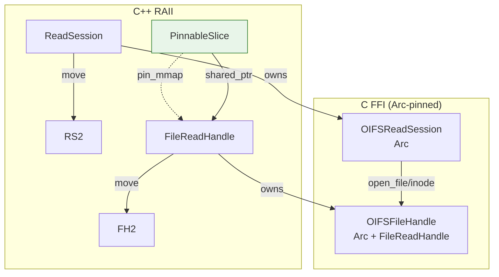
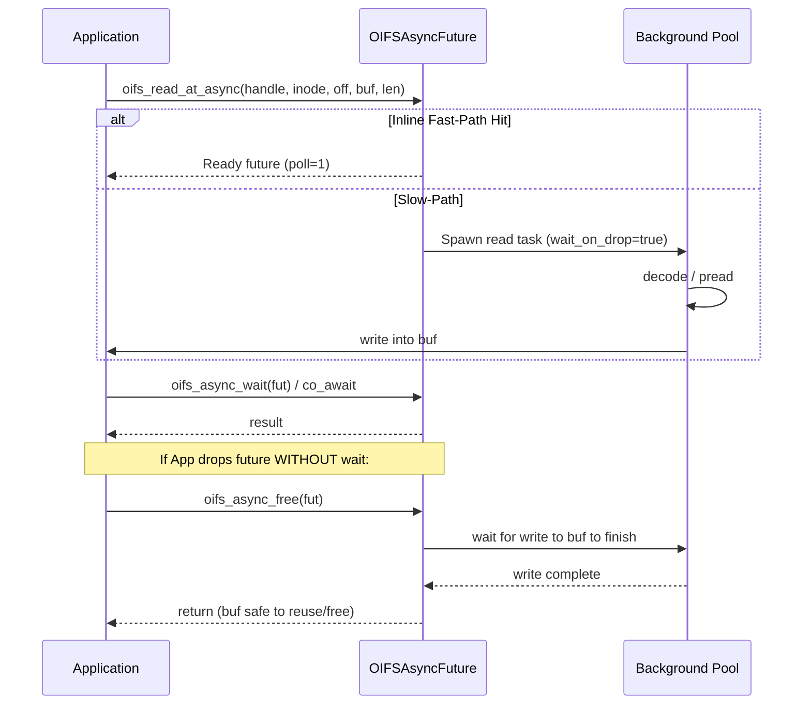

# C FFI and C++17/20 API Surface

The OIFS storage engine exports a **public C FFI** ([`include/oifs.h`](repo://include/oifs.h), [`src/ffi.rs`](repo://src/ffi.rs)) and a **header-only C++17/20 RAII wrapper** ([`include/oifs.hpp`](repo://include/oifs.hpp)). Together they expose the engine to C, C++, Python, Go, Rust, and any language that can call C ABI functions.

This page documents:
- Opaque handle types and ownership model
- Synchronous and asynchronous I/O operations
- `PinnableSlice` zero-copy memory-mapped reads
- `co_await` integration for C++20 coroutines
- C++ RAII wrappers with move semantics
- Error code conventions
- Ownership/lifetime diagrams for FFI handles

---

## Opaque Handle Model

All public C API functions operate on opaque pointers. The Rust-side definitions live in [`src/ffi.rs`](repo://src/ffi.rs#L11-L25):

```rust
pub struct OIFSHandle {
    pub dm: DiskManager,
    pub last_error: std::sync::Mutex<Option<String>>,
    pub fuse_state: std::sync::OnceLock<crate::fuse::OifsFuseState>,
}
```

In C ([`include/oifs.h#L52`](repo://include/oifs.h#L52)):
```c
typedef struct OIFSHandle OIFSHandle;
```

Additional opaque handles:
| Handle | Purpose |
|--------|---------|
| `OIFSHandle` | Filesystem instance (wraps `DiskManager`) |
| `OIFSReadSession` | Amortized read lock + inode cache for batch reads |
| `OIFSFileHandle` | Pinned file within a read session (zero `RwLock` overhead) |
| `OIFSAsyncFuture` | In-flight async operation (inline fast-path or background) |
| `OIFSFilterConfig` | SIMD pre-compression filter pipeline config |

### Handle-Isolated Error State

Each `OIFSHandle` maintains its own `last_error: Mutex<Option<String>>`. Successful calls clear it; failures populate it. Retrieve with `oifs_last_error`. This avoids global `errno` races in multithreaded hosts.

---

## C FFI: Complete API Surface

### Version & Compatibility Handshake
```c
uint32_t oifs_version_major(void);
uint32_t oifs_version_minor(void);
uint32_t oifs_version_patch(void);
uint64_t oifs_version_code(void);
const char* oifs_version_string(void);

#define OIFS_VERSION_COMPAT_OK       0
#define OIFS_VERSION_COMPAT_WARN     1
#define OIFS_VERSION_COMPAT_ERR     -1
int32_t oifs_check_version(uint32_t req_major, uint32_t req_minor, uint32_t req_patch);
int32_t oifs_loaded_path(char* buf, size_t buf_size);
```
Policy: **block older versions, permit newer versions**.

### Lifecycle & Open Modes
```c
/* Standalone direct access */
OIFSHandle* oifs_open(const char* path, uint64_t size);
OIFSHandle* oifs_open_with_password(const char* path, uint64_t size, const char* password);
OIFSHandle* oifs_open_with_options(const char* path, uint64_t size, const char* password,
                                   uint8_t storage_mode, uint8_t journaled);
OIFSHandle* oifs_open_read_only(const char* path, const char* password, uint8_t storage_mode);

/* Session registry reuse (IPC / local / network) */
OIFSHandle* oifs_get_or_open(const char* path, uint64_t size);
OIFSHandle* oifs_get_or_open_with_password(const char* path, uint64_t size, const char* password);

void oifs_close(OIFSHandle* handle);
int32_t oifs_is_read_only(const OIFSHandle* handle);
int32_t oifs_flush(OIFSHandle* handle);
int32_t oifs_set_durability_mode(OIFSHandle* handle, uint8_t mode);
int32_t oifs_set_file_io_cache_bytes(OIFSHandle* handle, size_t bytes);
```

**Storage modes**: `OIFS_STORAGE_MODE_MMAP (0)`, `OIFS_STORAGE_MODE_FILE_IO (1)`  
**Durability modes**: `OIFS_DURABILITY_LAZY (0)`, `OIFS_DURABILITY_RANGE_ASYNC (1)`, `OIFS_DURABILITY_STRICT (2)`

### I/O Engine Backend Configuration
```c
#define OIFS_IO_BACKEND_MMAP     0
#define OIFS_IO_BACKEND_PREAD    1
#define OIFS_IO_BACKEND_IO_URING 2
int32_t oifs_set_io_backend(OIFSHandle* handle, uint8_t backend);
int32_t oifs_get_io_backend(OIFSHandle* handle);
```

### Directory Operations
```c
typedef void (*ListCallback)(const char* name, uint64_t size, uint64_t mtime, void* user_data);
int32_t oifs_ls(OIFSHandle* handle, ListCallback cb, void* user_data);
int32_t oifs_ls_dir(OIFSHandle* handle, const char* path, ListCallback cb, void* user_data);
int32_t oifs_mkdir(OIFSHandle* handle, const char* path);
```

### File Operations & Metadata
```c
int32_t oifs_create_file(OIFSHandle* handle, const char* path);
int32_t oifs_create_or_open_file(OIFSHandle* handle, const char* path);
int32_t oifs_delete_file(OIFSHandle* handle, const char* path);
int32_t oifs_rename(OIFSHandle* handle, const char* old_path, const char* new_path);
int32_t oifs_truncate_file(OIFSHandle* handle, const char* filename, uint64_t new_size);

typedef struct { ... } OIFSFileStat;  // inode_id, size, compressed_size, timestamps, flags
int32_t oifs_stat(OIFSHandle* handle, const char* path, OIFSFileStat* out_stat);
int32_t oifs_exists(OIFSHandle* handle, const char* path);
```

### Synchronous Reads & Writes (Path-Based)
```c
int64_t oifs_read_at(OIFSHandle* handle, const char* filename, uint64_t offset,
                     uint8_t* buf, uint64_t buf_size);
int64_t oifs_read_file(OIFSHandle* handle, const char* filename,
                       uint8_t* buf, uint64_t buf_size);

int32_t oifs_write_file(OIFSHandle* handle, const char* filename,
                        const uint8_t* buf, uint64_t buf_size);
```

### Write Policy Flags
```c
#define OIFS_WRITE_POLICY_DEFAULT       0x00
#define OIFS_WRITE_POLICY_RAW           0x01
#define OIFS_WRITE_POLICY_STREAM        0x02
#define OIFS_WRITE_POLICY_SEEKABLE_64K  0x08

int32_t oifs_write_file_with_policy(OIFSHandle* handle, const char* filename,
                                    uint64_t offset, const uint8_t* buf, uint64_t buf_size,
                                    uint32_t policy_flags, int32_t zstd_level);
```

### Inode-Direct & Batch I/O (Zero Path Resolution)
```c
int64_t oifs_resolve_path(OIFSHandle* handle, const char* path);

int64_t oifs_create_file_with_data(OIFSHandle* handle, const char* path,
                                   const uint8_t* buf, uint64_t buf_size,
                                   uint32_t policy_flags, int32_t zstd_level);

int64_t oifs_read_at_inode(OIFSHandle* handle, uint64_t inode_id, uint64_t offset,
                           uint8_t* buf, uint64_t buf_size);

typedef struct {
    uint64_t inode_id;
    uint64_t offset;
    uint8_t* buf;
    uint64_t buf_size;
    int64_t result;
} OIFSReadBatchItem;

int32_t oifs_read_at_batch(OIFSHandle* handle, OIFSReadBatchItem* items, size_t count);
```

### Shared Read Session & Pinned File Handle (Zero-Copy Path)
```c
OIFSReadSession* oifs_begin_read(OIFSHandle* handle);
void oifs_end_read(OIFSReadSession* session);

OIFSFileHandle* oifs_session_open_file(const OIFSReadSession* session, const char* path);
OIFSFileHandle* oifs_session_open_inode(const OIFSReadSession* session, uint64_t inode_id);
void oifs_file_close(OIFSFileHandle* file);

uint64_t oifs_file_size(const OIFSFileHandle* file);
uint64_t oifs_file_inode_id(const OIFSFileHandle* file);
int64_t oifs_file_read_at(const OIFSFileHandle* file, uint64_t offset,
                          uint8_t* buf, uint64_t buf_size);

/* True zero-copy mmap slice */
int32_t oifs_file_mmap_slice(const OIFSFileHandle* file, uint64_t offset, uint64_t max_len,
                             const uint8_t** out_ptr, uint64_t* out_len);
/* Returns: 0 = zero-copy OK (ptr valid while file/session open),
 *          1 = zero-copy unavailable (fallback to oifs_file_read_at),
 *         -1 = error */
```

---

## Asynchronous I/O & Group Commit (C FFI)

### Future-Based API
```c
OIFSAsyncFuture* oifs_read_at_async(OIFSHandle* handle, uint64_t inode_id,
                                    uint64_t offset, uint8_t* buf, uint64_t buf_size);
OIFSAsyncFuture* oifs_create_file_with_data_async(OIFSHandle* handle, const char* path,
                                                  const uint8_t* buf, uint64_t buf_size,
                                                  uint32_t policy_flags, int32_t zstd_level);
OIFSAsyncFuture* oifs_write_file_async(OIFSHandle* handle, const char* path,
                                       uint64_t offset, const uint8_t* buf, uint64_t buf_size,
                                       uint32_t policy_flags, int32_t zstd_level);
OIFSAsyncFuture* oifs_flush_async(OIFSHandle* handle);

int32_t oifs_async_poll(const OIFSAsyncFuture* fut);      /* 1=ready, 0=pending, -1=invalid */
int64_t oifs_async_wait(OIFSAsyncFuture* fut);            /* blocks, returns result or -1 */
int32_t oifs_async_last_error(const OIFSAsyncFuture* fut, char* buf, uint32_t buf_size);
void oifs_async_free(OIFSAsyncFuture* fut);               /* drop barrier: waits if writing to caller buf */
```

### Callback-Based API
```c
typedef void (*OifsAsyncReadCallback)(int64_t status_or_len, const uint8_t* data,
                                      size_t data_len, void* user_data);
typedef void (*OifsAsyncStatusCallback)(int64_t status_or_inode, void* user_data);

int32_t oifs_read_at_async_cb(OIFSHandle* handle, uint64_t inode_id, uint64_t offset,
                              uint64_t len, OifsAsyncReadCallback cb, void* user_data);
int32_t oifs_create_file_with_data_async_cb(OIFSHandle* handle, const char* path,
                                            const uint8_t* buf, uint64_t buf_size,
                                            uint32_t policy_flags, int32_t zstd_level,
                                            OifsAsyncStatusCallback cb, void* user_data);
```

### Async Execution Model

<!-- openwiki: mermaid parse failed and this diagram was converted to a text fence so it does not break rendering. Fix the diagram source and restore the mermaid fence. Parser error: Parse error on line 4: ...dy immediately\npoll() = 1\n~50 ns] Expecting 'SQE', 'DOUBLECIRCLEEND', 'PE', '-)', 'STADIUMEND', 'SUBROUTINEEND', 'PIPE', 'CYLINDEREND', 'DIAMOND_STOP', 'TAGEND', 'TRAPEND', 'INVTRAPEND', 'UNICODE_TEXT', 'TEXT', 'TAGSTART', got 'PS' -->
```text
flowchart TD
    subgraph CALLER["Caller Thread"]
        A[oifs_read_at_async] -->|Inline Fast-Path| B{cache/mmap hit?}
        B -- yes --> C[Ready immediately\npoll() = 1\n~50 ns]
        B -- no --> D[Spawn to bg pool]
    end

    subgraph BG["Background Worker Pool"]
        D --> E[Zstd decode / XChaCha20 decrypt / pread]
        E --> F[Write to caller buf]
        F --> G[Mark future ready]
    end

    C --> H[caller calls wait()/poll()]
    G --> H
    H --> I[Returns bytes_read]
```

- **Inline Fast-Path**: Mmap / `DataPageCache` / `ChunkReadCache` / `DecodedBlobCache` hits complete **on the calling thread** with zero context switch (~50 ns).
- **Slow-Path**: Cold reads, compressed/encrypted decode, or lock contention dispatch to a **persistent background pool**.
- **Drop Barrier**: If `oifs_async_free` is called while a background read is still writing into the caller's buffer, it **blocks until the write finishes**—preventing Use-After-Free.
- **Group Commit (Writes)**: Concurrent async writes under `OIFS_DURABILITY_STRICT` share a **single physical `flush()` per batch**, preserving WAL-first crash consistency while amplifying throughput 10–30×.

---

## FUSE Kernel Protocol Dispatcher

```c
int64_t oifs_fuse_dispatch_frame(OIFSHandle* handle,
                                 const uint8_t* req_buf, size_t req_len,
                                 uint8_t* resp_buf, size_t resp_cap);
```
Dispatches a raw **FUSE Kernel ABI v7.28** request frame. Open FUSE file/directory handles (`fh`) persist across calls on the same `OIFSHandle`. Read-only handles reject mutating opcodes with `-EROFS`.

---

## Cross-Image Operations

```c
/* Whole-image CoW clone */
#define OIFS_CLONE_METHOD_APFS_CLONEFILE  0
#define OIFS_CLONE_METHOD_LINUX_FICLONE   1
#define OIFS_CLONE_METHOD_STANDARD_COPY   2
int32_t oifs_clone_image(const char* src_path, const char* dst_path, uint8_t* out_method);

/* 3-tier file transfer */
#define OIFS_TRANSFER_METHOD_REFLINK           0
#define OIFS_TRANSFER_METHOD_COPY_FILE_RANGE   1
#define OIFS_TRANSFER_METHOD_RAW_BLOCK_COPY    2
#define OIFS_TRANSFER_METHOD_LOGICAL_REENCODE  3
#define OIFS_TRANSFER_FLAG_MOVE       0x01
#define OIFS_TRANSFER_FLAG_OVERWRITE  0x02

typedef struct { ... } OIFSTransferStats;
int32_t oifs_transfer_file_to(OIFSHandle* src_handle, const char* src_path,
                              OIFSHandle* dst_handle, const char* dst_path,
                              uint32_t flags, OIFSTransferStats* out_stats);

/* Sub-range splice */
#define OIFS_SPLICE_TRIM_KEEP        0
#define OIFS_SPLICE_TRIM_PUNCH_HOLE  1
#define OIFS_SPLICE_TRIM_COLLAPSE    2

typedef struct { ... } OIFSSpliceStats;
int32_t oifs_splice_range_to(OIFSHandle* src_handle, uint64_t src_inode, uint64_t src_off,
                             OIFSHandle* dst_handle, uint64_t dst_inode, uint64_t dst_off,
                             uint64_t len, uint8_t trim_mode, OIFSSpliceStats* out_stats);
```

---

## SIMD Numeric Pre-Compression Filters

```c
typedef struct {
    uint8_t typesize;   /* 1, 2, 4, 8 (0 = disabled) */
    uint8_t delta;      /* first-order delta */
    uint8_t shuffle;    /* byte shuffle */
    uint8_t bitshuffle; /* bit shuffle */
} OIFSFilterConfig;

int64_t oifs_create_file_with_data_filtered(OIFSHandle* handle, const char* path,
                                            const uint8_t* buf, uint64_t buf_size,
                                            uint32_t policy_flags, int32_t zstd_level,
                                            const OIFSFilterConfig* filter_cfg);

int32_t oifs_write_file_with_filters(OIFSHandle* handle, const char* path,
                                     uint64_t offset, const uint8_t* buf, uint64_t buf_size,
                                     uint32_t policy_flags, int32_t zstd_level,
                                     const OIFSFilterConfig* filter_cfg);
```

---

## Online Maintenance & Diagnostics

```c
typedef struct { ... } OIFSFsckReport;          // is_clean, orphan_inodes, leaked_blocks, ...
typedef struct { ... } OIFSFragmentationStats;  // total/used/free blocks, runs, frag_ratio
typedef struct { ... } OIFSDefragStats;         // files_processed, bytes_moved, blocks_freed

int32_t oifs_verify_integrity(OIFSHandle* handle, OIFSFsckReport* out_report);
int32_t oifs_analyze_fragmentation(OIFSHandle* handle, OIFSFragmentationStats* out_stats);
int32_t oifs_defragment(OIFSHandle* handle, OIFSDefragStats* out_stats);
```

---

## Error Handling Convention

| Return | Meaning |
|--------|---------|
| `0` | Success (for `int32_t` functions) |
| `>0` | Bytes read / inode ID / status |
| `-1` | Failure (check `oifs_last_error`) |
| `NULL` | Failure for pointer-returning functions |

```c
int32_t oifs_last_error(OIFSHandle* handle, char* buf, uint32_t buf_size);
```
- Copies the handle's last error string into `buf`, guaranteed **NUL-terminated**.
- Returns `0` on success, `-1` if `handle`/`buf` is null or `buf_size == 0`.
- Each handle's error state is **independent** (no global `errno`).

---

# C++17/20 Header-Only API (`oifs.hpp`)

[`include/oifs.hpp`](repo://include/oifs.hpp) provides **move-only RAII wrappers**, `ByteView`/`Span`/`MutableByteSpan` helpers, `PinnableSlice` zero-copy reads, and **C++20 `co_await` integration**.

```cpp
#include "oifs.hpp"
using namespace oifs;
```

### Core RAII Wrappers

| Class | Wraps | Key Methods |
|-------|-------|-------------|
| `FileSystem` | `OIFSHandle*` | `open`, `open_with_password`, `get_or_open`, `open_read_only`, `begin_read`, `read_at_async`, `create_file_with_data_async`, `write_file_async`, `flush_async`, `ls`, `stat`, `mkdir`, `delete_file`, `rename`, `transfer_file_to`, `splice_range_to`, `verify_integrity`, `analyze_fragmentation`, `defragment`, `set_durability_mode`, `set_io_backend` |
| `ReadSession` | `OIFSReadSession*` | `open_file(path)`, `open_inode(id)`, `close()` |
| `FileReadHandle` | `OIFSFileHandle*` | `size()`, `inode_id()`, `read_at(offset, dst)`, `try_mmap_view(offset, max_len)`, `read_pinnable(offset, max_len, out)`, `close()` |
| `AsyncFuture` | `OIFSAsyncFuture*` | `is_ready()`, `wait()`, `last_error()`, `operator co_await()` (C++20) |

All wrappers are **move-only** (deleted copy, default move). Destructors call the corresponding `_close`/`_free` FFI function.

### `ByteView`, `MutableByteSpan`, `Span<T>`

Non-owning views over contiguous memory. In C++20 they implicitly convert to `std::span`.

```cpp
ByteView view(ptr, len);              // const uint8_t*
MutableByteSpan mbuf(ptr, len);       // uint8_t*
Span<const T> s(view);                // typed view with alignment/size check
auto vec = view.to_vector();          // copy to owned storage
```

### `PinnableSlice` — Zero-Copy / 1-Copy Fallback

```cpp
class PinnableSlice {
public:
    const uint8_t* data() const noexcept;
    size_t size() const noexcept;
    bool empty() const noexcept;
    bool is_pinned() const noexcept;     // true = zero-copy mmap ptr
    bool is_zero_copy() const noexcept;  // alias

    ByteView view() const noexcept;
    operator ByteView() const noexcept;
    template<typename T> Span<const T> as_span() const;

    // Iterators, operator[], as_string_view, reset()
};
```

**Behavior**:
- On `StorageMode::Mmap` with **raw contiguous extents** (`oifs_file_mmap_slice == 0`): pins the mmap address directly (`is_pinned() == true`, **0 memcpy, 0 heap allocation**). Holds a `shared_ptr<OIFSFileHandle>` so the mapping stays valid.
- On `StorageMode::FileIo`, compressed, encrypted, sparse, or non-contiguous ranges (`oifs_file_mmap_slice == 1`): falls back to reading into its internal `std::vector<uint8_t>` (`is_pinned() == false`, **1-copy**).

**Usage**:
```cpp
FileSystem fs = FileSystem::open("data.img");
auto session = fs.begin_read();
auto fh = session.open_file("large.bin");

PinnableSlice slice;
fh.read_pinnable(0, 1 << 20, slice);  // reads up to 1 MiB

if (slice.is_zero_copy()) {
    // slice.data() points directly into the mmap
    process(slice.view());
} else {
    // slice.data() points to internal fallback buffer
    process(slice.view());
}
// slice destructor releases pin / keeps fallback capacity
```

### C++20 Coroutine `co_await` Integration

```cpp
#if defined(OIFS_HAS_CPP20_COROUTINE)
    class Awaiter {
        bool await_ready() const noexcept { return fut_.is_ready(); }
        void await_suspend(std::coroutine_handle<> h);
        int64_t await_resume();  // throws on error
    };
    Awaiter operator co_await() noexcept;
#endif
```

**Example**:
```cpp
// Inline fast-path: await_ready() == true → resumes immediately, no suspension
// Slow-path: suspends, background pool completes, resumes on caller's executor
auto fut = fs.read_at_async(inode_id, offset, MutableByteSpan(buf, len));
co_await fut;  // int64_t bytes_read = co_await fs.read_at_async(...);
```

- **Fast-Path hits** (`is_ready() == true`) → `await_ready()` returns `true`, **zero suspension, zero thread hop**.
- **Pending futures** → suspend coroutine, background worker completes I/O, resume via `h.resume()` on a detached thread (caller should provide a proper executor in production).
- **Error handling**: `await_resume()` throws `oifs::Error` on failure; use `try/catch` or let propagate.

### Async Callback Helpers (Lambda-Friendly)

```cpp
// Reads asynchronously; invokes cb(status_or_len, ByteView) or cb(status, ptr, len)
template<typename Fn>
void read_at_async_cb(uint64_t inode_id, uint64_t offset, uint64_t len, Fn&& cb);

// Creates file asynchronously; invokes cb(inode_id_or_error)
template<typename Fn>
void create_file_with_data_async_cb(string_view path, ByteView data,
                                    uint32_t policy, int32_t zstd, Fn&& cb);
```

```cpp
fs.read_at_async_cb(inode, 0, 4096, [](int64_t status, ByteView data) {
    if (status >= 0) process(data);
    else handle_error(status);
});
```

### Error Handling

```cpp
class Error : public std::runtime_error {
    explicit Error(const std::string& msg);
    explicit Error(const char* msg);
};

// All RAII methods throw Error on failure
try {
    FileSystem fs = FileSystem::open("data.img");
    fs.mkdir("dir");
    fs.write_file("dir/file.bin", ByteView(data, size));
} catch (const Error& e) {
    // e.what() contains oifs_last_error message
}
```

---

## Ownership & Lifetime Diagrams

### `FileSystem` (`OIFSHandle`) Lifetime

<!-- openwiki: mermaid parse failed and this diagram was converted to a text fence so it does not break rendering. Fix the diagram source and restore the mermaid fence. Parser error: Parse error on line 7: ... D -> E[mmmap.flush()\nWAL sync\nRefCou Expecting 'SQE', 'DOUBLECIRCLEEND', 'PE', '-)', 'STADIUMEND', 'SUBROUTINEEND', 'PIPE', 'CYLINDEREND', 'DIAMOND_STOP', 'TAGEND', 'TRAPEND', 'INVTRAPEND', 'UNICODE_TEXT', 'TEXT', 'TAGSTART', got 'PS' -->
```text
flowchart LR
    subgraph HOST["Host Application"]
        A[FileSystem fs] -->|move| B[FileSystem fs2]
        B -->|destructor| C[oifs_close]
    end
    C --> D[(DiskManager drop)]
    D --> E[mmmap.flush()\nWAL sync\nRefCount--]
```

- `FileSystem` is **move-only**. Move transfers ownership of the raw `OIFSHandle*`.
- Destructor calls `oifs_close`, which `Box::from_raw` and drops the `DiskManager`.
- `DiskManager` drop triggers `mmap.flush()` committing all changes.

### `ReadSession` + `FileReadHandle` + `PinnableSlice` Lifetime



**Critical invariants**:
1. `OIFSReadSession` and `OIFSFileHandle` **both hold `Arc<FfiSharedSession>`** (which owns the `DiskManager` and the `RwLockReadGuard`).
2. `OIFSFileHandle`'s `Arc` is **independent** of the parent `OIFSReadSession`'s `Arc`.
3. **Result**: C callers can destroy `OIFSReadSession` *before* `OIFSFileHandle` (or vice versa) **without Use-After-Free**. The underlying read lock and mmap stay alive until *all* handles are dropped.
4. `PinnableSlice::pin_mmap` captures a `shared_ptr<OIFSFileHandle>`, so the slice keeps the file handle (and thus the session) alive.

### `AsyncFuture` Drop Barrier



---

## FFI Safety Guarantees

| Guarantee | Mechanism |
|-----------|-----------|
| **Null pointer checks** | Every `extern "C"` function validates inputs |
| **UTF-8 validation** | `cstr_to_str` returns error on invalid UTF-8 |
| **Panic isolation** | All entry points wrapped in `catch_unwind(AssertUnwindSafe(...))` |
| **No ABI unwind** | Rust panics never cross the C boundary |
| **Integer overflow** | `usize::try_from` on all `uint64_t` buffer sizes |
| **Use-After-Free prevention** | `Arc<FfiSharedSession>` for read handles; drop barrier for async buffers |
| **Thread safety** | `DiskManager` uses `Arc<RwLock<>>`; handles are `Send + Sync` |

---

## Quick Reference: C ↔ C++ Mapping

| C Function | C++ Method |
|------------|------------|
| `oifs_open` | `FileSystem::open` |
| `oifs_open_with_password` | `FileSystem::open_with_password` |
| `oifs_get_or_open` | `FileSystem::get_or_open` |
| `oifs_open_read_only` | `FileSystem::open_read_only` |
| `oifs_close` | `FileSystem::~FileSystem()` / `close()` |
| `oifs_begin_read` | `FileSystem::begin_read()` → `ReadSession` |
| `oifs_session_open_file` | `ReadSession::open_file(path)` → `FileReadHandle` |
| `oifs_file_read_at` | `FileReadHandle::read_at(offset, dst)` |
| `oifs_file_mmap_slice` | `FileReadHandle::try_mmap_view(offset, max_len)` |
| `oifs_read_at_async` | `FileSystem::read_at_async(...)` → `AsyncFuture` |
| `co_await future` | `AsyncFuture::operator co_await()` |
| `oifs_async_wait` | `AsyncFuture::wait()` |
| `oifs_async_free` | `AsyncFuture::~AsyncFuture()` / `reset()` |
| `oifs_last_error` | `FileSystem::last_error()` / `AsyncFuture::last_error()` |

---

## Related Pages

- [Concurrency and Session Architecture](../architecture/concurrency_and_session.md) — Session registry, IPC, and locking details
- [FFI Integration Guide](../integrations/ffi_integration.md) — Embedding in Python, Go, Node.js, etc.
- [FFI Workflow Examples](../workflows/ffi_workflow.md) — End-to-end usage patterns
