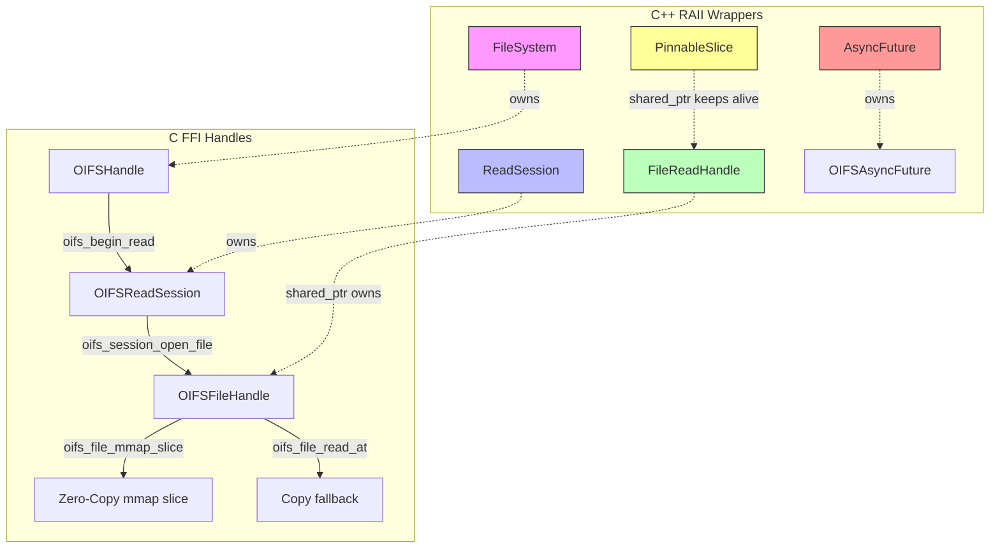
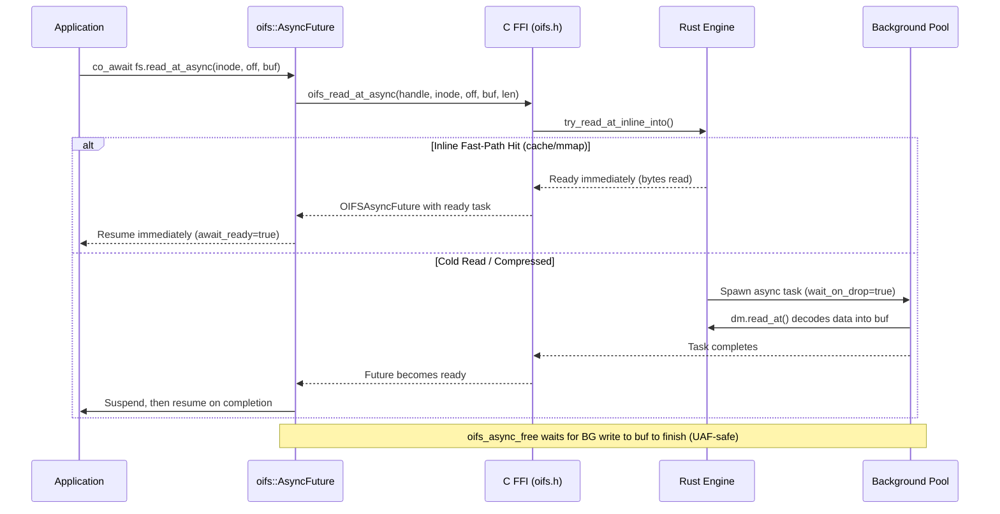

# C FFI & C++17/20 API Surface

The OIFS storage engine exports a **public C FFI** ([`include/oifs.h`](repo://include/oifs.h), [`src/ffi.rs`](repo://src/ffi.rs)) and a **header-only C++17/20 RAII wrapper** ([`include/oifs.hpp`](repo://include/oifs.hpp)). Together they expose the engine to C, C++, Python, Go, Rust, and any language that can call C ABI functions.

This page documents:
- Opaque handle types and ownership model
- Synchronous and asynchronous I/O operations
- `PinnableSlice` zero-copy memory-mapped reads
- `co_await` integration for C++20 coroutines
- C++ RAII wrappers with move semantics
- Error code conventions
- Ownership/lifetime diagrams for FFI handles

---

## Opaque Handle Model

All public C API functions operate on opaque pointers. The Rust-side definitions live in [`src/ffi.rs`](repo://src/ffi.rs#L11-L25):

```rust
pub struct OIFSHandle {
    pub dm: DiskManager,
    pub fuse_state: std::sync::OnceLock<crate::fuse::OifsFuseState>,
}
```

In C ([`include/oifs.h#L52`](repo://include/oifs.h#L52)):
```c
typedef struct OIFSHandle OIFSHandle;
```

Additional opaque handles:
| Handle | Purpose |
|--------|---------|
| `OIFSHandle` | Filesystem instance (wraps `DiskManager`) |
| `OIFSReadSession` | Amortized read lock + inode cache for batch reads |
| `OIFSFileHandle` | Pinned file within a read session (zero `RwLock` overhead) |
| `OIFSAsyncFuture` | In-flight async operation (inline fast-path or background) |
| `OIFSFilterConfig` | SIMD pre-compression filter pipeline config |

### Handle-Isolated Error State

Each `OIFSHandle` maintains its own thread-local `last_error` via a `RefCell` slot and an atomic counter (`FFI_ACTIVE_ERROR_THREADS`). Successful calls clear it; failures populate it. Retrieve with `oifs_last_error`. This avoids global `errno` races in multithreaded hosts ([`src/ffi.rs#L11-L55`](repo://src/ffi.rs#L11-L55)).

---

## C FFI: Complete API Surface

### Version & Compatibility Handshake
```c
uint32_t oifs_version_major(void);
uint32_t oifs_version_minor(void);
uint32_t oifs_version_patch(void);
uint64_t oifs_version_code(void);
const char* oifs_version_string(void);

#define OIFS_VERSION_COMPAT_OK       0
#define OIFS_VERSION_COMPAT_WARN     1
#define OIFS_VERSION_COMPAT_ERR     -1
int32_t oifs_check_version(uint32_t req_major, uint32_t req_minor, uint32_t req_patch);
int32_t oifs_loaded_path(char* buf, size_t buf_size);
```
Policy: **block older versions, permit newer versions** ([`include/oifs.h#L600-L645`](repo://include/oifs.h#L600-L645)).

### Lifecycle & Open Modes
```c
/* Standalone direct access */
OIFSHandle* oifs_open(const char* path, uint64_t size);
OIFSHandle* oifs_open_with_password(const char* path, uint64_t size, const char* password);
OIFSHandle* oifs_open_with_options(const char* path, uint64_t size, const char* password,
                                   uint8_t storage_mode, uint8_t journaled);
OIFSHandle* oifs_open_read_only(const char* path, const char* password, uint8_t storage_mode);

/* Session registry reuse (IPC / local / network) */
OIFSHandle* oifs_get_or_open(const char* path, uint64_t size);
OIFSHandle* oifs_get_or_open_with_password(const char* path, uint64_t size, const char* password);

void oifs_close(OIFSHandle* handle);
int32_t oifs_is_read_only(const OIFSHandle* handle);
int32_t oifs_flush(OIFSHandle* handle);
int32_t oifs_set_durability_mode(OIFSHandle* handle, uint8_t mode);
int32_t oifs_set_file_io_cache_bytes(OIFSHandle* handle, size_t bytes);
```

### Directory Operations
```c
typedef void (*ListCallback)(const char* name, uint64_t size, uint64_t mtime, void* user_data);
int32_t oifs_ls(OIFSHandle* handle, ListCallback cb, void* user_data);
int32_t oifs_ls_dir(OIFSHandle* handle, const char* path, ListCallback cb, void* user_data);
int32_t oifs_mkdir(OIFSHandle* handle, const char* path);
```

### File Operations & Metadata
```c
int32_t oifs_create_file(OIFSHandle* handle, const char* path);
int32_t oifs_create_or_open_file(OIFSHandle* handle, const char* path);
int32_t oifs_delete_file(OIFSHandle* handle, const char* path);
int32_t oifs_rename(OIFSHandle* handle, const char* old_path, const char* new_path);

typedef struct {
    uint64_t inode_id;
    uint64_t size;
    uint64_t compressed_size;
    uint64_t created_at;
    uint64_t modified_at;
    uint8_t is_dir;
    uint8_t encrypted;
    uint8_t seekable_64k;
    uint8_t filter_typesize;
    uint8_t filter_delta;
    uint8_t filter_shuffle;
    uint8_t filter_bitshuffle;
    uint8_t _pad;
} OIFSFileStat;

int32_t oifs_stat(OIFSHandle* handle, const char* path, OIFSFileStat* out_stat);
int32_t oifs_exists(OIFSHandle* handle, const char* path);
int64_t oifs_resolve_path(OIFSHandle* handle, const char* path);
```

### Synchronous I/O
```c
int64_t oifs_read_at(OIFSHandle* handle, const char* filename, uint64_t offset,
                     uint8_t* buf, uint64_t buf_size);
int64_t oifs_read_file(OIFSHandle* handle, const char* filename, uint8_t* buf, uint64_t buf_size);
int32_t oifs_write_file(OIFSHandle* handle, const char* filename, const uint8_t* buf, uint64_t buf_size);

/* Extended write with policy flags & zstd level */
#define OIFS_WRITE_POLICY_DEFAULT       0x00
#define OIFS_WRITE_POLICY_RAW           0x01
#define OIFS_WRITE_POLICY_STREAM        0x02
#define OIFS_WRITE_POLICY_SEEKABLE_64K  0x08

int32_t oifs_write_file_with_policy(OIFSHandle* handle, const char* filename, uint64_t offset,
                                    const uint8_t* buf, uint64_t buf_size,
                                    uint32_t policy_flags, int32_t zstd_level);
int32_t oifs_truncate_file(OIFSHandle* handle, const char* filename, uint64_t new_size);
```

### Direct Inode & Batch I/O
```c
int64_t oifs_create_file_with_data(OIFSHandle* handle, const char* path,
                                   const uint8_t* buf, uint64_t buf_size,
                                   uint32_t policy_flags, int32_t zstd_level);
int64_t oifs_read_at_inode(OIFSHandle* handle, uint64_t inode_id, uint64_t offset,
                           uint8_t* buf, uint64_t buf_size);

typedef struct {
    uint64_t inode_id;
    uint64_t offset;
    uint8_t* buf;
    uint64_t buf_size;
    int64_t result;
} OIFSReadBatchItem;

int32_t oifs_read_at_batch(OIFSHandle* handle, OIFSReadBatchItem* items, size_t count);
```

### Shared Read Session & Zero-Copy `mmap` Slice
```c
OIFSReadSession* oifs_begin_read(OIFSHandle* handle);
void oifs_end_read(OIFSReadSession* session);

OIFSFileHandle* oifs_session_open_file(const OIFSReadSession* session, const char* path);
OIFSFileHandle* oifs_session_open_inode(const OIFSReadSession* session, uint64_t inode_id);
void oifs_file_close(OIFSFileHandle* file);

uint64_t oifs_file_size(const OIFSFileHandle* file);
uint64_t oifs_file_inode_id(const OIFSFileHandle* file);
int64_t oifs_file_read_at(const OIFSFileHandle* file, uint64_t offset,
                          uint8_t* buf, uint64_t buf_size);

/* True Zero-Copy mmap view */
int32_t oifs_file_mmap_slice(const OIFSFileHandle* file, uint64_t offset, uint64_t max_len,
                             const uint8_t** out_ptr, uint64_t* out_len);
```
**Return values for `oifs_file_mmap_slice`:**
- `0`: Zero-copy succeeded; `*out_ptr` points directly to mapped file bytes (valid while the `OIFSFileHandle` or its parent `OIFSReadSession` remains open)
- `1`: Zero-copy unavailable (StorageMode::FileIo, compressed/encrypted file, sparse hole, or non-contiguous block boundary); fall back to `oifs_file_read_at`
- `-1`: Error or null pointer argument

### Asynchronous I/O & Group-Commit Write Engine
```c
typedef void (*OifsAsyncReadCallback)(int64_t status_or_len, const uint8_t* data,
                                      size_t data_len, void* user_data);
typedef void (*OifsAsyncStatusCallback)(int64_t status_or_inode, void* user_data);

OIFSAsyncFuture* oifs_read_at_async(OIFSHandle* handle, uint64_t inode_id, uint64_t offset,
                                    uint8_t* buf, uint64_t buf_size);
OIFSAsyncFuture* oifs_create_file_with_data_async(OIFSHandle* handle, const char* path,
                                                  const uint8_t* buf, uint64_t buf_size,
                                                  uint32_t policy_flags, int32_t zstd_level);
OIFSAsyncFuture* oifs_write_file_async(OIFSHandle* handle, const char* path, uint64_t offset,
                                       const uint8_t* buf, uint64_t buf_size,
                                       uint32_t policy_flags, int32_t zstd_level);
OIFSAsyncFuture* oifs_flush_async(OIFSHandle* handle);

int32_t oifs_async_poll(const OIFSAsyncFuture* fut);
int64_t oifs_async_wait(OIFSAsyncFuture* fut);
int32_t oifs_async_last_error(const OIFSAsyncFuture* fut, char* buf, uint32_t buf_size);
void oifs_async_free(OIFSAsyncFuture* fut);

int32_t oifs_read_at_async_cb(OIFSHandle* handle, uint64_t inode_id, uint64_t offset,
                              uint64_t len, OifsAsyncReadCallback cb, void* user_data);
int32_t oifs_create_file_with_data_async_cb(OIFSHandle* handle, const char* path,
                                            const uint8_t* buf, uint64_t buf_size,
                                            uint32_t policy_flags, int32_t zstd_level,
                                            OifsAsyncStatusCallback cb, void* user_data);
```

**Key async characteristics:**
- **Inline Fast-Path**: Cache/mmap hits complete immediately on the calling thread (`oifs_async_poll == 1`, zero thread switch)
- **Background Pool**: Cold reads and compressed/encrypted decodes execute on persistent background pool
- **Use-After-Free Safe**: `oifs_async_free` waits for any in-flight write to `buf` to finish before returning
- **Group Commit**: Concurrent async writes under `OIFS_DURABILITY_STRICT` share a single physical sync barrier per batch

### FUSE Kernel Protocol Dispatcher
```c
int64_t oifs_fuse_dispatch_frame(OIFSHandle* handle, const uint8_t* req_buf, size_t req_len,
                                 uint8_t* resp_buf, size_t resp_cap);
```
Dispatches raw FUSE Kernel ABI v7.28 request frames. Open FUSE file/directory handles (`fh`) persist across successive calls on the same `OIFSHandle`. Read-only handles automatically reject mutating opcodes with `-EROFS`.

### SIMD Numeric Pre-Compression Filters
```c
typedef struct {
    uint8_t typesize;   /* Element size in bytes (1, 2, 4, or 8; 0 = disabled) */
    uint8_t delta;      /* Non-zero to enable first-order delta encoding */
    uint8_t shuffle;    /* Non-zero to enable byte shuffle */
    uint8_t bitshuffle; /* Non-zero to enable bit shuffle */
} OIFSFilterConfig;

int64_t oifs_create_file_with_data_filtered(OIFSHandle* handle, const char* path,
                                            const uint8_t* buf, uint64_t buf_size,
                                            uint32_t policy_flags, int32_t zstd_level,
                                            const OIFSFilterConfig* filter_cfg);
int32_t oifs_write_file_with_filters(OIFSHandle* handle, const char* path, uint64_t offset,
                                     const uint8_t* buf, uint64_t buf_size,
                                     uint32_t policy_flags, int32_t zstd_level,
                                     const OIFSFilterConfig* filter_cfg);
```

### Cross-Image CoW Clone, 3-Tier Fast Transfer & Sub-Range Splice
```c
#define OIFS_CLONE_METHOD_APFS_CLONEFILE        0
#define OIFS_CLONE_METHOD_LINUX_FICLONE         1
#define OIFS_CLONE_METHOD_STANDARD_COPY         2

#define OIFS_TRANSFER_METHOD_REFLINK            0
#define OIFS_TRANSFER_METHOD_COPY_FILE_RANGE    1
#define OIFS_TRANSFER_METHOD_RAW_BLOCK_COPY     2
#define OIFS_TRANSFER_METHOD_LOGICAL_REENCODE   3

#define OIFS_TRANSFER_FLAG_MOVE                 0x01
#define OIFS_TRANSFER_FLAG_OVERWRITE            0x02

#define OIFS_SPLICE_TRIM_KEEP                   0
#define OIFS_SPLICE_TRIM_PUNCH_HOLE             1
#define OIFS_SPLICE_TRIM_COLLAPSE               2

typedef struct { /* ... */ } OIFSTransferStats;
typedef struct { /* ... */ } OIFSSpliceStats;

int32_t oifs_clone_image(const char* src_path, const char* dst_path, uint8_t* out_method);
int32_t oifs_transfer_file_to(OIFSHandle* src_handle, const char* src_path,
                              OIFSHandle* dst_handle, const char* dst_path,
                              uint32_t flags, OIFSTransferStats* out_stats);
int32_t oifs_splice_range_to(OIFSHandle* src_handle, uint64_t src_inode, uint64_t src_off,
                             OIFSHandle* dst_handle, uint64_t dst_inode, uint64_t dst_off,
                             uint64_t len, uint8_t trim_mode, OIFSSpliceStats* out_stats);
```

### Online Maintenance & Diagnostics
```c
typedef struct { /* ... */ } OIFSFsckReport;
typedef struct { /* ... */ } OIFSFragmentationStats;
typedef struct { /* ... */ } OIFSDefragStats;

int32_t oifs_verify_integrity(OIFSHandle* handle, OIFSFsckReport* out_report);
int32_t oifs_analyze_fragmentation(OIFSHandle* handle, OIFSFragmentationStats* out_stats);
int32_t oifs_defragment(OIFSHandle* handle, OIFSDefragStats* out_stats);
```

### Error Handling
```c
int32_t oifs_last_error(OIFSHandle* handle, char* buf, uint32_t buf_size);
```
Returns 0 on success, -1 on failure. The error message is NUL-terminated. Each handle maintains thread-local error state.

### I/O Engine Backend Configuration
```c
#define OIFS_IO_BACKEND_MMAP     0
#define OIFS_IO_BACKEND_PREAD    1
#define OIFS_IO_BACKEND_IO_URING 2

int32_t oifs_set_io_backend(OIFSHandle* handle, uint8_t backend);
int32_t oifs_get_io_backend(OIFSHandle* handle);
```

---

## C++17/20 Header-Only RAPI Wrapper (`oifs.hpp`)

The header-only wrapper in [`include/oifs.hpp`](repo://include/oifs.hpp) provides type-safe RAII classes with move semantics, exception-based error handling, and C++20 coroutine support.

### Core Types & Utilities
```cpp
namespace oifs {

class Error : public std::runtime_error { /* ... */ };

enum class StorageMode : uint8_t { Mmap = 0, FileIo = 1 };
enum class IoBackend : uint8_t { Mmap = 0, Pread = 1, IoUring = 2 };
enum class DurabilityMode : uint8_t { Lazy = 0, RangeAsync = 1, Strict = 2 };
enum class WritePolicy : uint32_t { Default = 0x00, Raw = 0x01, Stream = 0x02, Seekable64K = 0x08 };
enum class CloneMethod : uint8_t { ApfsClonefile = 0, LinuxFiclone = 1, StandardCopy = 2 };
enum class TransferMethod : uint8_t { Reflink = 0, CopyFileRange = 1, RawBlockCopy = 2, LogicalReencode = 3 };
enum class SpliceTrimMode : uint8_t { Keep = 0, PunchHole = 1, CollapseRange = 2 };

struct FilterConfig { /* ... */ };  // SIMD pre-compression filters
struct FileStat { /* ... */ };      // Inode metadata
struct DirEntry { /* ... */ };      // Directory listing entry
struct TransferOptions { bool move_file = false; bool overwrite = false; };
struct TransferStats { /* ... */ };
struct SpliceOptions { SpliceTrimMode trim_mode = SpliceTrimMode::Keep; };
struct SpliceStats { /* ... */ };
struct FsckReport { /* ... */ };
struct FragmentationStats { /* ... */ };
struct DefragStats { /* ... */ };

template<typename T> class Span { /* C++17-compatible span */ };
class ByteView { /* Non-owning read-only byte view */ };
class MutableByteSpan { /* Non-owning mutable byte view */ };
ByteView as_bytes(Span<const T>);   // Convert typed spans to ByteView

} // namespace oifs
```

### RAII Wrapper Classes

All C++ RAII wrappers are **move-only** (copy constructors/assignment deleted, default move operations, destructors call corresponding C FFI close/free functions):

| C++ Class | C Handle | Destructor Action |
|-----------|----------|-------------------|
| `FileSystem` | `OIFSHandle*` | `oifs_close` |
| `ReadSession` | `OIFSReadSession*` | `oifs_end_read` |
| `FileReadHandle` | `OIFSFileHandle*` | `oifs_file_close` |
| `AsyncFuture` | `OIFSAsyncFuture*` | `oifs_async_free` |

#### `FileSystem` — Primary entry point
```cpp
class FileSystem {
public:
    FileSystem() noexcept = default;
    explicit FileSystem(OIFSHandle* handle);
    ~FileSystem() noexcept;
    
    FileSystem(const FileSystem&) = delete;
    FileSystem& operator=(const FileSystem&) = delete;
    FileSystem(FileSystem&&) noexcept = default;
    FileSystem& operator=(FileSystem&&) noexcept = default;
    
    explicit operator bool() const noexcept;
    OIFSHandle* raw() const noexcept;
    void close() noexcept;
    
    // Static factories
    static FileSystem open(std::string_view path, uint64_t size = 0);
    static FileSystem open_with_password(std::string_view path, uint64_t size, std::string_view password);
    static FileSystem open_with_options(std::string_view path, const OpenOptions& opts);
    static FileSystem open_read_only(std::string_view path, std::string_view password = {}, StorageMode mode = StorageMode::Mmap);
    static FileSystem get_or_open(std::string_view path, uint64_t size = 0);
    static FileSystem get_or_open_with_password(std::string_view path, uint64_t size, std::string_view password);
    static CloneMethod clone_image(std::string_view src, std::string_view dst);
    
    // Properties
    bool is_read_only() const noexcept;
    std::string last_error() const;
    
    // Configuration
    void flush();
    void set_durability_mode(DurabilityMode mode);
    void set_file_io_cache_bytes(std::size_t bytes);
    IoBackend set_io_backend(IoBackend backend);
    IoBackend get_io_backend() const;
    
    // Directory operations
    void mkdir(std::string_view path);
    void delete_file(std::string_view path);
    void rename(std::string_view old_path, std::string_view new_path);
    void truncate_file(std::string_view path, uint64_t new_size);
    std::vector<DirEntry> ls() const;
    std::vector<DirEntry> ls(std::string_view path) const;
    
    // Metadata
    FileStat stat(std::string_view path) const;
    bool exists(std::string_view path) const;
    uint64_t resolve_path(std::string_view path) const;
    
    // Sync I/O
    std::vector<uint8_t> read_file(std::string_view path, std::size_t max_bytes = MAX_READ_FILE_BYTES) const;
    std::size_t read_at(std::string_view path, uint64_t offset, MutableByteSpan dst) const;
    std::size_t read_at_inode(uint64_t inode_id, uint64_t offset, MutableByteSpan dst) const;
    void read_at_batch(OIFSReadBatchItem* items, std::size_t count) const;
    void read_at_batch(std::vector<OIFSReadBatchItem>& items) const;
    
    void write_file(std::string_view path, ByteView data);
    void write_file(std::string_view path, uint64_t offset, ByteView data, uint32_t policy_flags = ..., int32_t zstd_level = 0);
    void write_file(std::string_view path, uint64_t offset, ByteView data, WritePolicy policy, int32_t zstd_level = 0);
    void write_file(std::string_view path, uint64_t offset, ByteView data, uint32_t policy_flags, int32_t zstd_level, FilterConfig filter);
    template<typename T> void write_span(std::string_view path, uint64_t offset, Span<const T> data, WritePolicy policy = ..., int32_t zstd_level = 0, FilterConfig filter = ...);
    
    // Single-transaction create + write
    uint64_t create_file_with_data(std::string_view path, ByteView data, uint32_t policy_flags = ..., int32_t zstd_level = 0);
    uint64_t create_file_with_data(std::string_view path, ByteView data, WritePolicy policy, int32_t zstd_level = 0);
    uint64_t create_file_with_data(std::string_view path, ByteView data, uint32_t policy_flags, int32_t zstd_level, FilterConfig filter);
    template<typename T> uint64_t create_file_with_span(std::string_view path, Span<const T> data, WritePolicy policy = ..., int32_t zstd_level = 0, FilterConfig filter = ...);
    
    // Cross-image operations
    TransferStats transfer_file_to(std::string_view src_path, FileSystem& dst, std::string_view dst_path, TransferOptions opts = {});
    SpliceStats splice_range_to(uint64_t src_inode, uint64_t src_off, FileSystem& dst, uint64_t dst_inode, uint64_t dst_off, uint64_t len, SpliceOptions opts = {});
    
    // Read session
    ReadSession begin_read() const;
    
    // Async I/O
    AsyncFuture read_at_async(uint64_t inode_id, uint64_t offset, MutableByteSpan dst) const;
    AsyncFuture create_file_with_data_async(std::string_view path, ByteView data, uint32_t policy_flags = ..., int32_t zstd_level = 0);
    AsyncFuture create_file_with_data_async(std::string_view path, ByteView data, WritePolicy policy, int32_t zstd_level = 0);
    AsyncFuture write_file_async(std::string_view path, uint64_t offset, ByteView data, uint32_t policy_flags = ..., int32_t zstd_level = 0);
    AsyncFuture write_file_async(std::string_view path, uint64_t offset, ByteView data, WritePolicy policy, int32_t zstd_level = 0);
    AsyncFuture write_file_async(std::string_view path, ByteView data);
    AsyncFuture flush_async();
    
    // Async with C++ callbacks
    template<typename Fn> void read_at_async_cb(uint64_t inode_id, uint64_t offset, uint64_t len, Fn&& cb) const;
    template<typename Fn> void create_file_with_data_async_cb(std::string_view path, ByteView data, uint32_t policy_flags, int32_t zstd_level, Fn&& cb);
    template<typename Fn> void create_file_with_data_async_cb(std::string_view path, ByteView data, WritePolicy policy, int32_t zstd_level, Fn&& cb);
    template<typename Fn> void create_file_with_data_async_cb(std::string_view path, ByteView data, Fn&& cb);
    
    // FUSE
    std::size_t fuse_dispatch_frame(ByteView req_frame, MutableByteSpan resp_buf) const;
    std::vector<uint8_t> fuse_dispatch_frame(ByteView req_frame) const;
    
    // Diagnostics
    FsckReport verify_integrity() const;
    FragmentationStats analyze_fragmentation() const;
    DefragStats defragment();
};
```

#### `ReadSession` — Amortized read lock & inode cache
```cpp
class ReadSession {
public:
    ReadSession() noexcept = default;
    explicit ReadSession(OIFSReadSession* session);
    ~ReadSession() noexcept;
    
    ReadSession(const ReadSession&) = delete;
    ReadSession& operator=(const ReadSession&) = delete;
    ReadSession(ReadSession&&) noexcept = default;
    ReadSession& operator=(ReadSession&&) noexcept = default;
    
    explicit operator bool() const noexcept;
    OIFSReadSession* raw() const noexcept;
    void close() noexcept;
    
    FileReadHandle open_file(std::string_view path) const;
    FileReadHandle open_inode(uint64_t inode_id) const;
};
```

#### `FileReadHandle` — Pinned file within a read session
```cpp
class FileReadHandle {
public:
    FileReadHandle() noexcept = default;
    explicit FileReadHandle(OIFSFileHandle* raw);
    ~FileReadHandle() noexcept = default;
    
    FileReadHandle(const FileReadHandle&) = delete;
    FileReadHandle& operator=(const FileReadHandle&) = delete;
    FileReadHandle(FileReadHandle&&) noexcept = default;
    FileReadHandle& operator=(FileReadHandle&&) noexcept = default;
    
    explicit operator bool() const noexcept;
    OIFSFileHandle* raw() const noexcept;
    
    uint64_t size() const noexcept;
    uint64_t inode_id() const noexcept;
    
    std::size_t read_at(uint64_t offset, MutableByteSpan dst) const;
    std::optional<ByteView> try_mmap_view(uint64_t offset, uint64_t max_len) const;
    std::size_t read_pinnable(uint64_t offset, uint64_t max_len, PinnableSlice& out) const;
    PinnableSlice read_pinnable(uint64_t offset, uint64_t max_len) const;
    
    void close() noexcept;
};
```

#### `PinnableSlice` — RocksDB-style zero-copy / 1-copy fallback read slice
```cpp
class PinnableSlice {
public:
    PinnableSlice() noexcept = default;
    ~PinnableSlice() noexcept = default;
    
    PinnableSlice(const PinnableSlice&) = delete;
    PinnableSlice& operator=(const PinnableSlice&) = delete;
    PinnableSlice(PinnableSlice&&) noexcept = default;
    PinnableSlice& operator=(PinnableSlice&&) noexcept = default;
    
    const uint8_t* data() const noexcept;
    std::size_t size() const noexcept;
    bool empty() const noexcept;
    bool is_pinned() const noexcept;      // true = zero-copy mmap
    bool is_zero_copy() const noexcept;   // alias for is_pinned()
    
    ByteView view() const noexcept;
    operator ByteView() const noexcept;
    std::string_view as_string_view() const noexcept;
    template<typename T> Span<const std::remove_cv_t<T>> as_span() const;
    
    void reset() noexcept;
    void Reset() noexcept;  // Alias for reset()
};
```

**Behavior:**
- **Zero-copy path** (`StorageMode::Mmap`, raw contiguous extents, `oifs_file_mmap_slice == 0`): `PinnableSlice` pins the memory-mapped address directly (`is_pinned() == true`, 0 memcpy, 0 heap allocation) while retaining a `shared_ptr` to the underlying `OIFSFileHandle` so the mapping remains valid.
- **Fallback path** (`StorageMode::FileIo`, compressed, encrypted, sparse, or non-contiguous ranges, `oifs_file_mmap_slice == 1`): `PinnableSlice` automatically falls back to reading into its reusable internal `std::vector<uint8_t>` (`is_pinned() == false`).

#### `AsyncFuture` — Move-only future with C++20 `co_await` support
```cpp
class AsyncFuture {
public:
    AsyncFuture() noexcept = default;
    explicit AsyncFuture(OIFSAsyncFuture* fut);
    ~AsyncFuture() noexcept;
    
    AsyncFuture(const AsyncFuture&) = delete;
    AsyncFuture& operator=(const AsyncFuture&) = delete;
    AsyncFuture(AsyncFuture&&) noexcept = default;
    AsyncFuture& operator=(AsyncFuture&&) noexcept = default;
    
    explicit operator bool() const noexcept;
    OIFSAsyncFuture* raw() const noexcept;
    void reset() noexcept;
    
    bool is_ready() const noexcept;           // Non-blocking poll
    int64_t wait();                           // Blocks until completion, returns result or throws Error
    std::string last_error() const;           // Diagnostic error message
    
#if defined(OIFS_HAS_CPP20_COROUTINE)
    class Awaiter {
    public:
        explicit Awaiter(AsyncFuture& fut);
        ~Awaiter();  // UAF-safe: joins worker thread or detaches if resuming
        
        bool await_ready() const noexcept;
        void await_suspend(std::coroutine_handle<> h);
        int64_t await_resume();
    };
    
    Awaiter operator co_await() noexcept { return Awaiter{*this}; }
#endif
};
```

**Coroutine characteristics:**
- **Inline Fast-Path hits**: `await_ready() == true` resumes immediately with zero suspension or thread hop
- **Pending futures**: Suspend and await `oifs_async_wait` on an owned waiter `std::thread`
- **Cancellation safety**: If the coroutine is cancelled/destroyed early from outside the waiter thread, `~Awaiter()` marks `cancelled = true` and synchronously joins `worker`, holding the drop barrier until the underlying Rust task stops touching any caller buffer (preventing UAF)

---

## Ownership & Lifetime Diagram



**Key lifetime invariants:**
1. `FileSystem` owns `OIFSHandle`; destructor calls `oifs_close`
2. `ReadSession` owns `OIFSReadSession`; destructor calls `oifs_end_read`
3. `FileReadHandle` holds `shared_ptr<OIFSFileHandle>` — keeps underlying read session and mmap alive even if `ReadSession` is destroyed first
4. `PinnableSlice` (when pinned) holds a `shared_ptr` to the `FileReadHandle`'s `OIFSFileHandle` — zero-copy view remains valid for the slice's lifetime
5. `AsyncFuture` owns `OIFSAsyncFuture`; destructor calls `oifs_async_free` which enforces a drop barrier for in-flight background writes

---

## Error Codes & Conventions

| C Macro | Value | Meaning |
|---------|-------|---------|
| `OIFS_OK` | 0 | Success |
| `OIFS_ERR_INVALID_ARG` | -1 | Null pointer, invalid size, etc. |
| `OIFS_ERR_NOT_FOUND` | -2 | Path/inode not found |
| `OIFS_ERR_READ_ONLY` | -3 | Operation on read-only handle |
| `OIFS_ERR_IO` | -4 | Underlying I/O failure |
| `OIFS_ERR_CORRUPT` | -5 | On-disk structure corruption |
| `OIFS_ERR_NOMEM` | -6 | Allocation failure |
| `OIFS_ERR_BUSY` | -7 | Resource busy / lock contention |

**Conventions:**
- C functions return `int32_t`/`int64_t`: `>= 0` = success (bytes read, inode ID, etc.), `-1` = error
- Error details retrieved via `oifs_last_error(handle, buf, buf_size)` (per-handle, thread-local)
- C++ API throws `oifs::Error` (derived from `std::runtime_error`) on failure
- `oifs_async_wait` returns result or `-1`; call `oifs_async_last_error` for details
- `oifs_check_version`: `0` = exact match, `1` = newer library (warn, allowed), `-1` = older (blocked)

---

## Async Architecture Summary



---

## Versioning & Compatibility

- **Header version**: Defined in `include/oifs.h` via `OIFS_VERSION_MAJOR/MINOR/PATCH` (synced from `Cargo.toml` at build time)
- **Runtime version**: Queried via `oifs_version_major/minor/patch/code/string()` C functions
- **Compatibility check**: `oifs_check_version(req_major, req_minor, req_patch)` enforces **block older, permit newer** policy
- **Loaded path**: `oifs_loaded_path(buf, buf_size)` returns absolute path of loaded `liboifs` dynamic library for diagnostics

---

## Related Pages

- [Async I/O & Engines](../architecture/async_io_and_engines.md) — Background pool, inline fast-path, group commit details
- [Overview](../architecture/overview.md) — Engine architecture and component relationships
- [FFI Integration](../integrations/ffi_integration.md) — Python/Go/Rust binding patterns
- [FFI Workflow](../workflows/ffi_workflow.md) — Build, test, and deploy FFI consumers
