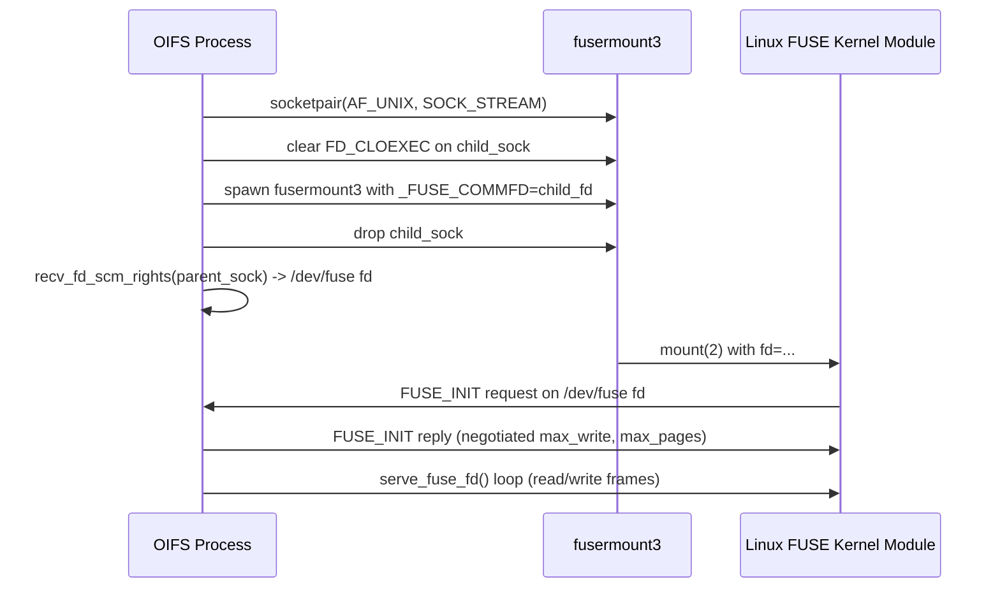
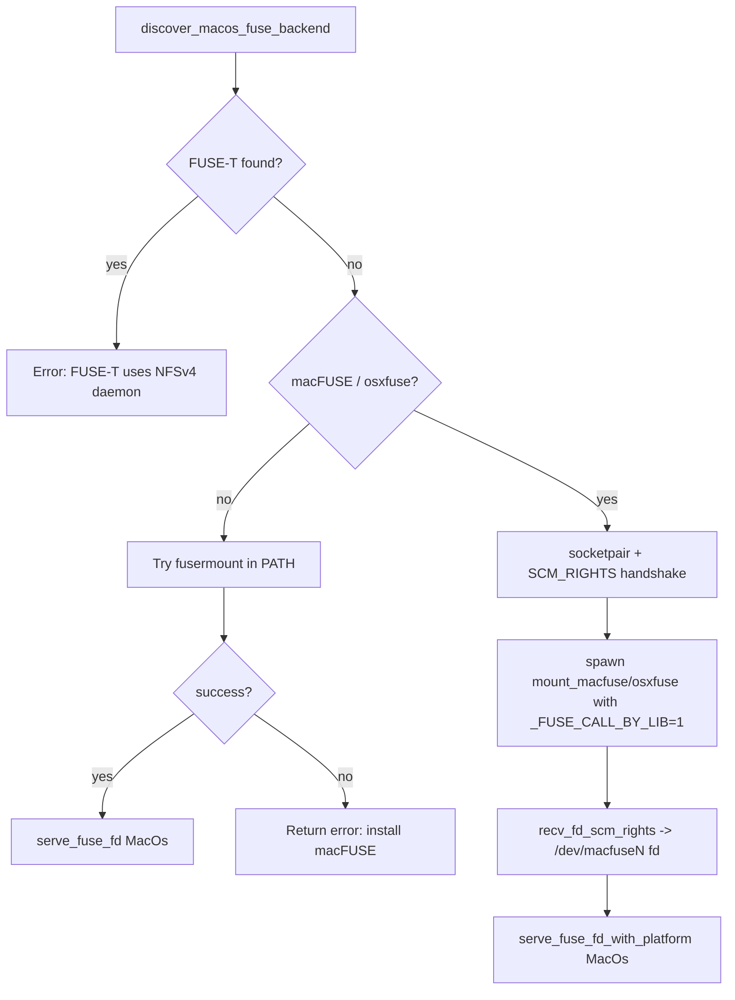

# FUSE Kernel Protocol Engine

The OIFS FUSE engine is a **pure-Rust implementation of the FUSE kernel ABI v7.28** (major 7, minor 28) with zero external C dependencies. It provides a complete wire parser, frame dispatcher, stateful open-handle table, and cross-platform kernel mount runners for Linux and macOS. The engine multiplexes any number of open FUSE file handles over the single underlying OIFS image file descriptor owned by the `DiskManager`.

## Key Properties

- **Endianness-portable**: Every wire structure uses explicit little-endian `to_le_bytes` / `from_le_bytes` serialization.
- **Dual ABI support**: Simultaneously supports standard Linux 88-byte `FuseAttr` and macOS/Darwin 104-byte `FuseAttr` (with `crtime`, `crtimensec`, `flags`), plus both Linux 8-byte and macOS 16-byte xattr request headers.
- **Single-FD container**: The `FuseHandleTable` multiplexes thousands of FUSE `fh` values over one `.img` OS file descriptor.
- **Strict read-only enforcement**: When mounted read-only (via `DiskManager::is_read_only()` or `FuseMountOptions::read_only`), **every mutating operation returns `-EROFS` with zero disk writes**.
- **Panic-free frame dispatch**: `OifsFuseFs::dispatch_frame` validates every header and payload boundary and never panics on truncated or malformed input.

## FUSE ABI Constants

The engine targets **FUSE kernel protocol version 7.28** with the following wire sizes:

| Structure | Linux ABI Size | macOS ABI Size |
|-----------|----------------|----------------|
| `FuseInHeader` | 40 B | 40 B |
| `FuseOutHeader` | 16 B | 16 B |
| `FuseAttr` | 88 B | 104 B |
| `FuseEntryOut` | 128 B | 144 B |
| `FuseAttrOut` | 104 B | 120 B |
| `FuseSetAttrIn` | 88 B | 128 B (extended) |
| `FuseInitIn` | 16 B | 16 B |
| `FuseInitOut` | 64 B (ABI v7.28) | 64 B |
| `fuse_setxattr_in` / `fuse_getxattr_in` | 8 B | 16 B (adds `position`) |
| `fuse_dirent` header | 24 B | 24 B |

```rust
pub const FUSE_KERNEL_VERSION: u32 = 7;
pub const FUSE_KERNEL_MINOR_VERSION: u32 = 28;
pub const FUSE_ROOT_ID: u64 = 1;
```

The platform-dependent layout is selected via `FuseAbiPlatform`:

```rust
pub enum FuseAbiPlatform {
    Linux,   // 88-byte FuseAttr, 128-byte FuseEntryOut, 104-byte FuseAttrOut
    MacOs,   // 104-byte FuseAttr, 144-byte FuseEntryOut, 120-byte FuseAttrOut
}
```

## Frame Parser & Dispatcher

### Request/Response Headers

`FuseInHeader` (40 bytes) and `FuseOutHeader` (16 bytes) are parsed with explicit bounds checking:

```rust
let Some(hdr) = FuseInHeader::parse(request) else {
    return FuseOutHeader::error_frame(unique, -libc::EINVAL);
};
let payload = &request[FUSE_IN_HEADER_SIZE..];
```

The dispatcher validates:
- `buf.len() >= 40`
- `header.len as usize == buf.len()`
- Opcode is supported (`FuseOpcode::from_u32`)
- Payload length matches declared sizes for each opcode

### Opcode Dispatch

`dispatch_frame_for_platform` matches on `FuseOpcode` and routes to typed handlers:

```rust
match opcode {
    FuseOpcode::Init => { /* handshake */ }
    FuseOpcode::Lookup => { /* path lookup */ }
    FuseOpcode::Getattr => { /* attribute query */ }
    FuseOpcode::Setattr => { /* size/truncate, rejected if read-only */ }
    FuseOpcode::Mkdir => { /* directory creation, rejected if read-only */ }
    FuseOpcode::Unlink => { /* file deletion, rejected if read-only */ }
    FuseOpcode::Rmdir => { /* directory deletion, rejected if read-only */ }
    FuseOpcode::Rename => { /* rename/move, rejected if read-only */ }
    FuseOpcode::Open => { /* open file, write flags checked */ }
    FuseOpcode::Create => { /* create file, rejected if read-only */ }
    FuseOpcode::Read => { /* read data */ }
    FuseOpcode::Write => { /* write data, rejected if read-only */ }
    FuseOpcode::Flush => { /* flush dirty pages */ }
    FuseOpcode::Fsync => { /* sync data/metadata */ }
    FuseOpcode::Setxattr => { /* returns ENOTSUP */ }
    FuseOpcode::Getxattr => { /* returns ENOTSUP */ }
    FuseOpcode::Listxattr => { /* returns ENOTSUP */ }
    FuseOpcode::Removexattr => { /* returns ENOTSUP / EROFS */ }
    FuseOpcode::Release => { /* close file handle */ }
    FuseOpcode::Opendir => { /* open directory */ }
    FuseOpcode::Readdir => { /* list directory */ }
    FuseOpcode::Releasedir => { /* close dir handle */ }
    FuseOpcode::Statfs => { /* filesystem stats */ }
    FuseOpcode::Access => { /* permission check, write rejected if read-only */ }
    FuseOpcode::Destroy => { /* cleanup */ }
    FuseOpcode::Forget | FuseOpcode::BatchForget => { /* no reply */ }
    ...
}
```

**One-way notifications** (`FUSE_FORGET`, `FUSE_BATCH_FORGET`) return an empty `Vec` — no response frame is sent.

### Payload Parsing Safety

Every payload struct implements a `parse` / `parse_for` method that:
- Checks minimum buffer length
- Uses `read_u{16,32,64}_le` helpers with bounds-checked slice access
- Returns `None` on truncation (mapped to `-EINVAL` by dispatcher)

Example for `FuseWriteIn` (40-byte header followed by `size` payload bytes):

```rust
let Some(write_in) = FuseWriteIn::parse(payload) else {
    return FuseOutHeader::error_frame(unique, -libc::EINVAL);
};
let data_len = write_in.size as usize;
let data_end = FUSE_WRITE_IN_SIZE.checked_add(data_len)
    .filter(|&e| e <= payload.len())
    .ok_or_else(|| FuseOutHeader::error_frame(unique, -libc::EINVAL))?;
let data = &payload[FUSE_WRITE_IN_SIZE..data_end];
```

## Cross-Platform Mount Runners

### Linux: `/dev/fuse` + `fusermount3`

The primary Linux mount path uses `fusermount3` (falling back to `fusermount`) with the `_FUSE_COMMFD` handshake over `SCM_RIGHTS`:



The `SCM_RIGHTS` fd passing uses `sendmsg`/`recvmsg` with `CMSG_SPACE(sizeof(int))`:

```rust
pub fn recv_fd_scm_rights(sock_fd: RawFd) -> std::io::Result<OwnedFd> {
    let mut cmsg_buf = vec![0u8; unsafe { libc::CMSG_SPACE(4) as usize }];
    // msghdr setup with iov + control buffer
    let n = libc::recvmsg(sock_fd, &mut msg, 0);
    // iterate CMSG headers, match SOL_SOCKET + SCM_RIGHTS
    // copy received_fd from CMSG_DATA
}
```

### Fallback: Direct `/dev/fuse` + `mount(2)`

For privileged containers (root), the engine opens `/dev/fuse` directly and invokes `mount(2)`:

```rust
let dev_file = OpenOptions::new().read(true).write(true).open("/dev/fuse")?;
let data_str = format!(
    "fd={fd},rootmode=40000,user_id={},group_id={},default_permissions{}",
    opts.uid, opts.gid, if opts.allow_other { ",allow_other" } else { "" }
);
let rc = unsafe {
    libc::mount(
        c"oifs".as_ptr(),
        target.as_ptr(),
        c"fuse.oifs".as_ptr(),
        MS_NOSUID | MS_NODEV | if read_only { MS_RDONLY } else { 0 },
        data.as_ptr().cast()
    )
};
```

### macOS: `FUSE-T` / `macFUSE` / `osxfuse`

macOS mount discovers the available backend and uses the appropriate helper:



The macOS handshake sets these environment variables before spawning the mount helper:

```rust
std::process::Command::new(&mount_helper)
    .env("_FUSE_CALL_BY_LIB", "1")
    .env("_FUSE_COMMFD", child_fd.to_string())
    .env("_FUSE_COMMVERS", "2")
    .env("_FUSE_DAEMON_PATH", current_exe())
    .arg("-o").arg(opts)
    .arg(mountpoint)
    .spawn()
```

## FUSE Mount Options

`FuseMountOptions` configures the FUSE mount behavior:

```rust
pub struct FuseMountOptions {
    pub read_only: bool,              // Enforce read-only (EROFS on mutations)
    pub compression_mode: CompressionMode,
    pub uid: u32,                     // Owner UID in FuseAttr
    pub gid: u32,                     // Owner GID in FuseAttr
    pub attr_ttl_secs: u64,           // attr_valid TTL
    pub entry_ttl_secs: u64,          // entry_valid TTL
    pub allow_other: bool,            // Pass allow_other mount option
    pub abi_platform: FuseAbiPlatform, // Linux vs macOS wire layout
    pub reject_macos_metadata: bool,  // Fast-reject .DS_Store, ._*, etc.
    pub normalize_nfc: bool,          // NFD->NFC normalization
    pub volname: Option<String>,      // macOS volume name
    pub max_write: u32,               // Requested max_write (default 1 MiB)
}
```

### Key Options

| Option | Default | Description |
|--------|---------|-------------|
| `read_only` | `false` | Enforces `-EROFS` on all mutating ops |
| `allow_other` | `false` | Adds `allow_other` to mount options |
| `attr_ttl_secs` | `1` | Attribute cache TTL (`attr_valid`) |
| `entry_ttl_secs` | `1` | Entry cache TTL (`entry_valid`) |
| `reject_macos_metadata` | `true` | Reject Finder metadata files with `-ENOENT` |
| `normalize_nfc` | `true` | Convert NFD filenames to NFC |
| `max_write` | `1 MiB` | Negotiated with kernel at `FUSE_INIT` |

### Attribute Caching

The engine sets `attr_valid` and `entry_valid` from `FuseMountOptions`:

- `attr_ttl_secs` (default 1s) → `FuseAttrOut.attr_valid` / `FuseEntryOut.attr_valid`
- `entry_ttl_secs` (default 1s) → `FuseEntryOut.entry_valid`

Cache invalidation is implicit: the kernel re-issues `GETATTR`/`LOOKUP` when TTL expires. No explicit invalidation API is implemented; the short TTL (1s default) ensures reasonable coherence.

### Linux Mount Options (filtered)

```text
fsname=oifs,default_permissions,subtype=oifs[,ro][,allow_other]
```

Strips macOS-only options: `noappledouble`, `noapplexattr`, `volname`, `local`, `iosize`.

### macOS Mount Options

```text
fsname=oifs,default_permissions,noappledouble,noapplexattr,local,iosize=<max_write>[,ro][,allow_other][,volname=<name>]
```

## Dynamic `max_write` Negotiation

The engine negotiates `max_write` during `FUSE_INIT` based on kernel capabilities and sysfs configuration.

### Constants

```rust
pub const FUSE_MIN_MAX_WRITE: u32 = 4096;           // 4 KiB minimum
pub const FUSE_LEGACY_MAX_WRITE: u32 = 128 * 1024;  // 128 KiB (Linux < 4.20)
pub const FUSE_DEFAULT_MAX_WRITE: u32 = 1024 * 1024; // 1 MiB default
pub const FUSE_MAX_SUPPORTED_WRITE: u32 = 4 * 1024 * 1024; // 4 MiB max
```

### Negotiation Logic

```rust
pub fn negotiate_max_write(
    requested: u32,
    init_flags: u32,
    platform: FuseAbiPlatform,
    page_size: u32,
    linux_max_pages_limit: u32,
) -> (u32, u16) {
    match platform {
        FuseAbiPlatform::Linux => {
            if (init_flags & FUSE_MAX_PAGES) == 0 {
                // Linux < 4.20: hard cap at 32 pages (128 KiB on 4K pages)
                let legacy_cap = 32u32.saturating_mul(page_size).max(FUSE_LEGACY_MAX_WRITE);
                (requested.min(legacy_cap), 0)
            } else {
                // Linux 4.20+: cap by max_pages_limit * page_size
                let limit_pages = linux_max_pages_limit.clamp(32, 1024);
                let kernel_cap = limit_pages.saturating_mul(page_size);
                let max_write = requested.min(kernel_cap);
                let max_pages = max_write.div_ceil(page_size).clamp(1, limit_pages) as u16;
                (max_write, max_pages)
            }
        }
        FuseAbiPlatform::MacOs => {
            if (init_flags & FUSE_BIG_WRITES) == 0 {
                (FUSE_MIN_MAX_WRITE, 0)
            } else {
                let max_pages = if (init_flags & FUSE_MAX_PAGES) != 0 {
                    max_write_to_pages(requested, page_size)
                } else { 0 };
                (requested, max_pages)
            }
        }
    }
}
```

### Linux Kernel `max_pages_limit` Detection

On Linux 6.13+, the sysfs parameter `/sys/module/fuse/parameters/max_pages_limit` controls the maximum (defaults to 256, configurable up to 1024):

```rust
pub fn detect_linux_fuse_max_pages_limit() -> u32 {
    #[cfg(target_os = "linux")]
    {
        if let Ok(raw) = std::fs::read_to_string("/sys/module/fuse/parameters/max_pages_limit")
            && let Ok(parsed) = raw.trim().parse::<u32>()
        {
            return parsed.clamp(32, 1024);
        }
    }
    256 // Linux 4.20–6.12 or non-Linux fallback
}
```

**Resulting caps:**
- Linux < 4.20: **128 KiB** (32 pages × 4 KiB)
- Linux 4.20–6.12: **1 MiB** (256 pages × 4 KiB)
- Linux 6.13+ (default): **1 MiB** (256 pages × 4 KiB)
- Linux 6.13+ (tuned): up to **4 MiB** (1024 pages × 4 KiB)

The negotiated `max_write` is stored in `OifsFuseState.max_write` and enforced on every `FUSE_WRITE` request.

## FuseHandleTable: Handle Multiplexing

The `FuseHandleTable` maps FUSE `fh: u64` values to `FuseFileHandle` entries, allowing thousands of concurrent open files/directories over a single `.img` fd:

```rust
pub struct FuseFileHandle {
    pub inode_id: u64,      // OIFS inode backing this handle
    pub flags: u32,         // POSIX open flags (O_RDONLY, O_WRONLY, O_APPEND, etc.)
    pub is_dir: bool,       // true for FUSE_OPENDIR handles
}

pub struct FuseHandleTable {
    next_fh: AtomicU64,                    // monotonically increasing handle IDs
    handles: RwLock<FxHashMap<u64, FuseFileHandle>>,
}
```

**Operations:**
- `insert(handle) -> u64`: Allocates next non-zero `fh`, stores handle, returns `fh`
- `get(fh) -> Option<FuseFileHandle>`: Read-locked lookup
- `remove(fh) -> Option<FuseFileHandle>`: Write-locked removal (on `RELEASE`/`RELEASEDIR`)
- `clear()`: Drops all handles (on `FUSE_DESTROY`)

**Key invariant:** All I/O (`read_at`, `write_data`, `truncate`) goes through the single `DiskManager` instance — no per-handle OS file descriptors are opened.

## Read-Only Enforcement

Read-only semantics are enforced at **two levels**:

1. **DiskManager level**: `DiskManager::is_read_only()` returns `true` when the image was opened with `oifs_open_read_only` or the file has `0444` permissions.
2. **FUSE mount level**: `FuseMountOptions::read_only` (set via CLI `--read-only` or `mount -o ro`).

The combined check in `OifsFuseState`:

```rust
pub fn is_read_only(&self, dm: &DiskManager) -> bool {
    dm.is_read_only() || self.options.read_only
}
```

**Every mutating operation checks this first:**

```rust
pub fn mkdir(&self, dm: &DiskManager, parent: u64, name: &str, _mode: u32) -> Result<FuseEntryOut, i32> {
    if self.is_read_only(dm) {
        return Err(-libc::EROFS);
    }
    // ... actual mkdir logic
}

pub fn write(&self, dm: &DiskManager, nodeid: u64, fh: u64, offset: u64, data: &[u8], flags: u32) -> Result<u32, i32> {
    if self.is_read_only(dm) {
        return Err(-libc::EROFS);
    }
    // ... actual write logic
}

pub fn setattr_size(&self, dm: &DiskManager, nodeid: u64, new_size: u64) -> Result<FuseAttrOut, i32> {
    if self.is_read_only(dm) {
        return Err(-libc::EROFS);
    }
    // ... truncate logic
}

pub fn access(&self, dm: &DiskManager, nodeid: u64, mask: u32) -> Result<(), i32> {
    if self.is_read_only(dm) && (mask & libc::W_OK) != 0 {
        return Err(-libc::EROFS);
    }
    Ok(())
}
```

Even `setxattr`/`removexattr` return `-EROFS` before `-ENOTSUP`:

```rust
pub fn removexattr(&self, dm: &DiskManager, nodeid: u64, _name: &str) -> Result<(), i32> {
    if self.is_read_only(dm) {
        return Err(-libc::EROFS);
    }
    Err(-libc::ENOTSUP)
}
```

## Inode-to-FUSE NodeID Mapping

OIFS inode IDs are 0-based (root = 0), while FUSE node IDs are 1-based (root = `FUSE_ROOT_ID = 1`). The engine provides bijective mapping:

```rust
/// Maps an OIFS inode ID (0 = root) to a FUSE node ID (1 = FUSE_ROOT_ID).
pub const fn inode_to_nodeid(inode_id: u64) -> Option<u64> {
    inode_id.checked_add(1)
}

/// Maps a FUSE node ID (1 = FUSE_ROOT_ID) back to an OIFS inode ID (0 = root).
pub const fn nodeid_to_inode(nodeid: u64) -> Option<u64> {
    if nodeid == 0 { None } else { Some(nodeid - 1) }
}
```

**Generation numbers** are always set to 0 in `FuseEntryOut` since OIFS doesn't use generation-based invalidation.

## UTF-8 NFD → NFC Normalization

macOS APFS and Finder store filenames in **NFD** (decomposed) form, while Linux and OIFS directory indices expect **NFC** (composed). The engine normalizes on ingress when `FuseMountOptions::normalize_nfc = true` (default):

```rust
#[inline]
fn normalize_name<'a>(&self, name: &'a str) -> Cow<'a, str> {
    if self.options.normalize_nfc {
        normalize_filename_nfc(name)
    } else {
        Cow::Borrowed(name)
    }
}
```

### Implementation: `normalize_filename_nfc`

The function features a **zero-allocation fast path** for ASCII and already-composed strings:

```rust
pub fn normalize_filename_nfc(name: &str) -> Cow<'_, str> {
    if name.is_ascii() {
        return Cow::Borrowed(name); // fast path
    }
    // Quick scan for composable sequences
    let mut needs_compose = false;
    let mut prev = first_char;
    for ch in name.chars().skip(1) {
        if compose_pair(prev, ch).is_some() {
            needs_compose = true;
            break;
        }
        prev = ch;
    }
    if !needs_compose {
        return Cow::Borrowed(name); // already NFC
    }
    // Slow path: build composed String
    let mut out = String::with_capacity(name.len());
    // ... streaming composition using compose_pair
    Cow::Owned(out)
}
```

### Supported Composition Rules (`compose_pair`)

| Category | Examples |
|----------|----------|
| **Korean Hangul Jamo** | `L + V → LV`, `LV + T → LVT` (algorithmic per Unicode §3.12) |
| **Japanese Kana** | `hiragana/katakana + U+3099 (dakuten) → voiced`, `+ U+309A (handakuten) → semi-voiced` |
| **Latin diacritics** | `A + U+0300 → À`, `e + U+0301 → é`, `n + U+0303 → ñ`, etc. |
| **Cyrillic** | `Е + U+0308 → Ё`, `и + U+0306 → й` |
| **Combining marks** | Grave, acute, circumflex, tilde, macron, breve, dot above, diaeresis, ring above, double acute, caron, cedilla, ogonek |

This pure-Rust implementation avoids ICU or `unicode-normalization` crate dependencies.

## macOS Finder Metadata Storm Protection

macOS Finder aggressively issues `getxattr`/`setxattr`/`listxattr` on metadata files (`.DS_Store`, `._*`, `.Spotlight-V100`, etc.), which would:
1. Clutter the OIFS container with meaningless entries
2. Cause "metadata storms" — thousands of xattr syscalls per directory visit

### Fast Rejection

When `FuseMountOptions::reject_macos_metadata = true` (default), these filenames are rejected at **lookup entry** with `-ENOENT`:

```rust
pub fn is_macos_metadata_filename(name: &str) -> bool {
    name.starts_with("._")
        || matches!(
            name,
            ".DS_Store" | ".Spotlight-V100" | ".Trashes" | ".fseventsd" | ".TemporaryItems"
        )
}

#[inline]
fn reject_if_macos_metadata(&self, name: &str) -> Result<(), i32> {
    if self.options.reject_macos_metadata && is_macos_metadata_filename(name) {
        return Err(-libc::ENOENT);
    }
    Ok(())
}
```

### xattr Storm Throttling

Even when metadata files slip through (e.g., on Linux), the xattr handlers return **`-ENOTSUP`** instead of `-ENOSYS` or `-EINVAL`:

```rust
pub fn setxattr(...) -> Result<(), i32> {
    if self.is_read_only(dm) { return Err(-libc::EROFS); }
    let _ = self.resolve_file_inode(dm, nodeid)?;
    Err(-libc::ENOTSUP) // critical: ENOTSUP stops Finder retry loops
}

pub fn getxattr(...) -> Result<Vec<u8>, i32> { Err(-libc::ENOTSUP) }
pub fn listxattr(...) -> Result<Vec<u8>, i32> { Err(-libc::ENOTSUP) }
pub fn removexattr(...) -> Result<(), i32> { Err(-libc::ENOTSUP) }
```

**Why `-ENOTSUP`?** macOS Finder treats `-ENOSYS` (not implemented) and `-EINVAL` (invalid argument) as "try harder" signals and retries with different parameters. `-ENOTSUP` (operation not supported on this filesystem) cleanly terminates the storm.

## FUSE Request Flow Diagram

```mermaid
flowchart TD
    subgraph Kernel["Kernel FUSE Module"]
        K1["FUSE Request\n(lookup, getattr, read, write, ...)"]
        K2["FUSE Reply"]
    end

    subgraph OIFS["OIFS FUSE Engine"]
        D1["dispatch_frame_for_platform\n(buf: &[u8])"]
        D2["FuseInHeader::parse\nValidate len, opcode, payload"]
        D3["Match FuseOpcode"]
        
        H1["Lookup\n→ dm.lookup()\n→ build_entry_out"]
        H2["Getattr\n→ dm.read_inode()\n→ build_attr_out"]
        H3["Open/Create\n→ handle insert\n→ FuseOpenOut"]
        H4["Read\n→ dm.read_at()\n→ return data"]
        H5["Write\n→ dm.write_data()\n→ return written"]
        H6["Readdir\n→ dm.list_dir()\n→ encode dirents"]
        H7["Setattr\n→ dm.truncate()\n→ build_attr_out"]
        H8["Mkdir/Unlink/Rmdir/Rename\n→ dm mutations\n→ EROFS if read-only"]
        H9["Fsync/Flush\n→ dm.flush()/flush_async()"]
        H10["Statfs\n→ dm.superblock() +\n  analyze_fragmentation()"]
        H11["Access\n→ check read-only + W_OK"]
        H12["Setxattr/Getxattr/Listxattr/Removexattr\n→ ENOTSUP / EROFS"]
        H13["Init\n→ negotiate_max_write()\n→ FuseInitOut"]
        H14["Destroy\n→ handle_table.clear()\n→ dm.flush()"]
        H15["Forget/BatchForget\n→ no reply (empty Vec)"]
    end

    K1 -->|raw frame| D1
    D1 --> D2
    D2 --> D3
    D3 --> H1
    D3 --> H2
    D3 --> H3
    D3 --> H4
    D3 --> H5
    D3 --> H6
    D3 --> H7
    D3 --> H8
    D3 --> H9
    D3 --> H10
    D3 --> H11
    D3 --> H12
    D3 --> H13
    D3 --> H14
    D3 --> H15
    
    H1 -->|FuseEntryOut| K2
    H2 -->|FuseAttrOut| K2
    H3 -->|FuseOpenOut| K2
    H4 -->|data bytes| K2
    H5 -->|FuseWriteOut| K2
    H6 -->|dirent stream| K2
    H7 -->|FuseAttrOut| K2
    H8 -->|OK / errno| K2
    H9 -->|OK / errno| K2
    H10 -->|FuseKStatfs| K2
    H11 -->|OK / errno| K2
    H12 -->|ENOTSUP / EROFS| K2
    H13 -->|FuseInitOut| K2
    H14 -->|OK| K2
    H15 -.->|no reply| K2
```



## macOS vs Linux Differences Summary

| Aspect | Linux | macOS |
|--------|-------|-------|
| **Device** | `/dev/fuse` | `/dev/macfuseN` or `/dev/osxfuseN` |
| **Mount helper** | `fusermount3` / `fusermount` | `mount_macfuse` / `mount_osxfuse` |
| **ABI layout** | `FuseAbiPlatform::Linux` | `FuseAbiPlatform::MacOs` |
| **FuseAttr size** | 88 bytes | 104 bytes (+crtime, flags) |
| **xattr header** | 8 bytes | 16 bytes (+position) |
| **Mount options** | `subtype=oifs` | `noappledouble,noapplexattr,local,iosize,volname` |
| **Max write** | Negotiated via `max_pages_limit` | `BIG_WRITES` flag, `iosize=` option |
| **Unmount** | `fusermount3 -u`, `umount` | `umount`, `diskutil unmount` |
| **Metadata storm** | Filtered by `reject_macos_metadata` | Same + `-ENOTSUP` for xattr |

## Kani Formal Verification

The engine includes Kani proofs for critical invariants:

- **NodeID bijection**: `inode_to_nodeid` / `nodeid_to_inode` form a strict bijection; root (0) maps to `FUSE_ROOT_ID (1)`; invalid FUSE nodeid 0 is rejected.
- **Dirent alignment**: `fuse_dirent_align(24 + name_len)` always produces a multiple of 8, ≥ unaligned size, < unaligned + 8.
- **Frame header parsing**: `FuseInHeader::parse` never panics; rejects buffers < 40 bytes; rejects length mismatches.
