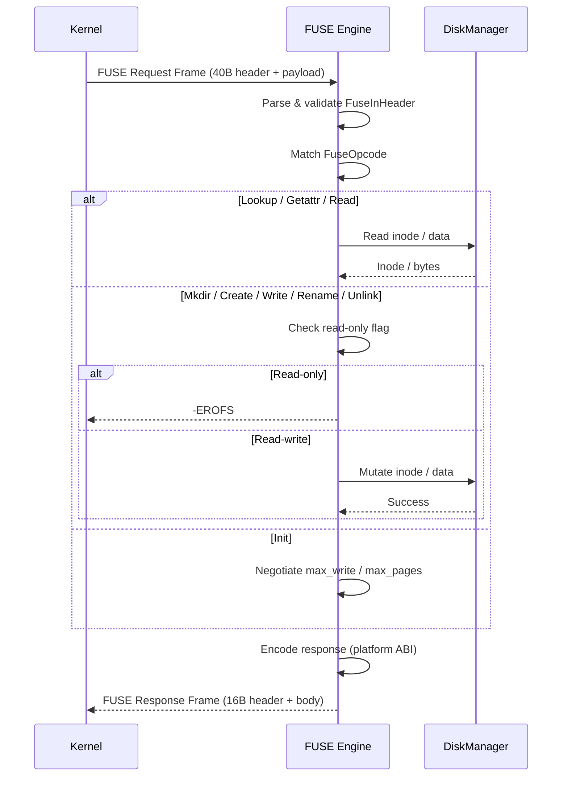

# FUSE Kernel Protocol Engine

The OIFS FUSE engine is a **pure-Rust implementation of the FUSE kernel ABI v7.28** (major 7, minor 28) with zero external C dependencies. It provides a complete wire parser, frame dispatcher, stateful open-handle table, and cross-platform kernel mount runners for Linux and macOS. The engine multiplexes any number of open FUSE file handles over the single underlying OIFS image file descriptor owned by the `DiskManager`.

## Key Properties

- **Endianness-portable**: Every wire structure uses explicit little-endian `to_le_bytes` / `from_le_bytes` serialization.
- **Dual ABI support**: Simultaneously supports standard Linux 88-byte `FuseAttr` and macOS/Darwin 104-byte `FuseAttr` (with `crtime`, `crtimensec`, `flags`), plus both Linux 8-byte and macOS 16-byte xattr request headers.
- **Single-FD container**: The `FuseHandleTable` multiplexes thousands of FUSE `fh` values over one `.img` OS file descriptor.
- **Strict read-only enforcement**: When mounted read-only (via `DiskManager::is_read_only()` or `FuseMountOptions::read_only`), **every mutating operation returns `-EROFS` with zero disk writes**.
- **Panic-free frame dispatch**: `OifsFuseState::dispatch_frame_for_platform` validates every header and payload boundary and never panics on truncated or malformed input.

## FUSE ABI Constants

The engine targets **FUSE kernel protocol version 7.28** with the following wire sizes:

| Structure | Linux ABI Size | macOS ABI Size |
|-----------|----------------|----------------|
| `FuseInHeader` | 40 B | 40 B |
| `FuseOutHeader` | 16 B | 16 B |
| `FuseAttr` | 88 B | 104 B |
| `FuseEntryOut` | 128 B | 144 B |
| `FuseAttrOut` | 104 B | 120 B |
| `FuseSetAttrIn` | 88 B | 128 B (extended) |
| `FuseInitIn` | 16 B | 16 B |
| `FuseInitOut` | 64 B (ABI v7.28) | 64 B |
| `fuse_setxattr_in` / `fuse_getxattr_in` | 8 B | 16 B (adds `position`) |
| `fuse_dirent` header | 24 B | 24 B |

```rust
pub const FUSE_KERNEL_VERSION: u32 = 7;
pub const FUSE_KERNEL_MINOR_VERSION: u32 = 28;
pub const FUSE_ROOT_ID: u64 = 1;
```

The platform-dependent layout is selected via `FuseAbiPlatform`:

```rust
pub enum FuseAbiPlatform {
    Linux,   // 88-byte FuseAttr, 128-byte FuseEntryOut, 104-byte FuseAttrOut
    MacOs,   // 104-byte FuseAttr, 144-byte FuseEntryOut, 120-byte FuseAttrOut
}
```

## Frame Parser & Dispatcher

### Request/Response Headers

`FuseInHeader` (40 bytes) and `FuseOutHeader` (16 bytes) are parsed with explicit bounds checking:

```rust
let Some(hdr) = FuseInHeader::parse(request) else {
    return FuseOutHeader::error_frame(unique, -libc::EINVAL);
};
let payload = &request[FUSE_IN_HEADER_SIZE..];
```

The dispatcher validates:
- `buf.len() >= 40`
- `header.len as usize == buf.len()`
- Opcode is supported (`FuseOpcode::from_u32`)
- Payload length matches declared sizes for each opcode

### Opcode Dispatch

`dispatch_frame_for_platform` matches on `FuseOpcode` and routes to typed handlers:

```rust
match opcode {
    FuseOpcode::Init => { /* handshake */ }
    FuseOpcode::Lookup => { /* path lookup */ }
    FuseOpcode::Getattr => { /* attribute query */ }
    FuseOpcode::Setattr => { /* size/truncate, rejected if read-only */ }
    FuseOpcode::Mkdir => { /* directory creation, rejected if read-only */ }
    FuseOpcode::Unlink => { /* file deletion, rejected if read-only */ }
    FuseOpcode::Rmdir => { /* directory deletion, rejected if read-only */ }
    FuseOpcode::Rename => { /* rename/move, rejected if read-only */ }
    FuseOpcode::Open => { /* open file, write flags checked */ }
    FuseOpcode::Create => { /* create file, rejected if read-only */ }
    FuseOpcode::Read => { /* read data */ }
    FuseOpcode::Write => { /* write data, rejected if read-only */ }
    FuseOpcode::Flush => { /* flush dirty pages */ }
    FuseOpcode::Fsync => { /* sync data/metadata */ }
    FuseOpcode::Setxattr => { /* returns ENOTSUP */ }
    // ... other opcodes
}
```

### One-Way Notifications

`FUSE_FORGET` and `FUSE_BATCH_FORGET` are one-way notifications from the kernel. The dispatcher returns an **empty `Vec<u8>`** (no response frame) for these opcodes, as required by the FUSE protocol.

### Error Handling

- Malformed or truncated frames return `-EINVAL` via `FuseOutHeader::error_frame`
- Unsupported opcodes return `-ENOSYS`
- All validation uses explicit bounds checks; **no `unwrap()` or `expect()` on wire input**

## FUSE Request/Response Flow



## Async Task Spawning & Kernel Interaction

The FUSE engine **does not use async/await or background task spawning** for request handling. Every `dispatch_frame_for_platform` call is a **synchronous, blocking function** that:

1. Parses the complete request frame from the input byte slice
2. Validates all header/payload boundaries
3. Performs the filesystem operation via `DiskManager` (which uses synchronous `pread`/`pwrite`/`msync`)
4. Encodes and returns the complete response frame

### Mount Runners

The kernel-facing transport runners are also synchronous:

| Runner | Transport | Concurrency Model |
|--------|-----------|-------------------|
| `serve_fuse_fd` | Linux `/dev/fuse`, macOS `/dev/macfuse*` | Blocking `read`/`write` loop on raw FD |
| `serve_stream` | Unix stream socket (`SOCK_STREAM`) | Blocking `read_exact`/`write_all` |
| `mount` (Linux) | `fusermount3` / `fusermount` + `SCM_RIGHTS` | Spawns mount helper, then `serve_fuse_fd` |
| `mount` (macOS) | `mount_macfuse`/`mount_osxfuse` + `SCM_RIGHTS` | Spawns mount helper, then `serve_fuse_fd` |

**Note**: The macOS mount helper (`mount_macfuse`) calls `mount(2)` *after* passing the FD via `SCM_RIGHTS`, and `mount(2)` blocks until the daemon answers `FUSE_INIT`. To avoid deadlock, the child process is reaped on a **background thread** (`std::thread::spawn`) before entering `serve_fuse_fd_with_platform`.

```rust
// macOS mount - background reap to avoid deadlock on FUSE_INIT
std::thread::spawn(move || {
    let _ = child.wait();
});
let res = self.serve_fuse_fd_with_platform(fuse_fd.as_raw_fd(), FuseAbiPlatform::MacOs);
```

### DiskManager Async Operations

`DiskManager` exposes **explicit async methods** (`read_at_async`, `write_data_async`, `flush_async_task`) that return `OifsAsyncTask` futures for callers using an external async runtime. These are **not used internally by the FUSE engine**—the kernel-facing paths remain synchronous.

## Core Operations

### Lookup (`FUSE_LOOKUP`)

```rust
pub fn lookup(&self, dm: &DiskManager, parent: u64, name: &str) -> Result<FuseEntryOut, i32> {
    let name = self.normalize_name(name);  // NFD -> NFC if enabled
    self.reject_if_macos_metadata(name.as_ref())?;  // Fast reject ._*, .DS_Store, etc.
    let parent_inode = nodeid_to_inode(parent).ok_or(-libc::ENOENT)?;
    let child_inode = dm.lookup(parent_inode, name.as_ref())?;
    let inode = dm.read_allocated_inode(child_inode)?;
    if inode.mode == FileType::Directory {
        self.record_parent(child_inode, parent_inode);  // Cache parent for ".."
    }
    self.build_entry_out(dm, child_inode, &inode)
}
```

- **Normalization**: UTF-8 NFD (macOS APFS/Finder) → NFC (Linux/OIFS) via `normalize_filename_nfc`
- **Metadata storm filter**: Rejects `._*`, `.DS_Store`, `.Spotlight-V100`, `.Trashes`, `.fseventsd`, `.TemporaryItems` with `-ENOENT`
- **Parent caching**: Records child→parent mapping for accurate `..` entries in `readdir`

### Open (`FUSE_OPEN`)

```rust
pub fn open(&self, dm: &DiskManager, nodeid: u64, flags: u32) -> Result<FuseOpenOut, i32> {
    if self.is_read_only(dm) && open_flags_request_write(flags) {
        return Err(-libc::EROFS);
    }
    let (inode_id, inode) = self.resolve_file_inode(dm, nodeid)?;
    if inode.mode == FileType::Directory {
        return Err(-libc::EISDIR);
    }
    if (flags as libc::c_int & libc::O_TRUNC) != 0 {
        dm.truncate(inode_id, 0)?;
    }
    let fh = self.handles.insert(FuseFileHandle { inode_id, flags, is_dir: false });
    Ok(FuseOpenOut { fh, open_flags: 0, padding: 0 })
}
```

- **Read-only check**: `open_flags_request_write` detects `O_WRONLY`, `O_RDWR`, `O_CREAT`, `O_TRUNC`, `O_APPEND`
- **Handle allocation**: `FuseHandleTable::insert` returns unique `fh` (lock-free SeqLock fast path)
- **Truncate**: `O_TRUNC` applied at open time

### Read (`FUSE_READ`)

```rust
pub fn read(&self, dm: &DiskManager, nodeid: u64, fh: u64, offset: u64, size: u32) -> Result<Vec<u8>, i32> {
    let inode_id = if fh != 0 {
        let handle = self.handles.get(fh).ok_or(-libc::EBADF)?;
        if handle.is_dir { return Err(-libc::EISDIR); }
        handle.inode_id
    } else {
        nodeid_to_inode(nodeid).ok_or(-libc::ENOENT)?
    };
    let inode = dm.read_allocated_inode(inode_id)?;
    if inode.mode == FileType::Directory { return Err(-libc::EISDIR); }
    
    let logical_size = logical_file_size(&inode);
    if offset >= logical_size || size == 0 { return Ok(Vec::new()); }
    let to_read = (size as usize).min(available).min(FUSE_MAX_FRAME_LEN);
    let mut buf = vec![0u8; to_read];
    let n = dm.read_at(inode_id, offset, &mut buf)?;
    buf.truncate(n);
    Ok(buf)
}
```

- **Handle or nodeid**: Uses `fh` if non-zero, else falls back to `nodeid`
- **Logical size**: Handles encrypted non-seekable files (size includes 16-byte AEAD tag)
- **Bounds**: Clamped to `FUSE_MAX_FRAME_LEN` (16 MiB)

### Write (`FUSE_WRITE`)

```rust
pub fn write(&self, dm: &DiskManager, nodeid: u64, fh: u64, offset: u64, data: &[u8], flags: u32) -> Result<u32, i32> {
    if self.is_read_only(dm) { return Err(-libc::EROFS); }
    let (inode_id, handle_flags) = if fh != 0 {
        let handle = self.handles.get(fh).ok_or(-libc::EBADF)?;
        if handle.is_dir { return Err(-libc::EISDIR); }
        (handle.inode_id, handle.flags)
    } else { (nodeid_to_inode(nodeid).ok_or(-libc::ENOENT)?, 0) };
    
    let is_append = ((handle_flags | flags) as libc::c_int & libc::O_APPEND) != 0;
    if is_append {
        let _append_guard = crate::lock_unpoisoned(&self.append_lock);
        let inode = dm.read_allocated_inode(inode_id)?;
        let append_off = logical_file_size(&inode);
        dm.write_data(inode_id, append_off, data, self.options.compression_mode)?;
    } else {
        dm.write_data(inode_id, offset, data, self.options.compression_mode)?;
    }
    Ok(written_len)
}
```

- **Read-only check**: Returns `-EROFS` before any disk access
- **Append handling**: Global `append_lock` mutex ensures atomic append offset calculation
- **Compression**: Uses `FuseMountOptions::compression_mode` (`Auto`/`Always`/`Never`/`Stream`/`Seekable`)

### Mkdir (`FUSE_MKDIR`)

```rust
pub fn mkdir(&self, dm: &DiskManager, parent: u64, name: &str, _mode: u32) -> Result<FuseEntryOut, i32> {
    if self.is_read_only(dm) { return Err(-libc::EROFS); }
    let name = self.normalize_name(name);
    self.reject_if_macos_metadata(name.as_ref())?;
    let parent_inode = nodeid_to_inode(parent).ok_or(-libc::ENOENT)?;
    let child_inode = dm.create_directory(parent_inode, name.as_ref())?;
    self.record_parent(child_inode, parent_inode);
    let inode = dm.read_inode(child_inode)?;
    self.build_entry_out(dm, child_inode, &inode)
}
```

- **Mode**: Uses fixed `0o755` (or `0o555` if read-only) regardless of requested mode

### Rename (`FUSE_RENAME` / `FUSE_RENAME2`)

```rust
pub fn rename(&self, dm: &DiskManager, parent: u64, name: &str, newparent: u64, newname: &str, flags: u32) -> Result<(), i32> {
    if self.is_read_only(dm) { return Err(-libc::EROFS); }
    if flags != 0 && flags != FUSE_RENAME_NOREPLACE { return Err(-libc::EINVAL); }
    let name = self.normalize_name(name);
    let newname = self.normalize_name(newname);
    // ... reject metadata, validate parents ...
    if flags == FUSE_RENAME_NOREPLACE && dm.lookup(new_parent_inode, newname.as_ref()).is_ok() {
        return Err(-libc::EEXIST);
    }
    let moved_inode_id = dm.lookup(old_parent_inode, name.as_ref())?;
    let overwritten_inode_id = dm.lookup(new_parent_inode, newname.as_ref()).ok();
    dm.rename(old_parent_inode, name.as_ref(), new_parent_inode, newname.as_ref())?;
    // Invalidate handles & parent cache for overwritten target
    if let Some(dst_id) = overwritten_inode_id {
        self.handles.invalidate_inode(dst_id);
        self.forget_parent(dst_id);
    }
    // Update parent cache if moved item is a directory
    if let Ok(inode) = dm.read_inode(moved_inode_id) {
        if inode.mode == FileType::Directory {
            self.record_parent(moved_inode_id, new_parent_inode);
        }
    }
    Ok(())
}
```

- **Flags**: Supports `FUSE_RENAME_NOREPLACE` (Linux `RENAME_NOREPLACE`, macOS `RENAME_EXCL`)
- **Overwrite handling**: Invalidates handles and parent cache for overwritten destination
- **Directory move**: Updates parent cache for moved directories

### Setattr (`FUSE_SETATTR`)

```rust
pub fn setattr_size(&self, dm: &DiskManager, nodeid: u64, new_size: u64) -> Result<FuseAttrOut, i32> {
    if self.is_read_only(dm) { return Err(-libc::EROFS); }
    let (inode_id, inode) = self.resolve_file_inode(dm, nodeid)?;
    if inode.mode == FileType::Directory { return Err(-libc::EISDIR); }
    dm.truncate(inode_id, new_size)?;
    let updated = dm.read_inode(inode_id)?;
    self.build_attr_out(dm, inode_id, &updated)
}
```

- **Only `FATTR_SIZE` handled**: Other attributes (mode, uid, gid, timestamps) are accepted but ignored (returns current attrs)
- **Directory check**: Returns `-EISDIR` for directories

## FuseHandleTable

The `FuseHandleTable` multiplexes thousands of FUSE file handles (`fh: u64`) over the single underlying OIFS image file descriptor:

```rust
pub struct FuseHandleTable {
    next_fh: AtomicU64,
    handles: RwLock<FxHashMap<u64, FuseFileHandle>>,
    fast_slots: Box<[SeqLockFuseHandleSlot; 256]>,  // Lock-free hot path
}
```

- **Lock-free reads**: `SeqLockFuseHandleSlot` provides wait-free `get(fh)` via sequence lock
- **Sharded fallback**: On cache miss, falls back to `RwLock<FxHashMap>`
- **Invalidation**: `invalidate_inode(inode_id)` removes all handles for an inode (used after unlink/rmdir/rename overwrite)
- **No additional OS FDs**: All `fh` values are purely in-memory mappings

## Dynamic max_write Negotiation

During `FUSE_INIT`, the engine negotiates `max_write` based on kernel capabilities:

```rust
pub fn negotiate_max_write(
    requested: u32,
    init_flags: u32,
    platform: FuseAbiPlatform,
    page_size: u32,
    linux_max_pages_limit: u32,
) -> (u32, u16) { ... }
```

| Kernel | `FUSE_MAX_PAGES` | `max_pages_limit` | Negotiated `max_write` |
|--------|------------------|-------------------|------------------------|
| Linux < 4.20 | No | N/A | 128 KiB (32 pages × 4 KiB) |
| Linux 4.20–6.12 | Yes | N/A (default 256) | 1 MiB (256 pages × 4 KiB) |
| Linux 6.13+ | Yes | Configurable (256–1024) | Up to 4 MiB (1024 pages × 4 KiB) |
| macOS | `FUSE_BIG_WRITES` | N/A | Requested (clamped to 4 MiB) |

- **Request**: Default 1 MiB (`FUSE_DEFAULT_MAX_WRITE`), clamped to `[4 KiB, 4 MiB]`
- **Reply**: `FuseInitOut.max_write` + `max_pages` (Linux 4.20+)
- **Sysfs probe**: `detect_linux_fuse_max_pages_limit()` reads `/sys/module/fuse/parameters/max_pages_limit`

## Cross-Platform Mount Runners

### Linux (`mount`)

1. **Primary**: `fusermount3` (fallback `fusermount`) with `_FUSE_COMMFD` + `SCM_RIGHTS`
   - Creates `socketpair`, clears `FD_CLOEXEC` on child end
   - Sets `_FUSE_COMMFD=<child_fd>` env var
   - Receives `/dev/fuse` FD back via `SCM_RIGHTS`
2. **Fallback**: Direct `/dev/fuse` open + `mount(2)` (privileged/root)
   - `mount("oifs", mountpoint, "fuse.oifs", MS_NOSUID|MS_NODEV, "fd=X,...")`
3. **Serve**: `serve_fuse_fd_with_platform(fd, FuseAbiPlatform::Linux)`

### macOS (`mount_macos`)

1. **Discovery**: Probes for `FUSE-T`, `macFUSE`, `osxfuse` (in that order)
2. **Handshake**: `socketpair` + `SCM_RIGHTS` with `_FUSE_CALL_BY_LIB=1`, `_FUSE_COMMFD`, `_FUSE_COMMVERS=2`, `_FUSE_DAEMON_PATH`
3. **Mount options**: `default_permissions,noappledouble,noapplexattr,local,iosize=<max_write>,volname=<name>`
4. **Background reap**: Child process reaped on thread to avoid `mount(2)` deadlock on `FUSE_INIT`
5. **Serve**: `serve_fuse_fd_with_platform(fd, FuseAbiPlatform::MacOs)`

## UTF-8 NFD → NFC Normalization

Implemented in pure Rust (`normalize_filename_nfc`) with:

- **Zero-allocation fast path**: ASCII and already-composed strings return `Cow::Borrowed`
- **Algorithmic composition**:
  - Korean Hangul Jamo (`L + V → LV`, `LV + T → LVT`)
  - Japanese Hiragana/Katakana dakuten (U+3099) & handakuten (U+309A)
  - Latin, European, Cyrillic combining diacritics (grave, acute, circumflex, tilde, macron, breve, dot above, diaeresis, ring above, double acute, caron, cedilla, ogonek)
- **Enabled by default**: Controlled by `FuseMountOptions::normalize_nfc` (default `true`)

## macOS Finder Metadata Storm Protection

```rust
pub fn is_macos_metadata_filename(name: &str) -> bool {
    name.starts_with("._")
        || matches!(name, ".DS_Store" | ".Spotlight-V100" | ".Trashes" | ".fseventsd" | ".TemporaryItems")
}
```

- **Lookup rejection**: Returns `-ENOENT` for filtered names
- **xattr operations**: All return `-ENOTSUP` (not `-ENOSYS`/`-EINVAL`) to stop Finder retry loops
- **Enabled by default**: Controlled by `FuseMountOptions::reject_macos_metadata` (default `true`)

## Read-Only Enforcement

```rust
fn is_read_only(&self, dm: &DiskManager) -> bool {
    dm.is_read_only() || self.options.read_only
}
```

Every mutating operation checks `is_read_only(dm)` **before any disk access**:

| Operation | Read-Only Response |
|-----------|-------------------|
| `Mkdir` | `-EROFS` |
| `Create` | `-EROFS` |
| `Unlink` | `-EROFS` |
| `Rmdir` | `-EROFS` |
| `Rename` | `-EROFS` |
| `Setattr` (size) | `-EROFS` |
| `Write` | `-EROFS` |
| `Setxattr` | `-EROFS` |
| `Removexattr` | `-EROFS` |
| `Open` (write flags) | `-EROFS` |

`DiskManager::is_read_only()` reflects the `O_RDONLY` open mode or explicit `StorageMode::ReadOnly`.

## Kani Formal Verification

The engine includes Kani proofs for critical ABI properties:

- **NodeID ↔ Inode bijection**: `inode_to_nodeid(0) = 1 (FUSE_ROOT_ID)`, `nodeid_to_inode(1) = 0`, invalid `nodeid 0` rejected
- **Dirent alignment**: `fuse_dirent_align(24 + name_len)` always produces 8-byte-aligned size within `[unaligned, unaligned+8)`
- **Frame header parsing**: `FuseInHeader::parse` never panics, rejects `len < 40`, rejects declared `len != buf.len()`
