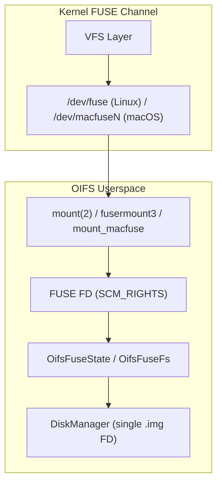
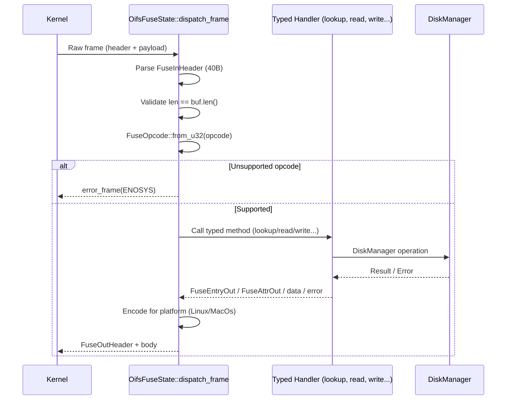
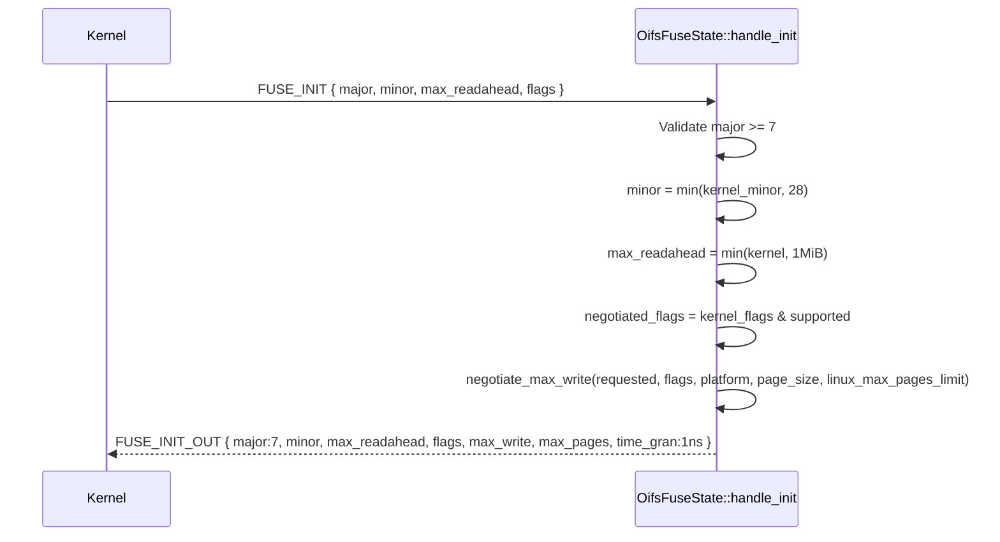

# FUSE Kernel Protocol Engine

The OIFS FUSE engine is a **pure-Rust implementation of the FUSE kernel ABI v7.28** (major 7, minor 28) with zero external C dependencies. It provides a complete wire parser, frame dispatcher, stateful open-handle table, and cross-platform kernel mount runners for Linux and macOS. The engine multiplexes any number of open FUSE file handles over the single underlying OIFS image file descriptor owned by the `DiskManager`.

## Key Properties

- **Endianness-portable**: Every wire structure uses explicit little-endian `to_le_bytes` / `from_le_bytes` serialization.
- **Dual ABI support**: Simultaneously supports standard Linux 88-byte `FuseAttr` and macOS/Darwin 104-byte `FuseAttr` (with `crtime`, `crtimensec`, `flags`), plus both Linux 8-byte and macOS 16-byte xattr request headers.
- **Single-FD container**: The `FuseHandleTable` multiplexes thousands of FUSE `fh` values over one `.img` OS file descriptor.
- **Strict read-only enforcement**: When mounted read-only (via `DiskManager::is_read_only()` or `FuseMountOptions::read_only`), **every mutating operation returns `-EROFS` with zero disk writes**.
- **Panic-free frame dispatch**: `OifsFuseState::dispatch_frame_for_platform` validates every header and payload boundary and never panics on truncated or malformed input.
- **UTF-8 NFD→NFC normalization**: Transparently normalizes macOS APFS/Finder filenames from NFD to NFC for Linux-compatible directory indices.
- **macOS Finder metadata storm protection**: Fast-rejects `.DS_Store`, `._*`, `.Spotlight-V100`, `.Trashes`, `.fseventsd`, `.TemporaryItems` with `-ENOENT` to prevent metadata churn.



## FUSE ABI Constants

The engine targets **FUSE kernel protocol version 7.28** with the following wire sizes:

| Structure | Linux ABI Size | macOS ABI Size |
|-----------|----------------|----------------|
| `FuseInHeader` | 40 B | 40 B |
| `FuseOutHeader` | 16 B | 16 B |
| `FuseAttr` | 88 B | 104 B |
| `FuseEntryOut` | 128 B | 144 B |
| `FuseAttrOut` | 104 B | 120 B |
| `FuseSetAttrIn` | 88 B | 128 B (extended) |
| `FuseInitIn` | 16 B | 16 B |
| `FuseInitOut` | 64 B (ABI v7.28) | 64 B |
| `fuse_setxattr_in` / `fuse_getxattr_in` | 8 B | 16 B (adds `position`) |
| `fuse_dirent` header | 24 B | 24 B |

```rust
pub const FUSE_KERNEL_VERSION: u32 = 7;
pub const FUSE_KERNEL_MINOR_VERSION: u32 = 28;
pub const FUSE_ROOT_ID: u64 = 1;
```

The platform-dependent layout is selected via `FuseAbiPlatform`:

```rust
pub enum FuseAbiPlatform {
    Linux,   // 88-byte FuseAttr, 128-byte FuseEntryOut, 104-byte FuseAttrOut
    MacOs,   // 104-byte FuseAttr, 144-byte FuseEntryOut, 120-byte FuseAttrOut
}
```

## Frame Parser & Dispatcher

### Request/Response Headers

`FuseInHeader` (40 bytes) and `FuseOutHeader` (16 bytes) are parsed with explicit bounds checking:

```rust
let Some(hdr) = FuseInHeader::parse(request) else {
    return FuseOutHeader::error_frame(unique, -libc::EINVAL);
};
let payload = &request[FUSE_IN_HEADER_SIZE..];
```

The dispatcher validates:
- `buf.len() >= 40`
- `header.len as usize == buf.len()`
- Opcode is supported (`FuseOpcode::from_u32`)
- Payload length matches declared sizes for each opcode

### Opcode Dispatch

`dispatch_frame_for_platform` matches on `FuseOpcode` and routes to typed handlers:



Supported opcodes (excerpt):

| Opcode | Value | Handler | Read-only check |
|--------|-------|---------|-----------------|
| `Init` | 26 | `handle_init` | No |
| `Lookup` | 1 | `lookup` | No |
| `Getattr` | 3 | `getattr` | No |
| `Setattr` | 4 | `setattr_size` | **Yes** (`-EROFS`) |
| `Mkdir` | 9 | `mkdir` | **Yes** |
| `Unlink` | 10 | `unlink` | **Yes** |
| `Rmdir` | 11 | `rmdir` | **Yes** |
| `Rename` | 12 | `rename` | **Yes** |
| `Open` | 14 | `open` | Write flags → **Yes** |
| `Create` | 35 | `create` | **Yes** |
| `Read` | 15 | `read` | No |
| `Write` | 16 | `write` | **Yes** |
| `Flush` | 25 | `flush` | Only if dirty |
| `Fsync` | 20 | `fsync` | Only if dirty |
| `Setxattr` | 21 | `setxattr` | **Yes** → `-ENOTSUP` |
| `Getxattr` | 22 | `getxattr` | `-ENOTSUP` |
| `Statfs` | 17 | `statfs` | No |
| `Release` | 18 | `release` | No |
| `Opendir` | 27 | `opendir` | No |
| `Readdir` | 28 | `readdir` | No |
| `Releasedir` | 29 | `releasedir` | No |
| `Access` | 34 | `access` | Write mask → `-EROFS` |
| `Destroy` | 38 | `destroy` | No |
| `Forget` | 2 | (one-way) | No |
| `BatchForget` | 42 | (one-way) | No |

One-way notifications (`FUSE_FORGET`, `FUSE_BATCH_FORGET`) return an empty `Vec` — no reply frame is sent to the kernel.

## FUSE Session & State Management

### OifsFuseState

The protocol state machine is `OifsFuseState`, which holds:

| Field | Purpose |
|-------|---------|
| `options: FuseMountOptions` | Mount configuration |
| `handles: FuseHandleTable` | Open file/directory handle table |
| `parent_map: RwLock<FxHashMap<u64, u64>>` | Child→parent inode mapping for `..` entries |
| `fast_parents: Box<[AtomicU64; 256]>` | Lock-free parent cache (packed child<<32 \| parent) |
| `dir_snapshots: RwLock<VecDeque<...>>` | Sorted directory entry cache (LRU, 8 entries) |
| `append_lock: Mutex<()>` | Serializes `O_APPEND` writes |
| `initialized: AtomicBool` | `FUSE_INIT` completed |
| `destroyed: AtomicBool` | `FUSE_DESTROY` processed |
| `max_write: AtomicU32` | Negotiated `max_write` payload size |

### Lifecycle

<!-- openwiki: mermaid parse failed and this diagram was converted to a text fence so it does not break rendering. Fix the diagram source and restore the mermaid fence. Parser error: Parse error on line 2: ...eated: OifsFuseState::new() Created Expecting 'SPACE', 'NL', 'HIDE_EMPTY', 'scale', 'COMPOSIT_STATE', 'STRUCT_STOP', 'STATE_DESCR', 'ID', 'FORK', 'JOIN', 'CHOICE', 'CONCURRENT', 'note', 'acc_title', 'acc_descr', 'acc_descr_multiline_value', 'CLICK', 'classDef', 'style', 'class', 'direction_tb', 'direction_bt', 'direction_rl', 'direction_lr', 'EDGE_STATE', got 'DESCR' -->
```text
stateDiagram-v2
    [*] --> Created: OifsFuseState::new()
    Created --> Initializing: FUSE_INIT received
    Initializing --> Active: InitOut negotiated (max_write, max_pages)
    Active --> Active: Request/Response dispatch
    Active --> Destroying: FUSE_DESTROY received
    Destroying --> Destroyed: handles.clear(), flush if !RO
    Destroyed --> [*]
    
    note right of Active
        Single-threaded kernel
        FD or multi-threaded
        UnixStream transport
    end note
```

### OifsFuseFs

High-level VFS façade wrapping `Arc<DiskManager>` + `OifsFuseState`. Provides:
- **Binary dispatcher**: `dispatch_frame(&[u8]) -> Vec<u8>`
- **Typed VFS API**: `lookup`, `getattr`, `read`, `write`, `mkdir`, `unlink`, `rename`, `opendir`, `readdir`, `statfs`, `access`, `setxattr`/`getxattr`/`listxattr`/`removexattr` (all `-ENOTSUP`), `open`/`create`/`release`/`flush`/`fsync`

## Handle Table: FuseHandleTable

Maps kernel `fh: u64` → `FuseFileHandle { inode_id, flags, is_dir }`.

- **Lock-free hot path**: 256 SeqLock slots (`fast_slots`) for zero-contention `get(fh)`.
- **Fallback**: `RwLock<FxHashMap<u64, FuseFileHandle>>` for insert/remove and cold lookups.
- **Invalidation**: `invalidate_inode(inode_id)` on unlink/rmdir/overwrite; `clear()` on `FUSE_DESTROY`.

```rust
pub struct FuseFileHandle {
    pub inode_id: u64,
    pub flags: u32,      // POSIX open flags
    pub is_dir: bool,    // true for FUSE_OPENDIR
}
```

## Protocol Negotiation: FUSE_INIT Handshake



### max_write Negotiation

| Platform | Kernel Flags | Effective Cap |
|----------|--------------|---------------|
| **Linux** < 4.20 (no `FUSE_MAX_PAGES`) | — | 128 KiB (32 pages × 4 KiB) |
| **Linux** 4.20–6.12 (`FUSE_MAX_PAGES`) | `max_pages_limit` (default 256) | `max_pages_limit × page_size` |
| **Linux** 6.13+ | `max_pages_limit` (sysfs, up to 1024) | `max_pages_limit × page_size` (up to 4 MiB) |
| **macOS** | `FUSE_BIG_WRITES` required | Requested (default 1 MiB), emitted as `-o iosize=<bytes>` |

`negotiate_max_write` is called with:
- `requested = options.effective_max_write()` (clamped to 4 KiB–4 MiB, 4 KiB aligned)
- `init_flags` from kernel
- `platform = options.abi_platform`
- `page_size = host_page_size()`
- `linux_max_pages_limit = detect_linux_fuse_max_pages_limit()` (reads `/sys/module/fuse/parameters/max_pages_limit`)

## Mount Options: FuseMountOptions

```rust
pub struct FuseMountOptions {
    pub read_only: bool,                    // Enforce -EROFS on all mutations
    pub compression_mode: CompressionMode,  // Applied to FUSE writes
    pub uid: u32,                           // Owner UID in FuseAttr
    pub gid: u32,                           // Owner GID in FuseAttr
    pub attr_ttl_secs: u64,                 // attr_valid TTL (default 1s)
    pub entry_ttl_secs: u64,                // entry_valid TTL (default 1s)
    pub allow_other: bool,                  // allow_other mount option
    pub abi_platform: FuseAbiPlatform,      // Linux / MacOs wire layout
    pub reject_macos_metadata: bool,        // Fast-reject ._*, .DS_Store, etc. (default true)
    pub normalize_nfc: bool,                // NFD→NFC filename normalization (default true)
    pub volname: Option<String>,            // macOS volume name
    pub max_write: u32,                     // Requested max_write (default 1 MiB)
}
```

### OS-Filtered Mount Option Strings

`build_mount_options_for_os(target_os, effective_read_only)` returns `-o` strings:

| Option | Linux | macOS |
|--------|-------|-------|
| `fsname=oifs` | ✅ | ✅ |
| `default_permissions` | ✅ | ✅ |
| `ro` | ✅ (if read_only) | ✅ (if read_only) |
| `allow_other` | ✅ (if requested) | ✅ (if requested) |
| `subtype=oifs` | ✅ | ❌ |
| `noappledouble` | ❌ | ✅ |
| `noapplexattr` | ❌ | ✅ |
| `local` | ❌ | ✅ |
| `iosize=<max_write>` | ❌ | ✅ |
| `volname=<name>` | ❌ | ✅ |

**Key mount options explained**:

- **`default_permissions`**: Enables kernel permission checking based on `uid`/`gid`/`mode` in `FuseAttr` (instead of FUSE daemon doing it). Required for correct multi-user access.
- **`allow_other`**: Allows non-owner users to access the mount (requires `user_allow_other` in `/etc/fuse.conf` on Linux).
- **`ro`**: Kernel-enforced read-only mount; combined with OIFS internal read-only check for defense in depth.
- **`fsname=oifs`**: Sets the filesystem name visible in `df`/`mount` output.
- **`subtype=oifs`** (Linux only): Sets `fstype=fuse.oifs` in `/proc/mounts`.
- **`noappledouble`/`noapplexattr`** (macOS only): Suppresses `._*` AppleDouble files and Apple extended attributes that macFUSE would otherwise synthesize.
- **`iosize`** (macOS only): Tunes the kernel I/O unit size; set to negotiated `max_write`.
- **`volname`** (macOS only): Volume label shown in Finder sidebar.

## Cross-Platform Mount Runners

### Linux: `/dev/fuse` + `fusermount3`

1. **Unprivileged path** (default): `spawn_fusermount_scm_rights`:
   - Creates `socketpair(AF_UNIX, SOCK_STREAM)`
   - Spawns `fusermount3 -o <opts> -- <mountpoint>` with `_FUSE_COMMFD=child_fd`
   - `fusermount3` opens `/dev/fuse`, passes FD via `SCM_RIGHTS` over socketpair
   - Parent receives FD, enters `serve_fuse_fd_with_platform(fd, Linux)`

2. **Privileged fallback**: `mount_linux_direct_dev_fuse`:
   - Opens `/dev/fuse` directly
   - Calls `mount("oifs", mountpoint, "fuse.oifs", MS_NOSUID|MS_NODEV|MS_RDONLY?, "fd=N,rootmode=40000,user_id=...,group_id=...,default_permissions,allow_other?")`
   - Enters `serve_fuse_fd_with_platform(fd, Linux)`

### macOS: `macFUSE` / `osxfuse` (kext) or `FUSE-T` (kext-free NFSv4)

- **Backend discovery**: `discover_macos_fuse_backend()` checks:
  1. `FUSE-T`: `/Library/Application Support/fuse-t/bin/mount_fuse-t` or `go-nfsv4`
  2. `macFUSE`: `/Library/Filesystems/macfuse.fs/Contents/Resources/mount_macfuse`
  3. `osxfuse`: `/Library/Filesystems/osxfuse.fs/Contents/Resources/mount_osxfuse`

- **macFUSE/osxfuse mount flow**:
  1. `socketpair` + `_FUSE_CALL_BY_LIB=1`, `_FUSE_COMMFD=child_fd`, `_FUSE_COMMVERS=2`, `_FUSE_DAEMON_PATH=<exe>`
  2. Spawns `mount_macfuse -o <opts> <mountpoint>` (no positional device arg)
  3. Child passes `/dev/macfuseN` FD via `SCM_RIGHTS`
  4. Parent enters `serve_fuse_fd_with_platform(fd, MacOs)`

- **FUSE-T**: Uses NFSv4 userspace daemon; cannot be served via `/dev/macfuse` FD. Returns error directing to use `serve_fuse_fd`/`serve_stream`/`dispatch_frame` directly.

### serve_fuse_fd (Packet Device Loop)

```rust
loop {
    n = read(fd, buf, buf_len);
    if EINTR/EAGAIN/ENOENT -> continue
    if ENODEV/ECONNRESET/EOF -> Ok(())
    req = &buf[..n];
    resp = dispatch_frame_for_platform(req, platform);
    if !resp.is_empty() { write(fd, resp); }
    if opcode == FUSE_DESTROY -> Ok(())
}
```

- Buffer size: `effective_max_write() + 4096`, clamped to `[128KiB+4KiB, 16MiB]`
- Atomic `read`/`write` per frame (no framing needed on packet devices)
- Retries on `EINTR`, ignores `ENOENT` (interrupted kernel request)

### serve_stream (Unix Stream)

For `AF_UNIX SOCK_STREAM`/`SOCK_SEQPACKET` (e.g., tests, IPC):
1. Read 40-byte `FuseInHeader` (exact)
2. Read remaining `header.len - 40` bytes
3. Dispatch, write full response
4. Exit on `FUSE_DESTROY` or clean EOF

## Attribute Caching & TTLs

The kernel caches inode attributes and directory entries based on TTLs returned in `FUSE_LOOKUP`, `FUSE_GETATTR`, `FUSE_SETATTR` responses.

| Cache Type | Struct Field | Default | Configurable via |
|------------|--------------|---------|------------------|
| **Attribute cache** | `FuseAttrOut.attr_valid` / `attr_valid_nsec` | 1 second | `FuseMountOptions.attr_ttl_secs` |
| **Entry cache** (positive) | `FuseEntryOut.entry_valid` / `entry_valid_nsec` | 1 second | `FuseMountOptions.entry_ttl_secs` |
| **Negative entry cache** | `FuseEntryOut.entry_valid` (on `-ENOENT`) | 1 second | Same as positive (`entry_ttl_secs`) |

**Implementation**:

```rust
fn build_entry_out(&self, dm, inode_id, inode) -> Result<FuseEntryOut, i32> {
    Ok(FuseEntryOut {
        nodeid: inode_to_nodeid(inode_id)?,
        generation: 0,
        entry_valid: self.options.entry_ttl_secs,   // <-- TTL
        attr_valid: self.options.attr_ttl_secs,     // <-- TTL
        entry_valid_nsec: 0,
        attr_valid_nsec: 0,
        attr: FuseAttr::from_inode(...),
    })
}
```

- **No explicit invalidation**: OIFS relies on short TTLs (default 1s) for coherence. For lower latency, reduce TTLs; for less kernel→userspace traffic, increase them.
- **`generation: 0`**: Not used (would require kernel `FUSE_INIT` `FUSE_EXPORT_SUPPORT` + `FUSE_HANDLE_KILLPRIV_V2` which OIFS doesn't advertise).

## macOS-Specific Behaviors

### FUSE-T vs macFUSE/osxfuse

| Aspect | FUSE-T (kext-free) | macFUSE / osxfuse (kext) |
|--------|-------------------|-------------------------|
| **Mechanism** | NFSv4 userspace daemon | Kernel extension + `/dev/macfuseN` |
| **OIFS mount support** | ❌ (cannot serve via FD) | ✅ via `mount_macfuse`/`mount_osxfuse` |
| **Wire ABI** | N/A (NFSv4) | macOS 104-byte `FuseAttr` |
| **Detection** | `discover_macos_fuse_backend()` | Same |

### macOS Finder Metadata Storm Protection

When `reject_macos_metadata = true` (default), these filenames are rejected at VFS entry with `-ENOENT`:

- `._*` (AppleDouble resource forks)
- `.DS_Store`
- `.Spotlight-V100`
- `.Trashes`
- `.fseventsd`
- `.TemporaryItems`

This prevents Finder/Spotlight from creating thousands of metadata files inside the OIFS container.

### UTF-8 NFD → NFC Normalization

When `normalize_nfc = true` (default), incoming filenames are normalized:

- **Input**: NFD (decomposed) as emitted by macOS APFS/Finder (e.g., `e` + `´` = 2 codepoints)
- **Output**: NFC (composed) as expected by Linux/OIFS directory indices (e.g., `é` = 1 codepoint)
- **Fast path**: ASCII and already-composed strings returned as `Cow::Borrowed` (zero allocation)
- **Supported compositions**: Hangul Jamo (L+V→LV, LV+T→LVT), Japanese Kana dakuten/handakuten, Latin/Cyrillic combining diacritics

## Extended Attributes (xattr)

**Unsupported on OIFS**. All xattr operations return `-ENOTSUP` (not `-ENOSYS` or `-EINVAL`, which would cause macOS Finder copies to abort):

| Opcode | Handler | Returns |
|--------|---------|---------|
| `SETXATTR` | `setxattr` | `-ENOTSUP` (or `-EROFS` if read-only) |
| `GETXATTR` | `getxattr` | `-ENOTSUP` |
| `LISTXATTR` | `listxattr` | `-ENOTSUP` |
| `REMOVEXATTR` | `removexattr` | `-ENOTSUP` (or `-EROFS` if read-only) |

Wire headers parsed for both Linux (8B) and macOS (16B with `position` for resource forks).

## Read-Only Enforcement

Two-layer defense:

1. **Mount option** `ro` / `FuseMountOptions.read_only`: Kernel blocks write syscalls at VFS layer.
2. **OIFS internal check**: `is_read_only(dm)` = `dm.is_read_only() || options.read_only`. Every mutating handler (`setattr_size`, `mkdir`, `unlink`, `rmdir`, `rename`, `open` with write flags, `create`, `write`, `setxattr`, `removexattr`, `flush`/`fsync` if dirty) returns `-EROFS` **before any disk access**.

```rust
fn is_read_only(&self, dm: &DiskManager) -> bool {
    dm.is_read_only() || self.options.read_only
}

pub fn write(&self, ...) -> Result<u32, i32> {
    if self.is_read_only(dm) { return Err(-libc::EROFS); }
    ...
}
```

## SCM_RIGHTS File Descriptor Passing

Used by both Linux `fusermount3` and macOS `mount_macfuse` to pass the kernel FUSE device FD to the userspace daemon.

```rust
pub fn send_fd_scm_rights(sock_fd: RawFd, fd: RawFd) -> io::Result<()>
pub fn recv_fd_scm_rights(sock_fd: RawFd) -> io::Result<OwnedFd>
```

- Ancillary data: `cmsg_level=SOL_SOCKET`, `cmsg_type=SCM_RIGHTS`
- `sendmsg`/`recvmsg` with `CMSG_SPACE`/`CMSG_LEN` calculations
- Linux: uses `MSG_CMSG_CLOEXEC` on receive
- Sets `FD_CLOEXEC` on received FD

## Formal Verification (Kani)

The engine includes Kani proofs for critical invariants:

| Proof | Property |
|-------|----------|
| `proof_fuse_nodeid_inode_bijection_and_root_mapping` | `inode_to_nodeid` / `nodeid_to_inode` form strict bijection; root `0 ↔ 1`; `u64::MAX` rejected |
| `proof_fuse_dirent_align_and_record_bounds` | `fuse_dirent_align(24 + name_len)` always multiple of 8, `≥ unaligned`, `< unaligned + 8` |
| `proof_fuse_frame_header_parse_no_panic_and_bounds` | `FuseInHeader::parse` never panics; rejects `<40B`; rejects `len != buf.len()` |

## Usage Examples

### Programmatic Frame Dispatch

```rust
let dm = DiskManager::open("data.oifs", 100_000_000)?;
let opts = FuseMountOptions::for_host_kernel();
let fuse_fs = OifsFuseFs::new(dm, opts);

// Raw binary frame dispatch (for custom transports)
let request = build_lookup_frame(1, FUSE_ROOT_ID, "hello.txt");
let response = fuse_fs.dispatch_frame(&request);
```

### Kernel Mount (Linux)

```rust
let dm = DiskManager::open("data.oifs", 100_000_000)?;
let opts = FuseMountOptions {
    read_only: false,
    allow_other: true,
    ..FuseMountOptions::for_host_kernel()
};
let fuse_fs = OifsFuseFs::new(dm, opts);
fuse_fs.mount("/mnt/oifs")?;  // Spawns fusermount3, serves until unmount
```

### Kernel Mount (macOS)

```rust
let dm = DiskManager::open("data.oifs", 100_000_000)?;
let opts = FuseMountOptions {
    volname: Some("MyOIFS".into()),
    ..FuseMountOptions::for_host_kernel()  // abi_platform = MacOs
};
let fuse_fs = OifsFuseFs::new(dm, opts);
fuse_fs.mount("/Volumes/MyOIFS")?;  // Uses mount_macfuse + SCM_RIGHTS
```

### Userspace-Only (No Kernel Mount)

```rust
let dm = DiskManager::open("data.oifs", 100_000_000)?;
let opts = FuseMountOptions::default();
let fuse_fs = OifsFuseFs::new(dm, opts);

// Serve over Unix domain socket pair
let (client, server) = UnixStream::pair()?;
std::thread::spawn(move || fuse_fs.serve_stream(&mut server));
// Client speaks FUSE ABI v7.28 over the socket
```

### Custom max_write

```rust
let opts = FuseMountOptions {
    max_write: 4 * 1024 * 1024,  // Request 4 MiB (clamped by kernel)
    ..FuseMountOptions::default()
};
```

## Related Pages

- [Async I/O & Pluggable Engines](async_io_and_engines.md) — Data block read engines (mmap/pread/io_uring)
- [Concurrency and Session](concurrency_and_session.md) — Multi-process coordination, master election
- [Architecture Overview](../architecture/overview.md) — System-wide component diagram
