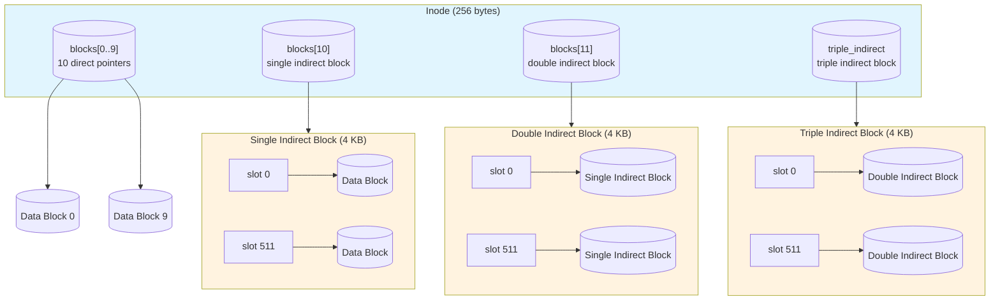

## Responsibility and ownership

The inode and directory subsystem defines the structural foundation of the OIFS filesystem across these modules:

<!-- openwiki: broken internal link [/src/inode.rs] link "/src/inode.rs" is root-absolute, which no real consumer resolves against the repository root (not a coding agent reading the page, not GitHub's Markdown renderer, not a local viewer); use a path relative to this file instead. Fix the href or restore the target, then delete this comment. -->
<!-- openwiki: broken internal link [/src/inode.rs#L33-L69] link "/src/inode.rs" is root-absolute, which no real consumer resolves against the repository root (not a coding agent reading the page, not GitHub's Markdown renderer, not a local viewer); use a path relative to this file instead. Fix the href or restore the target, then delete this comment. -->
<!-- openwiki: broken internal link [/src/inode.rs#L10-L15] link "/src/inode.rs" is root-absolute, which no real consumer resolves against the repository root (not a coding agent reading the page, not GitHub's Markdown renderer, not a local viewer); use a path relative to this file instead. Fix the href or restore the target, then delete this comment. -->
- [`src/inode.rs`](/src/inode.rs): Defines the 256-byte fixed-size [`Inode`](/src/inode.rs#L33-L69) struct, the [`FileType`](/src/inode.rs#L10-L15) discrimination model, block pointer tiers, encryption nonces, filter flags, chunked compression support, and `ChunkEntry` bit layout.
<!-- openwiki: broken internal link [/src/inode_format.rs] link "/src/inode_format.rs" is root-absolute, which no real consumer resolves against the repository root (not a coding agent reading the page, not GitHub's Markdown renderer, not a local viewer); use a path relative to this file instead. Fix the href or restore the target, then delete this comment. -->
- [`src/inode_format.rs`](/src/inode_format.rs): Implements deterministic on-disk encoding/decoding for the **format v2** 256-byte inode record (`INODE_SLOT_SIZE = 256`), including the frozen field layout `[0..166)`, `record_version` at offset 166, `flags` at offset 167, and zero-filled padding to byte 256. Legacy v1 (`bincode`) decoding is retained for backward compatibility.
<!-- openwiki: broken internal link [/src/directory.rs] link "/src/directory.rs" is root-absolute, which no real consumer resolves against the repository root (not a coding agent reading the page, not GitHub's Markdown renderer, not a local viewer); use a path relative to this file instead. Fix the href or restore the target, then delete this comment. -->
<!-- openwiki: broken internal link [/src/directory.rs#L5-L10] link "/src/directory.rs" is root-absolute, which no real consumer resolves against the repository root (not a coding agent reading the page, not GitHub's Markdown renderer, not a local viewer); use a path relative to this file instead. Fix the href or restore the target, then delete this comment. -->
<!-- openwiki: broken internal link [/src/directory.rs#L84-L93] link "/src/directory.rs" is root-absolute, which no real consumer resolves against the repository root (not a coding agent reading the page, not GitHub's Markdown renderer, not a local viewer); use a path relative to this file instead. Fix the href or restore the target, then delete this comment. -->
<!-- openwiki: broken internal link [/src/directory.rs#L211-L232] link "/src/directory.rs" is root-absolute, which no real consumer resolves against the repository root (not a coding agent reading the page, not GitHub's Markdown renderer, not a local viewer); use a path relative to this file instead. Fix the href or restore the target, then delete this comment. -->
<!-- openwiki: broken internal link [/src/directory.rs#L170-L208] link "/src/directory.rs" is root-absolute, which no real consumer resolves against the repository root (not a coding agent reading the page, not GitHub's Markdown renderer, not a local viewer); use a path relative to this file instead. Fix the href or restore the target, then delete this comment. -->
<!-- openwiki: broken internal link [/src/directory.rs#L234-L250] link "/src/directory.rs" is root-absolute, which no real consumer resolves against the repository root (not a coding agent reading the page, not GitHub's Markdown renderer, not a local viewer); use a path relative to this file instead. Fix the href or restore the target, then delete this comment. -->
- [`src/directory.rs`](/src/directory.rs): Defines the on-disk variable-length [`DirectoryEntry`](/src/directory.rs#L5-L10) record format, streaming [`DirectoryIterator`](/src/directory.rs#L84-L93), and zero-allocation lookup algorithms ([`find_entry_in_block`](/src/directory.rs#L211-L232), [`find_entry_in_block_with_hash`](/src/directory.rs#L170-L208), [`find_insert_offset_in_block`](/src/directory.rs#L234-L250)). Also provides SipHash-2-4 filename hashing for fast filtering.
<!-- openwiki: broken internal link [/src/disk/caches.rs] link "/src/disk/caches.rs" is root-absolute, which no real consumer resolves against the repository root (not a coding agent reading the page, not GitHub's Markdown renderer, not a local viewer); use a path relative to this file instead. Fix the href or restore the target, then delete this comment. -->
<!-- openwiki: broken internal link [/src/disk/caches.rs#L175-L195] link "/src/disk/caches.rs" is root-absolute, which no real consumer resolves against the repository root (not a coding agent reading the page, not GitHub's Markdown renderer, not a local viewer); use a path relative to this file instead. Fix the href or restore the target, then delete this comment. -->
<!-- openwiki: broken internal link [/src/disk/caches.rs#L202-L254] link "/src/disk/caches.rs" is root-absolute, which no real consumer resolves against the repository root (not a coding agent reading the page, not GitHub's Markdown renderer, not a local viewer); use a path relative to this file instead. Fix the href or restore the target, then delete this comment. -->
- [`src/disk/caches.rs`](/src/disk/caches.rs): Defines [`DirIndex`](/src/disk/caches.rs#L175-L195) with `stored` (on-disk ciphertext) and `plain` (plaintext) maps, cold-scan promotion threshold (`DIR_INDEX_BUILD_AFTER_SCANS = 8`), `may_have_holes` and `tail_offset` for O(1) inserts, and the 32-shard [`ShardedDirCache`](/src/disk/caches.rs#L202-L254) using Fibonacci hashing.
<!-- openwiki: broken internal link [/src/encryption.rs] link "/src/encryption.rs" is root-absolute, which no real consumer resolves against the repository root (not a coding agent reading the page, not GitHub's Markdown renderer, not a local viewer); use a path relative to this file instead. Fix the href or restore the target, then delete this comment. -->
- [`src/encryption.rs`](/src/encryption.rs): Implements deterministic filename encryption via 192-bit SIV nonce (`derive_filename_siv_nonce`), XChaCha20-Poly1305 AEAD with `parent_inode` bound in AAD (`filename_aad_stack`), and Base64URL `_e_` prefix encoding. Legacy v1 (12-byte nonce) fallback is supported.

## The 256-byte Inode structure (format v2)

<!-- openwiki: broken internal link [/src/inode.rs#L33-L69] link "/src/inode.rs" is root-absolute, which no real consumer resolves against the repository root (not a coding agent reading the page, not GitHub's Markdown renderer, not a local viewer); use a path relative to this file instead. Fix the href or restore the target, then delete this comment. -->
Every file and directory in OIFS is represented by an [`Inode`](/src/inode.rs#L33-L69) stored within the contiguous Inode Table starting at `superblock.inode_table_block`. The on-disk format is **format v2**: a deterministic 256-byte record (`INODE_SLOT_SIZE = 256`) with frozen field offsets `[0..166)`, a `record_version` byte at offset 166, `flags` (u32) at offset 167, and zero padding to byte 256. The in-memory `#[repr(C)]` struct mirrors this layout.

```rust
#[derive(Debug, Serialize, Deserialize, Clone, Copy, PartialEq)]
#[repr(C)]
pub struct Inode {
    /// Type of this inode (File or Directory)
    pub mode: FileType,
    /// Logical size in bytes (original/uncompressed size)
    pub size: u64,
    /// Physical size in bytes if compressed, 0 if stored raw
    pub compressed_size: u64,
    /// Creation timestamp (Unix epoch seconds)
    pub created_at: u64,
    /// Last modification timestamp (Unix epoch seconds)
    pub modified_at: u64,
    /// Direct block pointers (12 blocks × 4KB = 48KB max file size)
    /// Block ID 0 indicates unallocated/empty block
    pub blocks: [u64; 12],

    // Encryption fields
    /// Is this file encrypted?
    pub encrypted: bool,
    /// Nonce for XChaCha20-Poly1305 (24 bytes, unique per file)
    pub encryption_nonce: [u8; 24],

    // Pre-compression filter fields (blosc2-style pipeline)
    /// Element size for shuffle/delta filters (1, 2, 4, or 8 bytes). 0 = no filters.
    pub filter_typesize: u8,
    /// Whether delta encoding was applied before compression
    pub filter_delta: bool,
    /// Whether byte shuffle was applied before compression
    pub filter_shuffle: bool,
    /// Whether bit shuffle was applied before compression
    pub filter_bitshuffle: bool,

    /// Triple indirect block pointer for files > 1GB (supports up to 513GB)
    pub triple_indirect: u64,

    /// Extended inode flags (e.g. INODE_FLAG_SEEKABLE_64K)
    pub flags: u32,
}
```

### On-disk format v2 record layout (fixed 256 bytes)

| Offset | Size | Field | Notes |
|--------|------|-------|-------|
| 0 | 1 | `mode` | 0 = File, 1 = Directory |
| 1..9 | 8 | `size` (u64 LE) | Logical/uncompressed size |
| 9..17 | 8 | `compressed_size` (u64 LE) | Physical size; 0 = uncompressed |
| 17..25 | 8 | `created_at` (u64 LE) | Unix epoch seconds |
| 25..33 | 8 | `modified_at` (u64 LE) | Unix epoch seconds |
| 33..129 | 96 | `blocks[12]` (12×u64 LE) | Direct/indirect block pointers |
| 129 | 1 | `encrypted` (u8) | 0/1 boolean |
| 130..154 | 24 | `encryption_nonce` | XChaCha20-Poly1305 nonce |
| 154 | 1 | `filter_typesize` | 0/1/2/4/8 |
| 155 | 1 | `filter_delta` | 0/1 boolean |
| 156 | 1 | `filter_shuffle` | 0/1 boolean |
| 157 | 1 | `filter_bitshuffle` | 0/1 boolean |
| 158..166 | 8 | `triple_indirect` (u64 LE) | Triple indirect block pointer |
| 166 | 1 | `record_version` | Current = 2 (`INODE_V2_RECORD_VERSION`) |
| 167..171 | 4 | `flags` (u32 LE) | Extended flags (seekable 64K, etc.) |
| 171..256 | 85 | **zero padding** | Reserved for future fields |

### Metadata and sizing semantics

- `mode`: Indicates whether the inode is a regular file or directory container.
- `size`: Logical, uncompressed payload size in bytes. This represents the true file size exposed to users and applications.
- `compressed_size`: Physical disk space occupied by the compressed payload. A value of `0` denotes that the file is stored uncompressed (raw).
- `created_at` and `modified_at`: 64-bit Unix epoch timestamps in seconds.

### Multi-tier block pointer scheme (~513 GB capacity)

The 4KB block pointer architecture supports files ranging from small configurations to massive 513 GB scientific datasets:

| Pointer Field | Slot Index | Block Capacity | Max Cumulative Address Space |
| :--- | :--- | :--- | :--- |
| Direct Blocks | `blocks[0..9]` | 10 blocks | 40 KB |
| Single Indirect | `blocks[10]` | 512 blocks | ≈ 2.04 MB |
| Double Indirect | `blocks[11]` | 512² = 262,144 blocks | ≈ 1.002 GB |
| Triple Indirect | `triple_indirect` | 512³ = 134,217,728 blocks | ≈ 513.002 GB |

<!-- openwiki: broken internal link [/src/inode.rs#L193-L199] link "/src/inode.rs" is root-absolute, which no real consumer resolves against the repository root (not a coding agent reading the page, not GitHub's Markdown renderer, not a local viewer); use a path relative to this file instead. Fix the href or restore the target, then delete this comment. -->
**Constants** (from [`src/inode.rs`](/src/inode.rs#L193-L199)):
- `DIRECT_BLOCKS = 10`
- `PTRS_PER_BLOCK = 512` (4096 / 8)
- `SINGLE_END = DIRECT_BLOCKS + PTRS_PER_BLOCK = 522`
- `DOUBLE_END = SINGLE_END + PTRS_PER_BLOCK² = 262,666`
- `MAX_LOGICAL_BLOCKS = DOUBLE_END + PTRS_PER_BLOCK³ = 134,480,394` (~513 GB at 4 KB blocks)

**Note**: Block ID `0` indicates an unallocated sparse hole or unassigned pointer.

<!-- openwiki: broken internal link [/src/inode.rs#L161-L190] link "/src/inode.rs" is root-absolute, which no real consumer resolves against the repository root (not a coding agent reading the page, not GitHub's Markdown renderer, not a local viewer); use a path relative to this file instead. Fix the href or restore the target, then delete this comment. -->
The logical-to-pointer-tree decomposition is performed by [`BlockPath::from_logical`](/src/inode.rs#L161-L190) and is formally verified in Kani proofs to be bijective and bounds-safe for all indices `< MAX_LOGICAL_BLOCKS`.

### Chunked compression support (seekable 64K)

Files with the `INODE_FLAG_SEEKABLE_64K` flag set (`flags & 0x0001 != 0`) use a different interpretation of the block pointer fields. Each 64-bit slot in `blocks[0..12]` (and indirect blocks) represents a **64 KB logical chunk** rather than a single 4 KB block.

**Chunk layout (64-bit `ChunkEntry`):**
- `bits [0..32]`:   `start_block: u32` — physical start block on disk
- `bits [32..40]`:  `block_count: u8` — number of contiguous 4 KB blocks allocated (1..16, since 16 × 4 KB = 64 KB)
- `bits [40..48]`:  `flags: u8` — chunk state: `FLAG_EMPTY (0)`, `FLAG_COMPRESSED (1)`, `FLAG_RAW (2)`
- `bits [48..64]`:  `compressed_len: u16` — exact compressed byte length (≤ 65535)

<!-- openwiki: broken internal link [/src/inode.rs#L88-L153] link "/src/inode.rs" is root-absolute, which no real consumer resolves against the repository root (not a coding agent reading the page, not GitHub's Markdown renderer, not a local viewer); use a path relative to this file instead. Fix the href or restore the target, then delete this comment. -->
This is implemented via the [`ChunkEntry`](/src/inode.rs#L88-L153) wrapper type with accessor methods (`start_block()`, `block_count()`, `flags()`, `compressed_len()`, `is_empty()`, `is_compressed()`, `is_raw()`) and a `new()` constructor. The flag is defined as:
```rust
pub const INODE_FLAG_SEEKABLE_64K: u32 = 0x0001;
pub const CHUNK_SIZE_64K: usize = 64 * 1024;
```

### Cryptographic and filter flags

- `encrypted`: Boolean flag signaling that the payload is encrypted with XChaCha20-Poly1305.
- `encryption_nonce`: 192-bit (24-byte) unique cryptographic nonce generated per-file via `OsRng`.
- `filter_typesize`: Pre-compression data element width (1, 2, 4, 8 bytes; 0 = disabled).
- `filter_delta`, `filter_shuffle`, `filter_bitshuffle`: Blosc2-style pre-compression filter pipeline indicators required to reverse transformations on read.

### Formal verification with Kani

<!-- openwiki: broken internal link [/src/inode.rs#L321-L453] link "/src/inode.rs" is root-absolute, which no real consumer resolves against the repository root (not a coding agent reading the page, not GitHub's Markdown renderer, not a local viewer); use a path relative to this file instead. Fix the href or restore the target, then delete this comment. -->
<!-- openwiki: broken internal link [/src/inode.rs#L321-L366] link "/src/inode.rs" is root-absolute, which no real consumer resolves against the repository root (not a coding agent reading the page, not GitHub's Markdown renderer, not a local viewer); use a path relative to this file instead. Fix the href or restore the target, then delete this comment. -->
[`src/inode.rs`](/src/inode.rs#L321-L453) includes automated formal proofs in the [`kani_proofs`](/src/inode.rs#L321-L366) module:

- `proof_inode_new_file` / `proof_inode_new_directory`: Verify that `Inode::new` creates zero-initialized sizes, disabled filters, unencrypted state, zero block pointers, and valid modes.
- `proof_inode_no_dangling_blocks`: Proves that all 12 direct/indirect block pointers and the triple-indirect pointer are strictly `0` upon initialization.
- `proof_block_path_roundtrip_all_indices`: Proves the pointer-tree decomposition is bijective and in-bounds for every possible logical index.
- `proof_block_path_tier_boundaries` / `proof_block_path_tier_boundaries_symbolic`: Verify exact tier boundaries (direct/single/double/triple).
- `proof_chunk_entry_roundtrip_all` / `proof_chunk_entry_field_isolation` / `proof_chunk_entry_state_predicates`: Exhaustively verify `ChunkEntry` bit packing, field isolation, and state predicates.

## FileType discrimination

<!-- openwiki: broken internal link [/src/inode.rs#L10-L15] link "/src/inode.rs" is root-absolute, which no real consumer resolves against the repository root (not a coding agent reading the page, not GitHub's Markdown renderer, not a local viewer); use a path relative to this file instead. Fix the href or restore the target, then delete this comment. -->
[`FileType`](/src/inode.rs#L10-L15) classifies storage entities:

```rust
#[derive(Debug, Serialize, Deserialize, Clone, Copy, PartialEq)]
pub enum FileType {
    /// Regular file
    File,
    /// Directory (container for other files/directories)
    Directory,
}
```

<!-- openwiki: broken internal link [/src/disk.rs] link "/src/disk.rs" is root-absolute, which no real consumer resolves against the repository root (not a coding agent reading the page, not GitHub's Markdown renderer, not a local viewer); use a path relative to this file instead. Fix the href or restore the target, then delete this comment. -->
In [`DiskManager`](/src/disk.rs), `inode.mode` gates operations:
<!-- openwiki: broken internal link [/src/disk.rs#L1059] link "/src/disk.rs" is root-absolute, which no real consumer resolves against the repository root (not a coding agent reading the page, not GitHub's Markdown renderer, not a local viewer); use a path relative to this file instead. Fix the href or restore the target, then delete this comment. -->
- Writing payload data via `write_data_with_filters` to an inode with `mode == FileType::Directory` returns `DiskManagerError::Io("Cannot write data to non-file inode")` ([/src/disk.rs#L1059](/src/disk.rs#L1059)).
<!-- openwiki: broken internal link [/src/disk.rs#L569] link "/src/disk.rs" is root-absolute, which no real consumer resolves against the repository root (not a coding agent reading the page, not GitHub's Markdown renderer, not a local viewer); use a path relative to this file instead. Fix the href or restore the target, then delete this comment. -->
<!-- openwiki: broken internal link [/src/disk.rs#L1353] link "/src/disk.rs" is root-absolute, which no real consumer resolves against the repository root (not a coding agent reading the page, not GitHub's Markdown renderer, not a local viewer); use a path relative to this file instead. Fix the href or restore the target, then delete this comment. -->
<!-- openwiki: broken internal link [/src/disk.rs#L1397] link "/src/disk.rs" is root-absolute, which no real consumer resolves against the repository root (not a coding agent reading the page, not GitHub's Markdown renderer, not a local viewer); use a path relative to this file instead. Fix the href or restore the target, then delete this comment. -->
- Directory operations (`lookup`, `list_dir`, `delete_file`) on an inode with `mode == FileType::File` return `DiskManagerError::Io("Not a directory")` ([/src/disk.rs#L569](/src/disk.rs#L569), [L1353](/src/disk.rs#L1353), [L1397](/src/disk.rs#L1397)).

## Directory entry format and wire layout

<!-- openwiki: broken internal link [/src/directory.rs#L5-L10] link "/src/directory.rs" is root-absolute, which no real consumer resolves against the repository root (not a coding agent reading the page, not GitHub's Markdown renderer, not a local viewer); use a path relative to this file instead. Fix the href or restore the target, then delete this comment. -->
Directories in OIFS are stored within ordinary 4 KB data blocks pointed to by `inode.blocks[0]` (and subsequent blocks via the pointer tree). A directory block contains packed, variable-length [`DirectoryEntry`](/src/directory.rs#L5-L10) records:

```rust
#[derive(Debug, Clone, PartialEq, Serialize, Deserialize)]
pub struct DirectoryEntry {
    pub inode: u64,
    pub hash: u64,
    pub name: String,
}
```

### On-disk wire layout

<!-- openwiki: broken internal link [/src/directory.rs#L25-L43] link "/src/directory.rs" is root-absolute, which no real consumer resolves against the repository root (not a coding agent reading the page, not GitHub's Markdown renderer, not a local viewer); use a path relative to this file instead. Fix the href or restore the target, then delete this comment. -->
Each entry is serialized sequentially ([`serialize_into`](/src/directory.rs#L25-L43)):

```
┌──────────────────┬──────────────────┬─────────────────┬────────────────────────────┐
│  inode (8B LE)   │   hash (8B LE)   │ name_len (2B LE)│    name (name_len bytes)   │
└──────────────────┴──────────────────┴─────────────────┴────────────────────────────┘
0                  8                  16                18               18 + name_len
```

1. **Fixed Header (18 bytes)**:
   - `inode` (8 bytes, little-endian): Target inode number.
   - `hash` (8 bytes, little-endian): Optional fast-lookup hash (SipHash-2-4 of filename; `hash_filename` / `hash_filename_bytes`).
   - `name_len` (2 bytes, little-endian): Length of the UTF-8 filename in bytes.
2. **Variable Filename (`name`)**:
   - Up to 255 bytes (`MAX_FILENAME_LEN = 255`). Filenames exceeding 255 bytes return `DirectoryError::EntryTooLarge`.
   - Filenames containing path separators `/` or `\`, null bytes, empty strings, or `.` / `..` are rejected by `validate_filename` with `DirectoryError::InvalidFilename`.
3. **End-of-Block Sentinel**:
<!-- openwiki: broken internal link [/src/directory.rs#L64-L66] link "/src/directory.rs" is root-absolute, which no real consumer resolves against the repository root (not a coding agent reading the page, not GitHub's Markdown renderer, not a local viewer); use a path relative to this file instead. Fix the href or restore the target, then delete this comment. -->
   - When scanning or deserializing, `name_len == 0` serves as a sentinel indicating the termination of active entries in the block ([/src/directory.rs#L64-L66](/src/directory.rs#L64-L66)).

### Filename encryption (SIV + XChaCha20-Poly1305)

On encrypted filesystems, directory entries store the **ciphertext filename** (not plaintext). The encryption uses deterministic SIV construction:

<!-- openwiki: broken internal link [/src/encryption.rs#L629-L642] link "/src/encryption.rs" is root-absolute, which no real consumer resolves against the repository root (not a coding agent reading the page, not GitHub's Markdown renderer, not a local viewer); use a path relative to this file instead. Fix the href or restore the target, then delete this comment. -->
1. **SIV nonce derivation** ([`derive_filename_siv_nonce`](/src/encryption.rs#L629-L642)):
   ```
   BLAKE2b-512(
     "OIFS_SIV_FILENAME_V2_XCHACHA20" ||  // domain separation
     filename_siv_key ||                   // 32-byte subkey from HKDF
     parent_inode (8B LE) ||               // binds name to parent directory
     plaintext_name_bytes
   ) → first 24 bytes = 192-bit XNonce
   ```

2. **AEAD encryption** (`encrypt_filename`):
   - Algorithm: XChaCha20-Poly1305 (RFC 8439)
   - Key: `filename_cipher_key` (32-byte subkey from HKDF, domain-separated from SIV key)
   - AAD: `filename_aad_stack(parent_inode)` = `[0x01, "OIFS_AAD_v1______", parent_inode (8B LE)]` (20 bytes)
   - Payload: plaintext filename bytes
   - Output: `nonce (24B) || ciphertext || tag (16B)` → Base64URL unpadded → prefixed with `"_e_"`

3. **On-disk storage**: The `DirectoryEntry.name` field holds the `_e_...` string. The `hash` field is computed over the **plaintext** name for fast positive lookups; it is not encrypted.

4. **Decryption** (`decrypt_filename`):
   - Strips `_e_` prefix, Base64URL-decodes
   - Verifies nonce matches SIV derivation (constant-time) to prevent forgery
   - Falls back to legacy v1 format (12-byte ChaCha20Poly1305 nonce) if needed
   - Returns plaintext on success; returns original string on auth failure (opaque to caller)

**Plaintext map in `DirIndex`**: On encrypted filesystems, `DirIndex.plain: FxHashMap<String, (u64, u64)>` maps plaintext name → `(inode_id, plain_hash)` to avoid re-encrypting on repeated lookups. `plain_complete` is set when `plain.len() == stored.len()`.

### Zero-allocation lookup and fast insertion

Traditional directory lookups allocate intermediate strings and vectors for every scanned record. OIFS provides zero-allocation primitives for maximum throughput:

#### Zero-allocation lookup (`find_entry_in_block`)

<!-- openwiki: broken internal link [/src/directory.rs#L211-L232] link "/src/directory.rs" is root-absolute, which no real consumer resolves against the repository root (not a coding agent reading the page, not GitHub's Markdown renderer, not a local viewer); use a path relative to this file instead. Fix the href or restore the target, then delete this comment. -->
[`find_entry_in_block`](/src/directory.rs#L211-L232) searches a raw directory memory slice without a single heap allocation:

```rust
#[inline]
pub fn find_entry_in_block(slice: &[u8], target_name: &str) -> Option<u64> {
    let target_bytes = target_name.as_bytes();
    let mut offset = 0;
    while offset + 18 <= slice.len() {
        let len = u16::from_le_bytes([slice[offset + 16], slice[offset + 17]]) as usize;
        if len == 0 { break; }
        let name_start = offset + 18;
        let name_end = name_start + len;
        if name_end > slice.len() { break; }
        if len == target_bytes.len() && &slice[name_start..name_end] == target_bytes {
            let inode = u64::from_le_bytes(slice[offset..offset + 8].try_into().unwrap());
            return Some(inode);
        }
        offset = name_end;
    }
    None
}
```

- Bypasses UTF-8 validation and `String` allocation by directly comparing byte slices.
- Decodes integers in place with `u16::from_le_bytes` and `u64::from_le_bytes`.
- Operates at L1 CPU cache bandwidth.

#### Hash-filtered lookup (`find_entry_in_block_with_hash`)

<!-- openwiki: broken internal link [/src/directory.rs#L170-L208] link "/src/directory.rs" is root-absolute, which no real consumer resolves against the repository root (not a coding agent reading the page, not GitHub's Markdown renderer, not a local viewer); use a path relative to this file instead. Fix the href or restore the target, then delete this comment. -->
[`find_entry_in_block_with_hash`](/src/directory.rs#L170-L208) adds a 64-bit SipHash-2-4 pre-filter to skip string comparison for mismatched entries when the stored hash ≠ target hash:

```rust
#[inline]
pub fn find_entry_in_block_with_hash(
    slice: &[u8],
    target_name: &str,
    target_hash: u64,
) -> Option<u64> {
    // ... reads entry_hash at offset+8 .. offset+16 ...
    if (entry_hash == 0 || target_hash == 0 || entry_hash == target_hash)
       && len == target_bytes.len()
       && &slice[name_start..name_end] == target_bytes { ... }
}
```
- `hash == 0` means "hash not computed/stored"; treated as match (no filter).
- Used by `locate_entry_in_dir` during on-disk scans.

#### Fast append offset (`find_insert_offset_in_block`)

<!-- openwiki: broken internal link [/src/directory.rs#L234-L250] link "/src/directory.rs" is root-absolute, which no real consumer resolves against the repository root (not a coding agent reading the page, not GitHub's Markdown renderer, not a local viewer); use a path relative to this file instead. Fix the href or restore the target, then delete this comment. -->
[`find_insert_offset_in_block`](/src/directory.rs#L234-L250) steps through existing entries using the 18-byte header and length field until encountering `len == 0`. It returns the exact byte offset where the new record should be written, eliminating full block rewrites.

## DirIndex and ShardedDirCache

### DirIndex structure

<!-- openwiki: broken internal link [/src/disk/caches.rs#L175-L195] link "/src/disk/caches.rs" is root-absolute, which no real consumer resolves against the repository root (not a coding agent reading the page, not GitHub's Markdown renderer, not a local viewer); use a path relative to this file instead. Fix the href or restore the target, then delete this comment. -->
[`DirIndex`](/src/disk/caches.rs#L175-L195) is the in-memory index for a single directory:

```rust
pub(crate) struct DirIndex {
    pub(crate) complete: bool,              // entire directory indexed
    pub(crate) plain_complete: bool,        // plain map has all stored entries (encrypted FS)
    pub(crate) cold_scans: u32,             // number of targeted scans since last index build
    pub(crate) may_have_holes: bool,        // earlier blocks may have free space from deletions
    pub(crate) tail_offset: Option<(u64, u16)>, // (phys_block_id, next_insert_offset) for last block
    pub(crate) stored: FxHashMap<String, (u64, u64, u64)>, // ciphertext name → (inode, phys_block, stored_hash)
    pub(crate) plain: FxHashMap<String, (u64, u64)>,       // plaintext name → (inode, plain_hash) [encrypted FS only]
}
```

- `stored` always holds the on-disk names (ciphertext on encrypted FS, plaintext otherwise).
- `plain` is only used on encrypted filesystems to cache plaintext→inode mappings and avoid re-encryption.
- `cold_scans` increments on each targeted scan (miss or hit that requires scanning). When it reaches `DIR_INDEX_BUILD_AFTER_SCANS = 8`, the next miss/hit triggers a full index build.
- `may_have_holes` and `tail_offset` enable O(1) insertion: if the tail block has space, no scan is needed; if earlier blocks might have holes (from deletions), they are scanned only when the tail is full.

### DirIndex promotion logic

<!-- openwiki: broken internal link [/src/disk.rs#L1827-L1928] link "/src/disk.rs" is root-absolute, which no real consumer resolves against the repository root (not a coding agent reading the page, not GitHub's Markdown renderer, not a local viewer); use a path relative to this file instead. Fix the href or restore the target, then delete this comment. -->
<!-- openwiki: broken internal link [/src/disk.rs#L1962] link "/src/disk.rs" is root-absolute, which no real consumer resolves against the repository root (not a coding agent reading the page, not GitHub's Markdown renderer, not a local viewer); use a path relative to this file instead. Fix the href or restore the target, then delete this comment. -->
The promotion from targeted scans to complete index occurs in [`dir_lookup`](/src/disk.rs#L1827-L1928) and [`append_dir_entry_to_dir`](/src/disk.rs#L1962):

1. **First access** (no `DirIndex` exists): Build complete index in a single pass (`build_dir_index`), populate `stored`, `may_have_holes`, `tail_offset`, set `complete = true`.
2. **Subsequent lookups**: 
   - If `complete` (and `plain_complete` on encrypted FS): O(1) map lookup, no disk access.
   - If not complete: targeted on-disk scan (`locate_entry_in_dir`).
3. **Promotion trigger**: On a **negative lookup** (not found) OR when `cold_scans + 1 >= 8`, the next operation builds the full index outside the shard write lock, then installs it atomically.

This design ensures:
- First lookup (even negative) pays full scan once and never again.
- Hot directories become fully indexed automatically.
- Lock contention is minimized: index build happens outside the shard write lock.

### ShardedDirCache (32 shards)

<!-- openwiki: broken internal link [/src/disk/caches.rs#L202-L254] link "/src/disk/caches.rs" is root-absolute, which no real consumer resolves against the repository root (not a coding agent reading the page, not GitHub's Markdown renderer, not a local viewer); use a path relative to this file instead. Fix the href or restore the target, then delete this comment. -->
[`ShardedDirCache`](/src/disk/caches.rs#L202-L254) divides `dir_inode_id → DirIndex` across 32 independent `RwLock<FxHashMap<u64, DirIndex>>` shards:

```rust
const NUM_DIR_CACHE_SHARDS: usize = 32;
const SHARD_MASK: usize = NUM_DIR_CACHE_SHARDS - 1; // 31
fn shard_index(&self, dir_inode_id: u64) -> usize {
    (dir_inode_id.wrapping_mul(0x517cc1b727220a95) as usize) & SHARD_MASK
}
```

- Uses 64-bit Fibonacci hashing (multiplicative bijection) for uniform distribution.
- `read_shard` / `write_shard` return poison-resistant `RwLock` guards (`read_unpoisoned` / `write_unpoisoned`).
- Operations on one directory never stall concurrent operations on directories in other shards.

## Streaming directory iteration

<!-- openwiki: broken internal link [/src/directory.rs#L84-L93] link "/src/directory.rs" is root-absolute, which no real consumer resolves against the repository root (not a coding agent reading the page, not GitHub's Markdown renderer, not a local viewer); use a path relative to this file instead. Fix the href or restore the target, then delete this comment. -->
[`DirectoryIterator<'a>`](/src/directory.rs#L84-L93) implements the standard Rust `Iterator` trait over a borrowed slice `&'a [u8]`:

- Wraps `std::io::Cursor<&'a [u8]>`.
<!-- openwiki: broken internal link [/src/directory.rs#L45-L81] link "/src/directory.rs" is root-absolute, which no real consumer resolves against the repository root (not a coding agent reading the page, not GitHub's Markdown renderer, not a local viewer); use a path relative to this file instead. Fix the href or restore the target, then delete this comment. -->
- Successively calls [`DirectoryEntry::deserialize_from`](/src/directory.rs#L45-L81).
- Automatically halts when reaching the end of the memory buffer or encountering a zero-length name sentinel.
- Propagates I/O and UTF-8 errors via `Result<DirectoryEntry, DirectoryError>`.

## Inode block pointer tree (Mermaid)



- **Direct**: 10 pointers → 40 KB
- **Single indirect**: 1 block × 512 pointers → 2 MB
- **Double indirect**: 512 × 512 pointers → ~1 GB
- **Triple indirect**: 512³ pointers → ~513 GB total
- Each indirect block is a 4 KB array of 512 `u64` block IDs.
- Block ID 0 = unallocated/sparse hole at any level.

## Constants summary

| Constant | Value | Location |
|----------|-------|----------|
<!-- openwiki: broken internal link [/src/lib.rs#L27] link "/src/lib.rs" is root-absolute, which no real consumer resolves against the repository root (not a coding agent reading the page, not GitHub's Markdown renderer, not a local viewer); use a path relative to this file instead. Fix the href or restore the target, then delete this comment. -->
| `BLOCK_SIZE` | 4096 | [`src/lib.rs`](/src/lib.rs#L27) |
<!-- openwiki: broken internal link [/src/inode_format.rs#L71] link "/src/inode_format.rs" is root-absolute, which no real consumer resolves against the repository root (not a coding agent reading the page, not GitHub's Markdown renderer, not a local viewer); use a path relative to this file instead. Fix the href or restore the target, then delete this comment. -->
| `INODE_SLOT_SIZE` | 256 | [`src/inode_format.rs`](/src/inode_format.rs#L71) |
<!-- openwiki: broken internal link [/src/inode_format.rs#L76] link "/src/inode_format.rs" is root-absolute, which no real consumer resolves against the repository root (not a coding agent reading the page, not GitHub's Markdown renderer, not a local viewer); use a path relative to this file instead. Fix the href or restore the target, then delete this comment. -->
| `INODE_V2_PAYLOAD_LEN` | 166 | [`src/inode_format.rs`](/src/inode_format.rs#L76) |
<!-- openwiki: broken internal link [/src/inode_format.rs#L82] link "/src/inode_format.rs" is root-absolute, which no real consumer resolves against the repository root (not a coding agent reading the page, not GitHub's Markdown renderer, not a local viewer); use a path relative to this file instead. Fix the href or restore the target, then delete this comment. -->
| `INODE_V2_RECORD_VERSION` | 2 | [`src/inode_format.rs`](/src/inode_format.rs#L82) |
<!-- openwiki: broken internal link [/src/inode_format.rs#L95] link "/src/inode_format.rs" is root-absolute, which no real consumer resolves against the repository root (not a coding agent reading the page, not GitHub's Markdown renderer, not a local viewer); use a path relative to this file instead. Fix the href or restore the target, then delete this comment. -->
| `INODE_FORMAT_V2` | 2 | [`src/inode_format.rs`](/src/inode_format.rs#L95) |
<!-- openwiki: broken internal link [/src/inode.rs#L193] link "/src/inode.rs" is root-absolute, which no real consumer resolves against the repository root (not a coding agent reading the page, not GitHub's Markdown renderer, not a local viewer); use a path relative to this file instead. Fix the href or restore the target, then delete this comment. -->
| `DIRECT_BLOCKS` | 10 | [`src/inode.rs`](/src/inode.rs#L193) |
<!-- openwiki: broken internal link [/src/inode.rs#L195] link "/src/inode.rs" is root-absolute, which no real consumer resolves against the repository root (not a coding agent reading the page, not GitHub's Markdown renderer, not a local viewer); use a path relative to this file instead. Fix the href or restore the target, then delete this comment. -->
| `PTRS_PER_BLOCK` | 512 | [`src/inode.rs`](/src/inode.rs#L195) |
<!-- openwiki: broken internal link [/src/inode.rs#L199] link "/src/inode.rs" is root-absolute, which no real consumer resolves against the repository root (not a coding agent reading the page, not GitHub's Markdown renderer, not a local viewer); use a path relative to this file instead. Fix the href or restore the target, then delete this comment. -->
| `MAX_LOGICAL_BLOCKS` | 134,480,394 | [`src/inode.rs`](/src/inode.rs#L199) |
<!-- openwiki: broken internal link [/src/inode.rs#L72] link "/src/inode.rs" is root-absolute, which no real consumer resolves against the repository root (not a coding agent reading the page, not GitHub's Markdown renderer, not a local viewer); use a path relative to this file instead. Fix the href or restore the target, then delete this comment. -->
| `CHUNK_SIZE_64K` | 65536 | [`src/inode.rs`](/src/inode.rs#L72) |
<!-- openwiki: broken internal link [/src/inode.rs#L75] link "/src/inode.rs" is root-absolute, which no real consumer resolves against the repository root (not a coding agent reading the page, not GitHub's Markdown renderer, not a local viewer); use a path relative to this file instead. Fix the href or restore the target, then delete this comment. -->
| `INODE_FLAG_SEEKABLE_64K` | 0x0001 | [`src/inode.rs`](/src/inode.rs#L75) |
<!-- openwiki: broken internal link [/src/directory.rs#L81] link "/src/directory.rs" is root-absolute, which no real consumer resolves against the repository root (not a coding agent reading the page, not GitHub's Markdown renderer, not a local viewer); use a path relative to this file instead. Fix the href or restore the target, then delete this comment. -->
| `MAX_FILENAME_LEN` | 255 | [`src/directory.rs`](/src/directory.rs#L81) |
<!-- openwiki: broken internal link [/src/disk/caches.rs#L191] link "/src/disk/caches.rs" is root-absolute, which no real consumer resolves against the repository root (not a coding agent reading the page, not GitHub's Markdown renderer, not a local viewer); use a path relative to this file instead. Fix the href or restore the target, then delete this comment. -->
| `DIR_INDEX_BUILD_AFTER_SCANS` | 8 | [`src/disk/caches.rs`](/src/disk/caches.rs#L191) |
<!-- openwiki: broken internal link [/src/disk/caches.rs#L188] link "/src/disk/caches.rs" is root-absolute, which no real consumer resolves against the repository root (not a coding agent reading the page, not GitHub's Markdown renderer, not a local viewer); use a path relative to this file instead. Fix the href or restore the target, then delete this comment. -->
| `NUM_DIR_CACHE_SHARDS` | 32 | [`src/disk/caches.rs`](/src/disk/caches.rs#L188) |
<!-- openwiki: broken internal link [/src/encryption.rs#L332] link "/src/encryption.rs" is root-absolute, which no real consumer resolves against the repository root (not a coding agent reading the page, not GitHub's Markdown renderer, not a local viewer); use a path relative to this file instead. Fix the href or restore the target, then delete this comment. -->
| `FILENAME_ENC_PREFIX` | `"_e_"` | [`src/encryption.rs`](/src/encryption.rs#L332) |
<!-- openwiki: broken internal link [/src/encryption.rs#L409] link "/src/encryption.rs" is root-absolute, which no real consumer resolves against the repository root (not a coding agent reading the page, not GitHub's Markdown renderer, not a local viewer); use a path relative to this file instead. Fix the href or restore the target, then delete this comment. -->
| `SHORT_XCHACHA_THRESHOLD` | 192 | [`src/encryption.rs`](/src/encryption.rs#L409) |

## Related pages

- [Block Allocation](../architecture/block_allocation.md) — How blocks are allocated, freed, and tracked
- [Compression and Filters](../architecture/compression_and_filters.md) — Zstd compression pipeline and blosc2-style filters
- [Encryption](../architecture/encryption.md) — File payload encryption, chunk encryption, and key derivation
- [Basic Operations](../workflows/basic_operations.md) — File create, read, write, delete workflows
- [Encrypted Workflows](../workflows/encrypted_workflows.md) — Encrypted filesystem initialization and operations
