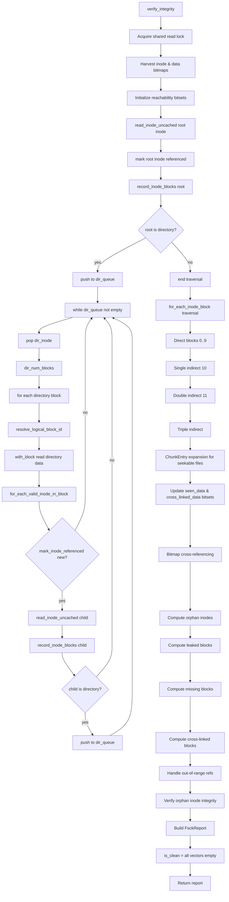

## Responsibility and ownership

Filesystem structural consistency verification is owned by [`DiskManager::verify_integrity`](repo://src/disk/maintenance.rs#L1590-L1595) (implemented in `verify_integrity_on`).

It serves as the OIFS equivalent of `fsck` (filesystem consistency check). Unlike continuous runtime operations that trust filesystem invariants, `verify_integrity` treats the raw on-disk state as untrusted, scanning block bitmaps, the inode table, and directory pointer trees to diagnose storage corruption, crash remnants, or software bugs.

Results are encapsulated within [`FsckReport`](repo://src/disk.rs#L254-L265), which is exposed directly to the CLI command `oifs fsck` ([`src/bin/oifs.rs`](repo://src/bin/oifs.rs#L1711-L1770)) and over the IPC layer via `IpcRequest::VerifyIntegrity` → `IpcResponseData::Fsck` ([`src/session.rs#L1335-L1352`](repo://src/session.rs#L1335-L1352)).

## The consistency model: allocation vs reachability

Filesystem consistency in OIFS requires that physical allocation states strictly match logical directory reachability:

$$\text{Allocated in Bitmaps} \iff \text{Reachable from Root Directory}$$

Corruption occurs whenever there is a divergence between what the bitmaps declare and what the inode and directory structures actually reference.

```
       [On-Disk Bitmaps]                       [Directory & Inode Tree]
(inode_bitmap / data_bitmap)                 (Root Inode 0 -> Dirs -> Files)
             │                                              │
             ▼                                              ▼
   Allocated Bit Sets                             Referenced Target Sets
             │                                              │
             └─────────────── Set Differences ──────────────┘
                                     │
         ┌───────────────────────────┼───────────────────────────┐
         ▼                           ▼                           ▼
   Orphan Inodes               Leaked Blocks               Missing Blocks
 (Allocated Inode,           (Allocated Block,           (Referenced Block,
  No Directory Ref)           No Inode Pointer)           Free in Bitmap)
                                     │
                                     ▼
                            Cross-Linked Blocks
                        (Block mapped by > 1 Inode)
```

## The 5 structural corruption categories

The integrity scanner partitions discrepancies into five formal failure modes:

| Defect Category | Field in `FsckReport` | Mathematical Definition | Severity / Impact |
| :--- | :--- | :--- | :--- |
| **Orphan Inodes** | `orphan_inodes` | $\text{AllocatedInodes} \setminus \text{ReferencedInodes}$ | Medium: Inodes occupy space in the inode table but cannot be accessed or unlinked by users. |
| **Leaked Blocks** | `leaked_blocks` | $\text{AllocatedBlocks} \setminus \text{ReferencedBlocks}$ | Low: Physical storage capacity is wasted because free blocks are marked in-use. |
| **Missing Blocks** | `missing_blocks` | $\text{ReferencedBlocks} \setminus \text{AllocatedBlocks}$ | **Critical**: Active files reference blocks that the block allocator considers free; future writes will overwrite and corrupt active file data. |
| **Cross-Linked Blocks**| `cross_linked_blocks` | $\{b \mid \text{Count}(\text{References}(b)) > 1\}$ | **Critical**: Multiple distinct inodes point to the exact same physical block; modifying one file silently corrupts another. |
| **Corrupted Inodes** | `corrupted_inodes` | Allocated inodes that fail format decoding or CRC32C integrity verification | **Critical**: Inode metadata is unreadable; any data reachable through them is inaccessible. |

## FsckReport structure and remediation guidance

```rust
/// Detailed diagnostic report from a consistency check (fsck)
#[derive(Debug, Clone, Serialize, Deserialize)]
pub struct FsckReport {
    /// True if filesystem is structurally consistent
    pub is_clean: bool,
    /// List of allocated inodes not referenced by any directory entries
    pub orphan_inodes: Vec<u64>,
    /// List of data blocks marked allocated in the bitmap but not mapped by any inode
    pub leaked_blocks: Vec<u64>,
    /// List of data blocks mapped by inodes but marked free in the bitmap
    pub missing_blocks: Vec<u64>,
    /// List of data blocks referenced by multiple inodes
    pub cross_linked_blocks: Vec<u64>,
    /// List of inodes that failed format decoding or CRC32C integrity verification
    pub corrupted_inodes: Vec<u64>,
}
```

**Remediation guidance per field:**

| Field | Remediation |
| :--- | :--- |
| `orphan_inodes` | Safe to clear the inode bitmap bits for each listed inode ID (`Bitmap::clear(idx)`). Orphan inodes carry no user data reachable from the namespace. |
| `leaked_blocks` | Safe to clear the corresponding data bitmap bits. These blocks contain no live file data. |
| `missing_blocks` | **Requires manual investigation**. The listed blocks hold file data but are marked free. Marking them allocated in the bitmap (`Bitmap::set(idx)`) restores accounting but does not guarantee file contents are intact if the blocks were subsequently reused. |
| `cross_linked_blocks` | **Requires manual investigation**. Multiple inodes share the same physical block. The only safe fix is to copy the block data to a fresh block for all but one inode and update that inode's pointer, then clear the cross-link from the report. |
| `corrupted_inodes` | **Requires manual investigation**. Inode metadata is damaged (format decode failure or CRC32C mismatch). Data reachable through these inodes is inaccessible. Consider clearing the inode bitmap bit and treating any referenced blocks as leaked. |

The `is_clean` flag is true only when all five vectors are empty. The CLI prints a human-readable summary and exits with a non-zero code if `!is_clean`.

## Verification algorithm

[`DiskManager::verify_integrity_on`](repo://src/disk/maintenance.rs#L1597-L1795) operates under a shared read lock (`inner.read().unwrap()`), allowing concurrent inspections without halting read workloads. It uses compact 64-bit word bitsets for reachability tracking and zero-copy bitmap word scanning.

### Step 1: Bitmap ground-truth harvesting

The scanner reads the inode and data bitmaps directly from disk via `inode_bitmap_slice()` and `data_bitmap_slice()` — no allocator state is trusted. These slices may span multiple blocks and are accessed either through the mmap view (zero-copy) or the file I/O mirror.

### Step 2: Single-pass reachable tree walk

Starting from `superblock.root_inode` (always inode 0), the verifier performs a breadth-first traversal:

```rust
let mut dir_queue: Vec<Inode> = Vec::new();
let mut corrupted_inodes: Vec<u64> = Vec::new();
mark_inode_referenced(sb.root_inode);
match Self::read_inode_uncached(&guard, sb.root_inode) {
    Ok(root_inode) => {
        record_inode_blocks(&root_inode);
        if root_inode.mode == crate::inode::FileType::Directory {
            dir_queue.push(root_inode);
        }
    }
    Err(_) => {
        corrupted_inodes.push(sb.root_inode);
    }
}

while let Some(dir_inode) = dir_queue.pop() {
    let num_blocks = Self::dir_num_blocks(&dir_inode);
    for blk_idx in 0..num_blocks {
        let phys_blk = Self::resolve_logical_block_id(&guard.backing, &dir_inode, blk_idx);
        if phys_blk == 0 { continue; }
        let _ = guard.backing.with_block(phys_blk, |block_data| {
            crate::directory::for_each_valid_inode_in_block(block_data, |child_id| {
                if mark_inode_referenced(child_id) {
                    match Self::read_inode_uncached(&guard, child_id) {
                        Ok(child_inode) => {
                            record_inode_blocks(&child_inode);
                            if child_inode.mode == crate::inode::FileType::Directory {
                                dir_queue.push(child_inode);
                            }
                        }
                        Err(_) => {
                            corrupted_inodes.push(child_id);
                        }
                    }
                }
            });
        });
    }
}
```

Key implementation details:

- **`read_inode_uncached`** ([`src/disk.rs#L6094-L6120`](repo://src/disk.rs#L6094-L6120)): Reads inodes directly from disk slots without polluting the inode cache, using the correct record version (v1 or v2) per slot based on the migration cursor.
- **`for_each_valid_inode_in_block`** ([`src/directory.rs#L378-L405`](repo://src/directory.rs#L378-L405)): Zero-allocation directory entry scanner that validates filename UTF-8 and length bounds before yielding inode IDs.
- **`dir_num_blocks`** ([`src/disk.rs#L2065-L2070`](repo://src/disk.rs#L2065-L2070)): Computes physical directory block count, handling legacy single-block directories where `size == 0 && blocks[0] != 0`.
- **Corrupted inode detection during traversal**: If `read_inode_uncached` fails for any child inode (format decode error or CRC32C mismatch), the inode ID is recorded in `corrupted_inodes` immediately.

### Step 3: Chunk reference validation and deduplication detection

For each reachable inode, **`for_each_inode_block`** ([`src/disk.rs#L3012-L3140`](repo://src/disk.rs#L3012-L3140)) walks the full pointer tree:

| Pointer Tier | Traversal Logic |
| :--- | :--- |
| **Direct (0..10)** | Visits each block pointer; if `INODE_FLAG_SEEKABLE_64K` is set, interprets the pointer as a `ChunkEntry` and expands to its contiguous block run (`start_block` .. `start_block + block_count`). |
| **Single Indirect (10)** | Reads the indirect block (512 `u64` pointers); visits each non-zero pointer with the same chunk-expansion logic. The indirect block itself is also visited. |
| **Double Indirect (11)** | Reads the double-indirect block (up to 512 single-indirect blocks); for each non-zero single-indirect, reads that block and visits its pointers with chunk expansion. The double-indirect block and each single-indirect block are also visited. |
| **Triple Indirect** | Same pattern, one level deeper (handled via `triple_indirect` field). The triple-indirect, double-indirect, and single-indirect blocks are all visited. |

The visitor records every physical data block ID in `seen_data` (a bitset). When a block is encountered a second time, it is recorded in `cross_linked_data`. Blocks outside the valid data range (`db_start .. db_start + max_data_blocks`) are tracked in `out_of_range_seen_blocks` and `out_of_range_cross_linked`.

**Deduplication detection**: If the same physical block appears in the chunk runs of two different inodes (or even twice within one inode due to a bug), it is reported as cross-linked. This catches both accidental cross-links and intentional deduplication that was not properly reference-counted.

### Step 4: Bitmap cross-referencing (allocated vs referenced)

After the tree walk completes, the scanner computes set differences between the bitmap words and the reachability bitsets:

```rust
// A. Orphan Inodes: allocated in inode bitmap (1) & unreferenced (0)
let mut orphan_inodes = Vec::new();
if let Some(ib_slice) = guard.inode_bitmap_slice() {
    for (w_idx, &ref_w) in ref_inodes.iter().enumerate() {
        let alloc_w = read_bitmap_word(ib_slice, w_idx, max_inodes);
        let mut diff = alloc_w & !ref_w;
        while diff != 0 {
            let bit = diff.trailing_zeros() as usize;
            orphan_inodes.push((w_idx * 64 + bit) as u64);
            diff &= diff - 1;
        }
    }
}

// B, C, D. Leaked, Missing, and Cross-Linked blocks
let mut leaked_blocks = Vec::new();
let mut missing_blocks = Vec::new();
let mut cross_linked_blocks = Vec::new();
let db_slice = guard.data_bitmap_slice().unwrap_or(&[]);

for w_idx in 0..data_words {
    let alloc_w = read_bitmap_word(db_slice, w_idx, max_data_blocks);
    let seen_w = seen_data[w_idx];
    let base_blk = db_start + (w_idx * 64) as u64;

    let mut leaked = alloc_w & !seen_w;
    while leaked != 0 {
        let bit = leaked.trailing_zeros() as u64;
        leaked_blocks.push(base_blk + bit);
        leaked &= leaked - 1;
    }

    let mut missing = seen_w & !alloc_w;
    while missing != 0 {
        let bit = missing.trailing_zeros() as u64;
        missing_blocks.push(base_blk + bit);
        missing &= missing - 1;
    }

    let mut cross = cross_linked_data[w_idx];
    while cross != 0 {
        let bit = cross.trailing_zeros() as u64;
        cross_linked_blocks.push(base_blk + bit);
        cross &= cross - 1;
    }
}
```

**Bitmap word reading** ([`src/disk/maintenance.rs#L1696-L1720`](repo://src/disk/maintenance.rs#L1696-L1720)) handles partial final words correctly by masking off bits beyond `max_inodes` / `max_data_blocks`.

### Step 5: Orphan inode integrity verification

After computing the `orphan_inodes` list, the scanner performs an additional verification pass: it attempts to read each orphan inode using `read_inode_uncached`. Any orphan inode that fails to decode (format error or CRC32C mismatch) is added to the `corrupted_inodes` list. This catches silent corruption in orphaned inodes that would otherwise go unnoticed.

```rust
for &oid in &orphan_inodes {
    if Self::read_inode_uncached(&guard, oid).is_err() {
        corrupted_inodes.push(oid);
    }
}
corrupted_inodes.sort_unstable();
corrupted_inodes.dedup();
```

### Step 6: Out-of-range reference handling

Blocks referenced by inodes that fall outside the valid data region (`blk < db_start` or `blk >= db_start + max_data_blocks`) cannot be checked against the data bitmap. They are collected in `out_of_range_seen_blocks` and `out_of_range_cross_linked`, then appended to `missing_blocks` and `cross_linked_blocks` respectively, since they represent references to blocks the allocator cannot track.

## Fsck verification flow diagram



## Orphan inode detection and recovery

**Detection**: Orphan inodes are inodes with their allocation bit set in the inode bitmap but never visited during the directory tree walk from root. The set difference `AllocatedInodes \ ReferencedInodes` is computed word-by-word over the inode bitmap and the `ref_inodes` bitset.

**Why they occur**:
- Crash during file creation (inode allocated, directory entry not yet linked)
- Crash during file deletion (directory entry removed, inode bitmap not yet cleared)
- Bug in directory entry management (forgotten `unlink` bitmap update)

**Recovery**: Since orphan inodes have no directory references, no user data is reachable through them. The inode bitmap bits can be safely cleared (`Bitmap::clear(idx)`) without data loss. Any payload blocks they reference will appear as `leaked_blocks` and can be cleared independently.

**Integrity verification**: The scanner also reads each orphan inode to detect metadata corruption. Orphans that fail CRC32C or format decoding are reported in `corrupted_inodes` and require manual investigation.

## Leaked, missing, and cross-linked block semantics

| Category | Bitmap State | Reachability State | Cause |
| :--- | :--- | :--- | :--- |
| **Leaked** | Allocated (`1`) | Unreferenced (`0`) | Crash after block allocation but before inode pointer update; or bug in `free` path. |
| **Missing** | Free (`0`) | Referenced (`1`) | Crash after inode pointer update but before bitmap allocation; or bitmap corruption. |
| **Cross-linked** | Allocated (`1`) | Referenced `>1` times | Bug in block allocation (returning same block twice); intentional deduplication without refcount. |

**Critical distinction**: `missing_blocks` and `cross_linked_blocks` are **critical severity** because they represent active file data at risk. `leaked_blocks` and `orphan_inodes` are lower severity — they waste space but do not corrupt live data. `corrupted_inodes` are critical because they represent inaccessible metadata.

## Repair modes and safety guarantees

**Current state**: OIFS `fsck` is **diagnostic only** — it reports inconsistencies but performs no automatic repairs. This is a deliberate design choice:

1. **No silent data loss**: Automatic repair of `missing_blocks` (marking blocks allocated) could preserve references to already-overwritten data.
2. **No silent corruption**: Automatic repair of `cross_linked_blocks` (duplicating blocks) requires allocating new blocks and copying data, which itself can fail mid-operation.
3. **Journaling handles runtime recovery**: On mount, `recover_journal` ([`src/disk.rs#L2179-L2250`](repo://src/disk.rs#L2179-L2250)) replays committed WAL transactions, bringing the filesystem to a consistent state *before* `fsck` would ever be needed.

**Manual repair procedures**:

| Defect | Manual Steps |
| :--- | :--- |
| Orphan Inodes | `Bitmap::clear(inode_bitmap, inode_id)` for each ID in `orphan_inodes`. |
| Leaked Blocks | `Bitmap::clear(data_bitmap, block_id)` for each ID in `leaked_blocks`. |
| Missing Blocks | 1. Verify block contents are intact (read block data). 2. `Bitmap::set(data_bitmap, block_id)` for each ID. 3. Re-run fsck to confirm. |
| Cross-Linked Blocks | 1. For each cross-linked block, read its data. 2. Allocate a fresh block (`allocate_block`). 3. Copy data to fresh block. 4. Update one inode's pointer to the fresh block (requires inode rewrite + journal). 5. Re-run fsck. |
| Corrupted Inodes | 1. Attempt data recovery via block pointers if inode is partially readable. 2. `Bitmap::clear(inode_bitmap, inode_id)`. 3. Referenced blocks become `leaked_blocks` — clear their bitmap bits. |

**Safety guarantees**:
- Read-only execution: `verify_integrity` acquires only a shared read lock; it never modifies on-disk state.
- Zero cache pollution: Uses `read_inode_uncached` to avoid evicting hot inodes from the inode cache.
- Concurrency-safe: Multiple `verify_integrity` calls (or `verify_integrity` alongside read workloads) can run concurrently.

## Journal cleanliness verification (read-only)

In addition to structural bitmap/directory verification, OIFS provides **`ImageBacking::is_journal_clean_read_only`** ([`src/storage.rs#L1798-L1823`](repo://src/storage.rs#L1798-L1823)):

- Copies the journal region into a memory buffer (no mmap dependency).
- Deserializes the journal header and scans `pending_transactions()`.
- Returns `true` iff the journal has zero pending transactions.
- **Strictly read-only** — performs zero disk writes.

This is used by read-only mounts to reject images with unrecovered journal transactions ([`src/disk.rs#L1340-L1365`](repo://src/disk.rs#L1340-L1365)), failing fast with a clear error instead of mounting a potentially inconsistent filesystem.

## Entry points summary

| Layer | Entry Point |
| :--- | :--- |
| **CLI** | `oifs fsck --image <path> [--json] [--password]` ([`src/bin/oifs.rs#L1711`](repo://src/bin/oifs.rs#L1711)) |
| **Rust API** | `DiskManager::verify_integrity() -> Result<FsckReport>` ([`src/disk.rs#L1590`](repo://src/disk.rs#L1590)) |
| **Session/IPC** | `OifsSession::verify_integrity() -> Result<FsckReport>` ([`src/session.rs#L1335`](repo://src/session.rs#L1335)) |
| **C FFI** | `oifs_verify_integrity(handle, out_report) -> i32` ([`src/ffi.rs#L3073`](repo://src/ffi.rs#L3073)) |

All paths converge on `DiskManager::verify_integrity_on`, which executes the algorithm described above under a shared read lock.

## Related pages

- [DiskManager & Persistence](../architecture/disk_manager_and_persistence.md) — Core storage engine architecture
- [Fsck Workflow](../workflows/fsck_workflow.md) — Operational guide for running and interpreting fsck
- [Crash Safety Testing](../testing/crash_safety_testing.md) — How crash scenarios are verified, including fsck after simulated crashes
