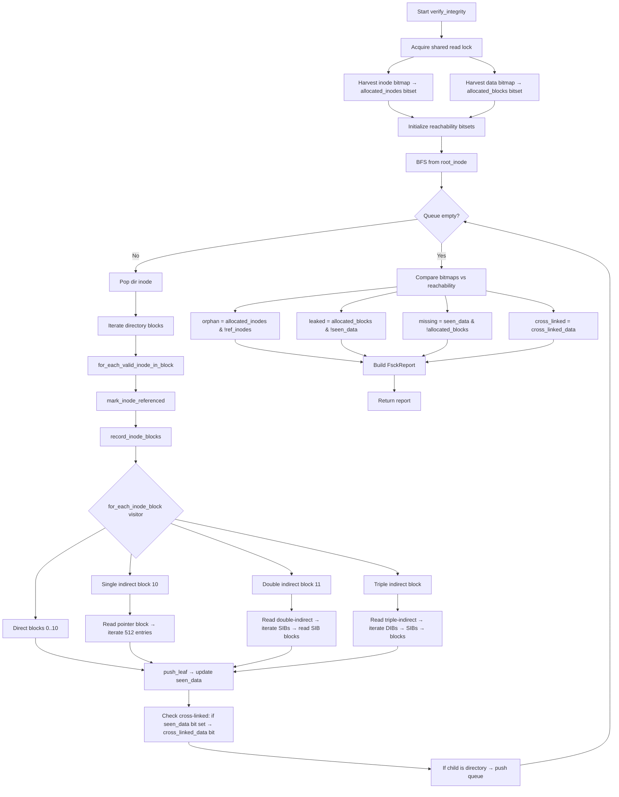

## Responsibility and ownership

Filesystem structural consistency verification is owned by [`DiskManager::verify_integrity`](repo://src/disk/maintenance.rs#L1534-L1542) (implemented in `verify_integrity_on`).

It serves as the OIFS equivalent of `fsck` (filesystem consistency check). Unlike continuous runtime operations that trust filesystem invariants, `verify_integrity` treats the raw on-disk state as untrusted, scanning block bitmaps, the inode table, and directory pointer trees to diagnose storage corruption, crash remnants, or software bugs.

Results are encapsulated within [`FsckReport`](repo://src/disk.rs#L251-L260), which is exposed directly to the CLI command `oifs fsck` ([`src/bin/oifs.rs`](repo://src/bin/oifs.rs#L1240-L1285)) and over the IPC layer via `IpcRequest::VerifyIntegrity` → `IpcResponseData::Fsck`.

## The consistency model: allocation vs reachability

Filesystem consistency in OIFS requires that physical allocation states strictly match logical directory reachability:

$$\text{Allocated in Bitmaps} \iff \text{Reachable from Root Directory}$$

Corruption occurs whenever there is a divergence between what the bitmaps declare and what the inode and directory structures actually reference.

```
       [On-Disk Bitmaps]                       [Directory & Inode Tree]
(inode_bitmap / data_bitmap)                 (Root Inode 0 -> Dirs -> Files)
             │                                              │
             ▼                                              ▼
   Allocated Bit Sets                             Referenced Target Sets
             │                                              │
             └─────────────── Set Differences ──────────────┘
                                     │
         ┌───────────────────────────┼───────────────────────────┐
         ▼                           ▼                           ▼
   Orphan Inodes               Leaked Blocks               Missing Blocks
 (Allocated Inode,           (Allocated Block,           (Referenced Block,
  No Directory Ref)           No Inode Pointer)           Free in Bitmap)
                                     │
                                     ▼
                            Cross-Linked Blocks
                        (Block mapped by > 1 Inode)
```

## The 4 structural corruption categories

The integrity scanner partitions discrepancies into four formal failure modes:

| Defect Category | Field in `FsckReport` | Mathematical Definition | Severity / Impact |
| :--- | :--- | :--- | :--- |
| **Orphan Inodes** | `orphan_inodes` | $\text{AllocatedInodes} \setminus \text{ReferencedInodes}$ | Medium: Inodes occupy space in the inode table but cannot be accessed or unlinked by users. |
| **Leaked Blocks** | `leaked_blocks` | $\text{AllocatedBlocks} \setminus \text{ReferencedBlocks}$ | Low: Physical storage capacity is wasted because free blocks are marked in-use. |
| **Missing Blocks** | `missing_blocks` | $\text{ReferencedBlocks} \setminus \text{AllocatedBlocks}$ | **Critical**: Active files reference blocks that the block allocator considers free; future writes will overwrite and corrupt active file data. |
| **Cross-Linked Blocks**| `cross_linked_blocks` | $\{b \mid \text{Count}(\text{References}(b)) > 1\}$ | **Critical**: Multiple distinct inodes point to the exact same physical block; modifying one file silently corrupts another. |

## FsckReport structure and remediation guidance

```rust
/// Detailed diagnostic report from a consistency check (fsck)
pub struct FsckReport {
    /// True if filesystem is structurally consistent
    pub is_clean: bool,
    /// List of allocated inodes not referenced by any directory entries
    pub orphan_inodes: Vec<u64>,
    /// List of data blocks marked allocated in the bitmap but not mapped by any inode
    pub leaked_blocks: Vec<u64>,
    /// List of data blocks mapped by inodes but marked free in the bitmap
    pub missing_blocks: Vec<u64>,
    /// List of data blocks referenced by multiple inodes
    pub cross_linked_blocks: Vec<u64>,
}
```

**Remediation guidance per field:**

| Field | Remediation |
| :--- | :--- |
| `orphan_inodes` | Safe to clear the inode bitmap bits for each listed inode ID (`Bitmap::clear(idx)`). Orphan inodes carry no user data reachable from the namespace. |
| `leaked_blocks` | Safe to clear the corresponding data bitmap bits. These blocks contain no live file data. |
| `missing_blocks` | **Requires manual investigation**. The listed blocks hold file data but are marked free. Marking them allocated in the bitmap (`Bitmap::set(idx)`) restores accounting but does not guarantee file contents are intact if the blocks were subsequently reused. |
| `cross_linked_blocks` | **Requires manual investigation**. Multiple inodes share the same physical block. The only safe fix is to copy the block data to a fresh block for all but one inode and update that inode's pointer, then clear the cross-link from the report. |

The `is_clean` flag is true only when all four vectors are empty. The CLI prints a human-readable summary and exits with a non-zero code if `!is_clean`.

## Verification algorithm

[`DiskManager::verify_integrity_on`](repo://src/disk/maintenance.rs#L1545-L1711) operates under a shared read lock (`inner.read().unwrap()`), allowing concurrent inspections without halting read workloads. It uses compact 64-bit word bitsets for reachability tracking and zero-copy bitmap word scanning.

### Step 1: Bitmap ground-truth harvesting

Using 64-bit word scanning via [`BitmapRef::for_each_set_bit`](repo://src/bitmap.rs#L94-L108) (and an inline `read_bitmap_word` helper), the scanner collects all physically marked bits:
- `allocated_inodes`: Scans `superblock.inode_bitmap_block` across `superblock.inode_count`.
- `allocated_data_blocks`: Scans `superblock.data_bitmap_block` starting at `superblock.data_block_start`.

Because word scanning uses CPU bitwise intrinsics (`word &= word - 1` to iterate set bits), scanning hundreds of thousands of blocks completes in sub-millisecond time.

### Step 2: Queue-based directory tree traversal

Starting from `superblock.root_inode` (inode 0), the scanner performs a breadth-first search (BFS) across the directory hierarchy:

```rust
let mut dir_queue: Vec<Inode> = Vec::new();
mark_inode_referenced(sb.root_inode);
let root_inode = Self::read_inode_uncached(&guard, sb.root_inode)?;
record_inode_blocks(&root_inode);
if root_inode.mode == crate::inode::FileType::Directory {
    dir_queue.push(root_inode);
}

while let Some(dir_inode) = dir_queue.pop() {
    // iterate each directory block...
    crate::directory::for_each_valid_inode_in_block(block_data, |child_id| {
        if mark_inode_referenced(child_id) {
            let child_inode = Self::read_inode_uncached(&guard, child_id)?;
            record_inode_blocks(&child_inode);
            if child_inode.mode == crate::inode::FileType::Directory {
                dir_queue.push(child_inode);
            }
        }
    });
}
```

* `mark_inode_referenced` sets a bit in the `ref_inodes` bitset (or an overflow `FxHashSet` for out-of-range IDs).
* `record_inode_blocks` invokes `for_each_inode_block` to walk every direct, single-indirect, double-indirect, and triple-indirect pointer and records each data block in `seen_data` bitset.

### Step 3: Cross-linked block detection during traversal

The cross-linked detection happens inline inside `record_inode_blocks` as the traversal visits each inode's block pointers:

```rust
let mut record_inode_blocks = |inode: &Inode| {
    Self::for_each_inode_block(&guard.mmap, inode, |blk| {
        if blk is in valid data range {
            let idx = (blk - db_start) as usize;
            let mask = 1u64 << (idx % 64);
            let sw = &mut seen_data[idx / 64];
            if (*sw & mask) != 0 {
                // already seen by another inode → cross-linked
                cross_linked_data[idx / 64] |= mask;
            } else {
                *sw |= mask;
            }
        } else {
            // track out-of-range references similarly
        }
    });
};
```

This algorithm:
1. Iterates every block pointer of every reachable inode via `for_each_inode_block`.
2. For each data block ID, checks if its bit is already set in `seen_data`.
3. If already set, the block is cross-linked — the bit is also set in `cross_linked_data`.
4. Otherwise, marks it as seen in `seen_data`.

Because the traversal visits every reachable inode exactly once (via `mark_inode_referenced` dedup), the `seen_data` bitset records the union of all blocks referenced by reachable inodes, while `cross_linked_data` records the subset referenced by ≥2 inodes.

### Step 4: Set-theoretic comparison

After traversal, the scanner reads the on-disk bitmaps word-by-word and computes differences against the reachability bitsets:

```rust
for w_idx in 0..data_words {
    let alloc_w = read_bitmap_word(db_slice, w_idx, max_data_blocks);
    let seen_w = seen_data[w_idx];
    let base_blk = db_start + (w_idx * 64) as u64;

    // B. Leaked: allocated in bitmap but never seen
    let mut leaked = alloc_w & !seen_w;
    while leaked != 0 { ... }

    // C. Missing: seen by inode but free in bitmap
    let mut missing = seen_w & !alloc_w;
    while missing != 0 { ... }

    // D. Cross-linked: recorded during traversal
    let mut cross = cross_linked_data[w_idx];
    while cross != 0 { ... }
}
```

Orphan inodes are computed similarly against `ref_inodes` vs. the inode bitmap.

## Cross-linked block detection algorithm details

The cross-linked detection is a single-pass sweep-line over the reachable block reference stream:

1. **Input stream**: All data block IDs extracted from every reachable inode's block pointer tree (direct `blocks[0..10]`, single-indirect `blocks[10]`, double-indirect `blocks[11]`, triple-indirect `triple_indirect`). The visitor `for_each_inode_block` flattens this hierarchy, expanding indirect pointer blocks recursively and expanding contiguous runs for seekable 64K-chunked files.

2. **State**: Two bitsets of size `max_data_blocks` bits:
   - `seen_data` — bits set for blocks referenced by ≥1 reachable inode.
   - `cross_linked_data` — bits set for blocks referenced by ≥2 reachable inodes.

3. **Update rule per block ID `blk`**:
   ```text
   if blk in valid range:
       idx = blk - db_start
       if seen_data[idx] == 1:
           cross_linked_data[idx] = 1   // second (or third...) reference
       else:
           seen_data[idx] = 1           // first reference
   ```

4. **Output**: After traversal, `cross_linked_data` is iterated (`cross & -cross` loop) to emit the sorted list of cross-linked block IDs in `FsckReport.cross_linked_blocks`.

This design is O(R) where R is the total number of block pointers across all reachable inodes, with O(max_data_blocks / 64) extra space.

## fsck phases flowchart



*Caption: fsck verification phases — scan bitmaps → BFS directory tree with block pointer traversal and cross-link detection → set-theoretic comparison → report.*

## How journaling reduces fsck need

When a filesystem is created with journaling enabled (geometry `inode_table_block >= 3 + JOURNAL_RESERVED_BLOCKS`), metadata mutations (`create_file`, `delete_file`, `mkdir`, `write_data` that extends a file, `truncate`) are first recorded as a checksummed transaction in a fixed-size circular ring buffer (the journal), flushed to stable storage, and **only then** applied in place.

### Mount-time automatic replay

On every mount of a journaled image, `DiskManager::open` calls [`recover_journal`](repo://src/disk.rs#L1489-L1531) **before** the manager is published:

```rust
if superblock.has_journal_layout() {
    Self::recover_journal(&mut mmap, &superblock)?;
    mmap.flush()?;
}
```

`recover_journal` performs:
1. **Phase 1**: Snapshot the journal region, decode all valid transaction frames via `JournalRing::recover`, collecting `MetadataOp` list.
2. **Phase 2**: Redo every op directly against the mmap via `apply_op_in_place` (idempotent post-image writes: `SetInodeBitmap`, `SetDataBitmap`/`SetDataBitmapRange`, `WriteInode`, `WriteBlockSlice`).
3. **Phase 3**: Reset the ring (`head = tail = 0`, `cleanly_unmounted = true`) and persist the header.

Because every `MetadataOp` is an **absolute post-image** (not a delta), replay is idempotent: replaying a transaction any number of times yields the same filesystem state. Torn writes are detected by the per-frame CRC32C and trailing commit marker (`0xDEAD_BEEF`); incomplete frames are ignored.

### Result: fsck becomes a diagnostic, not a recovery tool

- **Clean shutdown**: Journal ring is empty (`cleanly_unmounted = true`). Mount is instantaneous; no replay needed.
- **Crash or power loss**: Any transactions committed to the WAL but not yet applied in-place are replayed automatically on next mount. The filesystem state after replay is exactly the state that would have resulted had the in-place phase completed.
- **Fsck role**: `verify_integrity` is still useful to detect non-journal corruptions (bit rot, hardware faults, software bugs that bypassed the journal, manual hex-editing). On a correctly functioning journaled image, `fsck` will consistently report `is_clean = true` even after unclean shutdowns.

The journal effectively replaces the traditional "fsck on boot" with a guaranteed-bounded, deterministic replay that takes time proportional to the number of uncommitted transactions (typically a handful of frames), not to the size of the filesystem.
