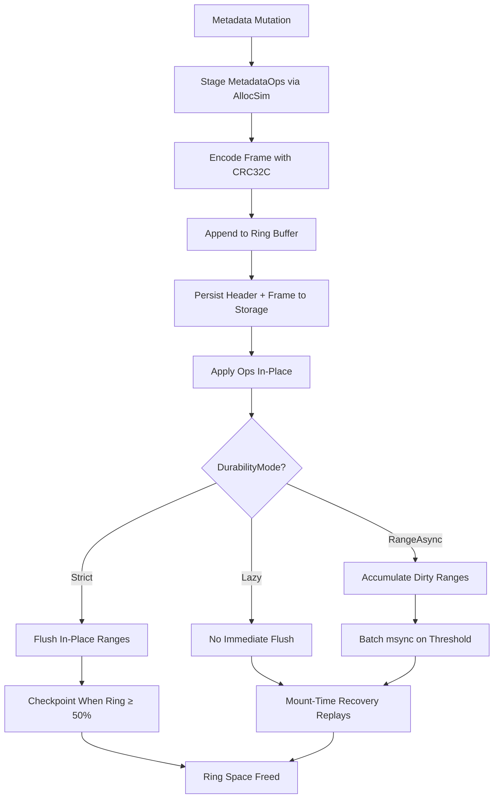

# Metadata WAL / Journaling

The journal subsystem implements a write-ahead log (WAL) for metadata mutations in OIFS. Before any metadata change (e.g., `create_file`, `delete_file`, `mkdir`, inode updates) is applied to the filesystem image, it is first recorded as a checksummed transaction in a fixed-size circular ring buffer residing in the journal region on disk. On crash recovery, the journal replays all durable-but-unapplied transactions to restore a consistent state, eliminating the need for a full `fsck` scan.

## Design Overview

* **Backward compatibility** – The on-disk `SuperBlock` layout is unchanged; a journaled image is identified by geometry (`inode_table_block >= 3 + JOURNAL_RESERVED_BLOCKS`) and a magic word in the journal header block. Non-journaled images behave exactly as before.
* **Idempotent redo** – Every `MetadataOp` encodes an absolute post-image write or an absolute bit-set operation. Replaying a transaction any number of times yields the same filesystem state, which makes the "write WAL first, then apply in place" approach safe even if a crash occurs during the in-place phase.
* **Torn-write detection** – Each transaction frame carries a CRC32C (Castagnoli) checksum over its header and payload, plus a trailing commit marker (`0xDEAD_BEEF`). A partially written frame fails verification and is ignored during recovery.
* **Zero new dependencies** – CRC32C is implemented in-crate with a compile-time generated table, keeping the code verifiable under model-checking tools like Kani/CBMC.
* **Mandatory journaling** – Every metadata mutation must go through the journal. Bypassing the journal leaves stale transactions in the ring; replay would overwrite newer changes with old post-images, causing silent data loss (observed when a zeroed inode post-image from a stalled `create` overwrote a later write's size and block pointers).

## On-Disk Layout

The journal region occupies the first `1 + JOURNAL_RING_BLOCKS` blocks of a journaled image:

| Block ID | Contents                          |
|----------|-----------------------------------|
| 3        | Journal header block (40 bytes of state + padding) |
| 4‑35     | Record ring (32 blocks = 128 KiB) |

* `JOURNAL_HEADER_MAGIC = 0x4A52_4E4C` ("JRNL" in ASCII)
* `JOURNAL_FORMAT_VERSION = 1`
* `JOURNAL_RING_BLOCKS = 32`
* `JOURNAL_RESERVED_BLOCKS = 33` (1 header + 32 ring blocks)
* `JOURNAL_INODE_TABLE_BLOCK = 36` (first inode-table block in a journaled image)

### Journal Header (40 bytes, little-endian)

| Offset | Size | Field               | Description |
|--------|------|---------------------|-------------|
| 0      | 4    | magic               | `JOURNAL_HEADER_MAGIC` |
| 4      | 4    | version             | `JOURNAL_FORMAT_VERSION` |
| 8      | 4    | ring_blocks         | `JOURNAL_RING_BLOCKS` |
| 12     | 8    | head                | Byte offset of next append position within the record ring |
| 20     | 8    | tail                | Byte offset of the oldest transaction still needing replay |
| 28     | 8    | tx_seq              | Monotonically increasing transaction sequence number |
| 36     | 1    | cleanly_unmounted   | `1` after a clean shutdown or successful recovery |
| 37‑39  | 3    | reserved            | Zero-filled |

### Transaction Frame Layout

Each transaction is stored as a contiguous frame inside the ring buffer:

| Field          | Size | Description |
|----------------|------|-------------|
| magic          | 4 B  | `TX_MAGIC = 0x5741_4C54` ("WALT") |
| tx_seq         | 8 B  | Transaction sequence number (matches header) |
| payload_len    | 4 B  | Length of the encoded metadata-operations payload |
| crc32c         | 4 B  | CRC32C over `tx_seq || payload_len || payload` |
| payload        | *    | Serialized `MetadataOp` sequence |
| commit_marker  | 4 B  | `TX_COMMIT_MARKER = 0xDEAD_BEEF` written **after** the payload |

The CRC covers everything except the leading magic and the marker itself, allowing the checksum to be stored inline while still detecting torn writes that corrupt any part of the protected region.

## Core Abstractions

### `JournalState`

Persisted in the journal header, tracks the ring buffer pointers and hygiene flag:

* `head` – next write offset (monotonic, wraps modulo ring size)
* `tail` – oldest un-checkpointed transaction offset
* `tx_seq` – latest transaction sequence number
* `cleanly_unmounted` – set after a clean unmount or successful recovery

### `MetadataOp`

Represents a single idempotent metadata mutation. Variants:

* `SetInodeBitmap` – allocate/free an inode
* `SetDataBitmap` – allocate/free a data block
* `SetDataBitmapRange` – allocate/free a contiguous range of data blocks
* `WriteInode` – overwrite a full 256-byte inode record (post-image)
* `WriteBlockSlice` – overwrite a byte range inside a data block (used for directory entry updates)

All encoding is little-endian, self-delimiting via a leading tag byte, and bounded in size (`encoded_size`).

### `JournalRing<'a>`

A mutable view over the journal region of a memory-mapped image. Provides the main operational interface:

* `open` – attach to an existing journal region, validating the header
* `create` – format a fresh empty journal
* `append` – encode and write a transaction, advancing `head` and handling wrap-around and overwrite-oldest semantics
* `persist` – flush the header block to stable storage (caller must `msync` the header plus the last written frame range)
* `recover` – replay all valid transactions between `tail` and `head` in order, stopping at the first torn or corrupt frame
* `checkpoint` / `checkpoint_to` – advance `tail` to discard transactions whose in-place effects are already durable

## Write-Ahead Logging Protocol

The journaling protocol follows a strict sequence for every metadata mutation:

1. **Stage operations** – The mutation's metadata effects are encoded as a `Vec<MetadataOp>` using `AllocSim` to predict allocator behavior without touching on-disk bitmaps. For data writes, small payloads (≤ 8 KiB) may be inlined as `WriteBlockSlice` ops directly in the frame under `DurabilityMode::Strict`.
2. **Encode transaction frame** – `encode_frame` coalesces adjacent operations (e.g., contiguous `SetDataBitmap` → `SetDataBitmapRange`, contiguous `WriteBlockSlice` → single slice) and builds a CRC32C-protected frame with sequence number, payload length, payload, and commit marker.
3. **Append to ring and persist** – `JournalRing::append` writes the frame contiguously (wrapping to offset 0 if needed), updates `head`, increments `tx_seq`, clears `cleanly_unmounted`, and persists the header. The caller receives the byte range written (`last_write`) and any wrap-zeroed tail range (`last_wrap_pad`).
4. **Apply in place** – The same `MetadataOp` list is applied to the live image via `apply_op_in_place`, which performs absolute post-image writes to bitmaps, inode table, and data blocks. Because every op is an absolute assignment, re-applying a committed transaction is idempotent.
5. **Checkpoint (deferred)** – Once the in-place writes are known durable, the journal ring is advanced via `checkpoint_to` (using a `head` snapshot taken before the flush) or `checkpoint` (tail := head). This discards the WAL record and frees ring space. Under `DurabilityMode::Strict`, checkpointing occurs automatically when the ring reaches 50% capacity; under `Lazy`, `RangeAsync`, and `LegacyWholeMmapAsync`, the ring is kept and mount-time recovery replays it.

## CRC32C Verification

* **Algorithm** – Castagnoli polynomial (`0x82F6_3B78`) with standard reflected representation, pre- and post-inversion (`!crc32c_update(0xFFFF_FFFF, data)`).
* **Hardware acceleration** – Uses ARMv8 CRC extension (`__crc32cb`/`__crc32cd`) or x86 SSE4.2 (`_mm_crc32_u64`/`_mm_crc32_u8`) when available; falls back to a `const fn` software table (256-entry) generated at compile time. The same function is used on all paths, making results deterministic for Kani/CBMC proofs.
* **Coverage** – The checksum is computed over `tx_seq || payload_len || payload`. The leading magic (`TX_MAGIC`) and trailing commit marker (`TX_COMMIT_MARKER`) are excluded so the checksum field itself can be stored inline.
* **Validation** – `decode_frame` verifies magic, payload length bounds, CRC32C match, and commit marker presence. A frame that fails any check is treated as torn; recovery stops at the first invalid frame and replays everything before it.

## Redo Recovery

On mount, `DiskManager::recover_journal` performs three phases:

1. **Snapshot & decode** – The journal region is copied to a local buffer. `JournalRing::recover` walks from `tail` to `head`, validating each frame with `decode_frame`. Valid frames are collected; the first invalid frame stops the scan.
2. **Redo apply** – Collected `MetadataOp`s are applied in order to the live image via `apply_op_in_place`. Idempotence guarantees that replaying a partially applied transaction is safe.
3. **Ring reset** – The header is rewritten with `head = 0`, `tail = 0`, `cleanly_unmounted = true`, and the header block is flushed. Subsequent mounts see a clean journal.

Recovery is automatic and requires no user intervention. The `cleanly_unmounted` flag in the header also allows a fast path: if the flag is set and the ring is empty, mount skips the scan entirely.

## Checkpointing

Checkpointing discards WAL entries whose in-place effects are already durable, freeing ring capacity.

* **`JournalRing::checkpoint`** – Sets `tail := head`. After this, `used() == 0` and a subsequent `recover()` replays nothing.
* **`JournalRing::checkpoint_to(cursor)`** – Advances `tail` to `cursor` (a previous `head` snapshot), provided `cursor` lies between the old `tail` and `head` in ring order. The tail only moves forward and never passes `head`.
* **JBD2-style deferred checkpointing** – Under `DurabilityMode::Strict`, `DiskManager::maybe_checkpoint` is called after each mutation. It opens the journal region, checks if `ring.used() >= ring.ring_bytes() / 2`, and if so, flushes the entire image (`backing.flush()`) then calls `checkpoint_journal` (which calls `ring.checkpoint()` and flushes the header). This batches multiple transactions into a single `msync(MS_SYNC)` for the in-place metadata.
* **Other durability modes** – `Lazy`, `RangeAsync`, and `LegacyWholeMmapAsync` do **not** checkpoint on mutation. The ring accumulates until it wraps (overwrite-oldest semantics). Mount-time recovery will replay any un-checkpointed transactions. This is safe because the ring overwrites oldest-first, bounding journal size.

## Interaction with `DurabilityMode`

| Mode | WAL Frame Flush | In-Place Flush | Checkpointing |
|------|----------------|----------------|---------------|
| **Strict** | Synchronous `msync(MS_SYNC)` of frame + header on every `commit_journal_tx` (or batched via group-commit drainer) | Synchronous `msync(MS_SYNC)` of all mutated ranges on every mutation | Automatic at 50% ring watermark; also on explicit `flush()`/`Drop` |
| **RangeAsync** | Asynchronous `msync(MS_ASYNC)` of frame + header | Accumulated in `pending_async_ranges`, drained in coalesced batches (gap-bridged to 1 MiB) at threshold | **Never** on mutation; ring kept for recovery |
| **Lazy** | No per-mutation flush (relies on OS page cache) | No per-mutation flush | **Never** on mutation; ring kept for recovery |
| **LegacyWholeMmapAsync** | Asynchronous `msync(MS_ASYNC)` of entire mapping | Same as `RangeAsync` but whole mapping | **Never** on mutation; ring kept for recovery |

### Strict Mode Detail

In `Strict` mode, `commit_journal_tx` uses `JournalRing::try_append_without_overwrite`. If the ring lacks space for the new frame without overwriting un-checkpointed entries, it:
1. Flushes all pending in-place metadata (`guard.backing.flush()`)
2. Checkpoints the journal (`checkpoint_journal`)
3. Retries the append (now guaranteed to succeed on the empty ring)

This ensures the WAL never overwrites a transaction whose in-place effects are not yet durable.

The `is_strict_sync_deferred()` flag (controlled by a global group-commit batching state) modifies this: when `true`, the per-mutation synchronous flush is skipped and a background drainer issues a single `flush()` for the whole batch before completing any future. In that case, small payloads (≤ 8 KiB) are written directly to the data area instead of being inlined into the WAL frame, reducing ring pressure.

## AllocSim: Allocation Simulation

`AllocSim` predicts the on-disk allocator's behavior during transaction staging without modifying the live bitmaps:

* **`new_data_only`** – Used by `write_data`, `create_entry_journaled`, and other data-only mutations. It copies only the data bitmap (lazily, on first allocation/free) and tracks fresh block allocations, frees, and pointer updates in memory.
* **`new` (test-only)** – Copies both inode and data bitmaps for full mutation simulation.
* **Fresh block tracking** – Every allocated block is recorded in `fresh_blocks` and `unzeroed_fresh`. The transaction builder emits `WriteBlockSlice` ops to zero the block if it contains stale data.
* **Pointer simulation** – Indirect block pointer modifications are recorded in a `FxHashMap<(parent_block, slot), child_block>` so the transaction can encode the correct post-image pointer values.

When the transaction commits, the `MetadataOp` list contains `SetDataBitmap`/`SetDataBitmapRange` for the bitmap changes and `WriteBlockSlice` for zeroing/initializing fresh blocks, plus `WriteInode` for the updated inode.

## Journal Region Geometry

The `SuperBlock` method `has_journal_layout()` detects a journaled image:

* **Legacy layouts (v1/v2)** – Fixed geometry: `inode_table_block == 36` (`JOURNAL_INODE_TABLE_BLOCK`), meaning the journal header is at block 3 and the ring occupies blocks 4–35.
* **v3 layout** – Multi-block bitmaps; the journal region sits between the data bitmap and the inode table. `journal_header_block()` returns `data_bitmap_block + data_bitmap_blocks()`, and the ring follows. `has_journal_layout()` checks `inode_table_block == 1 + inode_bitmap_blocks + data_bitmap_blocks + JOURNAL_RESERVED_BLOCKS`.

This design keeps the `SuperBlock` binary layout identical for journaled and non-journaled images; the journal region is purely a geometry shift.

## Recovery Guarantees

* **No full `fsck` required** – Mount-time recovery replays only the durable tail of the WAL. A clean unmount (`mark_clean_shutdown` or `checkpoint`) leaves `cleanly_unmounted = true` and an empty ring, allowing a fast mount.
* **Torn frame isolation** – A power loss during frame write leaves a partial frame without a valid CRC or commit marker. Recovery stops at that frame; all earlier transactions are complete and are replayed. The partial frame is silently dropped.
* **Idempotent redo** – Because every `MetadataOp` is an absolute post-image assignment, applying a transaction twice has the same effect as applying it once. This makes the "WAL first, then in-place" protocol safe even if the crash occurs mid-way through the in-place phase.
* **Stale transaction prevention** – The requirement that **every** metadata mutation go through the journal prevents stale WAL entries from rolling back newer changes. If a mutation bypasses the journal while a stale transaction remains in the ring, recovery would replay the stale post-image over the newer on-disk state, causing silent data loss.

## Testing and Verification

* **Kani proofs** – `journal.rs` contains `#[kani::proof]` modules verifying:
  * Ring cursor arithmetic never leaves the ring
  * `checkpoint` empties the ring (`used() == 0`)
  * `checkpoint_to` monotonicity (tail never moves backward, never passes head)
  * `push_data_bitmap_op` never merges opposite-polarity spans
  * State-transition invariants of `append` (wrap handling, tail advancement)
* **Unit tests** – `checkpoint_tests` and integration tests cover:
  * Checkpoint advances tail to snapshot, leaves later transactions pending
  * Checkpoint never moves tail backwards
  * Checkpoint refuses cursors past head
  * Checkpointed transactions are not replayed on reopen
  * Ring wrap after checkpoint replays post-wrap frames
  * Ring wrap preserves pre-wrap un-checkpointed frames
  * Recovery stops at torn frame
  * `apply_op_in_place` is idempotent
* **Crash simulation** – `tests/crash_safety.rs` uses a fault-injecting backend to verify that after simulated power loss at any point, mount recovery produces a consistent filesystem.

## Related Pages

* [Disk Manager and Persistence](../architecture/disk_manager_and_persistence.md) – Durability modes, flush semantics, and journal interaction
* [Superblock and Layout](../architecture/superblock_and_layout.md) – Journal region geometry and `has_journal_layout()`
* [Crash Safety Testing](../testing/crash_safety_testing.md) – Fault injection and recovery verification
