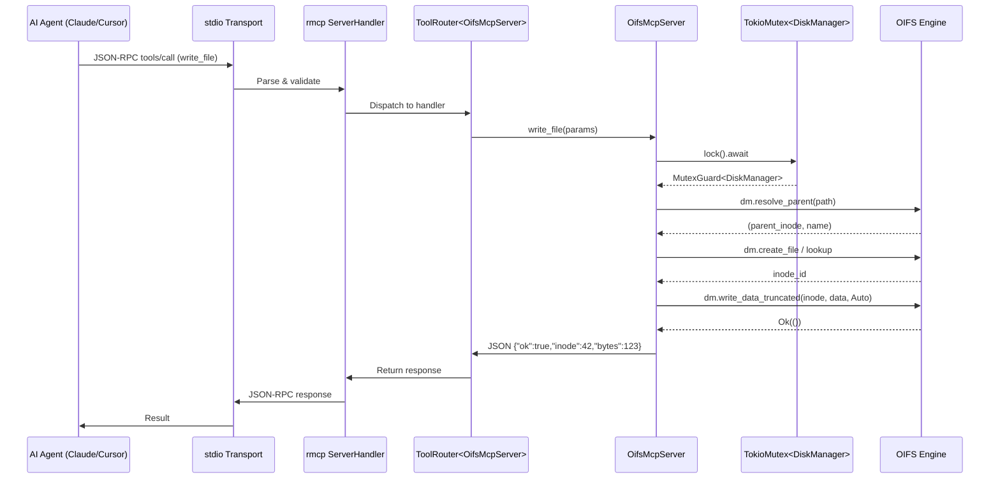

## Responsibility and ownership

The [`oifs_mcp`](repo://src/bin/oifs_mcp.rs) binary exposes the OIFS filesystem engine to AI agents (such as Claude Desktop, Cursor, and autonomous agent loops) via the **Model Context Protocol (MCP)**.

Rather than giving AI agents unrestricted access to the host operating system filesystem, `oifs_mcp` provisions a self-contained, sandboxed `.img` container. All file operations, directory hierarchies, append logs, and storage metrics are fully confined within this single file image.

## Architecture and framework (rmcp)

`oifs_mcp` is built on top of [`rmcp`](repo://src/bin/oifs_mcp.rs#L10-L13) (the Rust MCP SDK), implementing an asynchronous JSON-RPC protocol over standard input/output (`stdio`):

<!-- openwiki: mermaid parse failed and this diagram was converted to a text fence so it does not break rendering. Fix the diagram source and restore the mermaid fence. Parser error: Parse error on line 2: ... A[AI Agent Host (Cursor / Claude Des Expecting 'SQE', 'DOUBLECIRCLEEND', 'PE', '-)', 'STADIUMEND', 'SUBROUTINEEND', 'PIPE', 'CYLINDEREND', 'DIAMOND_STOP', 'TAGEND', 'TRAPEND', 'INVTRAPEND', 'UNICODE_TEXT', 'TEXT', 'TAGSTART', got 'PS' -->
```text
flowchart TD
    A[AI Agent Host (Cursor / Claude Desktop)] -->|JSON-RPC (stdio transport)| B[rmcp Service Handler (ServerHandler)]
    B -->|ToolRouter dispatch & JsonSchema validation| C[OifsMcpServer]
    C -->|async mutex lock| D[TokioMutex<DiskManager>]
    D -->|mmap & storage calls| E[OIFS Engine (DiskManager / Inode / Bitmap)]
```

### The OifsMcpServer structure

Server state is encapsulated by [`OifsMcpServer`](repo://src/bin/oifs_mcp.rs#L27-L32):

```rust
#[derive(Clone)]
struct OifsMcpServer {
    dm: Arc<TokioMutex<DiskManager>>,
    image_path: PathBuf,
    tool_router: ToolRouter<Self>,
}
```

- **Thread and Async Safety**: Because `rmcp` operates in an asynchronous Tokio runtime while `DiskManager` performs synchronous mmap I/O, `DiskManager` is wrapped in `Arc<TokioMutex<DiskManager>>`. Each incoming MCP tool invocation acquires this mutex to ensure sequential transaction isolation.
  - **Why TokioMutex is acceptable for agent workloads**: AI agent interactions are inherently sequential from the perspective of a single conversation — an LLM emits one tool call, waits for the result, then emits the next. The mutex serializes these naturally sequential requests. There is no high-concurrency fan-out from a single agent; concurrent access would only occur if multiple agent hosts connected to the same server process, which the stdio transport prevents by design (one stdin/stdout pair per process). For workloads requiring parallelism, the IPC/daemon path ([`src/ipc.rs`](repo://src/ipc.rs)) provides a multi-threaded alternative.
- **Bootstrapping**: Constructed via [`OifsMcpServer::new`](repo://src/bin/oifs_mcp.rs#L33-L47). If the target image file does not yet exist and an `OIFS_PASSWORD` environment variable is detected, it automatically initializes an encrypted image via `DiskManager::create_encrypted`; otherwise, it calls `DiskManager::open_with_password`.
- **Defaults**: Defaults to `agent_memory.img` with a default size of 10 MB ([`DEFAULT_IMAGE`](repo://src/bin/oifs_mcp.rs#L23), [`DEFAULT_SIZE_MB`](repo://src/bin/oifs_mcp.rs#L24)), configurable via `--size <MB>` and positional CLI arguments.

## Server capabilities and initialization

The server implements [`ServerHandler`](repo://src/bin/oifs_mcp.rs#L338-L354) to announce capabilities during the MCP handshake:

```rust
#[rmcp::tool_handler]
impl ServerHandler for OifsMcpServer {
    fn get_info(&self) -> ServerInfo {
        ServerInfo {
            instructions: Some(
                "OIFS Memory Sandbox — A sandboxed inode filesystem for AI agent memory. \
                 All reads/writes are isolated inside a .img file."
                    .into(),
            ),
            capabilities: ServerCapabilities::builder().enable_tools().build(),
            ..Default::default()
        }
    }
}
```

By enabling `.enable_tools()`, the server advertises its available tool registry and JSON schemas to connected LLMs.

## Single-image sandbox model and path resolution

The sandbox model is deliberately simple:

1. **One image per server process**: The CLI accepts a single image path (default: `agent_memory.img`). All tools operate exclusively within this image.
2. **Path resolution is always relative to the image root**: Paths like `"notes/todo.txt"` or `"."` are resolved by `DiskManager::resolve_path` ([`disk.rs`](repo://src/disk.rs#L6478)) starting from the root inode (inode 1). There is no concept of "current working directory" — every path is absolute within the sandbox.
3. **Parent directories must exist**: `write_file`, `mkdir`, and `append_file` use `resolve_parent` to locate the parent directory inode, then create the child. They do **not** auto-create intermediate directories (no `mkdir -p` semantics). The agent must create the directory hierarchy first with `mkdir` calls.
4. **Encryption is image-scoped**: If `OIFS_PASSWORD` is set at startup, the entire image is encrypted with AES-256-XTS. The same password must be supplied on every subsequent launch to open the image. The MCP server itself has no key-management logic — it simply forwards the environment variable to `DiskManager`.

## Session management and DiskManager integration

The MCP server uses `OifsSession` internally for DiskManager lifecycle management, though currently it operates exclusively in **Standalone mode** (direct `mmap` access, zero IPC overhead). The session abstraction is defined in [`session.rs`](repo://src/session.rs):

- **SessionMode**: The `OifsSession` enum supports three modes: `Standalone` (direct access), `Local` (Unix Domain Socket IPC), and `Network` (TCP with rendezvous file). The MCP server uses `Standalone` mode implicitly via `DiskManager::open_with_password` / `DiskManager::create_encrypted`.
- **Process-wide registry**: `OifsSession` maintains a process-wide registry (keyed by canonicalized image path) so multiple handles to the same image share a single `DiskManager` instance. The MCP server currently creates one session per process.
- **DiskManager access**: The `OifsMcpServer` wraps `DiskManager` in `Arc<TokioMutex<DiskManager>>` rather than using the session's direct `Arc<DiskManager>` because the server runs in an async Tokio context while `DiskManager` is synchronous. The mutex bridges this boundary.

## Available MCP tools

All tools are registered via the [`tool_router`](repo://src/bin/oifs_mcp.rs#L157) macro. Each tool acquires `self.dm.lock().await`, executes the operation, and returns a JSON string built with `serde_json` (never hand-rolled `format!`) to guarantee correct escaping.

### Tool response convention

- **Success**: `{"ok": true, ...}` with tool-specific fields.
- **Failure**: `{"ok": false, "error": "..."}` — a single JSON object with a human-readable error message.

### `write_file`

```json
{
  "name": "write_file",
  "description": "Write (create or overwrite) a file inside the OIFS sandbox image. Parent directories must already exist.",
  "parameters": {
    "type": "object",
    "properties": {
      "path": { "type": "string", "description": "Path inside the OIFS image (e.g. \"notes/todo.txt\")" },
      "content": { "type": "string", "description": "UTF-8 content to write" }
    },
    "required": ["path", "content"]
  }
}
```

**Behavior**: Resolves parent directory, creates file if missing, writes content with automatic compression (`CompressionMode::Auto`). Returns `inode` ID and `bytes` written.

### `read_file`

```json
{
  "name": "read_file",
  "description": "Read the contents of a file inside the OIFS sandbox image. Returns UTF-8 text content.",
  "parameters": {
    "type": "object",
    "properties": {
      "path": { "type": "string", "description": "Path inside the OIFS image (e.g. \"notes/todo.txt\")" }
    },
    "required": ["path"]
  }
}
```

**Behavior**: Resolves path to inode, reads data, validates UTF-8. Returns raw file content (not JSON-wrapped) on success.

### `list_dir`

```json
{
  "name": "list_dir",
  "description": "List files and directories at a given path inside the OIFS sandbox image. Returns one JSON object per line (JSONL).",
  "parameters": {
    "type": "object",
    "properties": {
      "path": { "type": "string", "description": "Path inside the OIFS image (e.g. \".\" for root, \"notes\" for a subdirectory)" }
    },
    "required": ["path"]
  }
}
```

**Behavior**: Resolves path to directory inode, lists entries. Returns **JSON Lines (JSONL)** — one JSON object per line with `name`, `kind` ("file"|"dir"), and `size`. Empty directory returns `{"entries":0}`.

### `mkdir`

```json
{
  "name": "mkdir",
  "description": "Create a directory inside the OIFS sandbox image. Parent directories must exist.",
  "parameters": {
    "type": "object",
    "properties": {
      "path": { "type": "string", "description": "Path of the new directory (e.g. \"notes/drafts\")" }
    },
    "required": ["path"]
  }
}
```

**Behavior**: Resolves parent directory, creates new directory inode. Returns `inode` ID.

### `delete_file`

```json
{
  "name": "delete_file",
  "description": "Delete a file from the OIFS sandbox image.",
  "parameters": {
    "type": "object",
    "properties": {
      "path": { "type": "string", "description": "Path of the file to delete (e.g. \"notes/old.txt\")" }
    },
    "required": ["path"]
  }
}
```

**Behavior**: Resolves parent directory, removes file entry. Returns `{"ok": true}`.

### `truncate_file`

```json
{
  "name": "truncate_file",
  "description": "Truncate or extend a file in the OIFS sandbox image to the specified size in bytes.",
  "parameters": {
    "type": "object",
    "properties": {
      "path": { "type": "string", "description": "Path inside the OIFS image (e.g. \"notes/todo.txt\")" },
      "size": { "type": "integer", "description": "Target file size in bytes" }
    },
    "required": ["path", "size"]
  }
}
```

**Behavior**: Resolves path, truncates/extends file to exact byte size. Returns `size`.

### `append_file`

```json
{
  "name": "append_file",
  "description": "Append a line to a file inside the OIFS sandbox image. Creates the file if it does not exist. Ideal for JSONL memory logs.",
  "parameters": {
    "type": "object",
    "properties": {
      "path": { "type": "string", "description": "Path inside the OIFS image (e.g. \"logs/memory.jsonl\")" },
      "content": { "type": "string", "description": "UTF-8 content to append (a newline is auto-added if missing)" }
    },
    "required": ["path", "content"]
  }
}
```

**Behavior**: Resolves parent, creates file if missing, reads existing content, appends new content + newline, writes back with `CompressionMode::Never` (critical for append-only logs). Returns `inode` and `total_bytes`.

### `status`

```json
{
  "name": "status",
  "description": "Show filesystem status: image path, total/used/free blocks, and fragmentation ratio.",
  "parameters": { "type": "object", "properties": {} }
}
```

**Behavior**: Runs `DiskManager::analyze_fragmentation()`. Returns `image`, `total_blocks`, `used_blocks`, `free_blocks`, `fragmentation` ratio.

## MCP tool invocation flow



## CLI interface and configuration

```bash
oifs_mcp [OPTIONS] [IMAGE_PATH]

Options:
  --size <MB>     Initial size when creating a new image (default: 10 MB)
  -h, --help      Show this help

Environment:
  OIFS_PASSWORD   If set, opens (or creates) the image as encrypted.
                  Required to open an existing encrypted image.
```

### Startup behavior

1. **Image creation**: If the image file doesn't exist and `OIFS_PASSWORD` is set, `DiskManager::create_encrypted` is called. Otherwise `DiskManager::open_with_password` auto-creates a plain image.
2. **Size handling**: The `--size` value (megabytes) is multiplied by `1024 * 1024` with checked arithmetic to prevent silent overflow ([`main`](repo://src/bin/oifs_mcp.rs#L401-L407)).
3. **Single image per process**: The CLI accepts exactly one positional image argument. All tools operate exclusively inside that image.
4. **Logging**: On startup the server logs to **stderr**: `[oifs-mcp] image=agent_memory.img size=10MB encrypted=false`.

### Example invocations

```bash
# Defaults: agent_memory.img, 10 MB, unencrypted
cargo run --bin oifs_mcp

# Custom image and size (20 MB)
cargo run --bin oifs_mcp -- --size 20 custom_agent.img

# Encrypted image (OIFS_PASSWORD must be set)
OIFS_PASSWORD=secret cargo run --bin oifs_mcp encrypted.img
```

## Integration with IDEs and AI agents

The MCP server uses the **stdio transport** with **JSON-RPC 2.0**. Any MCP-compatible client can spawn the binary and communicate over stdin/stdout.

### Claude Desktop

```json
{
  "name": "OIFS Memory Sandbox",
  "command": "cargo",
  "args": ["run", "--bin", "oifs_mcp", "--", "agent_memory.img"],
  "env": {
    "OIFS_PASSWORD": "your-encryption-password"
  }
}
```

- Use the full path to `cargo` if not on PATH (e.g., `/home/user/.cargo/bin/cargo`).
- Omit `env.OIFS_PASSWORD` if encryption is not needed.

### Cursor

Add to `mcp.json`:

```json
{
  "mcpServers": {
    "oifs-memory": {
      "command": "cargo",
      "args": ["run", "--bin", "oifs_mcp", "--", "agent_memory.img"],
      "env": { "OIFS_PASSWORD": "secret" }
    }
  }
}
```

### Custom agent loops

Spawn the binary as a subprocess and speak JSON-RPC 2.0 over its stdin/stdout. See [`tests/mcp_server_test.rs`](repo://tests/mcp_server_test.rs#L31-L70) for a minimal working example of the initialize → tools/list → tools/call sequence.

## Resource exposure

The current MCP server implementation **does not expose MCP resources** (resource URIs, resource templates, or `resources/list`/`resources/read` handlers). All filesystem access is mediated exclusively through the eight tools documented above. If resource exposure is needed (e.g., for direct file content retrieval without tool calls), the `ServerHandler` implementation would need to implement `list_resources`, `read_resource`, and/or `subscribe_resource` methods, and register resource templates via the rmcp macros.

## Related pages

- [MCP Integration Guide](../integrations/mcp_integration.md) — client configuration, encryption, sandbox isolation model
- [MCP Workflow](../workflows/mcp_workflow.md) — end-to-end workflow, tool reference table, test examples
<!-- openwiki: broken internal link [../architecture/disk_manager.md] file "../architecture/disk_manager.md" does not exist. Fix the href or restore the target, then delete this comment. -->
- [DiskManager Architecture](../architecture/disk_manager.md) — underlying storage engine, mmap I/O, encryption
<!-- openwiki: broken internal link [../architecture/session_ipc.md] file "../architecture/session_ipc.md" does not exist. Fix the href or restore the target, then delete this comment. -->
- [Session and IPC](../architecture/session_ipc.md) — `OifsSession`, `SessionMode`, multi-process coordination
