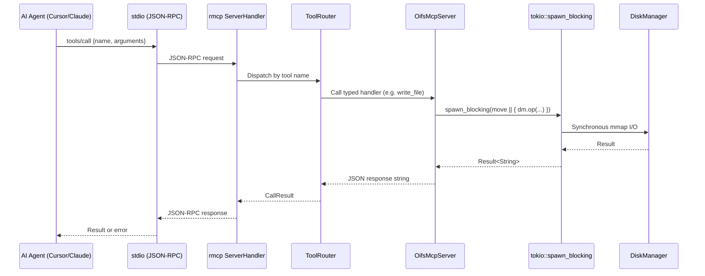

## Responsibility and ownership

The [`oifs_mcp`](repo://src/bin/oifs_mcp.rs) binary exposes the OIFS filesystem engine to AI agents (such as Claude Desktop, Cursor, and autonomous agent loops) via the **Model Context Protocol (MCP)**.

Rather than giving AI agents unrestricted access to the host operating system filesystem, `oifs_mcp` provisions a self-contained, sandboxed `.img` container. All file operations, directory hierarchies, append logs, and storage metrics are fully confined within this single file image.

## Architecture and framework (rmcp)

`oifs_mcp` is built on top of [`rmcp`](repo://src/bin/oifs_mcp.rs#L10-L13) (the Rust MCP SDK), implementing an asynchronous JSON-RPC protocol over standard input/output (`stdio`):

<!-- openwiki: mermaid parse failed and this diagram was converted to a text fence so it does not break rendering. Fix the diagram source and restore the mermaid fence. Parser error: Parse error on line 2: ... A[AI Agent Host (Cursor / Claude Des Expecting 'SQE', 'DOUBLECIRCLEEND', 'PE', '-)', 'STADIUMEND', 'SUBROUTINEEND', 'PIPE', 'CYLINDEREND', 'DIAMOND_STOP', 'TAGEND', 'TRAPEND', 'INVTRAPEND', 'UNICODE_TEXT', 'TEXT', 'TAGSTART', got 'PS' -->
```text
flowchart TD
    A[AI Agent Host (Cursor / Claude Desktop)] -->|JSON-RPC (stdio transport)| B[rmcp Service Handler (ServerHandler)]
    B -->|ToolRouter dispatch & JsonSchema validation| C[OifsMcpServer]
    C -->|spawn_blocking| D[DiskManager (sync mmap I/O)]
    D -->|mmap & storage calls| E[OIFS Engine (DiskManager / Inode / Bitmap)]
```

### The OifsMcpServer structure

Server state is encapsulated by [`OifsMcpServer`](repo://src/bin/oifs_mcp.rs#L36-L43):

```rust
#[derive(Clone)]
struct OifsMcpServer {
    dm: DiskManager,
    append_lock: Arc<std::sync::Mutex<()>>,
    image_path: PathBuf,
    tool_router: ToolRouter<Self>,
}
```

- **Async–sync bridge**: Because `rmcp` operates in an asynchronous Tokio runtime while `DiskManager` performs synchronous mmap I/O, each tool handler offloads the synchronous `DiskManager` work to a blocking task via `tokio::task::spawn_blocking`. The `DiskManager` itself is stored directly (not wrapped in a mutex) because each blocking task gets its own clone of the struct, and `DiskManager` uses internal `RwLock`/`Mutex` for its own synchronization.
- **Append serialization**: An additional `append_lock: Arc<std::sync::Mutex<()>>` serializes concurrent `append_file` calls so that multiple agents appending to the same log file interleave cleanly line-by-line.
- **Bootstrapping**: Constructed via [`OifsMcpServer::new`](repo://src/bin/oifs_mcp.rs#L45-L61). If the target image file does not yet exist and an `OIFS_PASSWORD` environment variable is detected, it automatically initializes an encrypted image via `DiskManager::create_encrypted`; otherwise, it calls `DiskManager::open_with_password`.
- **Defaults**: Defaults to `agent_memory.img` with a default size of 10 MB ([`DEFAULT_IMAGE`](repo://src/bin/oifs_mcp.rs#L23), [`DEFAULT_SIZE_MB`](repo://src/bin/oifs_mcp.rs#L24)), configurable via `--size <MB>` and positional CLI arguments.

## Server capabilities and initialization

The server implements [`ServerHandler`](repo://src/bin/oifs_mcp.rs#L370-L386) to announce capabilities during the MCP handshake:

```rust
#[rmcp::tool_handler]
impl ServerHandler for OifsMcpServer {
    fn get_info(&self) -> ServerInfo {
        ServerInfo {
            instructions: Some(
                "OIFS Memory Sandbox — A sandboxed inode filesystem for AI agent memory. \
                 All reads/writes are isolated inside a .img file."
                    .into(),
            ),
            capabilities: ServerCapabilities::builder().enable_tools().build(),
            ..Default::default()
        }
    }
}
```

By enabling `.enable_tools()`, the server advertises its available tool registry and JSON schemas to connected LLMs.

## Single-image sandbox model and path resolution

The sandbox model is deliberately simple:

1. **One image per server process**: The CLI accepts a single image path (default: `agent_memory.img`). All tools operate exclusively within this image.
2. **Path resolution is always relative to the image root**: Paths like `"notes/todo.txt"` or `"."` are resolved by `DiskManager::resolve_path` ([`disk.rs#L6704`](repo://src/disk.rs#L6704)) starting from the root inode (inode 1). There is no concept of "current working directory" — every path is absolute within the sandbox.
3. **Parent directories must exist**: `write_file`, `mkdir`, and `append_file` use `resolve_parent` ([`disk.rs#L6840`](repo://src/disk.rs#L6840)) to locate the parent directory inode, then create the child. They do **not** auto-create intermediate directories (no `mkdir -p` semantics). The agent must create the directory hierarchy first with `mkdir` calls.
4. **Encryption is image-scoped**: If `OIFS_PASSWORD` is set at startup, the entire image is encrypted with AES-256-XTS. The same password must be supplied on every subsequent launch to open the image. The MCP server itself has no key-management logic — it simply forwards the environment variable to `DiskManager`.

## Session management and DiskManager integration

The MCP server does **not** use `OifsSession` from [`session.rs`](repo://src/session.rs). Instead, it constructs `DiskManager` directly via `DiskManager::open_with_password` or `DiskManager::create_encrypted`, which operates in **Standalone mode** (direct `mmap` access, zero IPC overhead).

- The `OifsSession` abstraction in `session.rs` provides a process-wide registry and supports three modes (`Standalone`, `Local` UDS IPC, `Network` TCP). The MCP server bypasses this entirely and holds a `DiskManager` directly.
- This means there is **no cross-process session sharing** for the MCP server — each `oifs_mcp` process has its own independent `DiskManager` handle to the image file. If multiple agent hosts need shared access, the IPC/daemon path ([`src/ipc.rs`](repo://src/ipc.rs)) or FUSE mount ([`src/fuse.rs`](repo://src/fuse.rs)) should be used instead.

## Available MCP tools

All tools are registered via the [`tool_router`](repo://src/bin/oifs_mcp.rs#L123) macro. Each tool clones `self.dm`, executes the operation inside `tokio::task::spawn_blocking`, and returns a JSON string built with `serde_json` (never hand-rolled `format!`) to guarantee correct escaping.

### Tool response convention

- **Success**: `{"ok": true, ...}` with tool-specific fields.
- **Error**: `{"ok": false, "error": "..."}`.

### write_file

```json
{
  "name": "write_file",
  "description": "Write (create or overwrite) a file inside the OIFS sandbox image. Parent directories must already exist.",
  "parameters": { "path": "string", "content": "string" }
}
```

- Resolves parent directory via `resolve_parent`, creates file if missing via `create_file`, then writes content via `write_data_truncated` with `CompressionMode::Auto` ([`disk.rs#L8053`](repo://src/disk.rs#L8053)).
- Returns `{"ok": true, "inode": <u64>, "bytes": <usize>}`.

### read_file

```json
{
  "name": "read_file",
  "description": "Read the contents of a file inside the OIFS sandbox image. Returns UTF-8 text content.",
  "parameters": { "path": "string" }
}
```

- Resolves path via `resolve_path`, reads data via `read_data` ([`disk.rs#L4741`](repo://src/disk.rs#L4741)), validates UTF-8.
- Returns raw UTF-8 string content on success (not JSON-wrapped), or JSON error object on failure.

### list_dir

```json
{
  "name": "list_dir",
  "description": "List files and directories at a given path inside the OIFS sandbox image. Returns one JSON object per line (JSONL).",
  "parameters": { "path": "string" }
}
```

- Resolves directory inode via `resolve_path`, reads entries via `list_dir` ([`disk.rs#L6721`](repo://src/disk.rs#L6721)), reads each child inode for type and size.
- Returns **JSONL** (newline-delimited JSON objects): each line is `{"name": "...", "kind": "file|dir", "size": <u64>}`. Empty directory returns `{"entries":0}`.

### mkdir

```json
{
  "name": "mkdir",
  "description": "Create a directory inside the OIFS sandbox image. Parent directories must exist.",
  "parameters": { "path": "string" }
}
```

- Resolves parent via `resolve_parent`, creates directory via `create_directory` ([`disk.rs#L4076`](repo://src/disk.rs#L4076)).
- Returns `{"ok": true, "inode": <u64>}`.

### delete_file

```json
{
  "name": "delete_file",
  "description": "Delete a file from the OIFS sandbox image.",
  "parameters": { "path": "string" }
}
```

- Resolves parent via `resolve_parent`, deletes via `delete_file` ([`disk.rs#L7244`](repo://src/disk.rs#L7244)).
- Returns `{"ok": true}`.

### truncate_file

```json
{
  "name": "truncate_file",
  "description": "Truncate or extend a file in the OIFS sandbox image to the specified size in bytes.",
  "parameters": { "path": "string", "size": "u64" }
}
```

- Truncates via `truncate_path` ([`disk.rs#L8044`](repo://src/disk.rs#L8044)).
- Returns `{"ok": true, "size": <u64>}`.

### append_file

```json
{
  "name": "append_file",
  "description": "Append a line to a file inside the OIFS sandbox image. Creates the file if it does not exist. Ideal for JSONL memory logs.",
  "parameters": { "path": "string", "content": "string" }
}
```

- Acquires `append_lock` (process-wide `std::sync::Mutex<()>`) to serialize concurrent appends.
- Resolves parent via `resolve_parent`, creates file if missing via `create_file`, then appends via `write_data` at current file size with `CompressionMode::Never` ([`disk.rs#L5279`](repo://src/disk.rs#L5279)). Ensures trailing newline.
- Returns `{"ok": true, "inode": <u64>, "total_bytes": <u64>}`.

### status

```json
{
  "name": "status",
  "description": "Show filesystem status: image path, total/used/free blocks, and fragmentation ratio."
}
```

- Calls `analyze_fragmentation` ([`disk.rs#L147`](repo://src/disk.rs#L147)).
- Returns `{"image": "...", "total_blocks": <u64>, "used_blocks": <u64>, "free_blocks": <u64>, "fragmentation": <f64>}`.

## MCP tool invocation flow



## CLI startup behavior

The [`main`](repo://src/bin/oifs_mcp.rs#L388-L444) function:

1. Parses CLI arguments: optional `--size <MB>` (default 10), optional positional `IMAGE_PATH` (default `agent_memory.img`).
2. Computes `size_bytes = size_mb * 1024 * 1024` with `checked_mul` to prevent overflow.
3. Reads `OIFS_PASSWORD` from environment.
4. Logs: `[oifs-mcp] image=<path> size=<MB> encrypted=<bool>`.
5. Constructs `OifsMcpServer::new(image_path, size_bytes, password)`.
6. Starts rmcp stdio service: `server.serve(rmcp::transport::stdio()).await?`.
7. Waits for service to complete: `service.waiting().await?`.

### Image creation / open logic

```rust
let dm = match (!image_path.exists(), password) {
    (true, Some(pwd)) => DiskManager::create_encrypted(&image_path, size_bytes, pwd)?,
    _ => DiskManager::open_with_password(&image_path, size_bytes, password)?,
};
```

- **New image + password set** → `create_encrypted` (AES-256-XTS encrypted image).
- **New image, no password** → `open_with_password` creates a plain (unencrypted) image.
- **Existing image + password** → `open_with_password` opens encrypted image (verifies password).
- **Existing image, no password** → `open_with_password` opens plain image.

## What the MCP server does NOT expose

- **No MCP resources**: The server does not implement `resources/list`, `resources/read`, or resource templates. All filesystem access is mediated exclusively through the eight registered tools.
- **No prompts**: No prompt templates are registered.
- **No sampling**: No `sampling/createMessage` support.

## Related pages

- [MCP Integration](../integrations/mcp_integration.md) — configuring Cursor, Claude Desktop, and other MCP clients.
- [CLI Reference](../operations/cli_reference.md) — full CLI options for `oifs_mcp` and other binaries.
- [MCP Workflow](../workflows/mcp_workflow.md) — end-to-end agent memory workflows using the MCP server.
