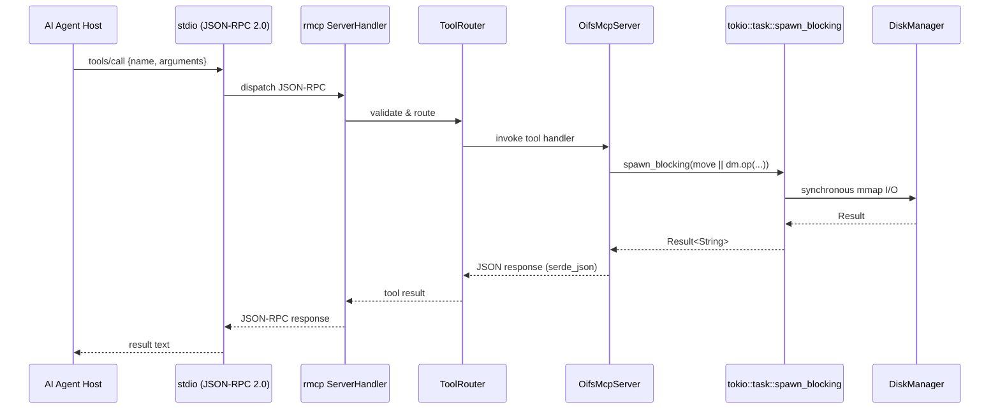

## Responsibility and ownership

The [`oifs_mcp`](repo://src/bin/oifs_mcp.rs) binary exposes the OIFS filesystem engine to AI agents (such as Claude Desktop, Cursor, and autonomous agent loops) via the **Model Context Protocol (MCP)**.

Rather than giving AI agents unrestricted access to the host operating system filesystem, `oifs_mcp` provisions a self-contained, sandboxed `.img` container. All file operations, directory hierarchies, append logs, and storage metrics are fully confined within this single file image.

## Architecture and framework (rmcp)

`oifs_mcp` is built on top of [`rmcp`](repo://src/bin/oifs_mcp.rs#L10-L13) (the Rust MCP SDK), implementing an asynchronous JSON-RPC protocol over standard input/output (`stdio`):

<!-- openwiki: mermaid parse failed and this diagram was converted to a text fence so it does not break rendering. Fix the diagram source and restore the mermaid fence. Parser error: Parse error on line 2: ... A[AI Agent Host (Cursor / Claude Des Expecting 'SQE', 'DOUBLECIRCLEEND', 'PE', '-)', 'STADIUMEND', 'SUBROUTINEEND', 'PIPE', 'CYLINDEREND', 'DIAMOND_STOP', 'TAGEND', 'TRAPEND', 'INVTRAPEND', 'UNICODE_TEXT', 'TEXT', 'TAGSTART', got 'PS' -->
```text
flowchart TD
    A[AI Agent Host (Cursor / Claude Desktop)] -->|JSON-RPC (stdio transport)| B[rmcp Service Handler (ServerHandler)]
    B -->|ToolRouter dispatch & JsonSchema validation| C[OifsMcpServer]
    C -->|spawn_blocking| D[DiskManager (sync mmap I/O)]
    D -->|mmap & storage calls| E[OIFS Engine (DiskManager / Inode / Bitmap)]
```

### The OifsMcpServer structure

Server state is encapsulated by [`OifsMcpServer`](repo://src/bin/oifs_mcp.rs#L36-L43):

```rust
#[derive(Clone)]
struct OifsMcpServer {
    dm: DiskManager,
    append_lock: Arc<std::sync::Mutex<()>>,
    image_path: PathBuf,
    tool_router: ToolRouter<Self>,
}
```

- **Async–sync bridge**: Because `rmcp` operates in an asynchronous Tokio runtime while `DiskManager` performs synchronous mmap I/O, each tool handler offloads the synchronous `DiskManager` work to a blocking task via `tokio::task::spawn_blocking`. The `DiskManager` itself is stored directly (not wrapped in a mutex) because each blocking task gets its own clone of the struct, and `DiskManager` uses internal `RwLock`/`Mutex` for its own synchronization.
- **Append serialization**: An additional `append_lock: Arc<std::sync::Mutex<()>>` serializes concurrent `append_file` calls so that multiple agents appending to the same log file interleave cleanly line-by-line.
- **Bootstrapping**: Constructed via [`OifsMcpServer::new`](repo://src/bin/oifs_mcp.rs#L45-L61). If the target image file does not yet exist and an `OIFS_PASSWORD` environment variable is detected, it automatically initializes an encrypted image via `DiskManager::create_encrypted`; otherwise, it calls `DiskManager::open_with_password`.
- **Defaults**: Defaults to `agent_memory.img` with a default size of 10 MB ([`DEFAULT_IMAGE`](repo://src/bin/oifs_mcp.rs#L23), [`DEFAULT_SIZE_MB`](repo://src/bin/oifs_mcp.rs#L24)), configurable via `--size <MB>` and positional CLI arguments.

## Server capabilities and initialization

The server implements [`ServerHandler`](repo://src/bin/oifs_mcp.rs#L370-L386) to announce capabilities during the MCP handshake:

```rust
#[rmcp::tool_handler]
impl ServerHandler for OifsMcpServer {
    fn get_info(&self) -> ServerInfo {
        ServerInfo {
            instructions: Some(
                "OIFS Memory Sandbox — A sandboxed inode filesystem for AI agent memory. \
                 All reads/writes are isolated inside a .img file."
                    .into(),
            ),
            capabilities: ServerCapabilities::builder().enable_tools().build(),
            ..Default::default()
        }
    }
}
```

By enabling `.enable_tools()`, the server advertises its available tool registry and JSON schemas to connected LLMs.

**The server does not expose MCP resources** (resource URIs, templates, or `resources/list`/`resources/read` handlers). All filesystem access is mediated exclusively through the registered tools.

## Transport

The server communicates exclusively over **stdio transport** (`rmcp::transport::stdio()` at [repo://src/bin/oifs_mcp.rs#L442](repo://src/bin/oifs_mcp.rs#L442)). There is no TCP transport option in the MCP server binary. The stdio transport pairs one stdin/stdout with one server process, making the MCP connection inherently sequential from a single agent's perspective.

## Single-image sandbox model and path resolution

The sandbox model is deliberately simple:

1. **One image per server process**: The CLI accepts a single image path (default: `agent_memory.img`). All tools operate exclusively within this image.
2. **Path resolution is always relative to the image root**: Paths like `"notes/todo.txt"` or `"."` are resolved by `DiskManager::resolve_path` ([`disk.rs#L6704`](repo://src/disk.rs#L6704)) starting from the root inode (inode 1). There is no concept of "current working directory" — every path is absolute within the sandbox.
3. **Parent directories must exist**: `write_file`, `mkdir`, and `append_file` use `resolve_parent` ([`disk.rs#L6840`](repo://src/disk.rs#L6840)) to locate the parent directory inode, then create the child. They do **not** auto-create intermediate directories (no `mkdir -p` semantics). The agent must create the directory hierarchy first with `mkdir` calls.
4. **Encryption is image-scoped**: If `OIFS_PASSWORD` is set at startup, the entire image is encrypted with AES-256-XTS. The same password must be supplied on every subsequent launch to open the image. The MCP server itself has no key-management logic — it simply forwards the environment variable to `DiskManager`.

## Session management and DiskManager integration

The MCP server does **not** use `OifsSession` from [`session.rs`](repo://src/session.rs). Instead, it constructs `DiskManager` directly via `DiskManager::open_with_password` or `DiskManager::create_encrypted`, which operates in **Standalone mode** (direct `mmap` access, zero IPC overhead).

- The `OifsSession` abstraction in `session.rs` provides a process-wide registry and supports three modes (`Standalone`, `Local` UDS IPC, `Network` TCP). The MCP server bypasses this entirely and holds a `DiskManager` directly.
- This means there is **no cross-process session sharing** for the MCP server — each `oifs_mcp` process has its own independent `DiskManager` handle to the image file. If multiple agent hosts need shared access, the IPC/daemon path ([`src/ipc.rs`](repo://src/ipc.rs)) or FUSE mount ([`src/fuse.rs`](repo://src/fuse.rs)) should be used instead.

## Available MCP tools

All tools are registered via the [`tool_router`](repo://src/bin/oifs_mcp.rs#L123) macro. Each tool clones `self.dm`, executes the operation inside `tokio::task::spawn_blocking`, and returns a JSON string built with `serde_json` (never hand-rolled `format!`) to guarantee correct escaping.

### Tool response convention

- **Success**: `{"ok": true, ...}` with tool-specific fields.
- **Failure**: `{"ok": false, "error": "..."}`.

### Tool catalog

| Tool | Description | Key Parameters | Notes |
|------|-------------|----------------|-------|
| `write_file` | Create or overwrite a file. Parent directories must already exist. | `path: string`, `content: string` | Uses `CompressionMode::Auto`; returns `inode` and `bytes` written. |
| `read_file` | Read a file's contents as UTF-8 text. | `path: string` | Returns raw UTF-8 content (not JSON-wrapped). Errors if non-UTF-8. |
| `list_dir` | List entries at a path. Emits **JSON Lines (JSONL)** — one JSON object per line. | `path: string` (e.g., `"."` or `"notes"`) | Returns `{"entries":0}` for empty dirs; otherwise newline-delimited objects with `name`, `kind` (`file`/`dir`), `size`. |
| `mkdir` | Create a directory. Parent directories must exist (no `mkdir -p`). | `path: string` | Returns `inode` of created directory. |
| `delete_file` | Delete a file. | `path: string` | |
| `truncate_file` | Truncate or extend a file to a specific byte size. | `path: string`, `size: number` (bytes) | Returns new `size`. |
| `append_file` | Append a line to a file (creates file if missing). Auto-adds trailing newline. Ideal for **JSONL memory logs**. | `path: string`, `content: string` | Serialized via `append_lock`; uses `CompressionMode::Never`; returns `inode` and `total_bytes`. |
| `status` | Show filesystem stats: image path, total/used/free blocks, fragmentation ratio. | *(none)* | Returns `image`, `total_blocks`, `used_blocks`, `free_blocks`, `fragmentation`. |

### Concurrency model

`OifsMcpServer` holds `DiskManager` directly (not wrapped in a `Mutex` or `TokioMutex`). Each tool handler clones `self.dm` and runs the synchronous `DiskManager` operation inside `tokio::task::spawn_blocking`. This works because:

- `DiskManager` uses internal `RwLock`/`Mutex` for its own synchronization.
- The `append_lock` (`Arc<std::sync::Mutex<()>>`) provides additional serialization for `append_file` to ensure clean line-by-line interleaving when multiple agents append to the same log.
- MCP over stdio is inherently sequential from a single agent's perspective: an LLM emits one tool call, waits for the result, then emits the next.

## Tool invocation flow



## CLI entry point

The [`main`](repo://src/bin/oifs_mcp.rs#L401-L446) function:

1. Parses CLI arguments: optional `--size <MB>` (default 10), optional positional image path (default `agent_memory.img`).
2. Reads `OIFS_PASSWORD` from environment.
3. Computes `size_bytes` with checked arithmetic to prevent overflow.
4. Logs startup info to stderr: `[oifs-mcp] image=... size=...MB encrypted=...`.
5. Constructs `OifsMcpServer::new(...)`.
6. Starts the rmcp service via `server.serve(rmcp::transport::stdio()).await?` and waits for completion.

## Startup behavior details

- **Image creation**: If the image file doesn't exist and `OIFS_PASSWORD` is set, `DiskManager::create_encrypted` is called. Otherwise `DiskManager::open_with_password` auto-creates a plain image.
- **Size handling**: The `--size` value (megabytes) is multiplied by `1024 * 1024` with checked arithmetic to prevent silent overflow.
- **Single image per process**: The CLI accepts exactly one positional image argument. All tools operate exclusively inside that image.
- **Logging**: On startup the server logs to **stderr**: `[oifs-mcp] image=agent_memory.img size=10MB encrypted=false`.

## Related pages

- [Architecture Overview](../architecture/overview.md) — overall system structure.
- [MCP Integration Guide](../integrations/mcp_integration.md) — client configuration for Claude Desktop, Cursor, and custom agents.
- [MCP Workflow](../workflows/mcp_workflow.md) — typical agent usage patterns and tool examples.
