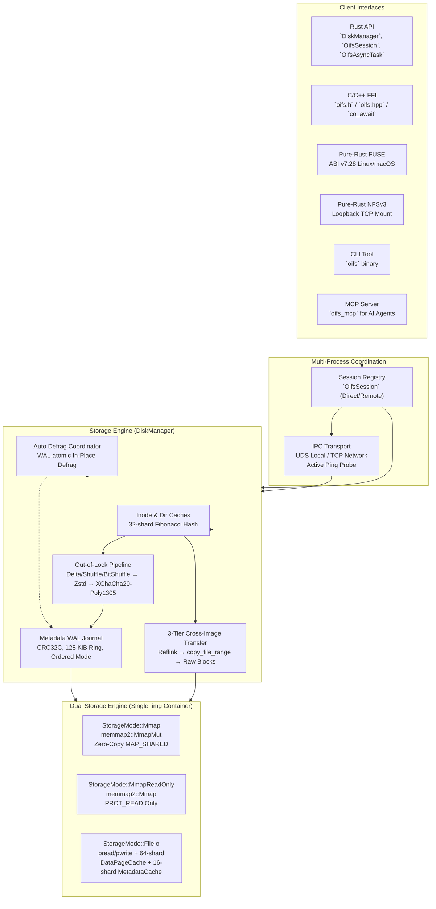
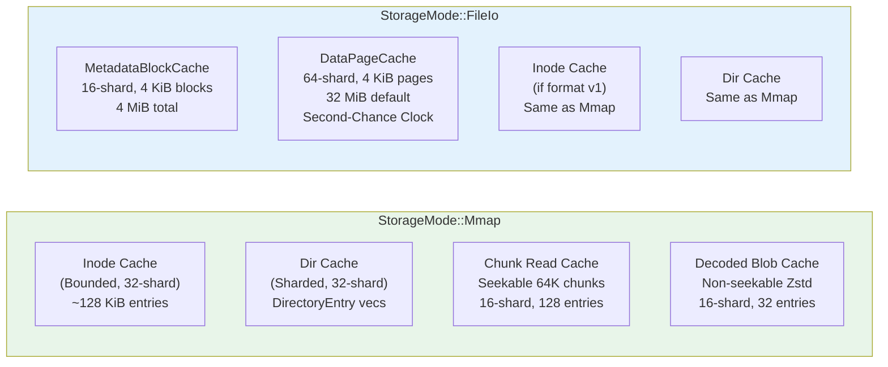
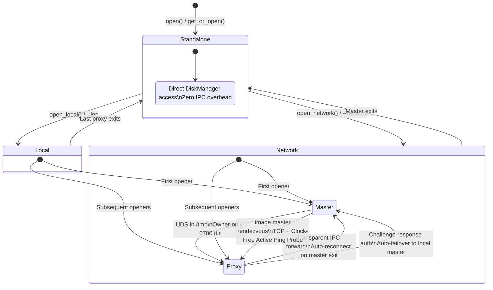
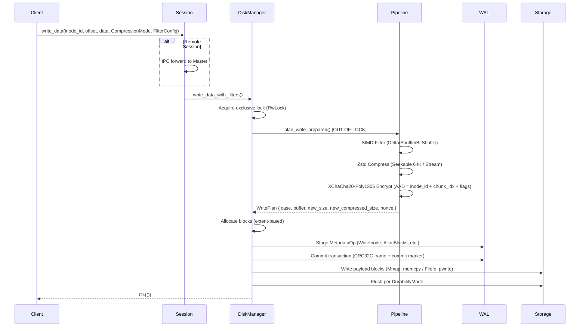

# Architecture Overview

OIFS (O's Inode File System) is a high-performance, embedded, multi-process inode filesystem engine implemented in Rust. It delivers crash-resilient storage, fine-grained concurrency, military-grade AEAD encryption, scientific data pre-compression filters, pluggable asynchronous I/O engines, a native Model Context Protocol (MCP) server for AI agents, a zero-external-C-dependency FUSE kernel protocol implementation (ABI v7.28), a stable C/C++ FFI interface, a pure-Rust NFSv3 loopback server, and cross-image fast transfer/splice/cloning capabilities — all packaged in a single portable `.img` container file.

> 🌐 **Interactive Architecture & Specs**: [https://ych.github.io/oifs/](https://ych.github.io/oifs/)  
> 📦 **Source Repository**: [https://github.com/ych/oifs](https://github.com/ych/oifs)

## System Context Diagram



*Diagram: OIFS system context showing client interfaces, coordination layer, storage engine pipeline, and dual storage backends.*

---

## Core Design Principles

| Principle | Description |
|-----------|-------------|
| **Single-Image Container** | All filesystem metadata (superblock, inodes, directories, bitmaps, WAL journal) and file data stored contiguously in one host file. |
| **Block-Oriented Layout** | Fixed 4 KiB block size with extent-based indexing (direct, single/double/triple indirect) supports files up to 513 GB. |
| **Pluggable I/O Engine** | Decouples payload block access from memory mapping via configurable backends: `Mmap` (default), `Pread`, Linux `io_uring`. |
| **Multi-Process Concurrency** | Dynamic Master-Proxy architecture coordinates shared access via IPC (Unix Domain Sockets or TCP with Active Ping Probe). |

---

## Storage Engines

OIFS supports three storage engine modes over the exact same on-disk format. The mode is selected at open time via [`StorageMode`][repo://src/storage.rs#L140-L155] and persists for the lifetime of the `DiskManager` handle.

### 1. `StorageMode::Mmap` (Default) — Zero-Copy Memory Mapping

```rust
// src/storage.rs:140-155
pub enum StorageMode {
    /// Memory-mapped container (memmap2::MmapMut, default).
    #[default]
    Mmap = 0,
    /// Pure positional pread/pwrite I/O without calling mmap().
    FileIo = 1,
}
```

- **Implementation**: [`ImageBacking::Mmap`][repo://src/storage.rs#L940-L1050] wraps `memmap2::MmapMut` with `MAP_SHARED`, giving direct zero-copy access to the entire `.img` file.
- **Read Path**: `mmap_slice()` returns `&[u8]` directly; inode records for format v2+ are decoded in-place from the mapping without additional copies.
- **Write Path**: Mutations modify the shared mapping; dirty pages are flushed according to [`DurabilityMode`][repo://src/disk.rs#L380-L430] (`Lazy`/`RangeAsync`/`Strict`/`LegacyWholeMmapAsync`).
- **Performance**: 40–58 GB/s on resident pages; batch reads resolve double-indirect extents by coalescing 4 KiB pages into large extents.
- **Crash Safety**: `MAP_SHARED` ensures modifications survive process crashes (SIGKILL); power-loss resilience depends on `DurabilityMode` and explicit `flush()`.

### 2. `StorageMode::MmapReadOnly` — Read-Only Memory Mapping

- **Implementation**: [`ImageBacking::MmapReadOnly`][repo://src/storage.rs#L1050-L1120] uses `memmap2::Mmap` with `PROT_READ` only.
- **Use Case**: `DiskManager::open_read_only*()` constructors for inspection of `0444` images.
- **Concurrency**: Acquires shared advisory lock (`F_RDLCK`), allowing multiple simultaneous readers while excluding writers (`F_WRLCK`).
- **WAL Verification**: On journaled images, verifies zero unrecovered transactions with zero disk writes.
- **Zero Flush on Drop**: Read-only mounts suppress all `msync`/`fdatasync` in `Drop`.

### 3. `StorageMode::FileIo` — Zero-mmap Positional I/O

```rust
// src/storage.rs:1120-1400
pub(crate) struct FileBacking {
    file: File,
    len: usize,
    read_only: bool,
    inode_bitmap_off: u64,
    inode_bitmap: Vec<u8>,      // Write-through mirror
    data_bitmap_off: u64,
    data_bitmap: Vec<u8>,       // Write-through mirror
    journal_off: u64,
    journal_buf: Vec<u8>,       // In-memory WAL mirror
    block_cache: MetadataBlockCache,   // 16-shard, 4 MiB
    data_cache: DataPageCache,         // 64-shard, 32 MiB default
}
```

- **Read Path**: `pread(2)` for all I/O; metadata blocks (indirect pointers, directory blocks) cached in **16-shard MetadataBlockCache** (4 MiB total); data blocks cached in **64-shard DataPageCache** (32 MiB default, configurable via `OIFS_FILE_IO_CACHE_MB`).
- **Write Path**: `pwrite(2)` with **write-through mirrors** for bitmaps and WAL region; cache invalidation on write (`update_if_present` for small spans, `invalidate_block_range` for large streaming writes).
- **Cache Coherency**: Second-Chance Clock eviction for data cache; metadata cache uses Fibonacci hash sharding. Both are strictly coherent on every write, zero, copy, and WAL replay.
- **Scan Resistance**: Extents > 64 KiB bypass `DataPageCache` to preserve sequential throughput.
- **Safety**: 100% Safe Rust; eliminates `SIGBUS` crashes and `unsafe` memory-mapping hazards.
- **I/O Backend**: [`IoBackend::Pread`][repo://src/io_engine.rs#L1-L50] (default) or `IoBackend::IoUring` (Linux, `--features io_uring`).

---

## Dual-Layer Cache Architecture



| Cache Layer | Mmap | FileIo | Purpose |
|-------------|------|--------|---------|
| **Inode Cache** | ✅ 32-shard | ✅ (v1 inodes only) | Zero-copy metadata access |
| **Dir Cache** | ✅ 32-shard | ✅ | Path resolution acceleration |
| **Chunk Read Cache** | ✅ 16-shard | ✅ | Seekable 64K chunk decompression |
| **Decoded Blob Cache** | ✅ 16-shard | ✅ | Full-file Zstd stream caching |
| **Metadata Block Cache** | ❌ (direct mmap) | ✅ 16-shard, 4 MiB | Indirect ptr / dir block caching |
| **Data Page Cache** | ❌ (OS page cache) | ✅ 64-shard, 32 MiB | Hot random/small-file reads |

**Key Invariant**: Under `Mmap` with format v2+ inodes, the inode cache is **bypassed entirely** — inodes are decoded directly from the mapping via [`uses_direct_mmap_inode`][repo://src/disk.rs#L650-L660].

---

## Core Subsystems

### DiskManager — Central Storage Engine

[`DiskManager`][repo://src/disk.rs#L1-L100] is the primary entrypoint owning the `.img` file, superblock, bitmaps, inode table, and WAL journal. Key responsibilities:

| Responsibility | Implementation |
|----------------|----------------|
| **File/Directory CRUD** | `create_file`, `create_directory`, `delete_file`, `lookup`, `rename` |
| **Data I/O** | `read_data`, `read_at`, `write_data`, `write_data_with_filters`, `truncate` |
| **Compression Pipeline** | SIMD Delta/Shuffle/BitShuffle → Seekable 64K Zstd / Stream Zstd (out-of-lock) |
| **Encryption** | XChaCha20-Poly1305 AEAD (payload), BLAKE2b-512 SIV + XChaCha20-Poly1305 (filenames) |
| **Metadata WAL** | CRC32C 128 KiB ring buffer, ordered mode, deferred checkpoint |
| **Cross-Image Transfer** | 3-tier: `FICLONERANGE`/`clonefile` → `copy_file_range` → Raw block copy |
| **Defragmentation** | Safe (new image) and WAL-atomic in-place modes |
| **Integrity Check** | `verify_integrity()` — full fsck (orphans, leaks, cross-links, missing blocks) |
| **Format Migration** | In-place v1→v2 inode record upgrade with resumable cursor |

**Concurrency**: Single `RwLock<DiskManagerInner>` protecting all mutable state; read-heavy operations (batch reads, lookups) take shared locks; mutations take exclusive lock with out-of-lock CPU-intensive pipeline (filter/compress/encrypt).

### Session — Master-Proxy Coordination

[`OifsSession`][repo://src/session.rs#L1-L100] provides transparent multi-process access via three modes:



| Mode | Transport | Auth | Use Case |
|------|-----------|------|----------|
| **Standalone** | None (direct) | N/A | Single-process, CLI, embedded |
| **Local** | Unix Domain Socket (`/tmp`) | Session secret (owner-only `0700` dir) | Multi-process same machine |
| **Network** | TCP + `.image.master` rendezvous | Challenge-response (BLAKE2b-512) | NFS/Lustre/multi-node clusters |

**Failover**: Proxies automatically reconnect on master exit; if a proxy becomes the new master (via `bind_or_connect` race), it promotes its `DiskManager` and starts an `IpcServer` seamlessly.

### Encryption Subsystem

[`encryption.rs`][repo://src/encryption.rs#L1-L100] implements a hardened key hierarchy:

```
Argon2id (m=64 MiB, t=3, p=4) + salt
    │
    ▼
Master Key (256-bit)
    │
    ├─► BLAKE2b-512(KDF_CONTEXT_PAYLOAD) ──► Payload Key: XChaCha20-Poly1305 (file/chunk data)
    ├─► BLAKE2b-512(KDF_CONTEXT_FILENAME_SIV) ──► Filename SIV Key: BLAKE2b-512 (deterministic nonce)
    ├─► BLAKE2b-512(KDF_CONTEXT_FILENAME_CIPHER) ─► Filename Cipher Key: XChaCha20-Poly1305 (AEAD)
    └─► BLAKE2b-512(KDF_CONTEXT_IPC_AUTH) ──► IPC Auth Key: BLAKE2b-512 (challenge-response)
```

- **Context-Bound AEAD**: File payloads include `inode_id` + `chunk_idx` + `flags` in AAD; seekable chunks bind ciphertext to chunk index.
- **Zeroize on Drop**: All keys implement `ZeroizeOnDrop`; password verifiers use `Zeroizing<String>`.
- **SIV Filenames**: 192-bit synthetic IV (BLAKE2b-512) provides deterministic encryption without IV storage.

### FUSE Engine — Pure-Rust Kernel Protocol

[`fuse.rs`][repo://src/fuse.rs#L1-L100] implements FUSE ABI v7.28 with zero external C dependencies:

| Capability | Detail |
|------------|--------|
| **Platforms** | Linux (`/dev/fuse` + `fusermount3`), macOS (macFUSE/osxfuse `SCM_RIGHTS`) |
| **ABI Support** | Dual Linux (88B `FuseAttr`) + macOS (104B `FuseAttr` with `crtime`/`flags`) |
| **Handle Table** | SeqLock 256-slot fast path + `RwLock` fallback; 1,000+ FUSE handles on 1 `.img` FD |
| **Max Write Negotiation** | Dynamic: Linux `FUSE_MAX_PAGES` + `/sys/module/fuse/parameters/max_pages_limit`; macOS `-o iosize` |
| **macOS Hardening** | Finder metadata storm filter (`.DS_Store`, `._*`); UTF-8 NFD→NFC normalization |
| **Read-Only Enforcement** | `-EROFS` on all mutations when `read_only` mount option or `DiskManager::is_read_only()` |

### NFSv3 Server — Pure-Rust Loopback

[`nfs.rs`][repo://src/nfs.rs#L1-L100] implements ONC RPC v2 / XDR / MOUNT v3 / NFS v3 over a single loopback TCP listener:

| Feature | Implementation |
|---------|----------------|
| **File Handles** | 16-byte stateless: `[fs_generation: u64 LE, inode_id: u64 LE]` |
| **Programs** | MOUNT v3 (100005) + NFS v3 (100003) multiplexed on 127.0.0.1 |
| **Operations** | GETATTR, SETATTR, LOOKUP, ACCESS, READ, WRITE, CREATE, MKDIR, REMOVE, RMDIR, RENAME, READDIR, READDIRPLUS, FSSTAT, FSINFO, PATHCONF, COMMIT |
| **Read-Only** | `NFS3ERR_ROFS` on mutations; honors `DiskManager::is_read_only()` |
| **Safety** | Bounded 2 MiB frame cap; panic-free XDR codec returns clean ONC errors |

### MCP Server — AI Agent Sandbox

[`oifs_mcp.rs`][repo://src/bin/oifs_mcp.rs#L1-L50] exposes OIFS as MCP tools over stdio JSON-RPC:

```json
{
  "mcpServers": {
    "oifs-sandbox": {
      "command": "oifs_mcp",
      "args": ["/path/to/agent_workspace.img", "--size", "64"],
      "env": { "OIFS_PASSWORD": "optional-vault-password" }
    }
  }
}
```

**Exposed Tools**: `read_file`, `write_file`, `append_file`, `list_dir`, `mkdir`, `delete_file`, `truncate_file`, `status`.

---

## Data Flow: Write Path (Create + Write)



---

## Cross-System Integration Points

| Interface | Entry Point | Session Mode | Storage Mode | Key Types |
|-----------|-------------|--------------|--------------|-----------|
| **Rust API** | `DiskManager::open*` | All (via `OifsSession`) | Mmap / FileIo | `DiskManager`, `OifsAsyncTask` |
| **C FFI** | `oifs_open`, `oifs_read_at` | Standalone only | Mmap / FileIo | `oifs.h`, `oifs.hpp`, `co_await` |
| **FUSE** | `OifsFuseFs::mount()` | Standalone (direct) | Mmap / FileIo | `FuseMountOptions`, `OifsFuseFs` |
| **NFS** | `OifsNfsServer::new().run()` | Standalone (direct) | Mmap / FileIo | `NfsMountOptions`, `OifsNfsServer` |
| **CLI** | `oifs` binary | All (`--ipc`, `--network`) | Mmap / FileIo (`--no-mmap`) | `src/bin/oifs.rs` |
| **MCP** | `oifs_mcp` binary | Standalone (direct) | Mmap (default) | `src/bin/oifs_mcp.rs` |

**Shared Invariants**:
- All frontends share the same `DiskManager` core — no forked logic.
- `OifsSession::get_or_open*` provides process-wide session deduplication via canonical path registry.
- Read-only mounts (`--read-only`, `F_RDLCK`, `PROT_READ`) work identically across FUSE, NFS, and direct API.

---

## Configuration & Operations

### Environment Variables

| Variable | Purpose | Default |
|----------|---------|---------|
| `OIFS_STORAGE_MODE` | `mmap` / `pread` / `file_io` | `mmap` |
| `OIFS_FILE_IO_CACHE_MB` | FileIo data page cache (MiB) | `32` (0 = disabled) |
| `OIFS_PASSWORD` | MCP/CLI encryption password | (none) |

### Durability Modes

```rust
// src/disk.rs:380-430
pub enum DurabilityMode {
    Lazy = 0,                    // Default: no per-op msync, OS writeback only
    RangeAsync = 1,              // msync(MS_ASYNC) on mutated ranges (batched)
    Strict = 2,                  // msync(MS_SYNC) on mutated ranges
    LegacyWholeMmapAsync = 3,    // msync(MS_ASYNC) entire mapping (legacy)
}
```

### Key Entry Points

| Operation | Method |
|-----------|--------|
| Open/Create | `DiskManager::open_with_options(path, size, password, journaled, mode)` |
| Read-Only | `DiskManager::open_read_only_with_storage_mode(path, password, mode)` |
| FUSE Mount | `OifsFuseFs::new(dm, opts).mount(mountpoint)` |
| NFS Serve | `OifsNfsServer::new(dm, opts).run("127.0.0.1:0")` |
| MCP Server | `cargo run --bin oifs_mcp -- <image> --size <MB>` |
| CLI | `oifs -i  <command> [--ipc|--network] [--no-mmap] [--read-only]` |

---

## Extension Points

| Extension | Mechanism |
|-----------|-----------|
| **Custom Filters** | Implement `FilterType` trait; register via `FilterConfig::custom()` |
| **I/O Backend** | Implement `IoBackend` trait; select via `IoBackend::IoUring` or env |
| **Compression** | `CompressionMode::Stream { level }` or `Seekable64K { level }` |
| **Encryption Scheme** | Versioned in superblock (`ENCRYPTION_SCHEME_CONTEXT_BOUND` = v2) |
| **Cross-Image Transfer** | `TransferMethod::Reflink` / `CopyFileRange` / `RawBlocks` with `ReflinkFallback` |

---

## Related Pages

- [Concurrency & Session Architecture](concurrency_and_session.md) — Master-Proxy IPC, session modes, failover
- [DiskManager & Persistence](disk_manager_and_persistence.md) — Superblock, bitmaps, extent allocator, WAL
- [Encryption](encryption.md) — Key hierarchy, Argon2id KDF, domain separation, AEAD details
- [FUSE Engine](fuse_engine.md) — ABI v7.28, handle table, mount options, macOS hardening
- [MCP Server](mcp_server.md) — Tool schemas, stdio JSON-RPC, AI agent integration
- [Storage Engines](storage_engines.md) — Mmap/FileIo internals, cache architecture, I/O backends

---

## Canonical Repository Links

| Component | Path |
|-----------|------|
| **Storage Modes** | `src/storage.rs` |
| **DiskManager Core** | `src/disk.rs` |
| **Encryption** | `src/encryption.rs` |
| **FUSE Engine** | `src/fuse.rs` |
| **NFS Server** | `src/nfs.rs` |
| **Session/IPC** | `src/session.rs`, `src/ipc.rs` |
| **WAL Journal** | `src/journal.rs` |
| **CLI** | `src/bin/oifs.rs` |
| **MCP Server** | `src/bin/oifs_mcp.rs` |
| **Maintenance/Defrag** | `src/disk/maintenance.rs` |
| **I/O Engine** | `src/io_engine.rs` |
| **Superblock** | `src/superblock.rs` |
| **Filters/Compression** | `src/filters.rs`, `src/zstd_pool.rs` |
| **C FFI** | `src/ffi.rs`, `include/oifs.h`, `include/oifs.hpp` |
