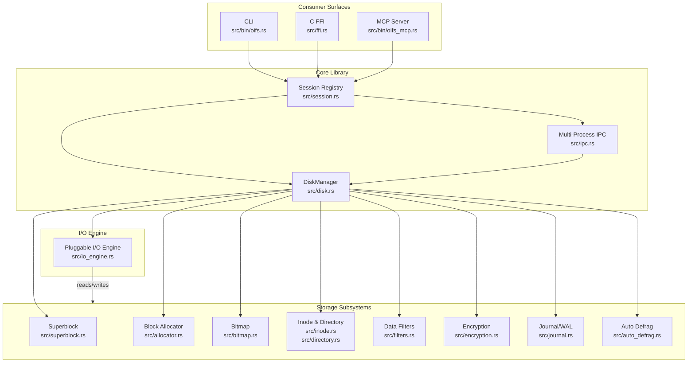
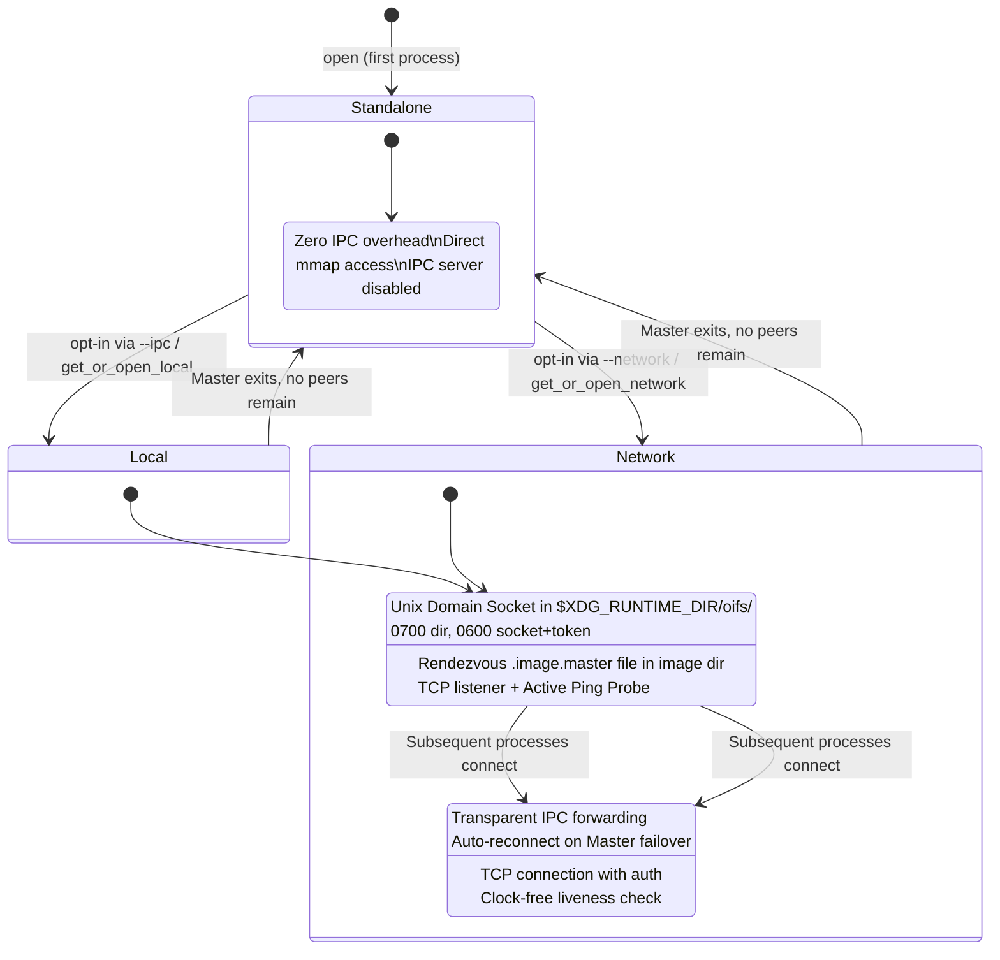

# OIFS Architecture Overview

OIFS (O's Inode File System) is a high-performance, embedded, multi-process inode filesystem engine implemented in Rust. It delivers crash-resilient storage, fine-grained concurrency, military-grade AEAD encryption, scientific data pre-compression filters, pluggable asynchronous I/O engines, a native Model Context Protocol (MCP) server for AI agents, and a stable C/C++ FFI interface, all packaged in a single portable `.img` container file.

Version **1.2.0** (Edition 2024) introduces the v3 on-disk layout with multi-block bitmaps for scaling beyond 128 MiB, a Metadata WAL (Write-Ahead Log) journal for crash-resilient metadata mutations, and an opt-in background auto-defragmentation coordinator.

## Core Design Principles

- **Single-Image Container**: All filesystem metadata (superblock, inodes, directories, bitmaps) and file data are stored contiguously in one host file, memory-mapped for efficient access.
- **Block-Oriented Layout**: Fixed 4KB block size with extent-based indexing (direct, single/double/triple indirect) supports files up to 513GB.
- **Pluggable I/O Engine**: Decouples block access from memory mapping via configurable backends (`mmap`, `pread`, Linux `io_uring`).
- **Multi-Process Concurrency**: Dynamic Master-Proxy architecture coordinates shared access via IPC (Unix domain sockets or TCP).
- **Layered Security**: Transparent at-rest encryption (XChaCha20-Poly1305 AEAD) with Argon2id key derivation and deterministic filename privacy.
- **Consumer Surfaces**: Unified access through CLI, C FFI library, and MCP server for AI agent integration.

## Module Layout

The core library (`src/lib.rs`) organizes functionality into 14 specialized modules:



**Module responsibilities:**

| Module | File | Purpose |
|--------|------|---------|
| `allocator` | `src/allocator.rs` | Sequential hint-based block and inode allocator with extent awareness |
| `auto_defrag` | `src/auto_defrag.rs` | Background defragmentation coordinator with fragmentation threshold triggering |
| `bitmap` | `src/bitmap.rs` | Hardware-accelerated free-block scanning via `tzcnt` instruction |
| `directory` | `src/directory.rs` | Variable-length entries with 32-shard memory-indexed lookups (`DirIndex`) |
| `disk` | `src/disk.rs` | Central `DiskManager` handling mmap lifecycle, concurrency (`RwLock`), durability, defragmentation, chunked I/O |
| `encryption` | `src/encryption.rs` | XChaCha20-Poly1305 AEAD, Argon2id KDF, BLAKE2b domain-separated subkeys, SIV filename encryption |
| `ffi` | `src/ffi.rs` | C ABI surface with `OIFSHandle`, 3-state version handshake (`oifs_check_version`), thread-isolated errors |
| `filters` | `src/filters.rs` | Pre-compression transformations (Delta, ByteShuffle, BitShuffle, TruncPrecision) with intelligent pipeline optimization |
| `inode` | `src/inode.rs` | 256-byte inode structure, block pointers, extent resolution, Kani formal verification |
| `inode_format` | `src/inode_format.rs` | Fixed 256-byte little-endian inode record encoding (format v2), per-inode version dispatch |
| `io_engine` | `src/io_engine.rs` | Pluggable I/O backends with ExtentList coalescing and kernel capability gating |
| `ipc` | `src/ipc.rs` | Master-Proxy protocol, UDS/TCP rendezvous, length-prefixed framing, challenge-response auth |
| `journal` | `src/journal.rs` | CRC32C-checksummed circular WAL ring, idempotent redo replay, torn-write detection |
| `session` | `src/session.rs` | Process-wide session registry with reference counting, transparent failover, mode switching |
| `superblock` | `src/superblock.rs` | On-disk superblock magic (`OIFS`), geometry, v3 layout, format_version, migration cursor |
| `zstd_pool` | `src/zstd_pool.rs` | Pooled Zstd `CCtx`/`DCtx` contexts for zero-allocation compression paths |

The uniform `BLOCK_SIZE` constant is defined as **4096 bytes** in `src/lib.rs`.

## Consumer Surfaces

OIFS exposes three distinct access paths to the same underlying library:

### 1. Command Line Interface (`src/bin/oifs.rs`)
Full-featured CLI for filesystem creation, manipulation, inspection, and maintenance. Supports all three session modes via `--ipc` (Local) and `--network` (Network) flags, plus `--auto-defrag[=THRESHOLD]` for background defragmentation.

### 2. C Foreign Function Interface (`src/ffi.rs`)
Stable C API (`liboifs.so` / `liboifs.dylib`) enabling integration with C/C++ applications. Provides:
- `oifs_open` / `oifs_open_with_password` / `oifs_create_encrypted` for filesystem access
- File/directory operations, `read`/`write`/`truncate`, attribute access
- `oifs_check_version` / `oifs_version_code` / `oifs_loaded_path` for 3-state runtime version handshake
- Thread-local error state via `OIFSHandle::last_error`

### 3. Model Context Protocol Server (`src/bin/oifs_mcp.rs`)
JSON-RPC server allowing AI agents and IDEs (Cursor, Claude Desktop) to inspect and modify OIFS images via standardized tools. Runs on stdio transport, exposes tools: `write_file`, `read_file`, `list_dir`, `mkdir`, `delete`, `stat`, `create_image`.

The MCP server and its async dependencies (`tokio`, `rmcp`) are gated behind the optional `mcp` feature flag, permitting lightweight builds without async runtimes.

## Feature Flags and Build Configuration

| Feature | Default | Description |
|---------|---------|-------------|
| `mcp` | ✅ | Enables `oifs_mcp` binary, pulls in `tokio`, `rmcp`, `schemars` |
| `io_uring` | ✅ (Linux) | Enables Linux `io_uring` async I/O backend via `io-uring` crate |
| `blosc2` | ❌ | Enables native C-Blosc2 interop wrappers in filters module |

**Default features:** `["mcp", "io_uring"]`

The crate compiles as both `cdylib` (for FFI) and `rlib` (for Rust dependencies) per `Cargo.toml` `[lib] crate-type`.

## Session Modes and Master/Proxy Topology

OIFS supports three session modes defined in `src/ipc.rs` as `SessionMode` enum:



### Standalone (Default)
- **Direct mode only**: No IPC, no background threads, zero sockets.
- Process directly accesses `DiskManager` via `mmap`.
- Used by `OifsSession::get_or_open`, `get_or_open_with_password`, `get_or_create_encrypted`.

### Local (Unix Domain Socket)
- **First process = Master**: Acquires exclusive `fcntl` lock, spawns IPC server on UDS in `$XDG_RUNTIME_DIR/oifs/` (per-user private, mode 0700).
- **Subsequent processes = Proxies**: Connect to UDS, transparently forward requests.
- Authenticated via session secret token (`.tok` file, mode 0600).
- Enabled via `--ipc` CLI flag or `get_or_open_local*`, `get_or_open_ipc*`.

### Network (TCP + Rendezvous)
- **First process = Master**: Writes `.image.master` rendezvous file in image directory (owner-only 0600) containing bind address, PID, auth token.
- **Subsequent processes = Proxies**: Read rendezvous file, connect via TCP, verify liveness with **Clock-Free Active Ping Probe** (Ping/Pong handshake).
- Default bind is loopback-only (`127.0.0.1:0`); non-loopback requires explicit `--allow-remote-ipc`.
- Enabled via `--network` CLI flag or `get_or_open_network*`.

All modes use the same `OifsSession` enum in `src/session.rs`, providing transparent failover: Proxies cache the password in a `Zeroizing<String>` and automatically reconnect to a new Master if the old one exits.

## On-Disk Layout and Versioning

### Superblock Structure (`src/superblock.rs`)
Block 0 contains the `SuperBlock` with:
- Magic: `0x4F494653` ("OIFS")
- `block_size = 4096`
- Geometry: `block_count`, `inode_bitmap_block`, `data_bitmap_block`, `inode_table_block`, `inode_count`, `data_block_start`, `root_inode`
- Encryption fields: `encrypted`, `encryption_salt[16]`, `encryption_version`
- **`format_version`** (u32) — **must remain the last field** for backward compatibility:
  - `0` or `1` → Legacy v1 (bincode inodes)
  - `2` → Fixed 256-byte inode format (v2)
  - `3` → **v3 Layout** (multi-block bitmaps, journal region between data bitmap and inode table)
- `migration_cursor` (u64) — tracks in-place format migration progress (0 = none)

### Layout Evolution
| Layout | `format_version` | Bitmaps | Journal | Max Image Size |
|--------|------------------|---------|---------|----------------|
| v1/v2 (Legacy) | 0/1/2 | Single block (32,768 bits) | Fixed block 3 | 128 MiB |
| v3 | 3 | Multi-block (sized to image) | Region after data bitmap | Unbounded (64-bit block IDs) |

**Journal Detection**: `SuperBlock::has_journal_layout()` returns true when `inode_table_block == 3 + JOURNAL_RESERVED_BLOCKS` (v3) or legacy fixed block detection.

### Inode Format Versioning (`src/inode_format.rs`)
Two independent version numbers:
- **SuperBlock `format_version`** → selects decoder family (v1 bincode vs v2 fixed)
- **`record_version` byte in inode slot** → selects revision within v2 family (currently `INODE_FORMAT_V2 = 2`)

During in-place migration (`oifs migrate`), `format_version` stays legacy until the last inode is rewritten, then atomically flips to `FORMAT_VERSION_FIXED_INODE`. Per-inode decoding uses `SuperBlock::inode_record_version_for(inode_id)` which consults `migration_cursor`.

## Pluggable I/O Engine (`src/io_engine.rs`)

Runtime-selectable payload read backend via API (`DiskManager::set_io_backend`) or `OIFS_IO_BACKEND` env var:

| Backend | Enum | Mechanism | Platforms |
|---------|------|-----------|-----------|
| `Mmap` (default) | `IoBackend::Mmap` | `memcpy` from shared mapping | All |
| `Pread` | `IoBackend::Pread` | Positional `pread(2)` per coalesced extent | Unix |
| `IoUring` | `IoBackend::IoUring` | Batched async submission to `io_uring` ring | Linux ≥ 5.6, `io_uring` feature |

All backends read through the OS page cache (no `O_DIRECT`), so dirty pages under `DurabilityMode::Lazy` are always visible. `IoUring` falls back to `Pread` on unsupported platforms/kernels; the effective backend is reported separately from the requested one.

Kernel support is gated at 5.6+ (for `IORING_OP_READ`) with additional RHEL 9.x kernel version checks in `src/io_engine.rs`.

## Encryption Architecture (`src/encryption.rs`)

```
Master Key (256-bit, Argon2id: m=64MiB, t=3, p=4)
    │
    ├── BLAKE2b-512 domain separation
    │       │
    │       ├── KDF_CONTEXT_PAYLOAD → payload_key (XChaCha20-Poly1305 file/chunk AEAD)
    │       ├── KDF_CONTEXT_FILENAME_SIV → filename_siv_key (BLAKE2b-512 SIV nonce)
    │       ├── KDF_CONTEXT_FILENAME_CIPHER → filename_cipher_key (XChaCha20-Poly1305 filename AEAD)
    │       └── KDF_CONTEXT_IPC_AUTH → ipc_auth_key (IPC challenge-response)
    │
    ├── File payload: XChaCha20-Poly1305 with AAD = inode_id || flags
    ├── Seekable chunk: XChaCha20-Poly1305 with AAD = inode_id || chunk_idx || flags
    ├── Filename: SIV construction → 24-byte synthetic nonce → deterministic encryption
    └── IPC: Challenge-response with session secret, password never crosses wire
```

- `zeroize` + `ZeroizeOnDrop` for automatic memory wiping
- `encryption_version` in superblock: `0` = unencrypted, `1` = legacy, `2` = context-bound (current)
- Encrypted images reject plaintext filename injection and refuse opening with password when `encrypted=false` (`NotEncrypted` error)

## Concurrency Model

### 32-Shard Lock Striping
- `BoundedInodeCache` and `ShardedDirCache` partitioned across 32 independent `RwLock` shards
- 64-bit Fibonacci hashing (`0x517cc1b727220a95`) for shard assignment
- **8.6M+ directory lookups/sec** across 16 threads, **9.97x faster** than single `RwLock`

### Out-of-Lock Processing Pipeline
- Delta/Shuffle/BitShuffle filtering, Zstd compression, XChaCha20-Poly1305 encryption execute **outside** exclusive filesystem locks
- Eliminates reader starvation during heavy multi-MB writes
- Zero-allocation path splitting: `resolve_path_iter` + `resolve_parent` at **11.9M lookups/sec (83.9 ns/op)**

### Journal Concurrency (`src/journal.rs`)
- CRC32C-checksummed circular ring buffer for metadata mutations
- **Ordered-mode**: payload flush → metadata commit (journaled)
- **Idempotent redo**: every `MetadataOp` is a post-image write or absolute bit set
- Three durability modes (`DurabilityMode` in `src/disk.rs`):
  - `Lazy` (default): process-safe, OS writeback, ~626k ops/sec
  - `RangeAsync`: batched `msync(MS_ASYNC)` per mutation, ~234k ops/sec
  - `Strict`: `msync(MS_SYNC)` per mutation, JBD2-style deferred checkpointing, ~10.9k ops/sec
- Non-blocking `flush()`/`flush_async()` serializes physical `msync` through dedicated mutex while holding only shared read lock

## Key Features Summary

| Feature | Implementation |
|---------|----------------|
| Inode-Based Architecture | Unix metadata model, files, directories, hard links, timestamps |
| Large File Support | 513GB max via triple-indirect (134,480,394 blocks × 4 KiB) |
| Authenticated Encryption | XChaCha20-Poly1305 AEAD, Argon2id KDF, BLAKE2b domain-separated subkeys, SIV filename encryption |
| Online Defragmentation | Safe mode (atomic `.old` swap) + WAL-atomic In-Place COW, background coordinator (`AutoDefragConfig`) |
| Pluggable I/O Engine | `Mmap` / `Pread` / `IoUring` with ExtentList coalescing |
| Extreme Compression | Delta/ByteShuffle/BitShuffle/TruncPrecision filters + Zstd → up to 390x on numerical data |
| Multi-Process Safety | Master-Proxy via `flock`, disjoint byte-range merging, POSIX `pwrite` semantics |
| Zero-Allocation Optimizations | Hardware `tzcnt` bitmap scanning, zero-copy dir lookups, filter pipelines with `Cow<'a, [u8]>` |
| Formal Verification | 92+ Kani proofs (block pointers, superblock, bitmaps, filters, CRC32C, WAL, AAD, IPC) |
| Concurrency Testing | Shuttle randomized schedule permutations, ThreadSanitizer stress tests |

## Formal Verification and Testing

- **92 Kani harnesses** verified under CBMC: block pointer resolution, superblock geometry, bitmap scanning, filter bijectivity, CRC32C torn-write detection, WAL ring/idempotency invariants, chunk entry bit-isolation, incremental seekable truncation, AAD domain separation, IPC frame bounds
- **Bolero fuzzing** integration for property/fuzz testing
- **Shuttle** randomized thread-schedule permutation testing
- **68 integration test suites** covering all consumer surfaces and subsystems
- **Release verification script** (`scripts/release_check.sh`) runs fmt, clippy, build, test, shuttle, kani, coverage

---

*See related deep-dives: [Superblock & Layout](superblock_and_layout.md), [Disk Manager & Persistence](disk_manager_and_persistence.md), [Journal](journal.md), [Encryption](encryption.md), [Compression & Filters](compression_and_filters.md), [Async I/O & Engines](async_io_and_engines.md), [Concurrency & Session](concurrency_and_session.md), [FFI Interface](ffi_interface.md), [MCP Server](mcp_server.md).*
