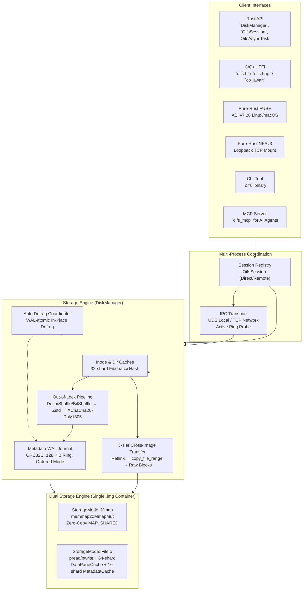
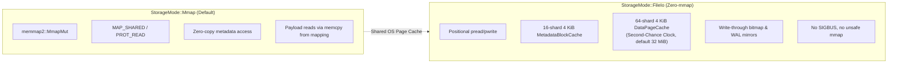
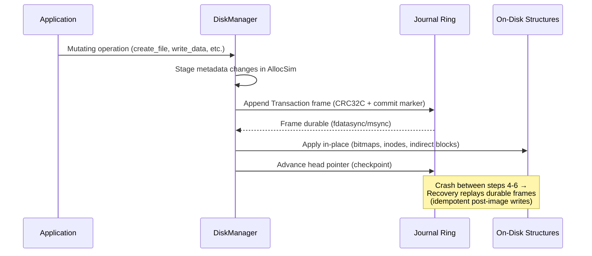
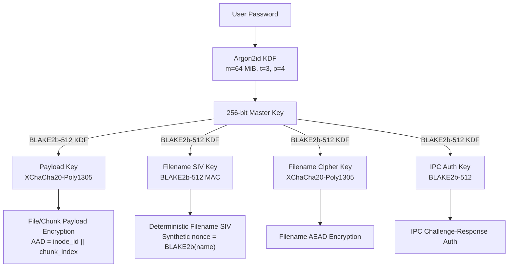
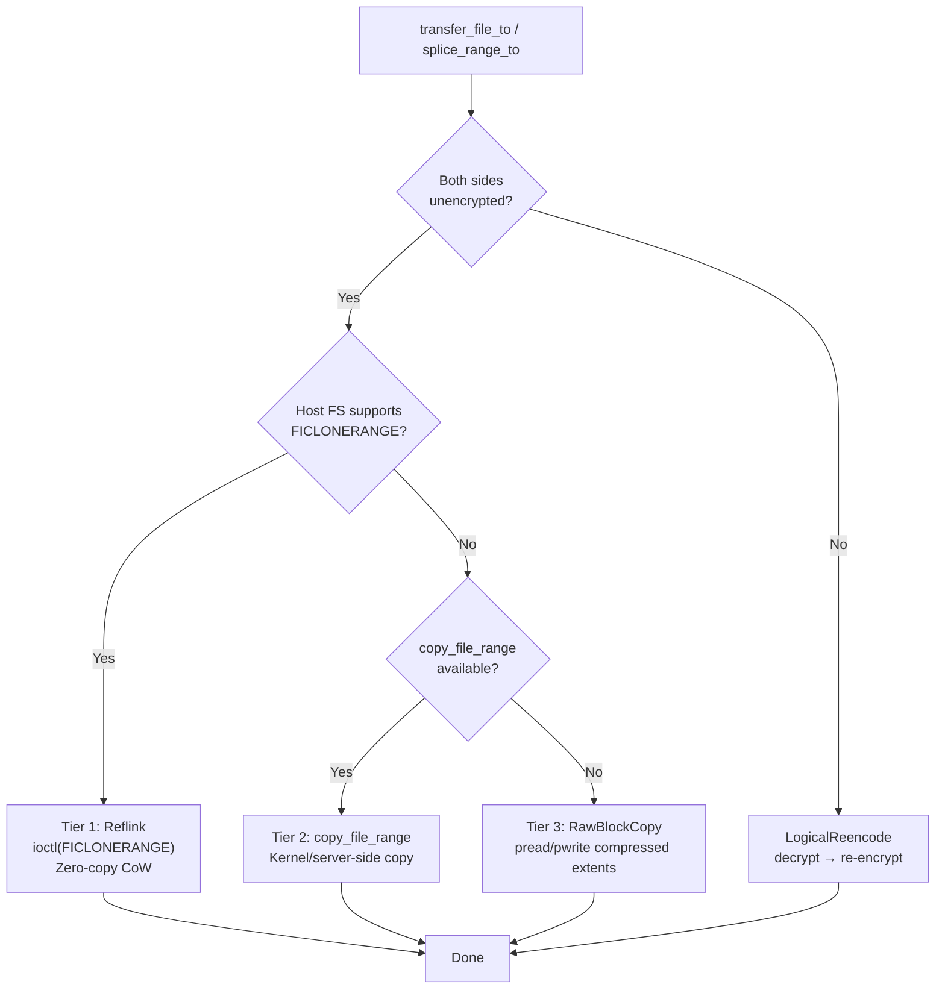

# OIFS Architecture Overview

OIFS (O's Inode File System) is a high-performance, embedded, multi-process inode filesystem engine implemented in Rust. It delivers crash-resilient storage, fine-grained concurrency, military-grade AEAD encryption, scientific data pre-compression filters, pluggable asynchronous I/O engines, a native Model Context Protocol (MCP) server for AI agents, a zero-external-C-dependency FUSE kernel protocol implementation (ABI v7.28), a stable C/C++ FFI interface, a pure-Rust NFSv3 loopback server, and cross-image fast transfer/splice/cloning capabilities, all packaged in a single portable `.img` container file.

> 🌐 **Interactive Architecture & Specs**: [https://ych.github.io/oifs/](https://ych.github.io/oifs/)  
> 📦 **Source Repository**: [https://github.com/ych/oifs](https://github.com/ych/oifs)

## System Context Diagram



*Diagram: OIFS system context showing client interfaces, coordination layer, storage engine pipeline, and dual storage backends.*

---

## Core Design Principles

| Principle | Description |
|-----------|-------------|
| **Single-Image Container** | All filesystem metadata (superblock, inodes, directories, bitmaps, WAL journal) and file data stored contiguously in one host file. |
| **Block-Oriented Layout** | Fixed 4 KiB block size with extent-based indexing (direct, single/double/triple indirect) supports files up to 513 GB. |
| **Pluggable I/O Engine** | Decouples payload block access from memory mapping via configurable backends: `Mmap` (default), `Pread`, Linux `io_uring`. |
| **Multi-Process Concurrency** | Dynamic Master-Proxy architecture coordinates shared access via IPC (Unix Domain Sockets or TCP with Active Ping Probe). |
| **Layered Security** | Transparent at-rest encryption (XChaCha20-Poly1305 AEAD) with Argon2id key derivation and deterministic filename privacy via SIV. |
| **Consumer Surfaces** | Unified access through CLI, C/C++ FFI, FUSE mount, NFSv3 loopback mount, MCP server for AI agents, and Rust async API. |
| **Cross-Image Operations** | First-class `transfer_file_to`, `splice_range_to`, and `clone_image` APIs with 3-tier automatic fallback pipeline. |
| **Crash Resilience** | Metadata WAL journal with CRC32C frame verification, ordered-mode commits, and idempotent redo recovery. |

---

## Dual Storage Engine

OIFS provides two storage backends over the **exact same on-disk format**. The choice is made at `DiskManager::open*` time via explicit `StorageMode` argument, the `OIFS_STORAGE_MODE` environment variable, or the process-wide `set_default_storage_mode()` override.



### Selection Criteria

| Scenario | Recommended Mode | Rationale |
|----------|------------------|-----------|
| General-purpose, resident working set | `Mmap` | 40–58 GB/s on hot pages; zero-copy metadata; simplest code path |
| Containers, network filesystems, `SIGBUS` risk | `FileIo` | Eliminates `mmap` hazards; works on NFS/SMB/FUSE where `mmap` is unreliable |
| Read-only mounts on 0444 files | `FileIo` (or `Mmap` with `PROT_READ`) | Both support `F_RDLCK` shared read-only access |
| Encrypted + journaled images | Either | Both support full feature parity; `FileIo` mirrors WAL in memory for fast replay |
| Memory-constrained environments | `FileIo` with small cache | Bounded user-space cache (configurable down to 0) vs. unbounded page cache pressure |

### FileIo Architecture Details

The `FileIo` backend (`FileBacking` in `src/storage.rs`) maintains:

- **Write-through bitmap mirrors**: Inode and data bitmaps are kept in memory and flushed on every allocation/free, enabling crash-safe allocation without `msync` of the full mapping.
- **In-memory WAL mirror**: When journaling is enabled, the 128 KiB ring buffer is mirrored in RAM for instant recovery replay without re-reading the journal region.
- **16-shard MetadataBlockCache** (4 MiB cap): Caches indirect pointer blocks and directory blocks under shared read locks with `Arc<[u8; 4096]>` entries, enabling deadlock-free nested `with_block` calls (e.g., double-indirect traversal).
- **64-shard DataPageCache** (configurable, default 32 MiB): Second-Chance Clock eviction, scan-resistant (extents > 64 KiB bypass), lock-free reference-bit updates, and strict coherence on every write/zero/copy/WAL replay.

---

## Cross-Cutting Concerns

### Metadata WAL Journaling

When created with `--journal`, OIFS reserves 33 blocks (1 header + 32 ring blocks = 128 KiB) after the data bitmap for a circular transaction log.



**Key properties**:
- **Ordered mode**: WAL frame flushed *before* in-place metadata mutation.
- **Idempotent redo**: Every `MetadataOp` is a post-image write or absolute bit set; replaying any number of times yields identical state.
- **CRC32C per frame**: Castagnoli polynomial, hardware-accelerated on x86_64 (SSE4.2) and AArch64 (CRC extension).
- **Backward compatible**: Non-journaled images have `inode_table_block == 3`; journaled images have `inode_table_block == 36`. Detection is purely geometric.

### Encryption (XChaCha20-Poly1305 AEAD)



**Properties**:
- **Domain separation**: Four independent 256-bit subkeys derived via `BLAKE2b-512(master || context)` — never reuse master key directly.
- **Per-inode/chunk AEAD**: Unique 192-bit nonce = `inode_id (64) || chunk_index (64) || random (64)` for seekable chunks; `inode_id || extent_index || 0` for stream-compressed files.
- **Filename privacy**: Deterministic SIV (Synthetic IV) mode via `BLAKE2b-512` MAC of plaintext name → nonce for `XChaCha20-Poly1305`; same name always encrypts to same ciphertext, enabling directory lookup without decryption.
- **Argon2id hardening**: 64 MiB memory, 3 iterations, 4 lanes (OWASP/RFC 9106 recommended).

### Compression Filters (SIMD Numerical Pipeline)

Before Zstd compression, OIFS applies an optional filter pipeline tuned for scientific/telemetry data:

| Filter | Operation | Best For |
|--------|-----------|----------|
| **Delta** | First-order difference (`x[i] - x[i-1]`) | Monotonic sequences, timestamps, sensor readings |
| **ByteShuffle** | Matrix transpose (elements × bytes) | Floating-point, integers — groups identical byte positions |
| **BitShuffle** | Bit-level matrix transpose | Boolean, bitfield, low-entropy binary data |
| **TruncPrecision** | Zero LSBs of mantissa | Lossy compression of FP32/FP64 with controlled precision |


- **Seekable 64 KiB chunks** (`INODE_FLAG_SEEKABLE_64K`): Random `read_at` without full decompression; chunk index stored in inode extent table.
- **SIMD-accelerated**: Delta/Shuffle use explicit `std::simd` (portable) with runtime feature detection.
- **Auto-selection**: `filter-analyze` CLI command profiles a sample and recommends optimal pipeline.

### Copy-on-Write Reflink & Cross-Image Transfer

OIFS implements a **3-tier automatic fallback pipeline** for moving data between images:



**Properties**:
- **Negative device-pair cache**: Failed `FICLONERANGE` (`EOPNOTSUPP`, `ENOTTY`, `EXDEV`, `ENOSYS`) cached per `(src_dev, dst_dev)` to avoid repeated syscalls.
- **Encrypted boundary**: Any encryption on either side forces `LogicalReencode` (decrypt with source key, re-encrypt with destination key + new nonce).
- **Sandwich alignment** (`splice_range_to`): Splits range into unaligned Head/Body/Tail at 4 KiB (raw) or 64 KiB (seekable) boundaries; Body uses fast path, Head/Tail fall back to logical RMW.
- **Crash-safe trim**: `PunchHole`/`CollapseRange` use two-image Copy-Commit-Then-Trim — destination committed & flushed before source blocks freed.

---

## Client Interfaces

### 1. Rust Native API

| Entry Point | Use Case |
|-------------|----------|
| `DiskManager::open*` / `create*` | Direct single-process access, full control over `StorageMode`, `DurabilityMode`, `IoBackend` |
| `OifsSession::get_or_open*` | Multi-threaded in-process sharing with automatic Standalone/Local/Network mode selection |
| `OifsAsyncTask` + `read_at_batch` | Async bulk reads with `io_uring` backend; futures-aware without async runtime dependency |

### 2. C/C++ FFI (`src/ffi.rs`, `include/oifs.h`, `include/oifs.hpp`)

- **Opaque handles**: `OIFSHandle`, `OIFSReadSession`, `OIFSFileHandle`, `OIFSAsyncFuture`
- **C API**: `oifs_open`, `oifs_open_with_password`, `oifs_create_file`, `oifs_read_at`, `oifs_write_data`, `oifs_transfer_file_to`, `oifs_clone_image`, `oifs_mount_fuse`, `oifs_mount_nfs`
- **Modern C++17/20**: RAII wrappers (`oifs::Handle`, `oifs::ReadSession`), `co_await` support for async ops, `oifs::PinnableSlice` for zero-copy `mmap` views
- **Panic boundary**: Every `extern "C"` entry wrapped in `catch_unwind` → returns error code, never unwinds across FFI

### 3. Pure-Rust FUSE (`src/fuse.rs`)

- **Zero external C dependency**: Implements FUSE ABI v7.28 wire protocol directly over `/dev/fuse` (Linux) or `fusermount3` + `SCM_RIGHTS` (macOS `macFUSE`/`osxfuse`/`FUSE-T`).
- **Dual ABI support**: Linux 88-byte `FuseAttr` + macOS 104-byte `FuseAttr` (with `crtime`/`flags`), both `FuseEntryOut`/`FuseAttrOut` sizes handled.
- **Single-FD container**: All FUSE file handles (`fh`) multiplex over the single underlying OIFS image descriptor via `FuseHandleTable`.
- **Strict RO enforcement**: When `read_only` mount or image opened read-only, every mutating op returns `-EROFS` with zero disk writes.
- **UTF-8 NFD→NFC normalization**: Filenames normalized on ingress; macOS Finder metadata storm filtering (ignores `._*`, `.DS_Store`, `com.apple.*` xattrs).

### 4. Pure-Rust NFSv3 Loopback Server (`src/nfs.rs`)

- **Zero dependencies**: No `rpcbind`/`portmap`; multiplexes MOUNT v3 (prog 100005) and NFS v3 (prog 100003) over single `127.0.0.1:<port>` TCP listener.
- **Stateless 16-byte handles**: `[fs_generation: u64 LE, inode_id: u64 LE]` — preserves single OS FD per image.
- **Full parity**: Works across `Mmap`/`FileIo`, plain/journaled/encrypted, compressed files, atomic `RENAME`, UTF-8 normalization, strict `--read-only` (`NFS3ERR_ROFS`).
- **Panic-free bounded codec**: All XDR reads enforce 4-byte alignment and 2 MiB frame cap; malformed RPCs return clean ONC errors (`GARBAGE_ARGS`, `PROC_UNAVAIL`).

### 5. CLI (`src/bin/oifs.rs`)

Primary user-facing tool with subcommands covering the full lifecycle:

| Category | Commands |
|----------|----------|
| **Image lifecycle** | `create`, `open`, `info`, `fsck`, `migrate` |
| **File ops** | `put`, `get`, `ls`, `mkdir`, `rm`, `mv`, `cp`, `truncate`, `append` |
| **Compression/filters** | `filter-analyze`, `put --filter auto --chunked`, `recompress` |
| **Encryption** | `create --encrypt`, `open --password`, `rekey` |
| **Maintenance** | `defrag`, `analyze-fragmentation`, `auto-defrag --enable --threshold 0.25` |
| **Cross-image** | `transfer`, `splice`, `clone` |
| **Mounting** | `mount` (FUSE), `mount-nfs` (NFSv3), `umount` |
| **IPC modes** | `--ipc` (Local UDS), `--network` (TCP + rendezvous), `--read-only` (shared `F_RDLCK`) |

### 6. MCP Server (`src/bin/oifs_mcp.rs`)

- **Model Context Protocol** server exposing filesystem as tools for AI agents (Claude Desktop, Cursor, etc.).
- **Tools**: `write_file`, `read_file`, `list_dir`, `mkdir`, `delete_file`, `truncate_file`, `append_file`.
- **Single-image sandbox**: Default `agent_memory.img` (10 MiB) auto-created; optional encryption via password.
- **Transport**: stdio (default) for IDE integration.

---

## Single-File Container Design & Portability

### On-Disk Layout (v3)

```text
Block 0:           SuperBlock (magic, geometry, encryption salt, format_version, migration_cursor)
Block 1:           Inode Bitmap (multi-block, scales with inode_count)
Block 1+N:         Data Bitmap (multi-block, scales with data_blocks)
Block 1+N+M:       Journal Header (if journaled) — "JRNL" magic + ring pointers
Block 1+N+M+1..32: Journal Ring (32 × 4 KiB = 128 KiB, CRC32C per frame)
Block 1+N+M+J:     Inode Table (256-byte fixed records, 16 per block)
Block ...:         Data Blocks (extent-indexed via inode direct/indirect pointers)
```

### Portability Guarantees

| Guarantee | Mechanism |
|-----------|-----------|
| **Endianness-neutral** | All on-disk integers little-endian (`to_le_bytes`/`from_le_bytes`); FFI header provides `OIFS_TO_LE*` macros for big-endian hosts |
| **Versioned format** | `SuperBlock.format_version` + `migration_cursor` enables in-place v1→v2 inode format migration with crash-resumable cursor |
| **No external deps** | Pure Rust; `memmap2` for `Mmap` mode (optional), `io_uring` feature-gated; FUSE/NFS/MCP implemented in-Rust |
| **Cross-platform** | Linux, macOS, Windows (FileIo only); FUSE on Linux/macOS; NFS on both; CLI/FFI/MCP everywhere |
| **Single OS FD** | Entire image accessed through one `File` handle; FUSE/NFS/MCP multiplex handles in userspace |

---

## Module Layout (src/lib.rs)

The core library exports 18 specialized modules:

```rust
pub mod allocator;       // Contiguous extent allocator with bitmap
pub mod auto_defrag;     // Background fragmentation coordinator
pub mod bitmap;          // BitmapRef/BitmapMut with 64-bit word ops
pub mod directory;       // Directory entry encoding & linear scan
pub mod disk;            // DiskManager: main filesystem interface
pub mod encryption;      // XChaCha20-Poly1305 + Argon2id + BLAKE2b KDF
pub mod ffi;             // C/C++ FFI bindings (OIFSHandle, async futures)
pub mod filters;         // Delta/Shuffle/BitShuffle/TruncPrecision + Zstd
pub mod fuse;            // Pure-Rust FUSE ABI v7.28 + VFS facade
pub mod inode;           // Inode struct, extent table, file types
pub mod inode_format;    // Fixed 256-byte v2 record codec (little-endian)
pub mod io_engine;       // Pluggable backends: Mmap/Pread/IoUring
pub mod ipc;             // Master-Proxy IPC (UDS/TCP + Active Ping)
pub mod journal;         // Metadata WAL (CRC32C, 128 KiB ring)
pub mod nfs;             // Pure-Rust NFSv3/MOUNT v3 loopback server
pub mod session;         // OifsSession registry (Direct/Remote)
pub mod storage;         // Dual backend: Mmap & FileIo (ImageBacking)
pub mod superblock;      // SuperBlock v3 layout, geometry, validation
pub mod zstd_pool;       // Thread-local Zstd compressor/decompressor pool
```

**Constant**: `BLOCK_SIZE = 4096` (used throughout for block alignment, bitmap sizing, extent indexing).

---

## Configuration Knobs (Environment Variables)

| Variable | Purpose | Values |
|----------|---------|--------|
| `OIFS_STORAGE_MODE` | Default storage backend | `mmap` (default), `pread`, `file`, `file_io`, `no-mmap` |
| `OIFS_FILE_IO_CACHE_MB` | FileIo data page cache size | `0`–`4096` MiB (default 32) |
| `OIFS_IO_BACKEND` | Payload read backend | `mmap` (default), `pread`, `io_uring` |
| `OIFS_DEFAULT_DURABILITY` | Default durability mode | `lazy`, `range_async`, `strict` |

---

## Related Pages

- [Concurrency & Session Model](./concurrency_and_session.md) — Master-Proxy IPC, session modes, failover
- [Disk Manager & Persistence](./disk_manager_and_persistence.md) — DiskManager internals, durability modes, allocation
- [Storage Engines](./storage_engines.md) — Deep dive on Mmap vs FileIo, caches, recovery
- [Quickstart](../quickstart.md) — Installation, CLI workflows, FUSE/NFS/MCP mounting
