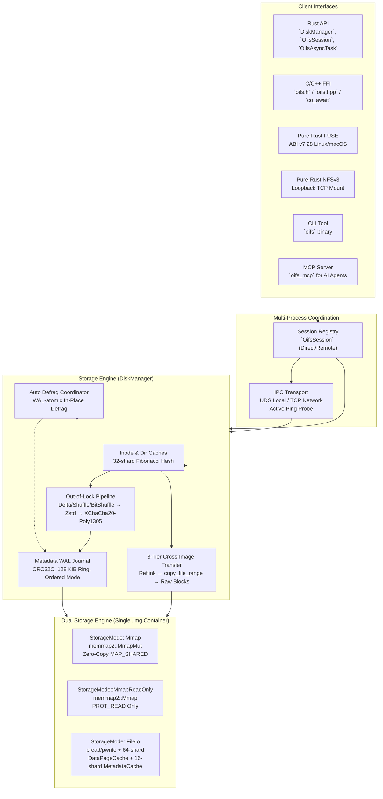
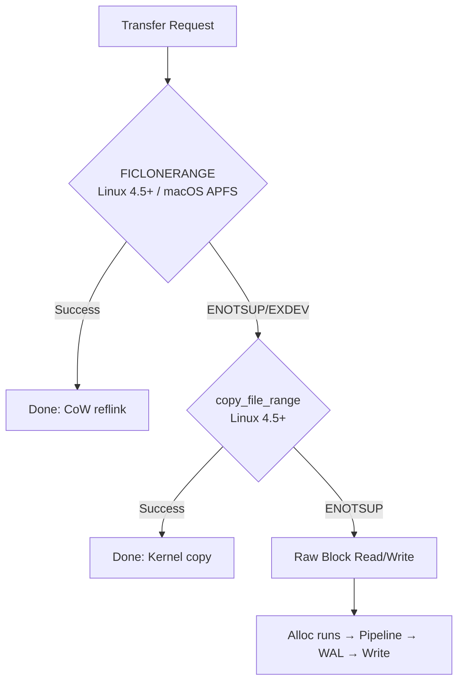

# Architecture Overview

OIFS (O's Inode File System) is a high-performance, embedded, multi-process inode filesystem engine implemented in Rust. It delivers crash-resilient storage, fine-grained concurrency, military-grade AEAD encryption, scientific data pre-compression filters, pluggable asynchronous I/O engines, a native Model Context Protocol (MCP) server for AI agents, a zero-external-C-dependency FUSE kernel protocol implementation (ABI v7.28), a stable C/C++ FFI interface, a pure-Rust NFSv3 loopback server, and cross-image fast transfer/splice/cloning capabilities — all packaged in a single portable `.img` container file.

> 🌐 **Interactive Architecture & Specs**: [https://ych.github.io/oifs/](https://ych.github.io/oifs/)  
> 📦 **Source Repository**: [https://github.com/ych/oifs](https://github.com/ych/oifs)

## System Context Diagram



*Diagram: OIFS system context showing client interfaces, coordination layer, storage engine pipeline, and dual storage backends.*

---

## Core Design Principles

| Principle | Description |
|-----------|-------------|
| **Single-Image Container** | All filesystem metadata (superblock, inodes, directories, bitmaps, WAL journal) and file data stored contiguously in one host file. |
| **Block-Oriented Layout** | Fixed 4 KiB block size with extent-based indexing (direct, single/double/triple indirect) supports files up to 513 GB. |
| **Pluggable I/O Engine** | Decouples payload block access from memory mapping via configurable backends: `Mmap` (default), `Pread`, Linux `io_uring`. |
| **Dual Storage Backend** | `StorageMode::Mmap` for zero-copy mmap access; `StorageMode::FileIo` for 100% `mmap`-free `pread`/`pwrite` with user-space caches — same on-disk format. |
| **Out-of-Lock Pipeline** | Compression (Zstd + SIMD Delta/Shuffle/BitShuffle) and encryption (XChaCha20-Poly1305) execute outside the inode cache lock. |
| **Ordered WAL Journal** | Metadata mutations are check-summed, appended to a 128 KiB ring, fsynced, then applied in place; crash recovery replays Redo only. |
| **Domain-Separated KDF** | Argon2id (m=64MiB, t=3, p=4) derives master key; BLAKE2b-512 derives isolated subkeys for payload AEAD, filename SIV, filename AEAD, and IPC auth — all `ZeroizeOnDrop`. |
| **Fast Cross-Image Path** | Three-tier `FICLONERANGE` → `copy_file_range` → raw-block fallback for zero-copy `clone`, `splice`, and `transfer`. |

---

## Subsystem Map (Module Ownership)

| Subsystem | Source Module | Purpose |
|-----------|---------------|---------|
| **Allocator** | `allocator.rs` | Extent-based block allocation with bitmap + free-list cache |
| **Auto Defrag** | `auto_defrag.rs` | Background/on-demand WAL-atomic in-place defragmentation |
| **Bitmap** | `bitmap.rs` | Bit-packed allocation bitmaps with SIMD find-first-free |
| **Directory** | `directory.rs` | Directory entry encoding, linear + hash-indexed lookup |
| **DiskManager** | `disk.rs` | Main filesystem API: CRUD, batch, transfer, defrag, fsck |
| **Encryption** | `encryption.rs` | Argon2id KDF, BLAKE2b domain-separated subkeys, XChaCha20-Poly1305, `ZeroizeOnDrop` |
| **FFI** | `ffi.rs` | C ABI (`oifs.h`) + Modern C++17/20 (`oifs.hpp`, `co_await`), thread-local error slots |
| **Filters** | `filters.rs` | SIMD Delta, ByteShuffle, BitShuffle, TruncPrecision pipelines |
| **FUSE** | `fuse.rs` | Pure-Rust FUSE ABI v7.28, Linux/macOS, zero external C deps |
| **Inode** | `inode.rs` | In-memory inode with extent list, compression metadata |
| **Inode Format** | `inode_format.rs` | Fixed 256-byte on-disk inode record (v2) |
| **I/O Engine** | `io_engine.rs` | Pluggable backends: `Mmap` / `Pread` / `IoUring` |
| **IPC** | `ipc.rs` | Master-Proxy over UDS (Local) or TCP + rendezvous (Network) |
| **Journal** | `journal.rs` | Metadata WAL: CRC32C, 128 KiB ring, ordered mode, idempotent Redo |
| **NFS** | `nfs.rs` | Pure-Rust NFSv3/MOUNTv3 over loopback TCP, stateless 16B handles |
| **Session** | `session.rs` | Transparent Direct/Remote session registry with failover |
| **Storage** | `storage.rs` | Dual backend: `Mmap` (memmap2) / `FileIo` (pread/pwrite + caches) |
| **Superblock** | `superblock.rs` | v3 layout: multi-block bitmaps, journal region, format migration cursor |
| **Zstd Pool** | `zstd_pool.rs` | Thread-local Zstd encoder/decoder pools with dict registry |

**Constant**: `BLOCK_SIZE = 4096` (defined in `lib.rs`)

---

## Runtime Domains & Data Flow

<!-- openwiki: mermaid parse failed and this diagram was converted to a text fence so it does not break rendering. Fix the diagram source and restore the mermaid fence. Parser error: Lexical error on line 25. Unrecognized text. ... Mmap["`Mmap` / `MmapReadOnly`<b -->
```text
flowchart LR
    subgraph Client["Client Process"]
        App["Application"]
        FFI["C/C++ FFI"]
        FUSE["FUSE Mount"]
        NFS["NFS Mount"]
        MCP["MCP stdio"]
    end

    subgraph IPC_Layer["IPC Transport (Optional)"]
        UDS["Unix Domain Socket<br/>`/tmp/oifs_*.sock` (0600)"]
        TCP["TCP + Rendezvous<br/>`.image.master`"]
        Auth["Challenge-Response<br/>Nonce + BLAKE2b MAC"]
    end

    subgraph Master["Master Process (DiskManager)"]
        Cache["32-Shard Inode Cache<br/>16-Shard Dir Cache"]
        Pipe["Pipeline: Filter → Zstd → XChaCha20-Poly1305"]
        WAL["WAL Journal<br/>CRC32C Ring Buffer"]
        Xfer["Cross-Image Transfer<br/>Reflink / copy_file_range / Raw"]
        Defrag["Auto Defrag<br/>WAL-atomic"]
    end

    subgraph Storage_Backend["Storage Backend"]
        Mmap["`Mmap` / `MmapReadOnly`<br/>memmap2 MAP_SHARED"]
        FileIo["`FileIo`<br/>pread/pwrite + PageCache"]
    end

    App -->|Rust API| Master
    FFI -->|oifs_* calls| Master
    FUSE -->|/dev/fuse| Master
    NFS -->|TCP localhost| Master
    MCP -->|stdio| Master

    Master -.->|Local Mode| UDS
    Master -.->|Network Mode| TCP
    UDS --> Auth
    TCP --> Auth
    Auth --> Master

    Cache --> Pipe
    Cache --> Xfer
    Pipe --> WAL
    WAL --> Storage_Backend
    Xfer --> Storage_Backend
    Defrag -.-> WAL
    Defrag -.-> Cache
```

### Write Path (Hot)

1. **Client** calls `DiskManager::write_at` / `WriteBatch` / FUSE `WRITE` / NFS `WRITE`
2. **Cache** acquires inode shard lock, appends to `WriteBatch` (out-of-lock)
3. **Pipeline** (released lock):  
   a. `FilterPipeline::apply` — SIMD Delta/Shuffle/BitShuffle  
   b. `Zstd` — seekable 64 KiB chunks or streaming frame  
   c. `XChaCha20-Poly1305` — encrypt with domain-separated payload key
4. **WAL** stages metadata ops (inode size, extent list, bitmap) as `MetadataOp` transaction, CRC32C, fsyncs ring
5. **Apply** in place: update inode, bitmaps, indirect blocks
6. **Storage** `flush` / `msync` per `DurabilityMode` (Lazy / RangeAsync / Strict)

### Read Path (Cold)

1. **Client** calls `read_at` / `read_at_batch` / FUSE `READ` / NFS `READ`
2. **Cache** resolves inode → extent list (decompresses indirect blocks if needed)
3. **I/O Engine** picks backend:  
   - `Mmap`: `memcpy` from shared mapping (zero-copy for resident pages)  
   - `Pread`: coalesced `pread(2)` per contiguous extent  
   - `IoUring`: batched submission, kernel services at queue depth > 1
4. **Pipeline** (released lock):  
   a. `XChaCha20-Poly1305` decrypt  
   b. `Zstd` decompress (seekable chunk or stream)  
   c. `FilterPipeline::unapply` — inverse SIMD filters
5. **Return** plaintext bytes to caller

---

## Client Interfaces

| Interface | Binary / Entry Point | Transport | Key Properties |
|-----------|---------------------|-----------|----------------|
| **Rust API** | `DiskManager`, `OifsSession`, `OifsAsyncTask` | In-process (Direct) or IPC (Remote) | Async `read_at_batch`, `WriteBatch`, `splice`, `transfer`, `defrag` |
| **C FFI** | `liboifs.so` / `liboifs.dylib` + `oifs.h` | In-process (Direct) | Opaque `OIFSHandle*`, thread-local error, `free`/`close` symmetry |
| **C++17/20** | `oifs.hpp` | In-process (Direct) | RAII `oifs::DiskManager`, `co_await` `read_at_async`, `PinnableSlice` zero-copy |
| **FUSE** | `oifs fuse  <mnt>` | Kernel `/dev/fuse` → userspace daemon | ABI v7.28, Linux + macOS (macFUSE), strict RO enforcement |
| **NFSv3** | `oifs nfs  <mnt>` | Loopback TCP (no rpcbind) | Stateless 16B handles, MOUNTv3 + NFSv3 multiplexed |
| **CLI** | `oifs` binary | In-process (Direct) | `create`, `put`/`get`, `mkdir`, `ls`, `defrag`, `fsck`, `clone`, `splice`, `bench` |
| **MCP** | `oifs_mcp` binary | stdio (JSON-RPC) | Tools: `write_file`, `read_file`, `list_dir`, `mkdir` for AI agents |

---

## Session & Multi-Process Coordination

`OifsSession` is the unified handle. It automatically becomes:

| Mode | Trigger | Transport | Auth | Failover |
|------|---------|-----------|------|----------|
| **Standalone** | Default (`get_or_open`) | None (direct `mmap`) | N/A | N/A |
| **Local** | `get_or_open_local` / `--ipc` | UDS in `$XDG_RUNTIME_DIR/oifs/` (0700 dir, 0600 sock) | Owner-only filesystem perms | Master exits → client reconnects to new master |
| **Network** | `get_or_open_network` / `--network` | TCP + `.image.master` rendezvous file in image dir | Challenge-response: 32B nonce + BLAKE2b MAC over `oifs-ipc-auth-v1` | Active Ping Probe (500 ms) detects dead master; bounded retry |

- **Master** = first process to open the image. Holds `DiskManager` + optional `IpcServer`.
- **Client** = subsequent processes. Forward every request over single persistent connection.
- **Registry**: process-wide `HashMap<PathBuf, OifsSession>` keyed by canonicalized path.

---

## On-Disk Layout (v3)

```
Block 0:          SuperBlock (magic=0x4F494653, format_version=3)
Block 1:          Inode Bitmap (grows: inode_bitmap_blocks)
Block 2:          Data Bitmap (grows: data_bitmap_blocks)
Block 3..J:       Journal Region (1 header + 32 ring blocks = 33 blocks)  ← only if journaled
Block J+1..:      Inode Table (256-byte fixed slots, INODE_FORMAT_V2)
Remaining:        Data Blocks (extent-indexed)
```

- **SuperBlock** (`superblock.rs`): `format_version=3` introduces multi-block bitmaps and journal region between data bitmap and inode table.
- **Journal** (`journal.rs`): 128 KiB ring (32 × 4 KiB), CRC32C per frame, ordered mode, idempotent Redo replay on mount.
- **Inodes** (`inode_format.rs`): Fixed 256-byte records, little-endian explicit fields, `INODE_FORMAT_V2`.
- **Extent indexing**: 12 direct + 1 single indirect + 1 double indirect + 1 triple indirect → 513 GB max file size.

---

## Encryption & Key Hierarchy

```
User Password
      │
      ▼
Argon2id (m=65536 KiB, t=3, p=4, salt=16B)  ──▶  Master Key (256-bit)
      │
      ├─▶ BLAKE2b-512("oifs.kdf.v2.payload.xchacha20poly1305")      ──▶ Payload Key (XChaCha20-Poly1305)
      ├─▶ BLAKE2b-512("oifs.kdf.v2.filename.siv.blake2b")           ──▶ Filename SIV Key (BLAKE2b-512 MAC)
      ├─▶ BLAKE2b-512("oifs.kdf.v2.filename.aead.xchacha20poly1305")──▶ Filename AEAD Key (XChaCha20-Poly1305)
      └─▶ BLAKE2b-512("oifs.kdf.v2.ipc.auth.blake2b")               ──▶ IPC Auth Key (BLAKE2b-512 MAC)
```

- All keys `ZeroizeOnDrop`.
- Filename encryption: SIV (deterministic) for directory lookups + AEAD for confidentiality.
- Payload encryption: seekable 64 KiB chunks (independent IV per chunk) or streaming.
- Encrypted images store salt + version in SuperBlock; `--encrypt` flag at `create`.

---

## Compression Pipeline

```
Input (element typesize: 1/2/4/8)
      │
      ├─▶ Delta (first-order difference)
      ├─▶ ByteShuffle (transpose bytes within elements)
      ├─▶ BitShuffle (transpose bits across elements)
      ├─▶ TruncPrecision (zero LSBs of FP mantissa)
      │
      ▼
Zstd (seekable 64 KiB chunks with dict registry OR streaming frame)
      │
      ▼
XChaCha20-Poly1305 AEAD (24B nonce = 12B chunk_id || 12B random)
```

- **Filter selection**: CLI `filter-analyze` heuristics + `--filter auto`.
- **Seekable chunks**: 64 KiB logical, independent Zstd frames, random `read_at` without full decompression.
- **Dictionary registry**: `ZstdDictRegistry` trains per-chunk-type dictionaries for ML/scientific data.

---

## Cross-Image Transfer (Zero-Copy Tiers)



- `clone`: single file, CoW reflink if same device.
- `splice`: move byte range between files (same image), adjusts extent lists in-place.
- `transfer`: copy file/dir tree across images, three-tier fallback, preserves sparsity.

---

## Feature Flags & Build Variants

| Feature | Dependencies | Binary | Purpose |
|---------|--------------|--------|---------|
| `default` = `cli` + `io_uring` | clap, io-uring (Linux) | `oifs` | Full CLI + async I/O |
| `cli` | clap | `oifs` | CLI tool only |
| `mcp` | rmcp, tokio, schemars | `oifs_mcp` | MCP server for AI agents (opt-in, keeps core lean) |
| `io_uring` | io-uring (Linux) | — | `IoBackend::IoUring` payload reads |
| `blosc2` | blosc2 (C lib) | — | C-Blosc2 filter interop |

> The `mcp` feature is **optional**; the core library and CLI build without any async runtime dependencies.

---

## Configuration & Environment

| Variable | Values | Default | Effect |
|----------|--------|---------|--------|
| `OIFS_STORAGE_MODE` | `mmap` / `pread` / `file` | `mmap` | Selects `StorageMode` at open |
| `OIFS_FILE_IO_CACHE_MB` | `0`–`4096` | `32` | `FileIo` data page cache budget |
| `OIFS_IO_BACKEND` | `mmap` / `pread` / `io_uring` | `mmap` | Payload read backend |
| `OIFS_DEFAULT_DURABILITY` | `lazy` / `range_async` / `strict` / `legacy` | `lazy` | `DurabilityMode` for mutations |
| `XDG_RUNTIME_DIR` | path | `$TMPDIR/oifs-<uid>` | Base for Local IPC sockets/tokens |

---

## Related Architecture Pages

- [Async I/O & Engines](async_io_and_engines.md) — `IoBackend` implementations, `io_uring` ring, batch submission
- [Compression & Filters](compression_and_filters.md) — SIMD pipelines, Zstd seekable chunks, dictionary training
- [Encryption](encryption.md) — Argon2id KDF, BLAKE2b domain separation, key zeroization, filename SIV/AEAD
- [FUSE Engine](fuse_engine.md) — ABI v7.28 parser, VFS facade, macOS/Linux mount runners
- [Journal](journal.md) — WAL ring, CRC32C, ordered mode, Redo recovery, transaction staging
- [MCP Server](mcp_server.md) — `rmcp` tool router, stdio transport, AI agent sandbox use cases
- [Storage Engines](storage_engines.md) — `Mmap` vs `FileIo`, page caches, `MmapReadOnly`, `SIGBUS` avoidance
- [Superblock & Layout](superblock_and_layout.md) — v3 geometry, multi-block bitmaps, journal region, format migration cursor
