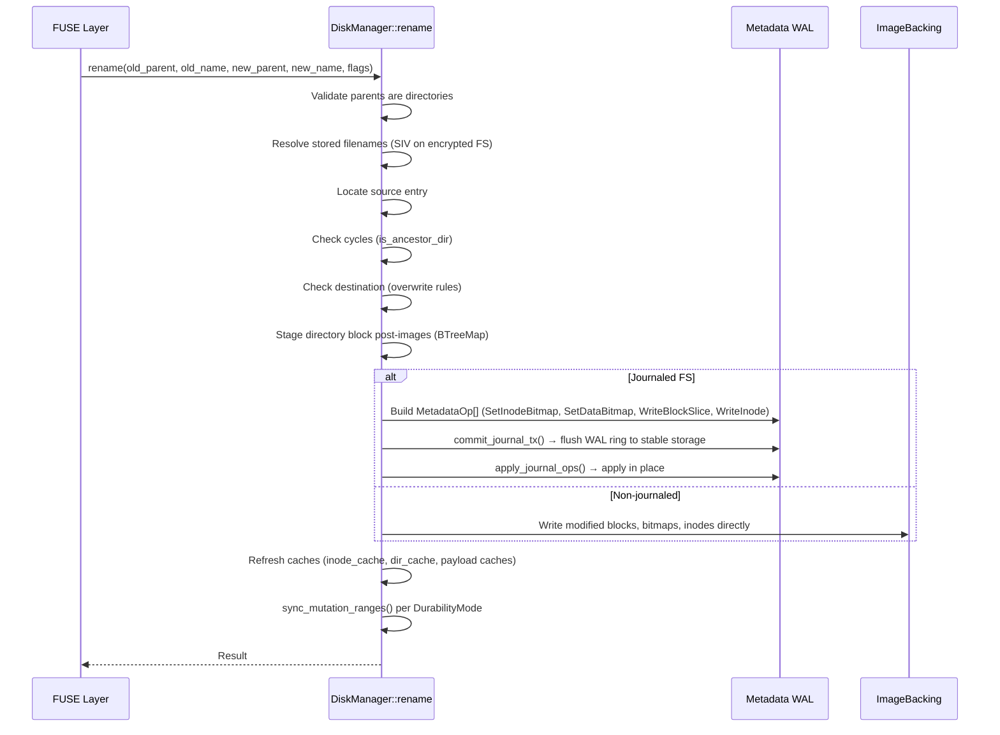

# Atomic Rename and Metadata Operations

This page documents the atomic POSIX rename implementation in OIFS, covering the FUSE opcode handling, the WAL transaction structure using `MetadataOp` variants, SIV filename re-encryption when moving across directories on encrypted filesystems, and the single-transaction `create_file_with_data` atomicity.

## FUSE Opcode Handling

### FUSE_RENAME (Legacy)

The legacy `FUSE_RENAME` opcode (value `23` on Linux) carries only `newdir: u64` followed by two NUL-terminated names. The macOS FUSE implementation may extend this to 16 bytes with an optional flags field.

```rust
// src/fuse.rs:3427-3450
FuseOpcode::Rename => {
    let Some(newdir) = read_u64_le(payload, 0) else { ... };
    // On macOS (macFUSE 4.x/5.x), `fuse_rename_in` may be 16 bytes
    // (`newdir: u64, flags: u32, padding: u32`) when `FUSE_RENAME` carries flags.
    let (flags, names_slice) = if platform == FuseAbiPlatform::MacOs
        && payload.len() > 16
        && payload[12..16] == [0, 0, 0, 0]
        && (payload[8] == 0 || payload[9..12] == [0, 0, 0])
    {
        (read_u32_le(payload, 8).unwrap_or(0), &payload[16..])
    } else {
        (0, &payload[8..])
    };
    let (old_name, new_name) = match parse_fuse_two_names(names_slice) { ... };
    match self.rename(dm, hdr.nodeid, old_name, newdir, new_name, flags) { ... }
}
```

### FUSE_RENAME2 (Modern, with Flags)

The modern `FUSE_RENAME2` opcode (value `28` on Linux) uses a fixed 16-byte header (`newdir: u64, flags: u32, padding: u32`) followed by the two names. The only flag currently supported is `FUSE_RENAME_NOREPLACE` (bit 0).

```rust
// src/fuse.rs:3452-3465
FuseOpcode::Rename2 => {
    let (Some(newdir), Some(flags)) = (read_u64_le(payload, 0), read_u32_le(payload, 8)) else { ... };
    if payload.len() < 16 { return FuseOutHeader::error_frame(unique, -libc::EINVAL); }
    let (old_name, new_name) = match parse_fuse_two_names(&payload[16..]) { ... };
    match self.rename(dm, hdr.nodeid, old_name, newdir, new_name, flags) { ... }
}
```

The VFS layer validates flags and enforces `NOREPLACE` semantics before delegating to `DiskManager::rename`:

```rust
// src/fuse.rs:2832-2856
pub fn rename(
    &self,
    dm: &DiskManager,
    parent: u64,
    name: &str,
    newparent: u64,
    newname: &str,
    flags: u32,
) -> Result<(), i32> {
    if self.is_read_only(dm) { return Err(-libc::EROFS); }
    if flags != 0 && flags != FUSE_RENAME_NOREPLACE { return Err(-libc::EINVAL); }
    // NFD→NFC normalization and macOS metadata filtering
    let name = self.normalize_name(name);
    let newname = self.normalize_name(newname);
    // NOREPLACE check
    if flags == FUSE_RENAME_NOREPLACE && dm.lookup(new_parent_inode, newname.as_ref()).is_ok() {
        return Err(-libc::EEXIST);
    }
    // ... perform rename via DiskManager ...
}
```

## MetadataOp Journal Framing

The WAL (Write-Ahead Log) uses **idempotent post-image** operations. Every `MetadataOp` is an absolute assignment, never a relative delta, making redo replay safe and repeatable. There is **no** `MetadataOp::Rename` or `MetadataOp::LinkCount` variant; renames are composed from primitive operations.

```rust
// src/journal.rs:308-337
pub enum MetadataOp {
    /// Set or clear the allocation bit for `inode_id` in the inode bitmap.
    SetInodeBitmap { inode_id: u64, allocated: bool },
    /// Set or clear the allocation bit for `block_id` in the data bitmap.
    SetDataBitmap { block_id: u64, allocated: bool },
    /// Set or clear a contiguous run of bits in the data bitmap.
    SetDataBitmapRange { start_block: u64, count: u32, allocated: bool },
    /// Overwrite the 256-byte inode record for `inode_id`.
    WriteInode { inode_id: u64, inode_bytes: Box<[u8; INODE_BYTES]> },
    /// Overwrite a byte range inside a data block (directory entry updates).
    WriteBlockSlice { block_id: u64, offset: u32, data: Vec<u8> },
}
```

Operations are coalesced (`coalesce_ops`) to merge adjacent bitmap allocations into `SetDataBitmapRange` and contiguous `WriteBlockSlice` updates on the same block into single slice writes, shrinking WAL frame sizes for multi-block operations.

### Transaction Encoding

A transaction frame has the layout:
```
magic(4) | tx_seq(8) | payload_len(4) | crc32c(4) | payload | commit_marker(4)
```
The CRC32C (Castagnoli) covers `tx_seq || payload_len || payload`. The commit marker (`0xDEAD_BEEF`) is written only after the payload is fully written, enabling torn-write detection during recovery.

### Mount-Time Recovery

On mount, `JournalRing::recover` replays every valid transaction between `tail` and `head` in append order. Replay stops at the first frame that fails validation (torn or corrupt tail) — everything before it is durable and is applied. Because every `MetadataOp` is an absolute post-image write, replaying a transaction twice is indistinguishable from replaying it once. The ring is then reset (`head = tail = 0`, `cleanly_unmounted = true`).

## DiskManager::rename Implementation

### Entry Point

```rust
// src/disk.rs:7234-7270
pub fn rename(
    &self,
    old_parent_inode_id: u64,
    old_name: &str,
    new_parent_inode_id: u64,
    new_name: &str,
) -> Result<(), DiskManagerError> {
    if self.is_read_only() { return Err(DiskManagerError::ReadOnly); }
    for name in [old_name, new_name] { validate_filename(name)?; }
    let mut guard = self.inner.write().unwrap();
    let res = Self::rename_internal(&mut guard, old_parent_inode_id, old_name, new_parent_inode_id, new_name);
    drop(guard);
    if res.is_ok() { self.maybe_drain_async_ranges(); }
    res
}
```

### Internal Rename Flow (`rename_internal`)

The internal implementation orchestrates the entire atomic operation:

1. **Validate parents** — Both old and new parent inodes must be directories.
2. **Resolve stored filenames** — On encrypted filesystems, `stored_filename` computes the SIV-encrypted name bound to the parent inode (see [Cross-Directory Moves with SIV Re-encryption](#cross-directory-moves-with-siv-re-encryption)).
3. **Locate source entry** — Finds `(src_inode_id, src_phys_blk)` in the old parent's directory blocks.
4. **POSIX no-op** — If `same_parent && old_name == new_name`, returns `Ok(())` without mutating anything.
5. **Cycle detection** — Rejects moving a directory into itself or any descendant via `is_ancestor_dir`.
6. **Destination handling** — Checks for existing entry at new location; enforces POSIX overwrite rules:
   - File → File: atomic replace, frees target blocks and inode.
   - Dir → Dir: only if target is empty; otherwise `"Directory is not empty"`.
   - Mismatched types: `"Is a directory"` / `"Not a directory"`.
7. **Stage directory block post-images** — Uses a `BTreeMap<u64, Vec<u8>>` (`modified_blocks`) to compose all directory block mutations in memory:
   - Remove old entry from `src_phys_blk`.
   - If overwriting, remove target entry from `dst_phys_blk`.
   - Insert new entry pointing to `src_inode_id` with freshly computed `new_hash` (using `new_stored` name).
   - If no space in existing blocks, allocates a new directory block for new parent.
8. **Commit WAL transaction** (journaled images only):
   - Pushes `SetInodeBitmap { allocated: false }` for overwritten inode.
   - Pushes `SetDataBitmap/SetDataBitmapRange { allocated: false }` for freed data blocks.
   - Pushes `WriteBlockSlice` for each modified directory block (full post-image).
   - Pushes `WriteInode` for old parent (updated `modified_at`).
   - Pushes `WriteInode` for new parent (updated `modified_at` and potentially `size` if grown).
   - Calls `commit_journal_tx` (flushes WAL to stable storage).
   - Calls `apply_journal_ops` (applies in place).
9. **Non-journaled path** — Directly writes modified blocks, updates bitmaps and inodes, flushes per `DurabilityMode`.
10. **Cache refresh** — Updates `inode_cache`, invalidates `dir_cache` for both parents and overwritten destination, invalidates payload caches for freed inode.
11. **Durability sync** — Calls `sync_mutation_ranges` with byte ranges covering inode bitmap, data bitmap, inode table slots, and modified directory blocks.



## Cross-Directory Moves with SIV Re-encryption

On encrypted filesystems, directory entry names are encrypted using a **deterministic 192-bit SIV (Synthetic IV)** construction with `XChaCha20-Poly1305`. The SIV nonce is derived from:
- A domain-separated `filename_siv_key`
- The **parent directory inode number** (`parent_inode`)
- The plaintext filename bytes

```rust
// src/encryption.rs:660-720
pub fn encrypt_filename(
    key: &EncryptionKey,
    parent_inode: u64,
    name: &str,
) -> Result<String, EncryptionError> {
    // Returns "_e_" + Base64URL(nonce || ciphertext || tag)
    // nonce = BLAKE2b512("OIFS_SIV_FILENAME_V2" || key || parent_inode || name)[..24]
    // AAD   = BLAKE2b512("OIFS_FILENAME_AAD_V2" || key || parent_inode)[..16]
}
```

**Critical implication for rename**: When moving an entry across directories, the stored filename **must be re-encrypted** because the `parent_inode` bound into the AAD and SIV nonce changes. The `rename_internal` function handles this by calling `stored_filename(guard, new_parent_inode_id, new_name)` for the destination, which produces a fresh `_e_` ciphertext. The old entry (encrypted under `old_parent_inode_id`) is removed, and the new entry (encrypted under `new_parent_inode_id`) is inserted.

The payload AEAD is **not** re-encrypted because it is bound to the `inode_id` (which remains constant during rename), not the parent directory.

```rust
// src/disk.rs:7298-7299
let old_stored = Self::stored_filename(guard, old_parent_inode_id, old_name)?.into_owned();
let new_stored = Self::stored_filename(guard, new_parent_inode_id, new_name)?.into_owned();
```

## Durability Guarantees and Ordering

### WAL-Before-Metadata Ordering

The fundamental invariant: **the WAL describing a mutation must reach stable storage before the metadata it describes**. A power loss must never leave the image with partially applied metadata that recovery has no record of.

- `commit_journal_tx` writes the transaction frame to the journal ring, updates the ring header (`head` cursor), and flushes the journal region (`flush_writeback`).
- On `DurabilityMode::Strict` (and when not using group-commit batching), `commit_journal_tx` additionally flushes the journal header block to ensure the cursor update is durable before returning.
- `sync_journal_region` flushes the entire journal region (header + ring) and is called by `DiskManager::flush`/`flush_async` to preserve ordering even when individual transactions skipped their own barrier.

### DurabilityMode Semantics

| Mode | Behavior |
|------|----------|
| **Lazy** (default) | Mutations update shared mmap/OS page cache only. No per-mutation `msync`. Changes survive process crashes; persistence across power loss on explicit `flush()`, `Drop`, or OS writeback. ~45× faster bulk throughput. |
| **RangeAsync** | Accumulates dirty ranges in `pending_async_ranges`; drains in coalesced batches (64 ops or 4 MiB) via `msync(MS_ASYNC)`. Journal region flushed first on each drain. |
| **Strict** | `msync(MS_SYNC)` on modified byte ranges for every mutation. Guarantees physical storage durability before return. Bridges 256 KiB gap between bitmaps and inode table to collapse syscalls. |
| **LegacyWholeMmapAsync** | Legacy whole-mapping `msync(MS_ASYNC)` after every mutation. |

During `RangeAsync` batch drain (`flush_async_batch`), the journal region is **always flushed first**, preserving WAL-before-metadata ordering.

### Drop Ordering

```rust
// src/disk.rs:1290-1310
impl Drop for DiskManagerInner {
    fn drop(&mut self) {
        let (flush_journal, flush_backing) = Self::should_sync_on_drop(self.read_only, self.superblock.has_journal_layout());
        if flush_journal { /* flush journal region */ }
        if flush_backing { /* flush backing */ }
    }
}
```
On shutdown, the journal region is flushed **before** the backing metadata, ensuring the log describing pending metadata does not lag behind the metadata itself.

## Atomicity of Rename

The entire rename operation (source unlink, optional target overwrite + block/inode release, destination link, parent inode updates) is committed in a **single atomic CRC32C WAL transaction** on journaled images. The transaction includes:

1. `SetInodeBitmap { allocated: false }` — free overwritten inode (if any)
2. `SetDataBitmapRange { allocated: false }` — free overwritten data blocks (if any)
3. `WriteBlockSlice` — directory block post-images (old parent removal, new parent insertion, overwritten parent removal)
4. `WriteInode` — old parent inode post-image (updated `modified_at`)
5. `WriteInode` — new parent inode post-image (updated `modified_at`, `size` if grown)

Because all operations are in one frame, recovery either replays the complete rename or none of it. There is no intermediate state where the source is unlinked but the destination not yet linked, or vice versa.

## FUSE RENAME_NOREPLACE Semantics

`FUSE_RENAME_NOREPLACE` (flag bit 0, value `1`) implements `renameat2(..., RENAME_NOREPLACE)`:

- **VFS check** (`src/fuse.rs:2867`): Before calling `DiskManager::rename`, the VFS performs `dm.lookup(new_parent_inode, newname)`. If the target exists, returns `-EEXIST` immediately.
- **DiskManager behavior**: The internal implementation always performs overwrite semantics (removes existing destination entry). The VFS `NOREPLACE` check prevents the call from reaching `DiskManager` when the flag is set and the target exists.
- **Atomicity**: The existence check and rename are **not** atomic together in the current implementation (TOCTOU window between VFS lookup and DiskManager rename). This matches typical FUSE semantics where the VFS layer enforces `NOREPLACE`.

## Edge Cases and Error Handling

| Scenario | Behavior |
|----------|----------|
| **Same parent, same name** | POSIX no-op: returns `Ok(())` without any metadata mutation. |
| **Directory into itself/descendant** | `is_ancestor_dir` check rejects with `EINVAL` ("Cannot move a directory into itself or its subdirectory"). |
| **Overwrite file with file** | Atomic replace: target inode and blocks freed, source entry moved. |
| **Overwrite empty dir with dir** | Target directory inode freed (must be empty), source moved. |
| **Overwrite non-empty dir** | Fails with `ENOTEMPTY` ("Directory is not empty"). |
| **File ↔ Dir mismatch** | Fails with `EISDIR` (source file → target dir) or `ENOTDIR` (source dir → target file). |
| **Sticky directory** | Not explicitly enforced in `rename_internal`; would require additional permission checks on `old_parent`/`new_parent` inodes. |
| **Cross-mount rename** | Not applicable — OIFS is a single-image filesystem; no mountpoint traversal. |
| **Read-only mount** | Returns `EROFS` at both FUSE and `DiskManager` entry points. |
| **Invalid filename** | Rejects empty, `.`, `..`, path separators, null bytes, >255 bytes. |
| **Encrypted FS: plaintext injection** | `dir_lookup` only matches authenticated `_e_` ciphertext names; never falls back to plaintext matching. |

## Related Operations

### create_file_with_data Atomicity

The `create_file_with_data` helper (used by FUSE `CREATE` with `O_TRUNC` semantics) atomically creates a file and writes initial data in a **single WAL transaction**:

```rust
// src/disk.rs:5500-5540
pub fn create_file_with_data(...) -> Result<u64, DiskManagerError> {
    // AllocSim stages inode + block allocation
    // WAL transaction: SetInodeBitmap(alloc), SetDataBitmapRange(alloc), WriteInode, WriteBlockSlice (data)
    // Single commit_journal_tx + apply_journal_ops
}
```

### delete_file / mkdir / rmdir

All metadata mutations follow the same pattern:
1. Stage operations in `AllocSim` (journaled) or operate directly (non-journaled).
2. Build `MetadataOp` list.
3. `commit_journal_tx` → `apply_journal_ops` (journaled) or direct write + `sync_mutation_ranges` (non-journaled).
4. Refresh caches.

This ensures **every metadata mutation is journaled**, preventing the class of bug where an unjournaled write (e.g., `write_data` updating size/block pointers) overwrites a pending WAL post-image on recovery.

## Testing and Verification

- **Kani proofs** (`src/journal.rs`): Idempotence of every `MetadataOp` variant under `apply_op_in_place`; encode/decode round-trips; `coalesce_ops` properties; ring cursor arithmetic.
- **Property tests** (`src/directory.rs`): Hash filter soundness, lookup equivalence, `dir_block_count` legacy compatibility, panic-free on arbitrary corrupt blocks.
- **Journal recovery tests** (`src/journal.rs`): Pre-wrap/post-wrap replay, checkpointed transactions not replayed, ops applied in append order, wrap survival.

## Key Files

| File | Responsibility |
|------|----------------|
| `src/fuse.rs` | FUSE_RENAME/RENAME2 opcode handling, VFS flag validation, NOREPLACE check |
| `src/disk.rs` | `DiskManager::rename`, `rename_internal`, WAL transaction build, durability sync |
| `src/journal.rs` | `MetadataOp` enum, frame encoding/decoding, `JournalRing::recover`, `commit_journal_tx`, `apply_journal_ops` |
| `src/encryption.rs` | `encrypt_filename`/`decrypt_filename` (SIV construction with parent_inode binding) |
| `src/directory.rs` | On-disk `DirectoryEntry` format, zero-allocation lookup/insert/remove, SipHash-2-4 |

## Summary

OIFS implements POSIX atomic rename by:
- Composing the operation from idempotent `MetadataOp` primitives (no dedicated `Rename` op).
- Committing all metadata changes (directory entries, bitmaps, inodes) in a **single WAL transaction** with CRC32C integrity.
- Re-encrypting directory entry names via SIV when crossing directory boundaries on encrypted filesystems.
- Enforcing WAL-before-metadata writeback ordering across all `DurabilityMode`s and on `Drop`.
- Replaying incomplete transactions automatically on mount via idempotent redo.

This design provides crash consistency without a full-image `fsck`, while maintaining high throughput via `Lazy`/`RangeAsync` durability modes for workloads that can tolerate OS-writeback persistence semantics.
