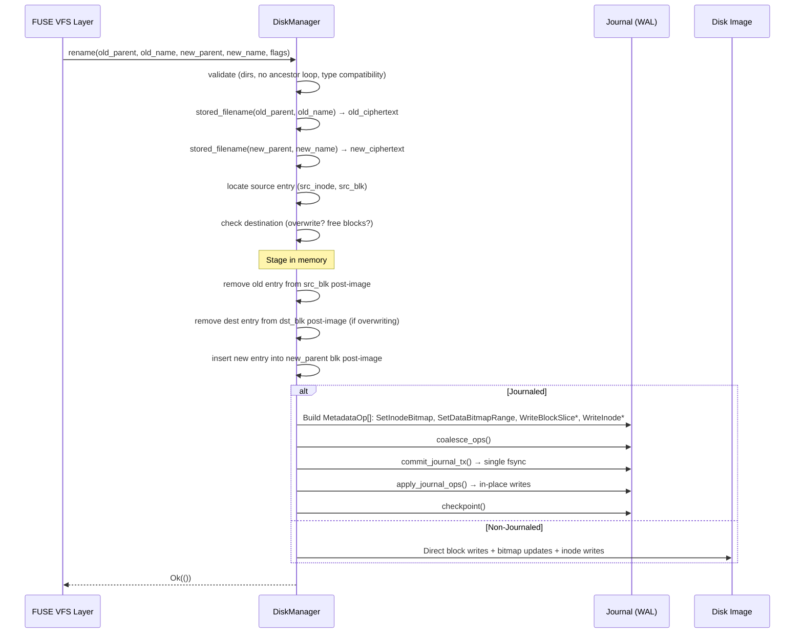

# Atomic Rename and Metadata Operations

This page documents the atomic POSIX rename implementation in OIFS, covering the FUSE opcode handling, the WAL transaction structure using `MetadataOp` variants, SIV filename re-encryption when moving across directories on encrypted filesystems, and the single-transaction `create_file_with_data` atomicity.

## FUSE Opcode Handling

### FUSE_RENAME (Legacy)

The legacy `FUSE_RENAME` opcode (value `23` on Linux) carries only `newdir: u64` followed by two NUL-terminated names. The macOS FUSE implementation may extend this to 16 bytes with an optional flags field.

```rust
// src/fuse.rs:3427-3450
FuseOpcode::Rename => {
    let Some(newdir) = read_u64_le(payload, 0) else { ... };
    // On macOS (macFUSE 4.x/5.x), `fuse_rename_in` may be 16 bytes
    // (`newdir: u64, flags: u32, padding: u32`) when `FUSE_RENAME` carries flags.
    let (flags, names_slice) = if platform == FuseAbiPlatform::MacOs
        && payload.len() > 16
        && payload[12..16] == [0, 0, 0, 0]
        && (payload[8] == 0 || payload[9..12] == [0, 0, 0])
    {
        (read_u32_le(payload, 8).unwrap_or(0), &payload[16..])
    } else {
        (0, &payload[8..])
    };
    let (old_name, new_name) = match parse_fuse_two_names(names_slice) { ... };
    match self.rename(dm, hdr.nodeid, old_name, newdir, new_name, flags) { ... }
}
```

### FUSE_RENAME2 (Modern, with Flags)

The modern `FUSE_RENAME2` opcode (value `28` on Linux) uses a fixed 16-byte header (`newdir: u64, flags: u32, padding: u32`) followed by the two names. The only flag currently supported is `FUSE_RENAME_NOREPLACE` (bit 0).

```rust
// src/fuse.rs:3452-3465
FuseOpcode::Rename2 => {
    let (Some(newdir), Some(flags)) = (read_u64_le(payload, 0), read_u32_le(payload, 8)) else { ... };
    if payload.len() < 16 { return FuseOutHeader::error_frame(unique, -libc::EINVAL); }
    let (old_name, new_name) = match parse_fuse_two_names(&payload[16..]) { ... };
    match self.rename(dm, hdr.nodeid, old_name, newdir, new_name, flags) { ... }
}
```

The VFS layer validates flags and enforces `NOREPLACE` semantics before delegating to `DiskManager::rename`:

```rust
// src/fuse.rs:2832-2856
pub fn rename(
    &self,
    dm: &DiskManager,
    parent: u64,
    name: &str,
    newparent: u64,
    newname: &str,
    flags: u32,
) -> Result<(), i32> {
    if self.is_read_only(dm) { return Err(-libc::EROFS); }
    if flags != 0 && flags != FUSE_RENAME_NOREPLACE { return Err(-libc::EINVAL); }
    // NFD→NFC normalization and macOS metadata filtering
    let name = self.normalize_name(name);
    let newname = self.normalize_name(newname);
    // NOREPLACE check
    if flags == FUSE_RENAME_NOREPLACE && dm.lookup(new_parent_inode, newname.as_ref()).is_ok() {
        return Err(-libc::EEXIST);
    }
    // ... perform rename via DiskManager ...
}
```

## MetadataOp Journal Framing

The WAL (Write-Ahead Log) uses **idempotent post-image** operations. Every `MetadataOp` is an absolute assignment, never a relative delta, making redo replay safe and repeatable. There is **no** `MetadataOp::Rename` or `MetadataOp::LinkCount` variant; renames are composed from primitive operations.

```rust
// src/journal.rs:308-337
pub enum MetadataOp {
    SetInodeBitmap { inode_id: u64, allocated: bool },
    SetDataBitmap { block_id: u64, allocated: bool },
    SetDataBitmapRange { start_block: u64, count: u32, allocated: bool },
    WriteInode { inode_id: u64, inode_bytes: Box<[u8; INODE_BYTES]> },
    WriteBlockSlice { block_id: u64, offset: u32, data: Vec<u8> },
}
```

| Variant | Purpose | Encoded Size |
|---------|---------|--------------|
| `SetInodeBitmap` | Mark inode allocated/free in inode bitmap | 10 bytes |
| `SetDataBitmap` | Mark single data block allocated/free | 10 bytes |
| `SetDataBitmapRange` | Mark contiguous run of data blocks | 14 bytes |
| `WriteInode` | Overwrite full 256-byte inode record | 266 bytes (1+8+256) |
| `WriteBlockSlice` | Overwrite byte range in a data block (directory entry updates) | 17 + data.len() |

The journal coalesces adjacent `SetDataBitmap` ops into `SetDataBitmapRange` and adjacent `WriteBlockSlice` ops targeting the same block to minimize frame size.

## Atomic Rename Workflow

`DiskManager::rename` performs the entire operation under the inner write lock and, on journaled images, commits a **single atomic WAL transaction** containing all metadata mutations.

### 1. Lookup and Validation

```rust
// src/disk.rs:7222-7330
pub fn rename(
    &self,
    old_parent_inode_id: u64,
    old_name: &str,
    new_parent_inode_id: u64,
    new_name: &str,
) -> Result<(), DiskManagerError> {
    // Read-only check, filename validation
    // Load source and destination parent inodes
    // Resolve stored (encrypted) filenames via stored_filename()
    // Locate source directory entry (src_inode_id, src_phys_blk)
    // POSIX no-op: same parent & same name → success
    // Ancestor check: prevent moving dir into self/descendant
    // Check destination existence and type compatibility
}
```

Key invariants enforced:
- Source and destination parents must be directories
- Cannot move a directory into itself or its descendants
- Overwrite semantics: file→file, empty dir→empty dir allowed; mismatched types fail with `EISDIR`/`ENOTDIR`; non-empty directory overwrite fails with `ENOTEMPTY`
- If destination inode equals source inode, treat as no-op

### 2. SIV Filename Re-encryption

On encrypted filesystems, the directory entry stores the **ciphertext** filename. When the parent directory changes, the SIV nonce changes (it binds `parent_inode_id`), so the ciphertext must be recomputed:

```rust
// src/disk.rs:7286-7287
let old_stored = Self::stored_filename(guard, old_parent_inode_id, old_name)?.into_owned();
let new_stored = Self::stored_filename(guard, new_parent_inode_id, new_name)?.into_owned();
```

`stored_filename` (src/disk.rs:2126-2143) calls `encryption::encrypt_filename` which derives a 24-byte SIV nonce from `(key, parent_inode_id, plaintext_name)` and encrypts with XChaCha20-Poly1305 using `parent_inode_id` in the AAD. This binds the filename ciphertext to its parent directory.

**Cross-directory move on encrypted FS**: The source entry (encrypted under old parent) is removed; a new entry with the same plaintext name but re-encrypted under the new parent is inserted. Payload blocks are **not** re-encrypted because file data AEAD is bound to `inode_id`, which remains unchanged.

### 3. Stage Directory Block Post-Images

All directory block mutations are composed in memory using a `BTreeMap<u64, Vec<u8>>` so that multiple edits to the same block combine cleanly:

```rust
// src/disk.rs:7336-7385
let mut modified_blocks: BTreeMap<u64, Vec<u8>> = BTreeMap::new();
// 1. Remove old entry from src_phys_blk
// 2. If overwriting destination, remove its entry from dst_phys_blk
// 3. Serialize new DirectoryEntry { inode: src_inode_id, hash: new_hash, name: new_stored }
// 4. Find free slot in new_parent's blocks (or allocate new block)
```

### 4. Build Journal Transaction

If journaling is enabled, all mutations are encoded as `MetadataOp`s and committed atomically:

```rust
// src/disk.rs:7434-7485
if journaled {
    let mut journal_ops: Vec<MetadataOp> = Vec::new();
    
    // Overwritten destination: free its inode and data blocks
    if let Some((dst_inode_id, _, ref dst_blocks)) = dst_info {
        journal_ops.push(MetadataOp::SetInodeBitmap { inode_id: dst_inode_id, allocated: false });
        for &blk in dst_blocks {
            push_data_bitmap_op(&mut journal_ops, blk, 1, false);
        }
    }
    
    // Modified directory blocks (source removal + destination insert)
    for (&blk_id, blk_data) in &modified_blocks {
        journal_ops.push(MetadataOp::WriteBlockSlice {
            block_id: blk_id,
            offset: 0,
            data: blk_data.clone(),
        });
    }
    
    // Updated parent inodes (mtime, size if grown)
    let old_parent_img = Self::build_inode_post_image(guard, old_parent_inode_id, &old_parent)?;
    journal_ops.push(MetadataOp::WriteInode { inode_id: old_parent_inode_id, inode_bytes: Box::new(old_parent_img) });
    if let Some(ref np) = new_parent_opt {
        let new_parent_img = Self::build_inode_post_image(guard, new_parent_inode_id, np)?;
        journal_ops.push(MetadataOp::WriteInode { inode_id: new_parent_inode_id, inode_bytes: Box::new(new_parent_img) });
    }
    
    // Coalesce and commit
    let ops = if is_already_coalesced(&journal_ops) { journal_ops } else { coalesce_ops(journal_ops) };
    Self::commit_journal_tx(guard, &ops)?;
    Self::apply_journal_ops(guard, &ops)?;
}
```

The transaction includes:
1. `SetInodeBitmap` + `SetDataBitmapRange` for any overwritten destination
2. `WriteBlockSlice` for each modified directory block (full block post-images)
3. `WriteInode` for both parent directories (updated `modified_at`, `size`)

### 5. Non-Journaled Path

On non-journaled images, mutations are applied directly under the same lock with explicit bitmap updates and inode writes, followed by cache invalidation.

## Atomic `create_file_with_data`

File creation with initial payload is a **single WAL transaction** when journaling is enabled and `DurabilityMode::Strict` is active (the default for safety). The operation stages:

1. `SetInodeBitmap` for the new inode
2. Payload blocks (either inlined as `WriteBlockSlice` in the WAL frame for ≤8 KiB, or via `stage_payload_write` which allocates blocks and emits bitmap + slice ops)
3. Directory entry insertion (`WriteBlockSlice` on parent directory block)
4. New inode post-image (`WriteInode`)
5. Parent directory inode post-image (`WriteInode`)

```rust
// src/disk.rs:3572-3750 (create_file_with_data_journaled)
fn create_file_with_data_journaled(...) -> Result<u64, DiskManagerError> {
    // Allocate inode_id
    // Encrypt payload if needed
    // Build ops: SetInodeBitmap, payload blocks, directory entry, WriteInode(new), WriteInode(parent)
    // Coalesce and commit
}
```

**Inline payload optimization**: Under `DurabilityMode::Strict` with immediate sync (not group-commit), payloads ≤ 2 blocks (8 KiB) are written as zero-padded `WriteBlockSlice` ops directly inside the WAL frame. This makes the file's data durable with the **same single sync barrier** that commits the metadata, avoiding the traditional 3-sync sequence (create → write data → sync).

## Crash Safety Guarantees

| Scenario | Behavior |
|----------|----------|
| Crash before WAL commit | No mutation visible; rename never happened |
| Crash after WAL commit, before apply | Recovery replays idempotent ops; final state reflects completed rename |
| Crash during apply | Idempotent redo ensures applying again yields same state |
| Power loss during directory block write | Full block post-image in WAL; replay restores consistent directory |
| Encrypted cross-directory move | SIV re-encryption is part of directory entry post-image; no partial ciphertext states |

## Mermaid Diagram: Rename Transaction Flow



## Related Pages

- [Encryption Architecture](../architecture/encryption.md) — SIV filename encryption, key derivation, AEAD binding
- [FFI Interface](../architecture/ffi_interface.md) — `oifs_rename` C API
- [FUSE Engine](../architecture/fuse_engine.md) — Opcode dispatch, macOS/Linux ABI differences
- [Journaling Subsystem](../architecture/journal.md) — WAL ring buffer, recovery, coalescing, durability modes
- [Basic Operations Workflows](../workflows/basic_operations.md) — End-to-end create/rename/delete flows
