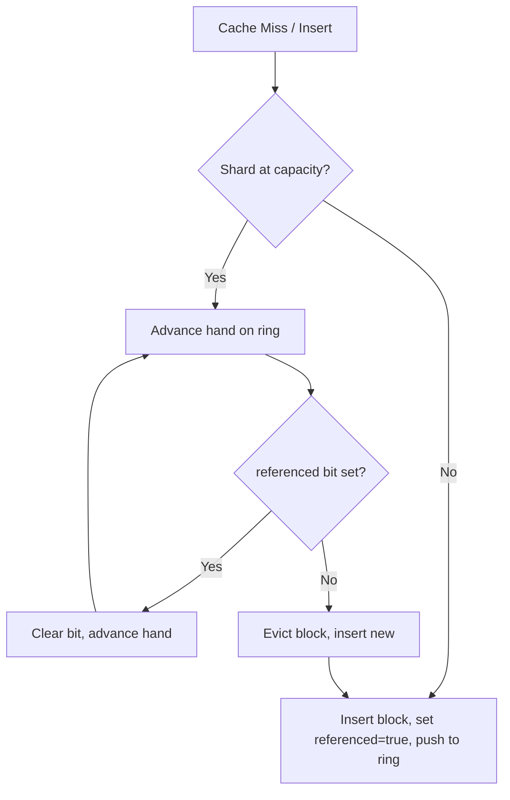
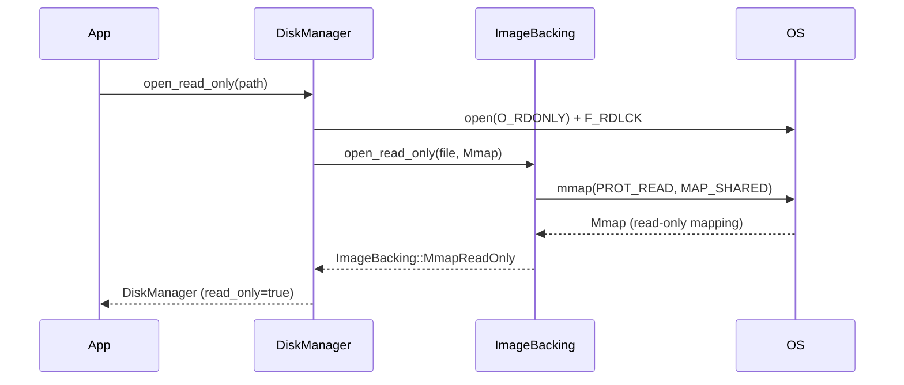
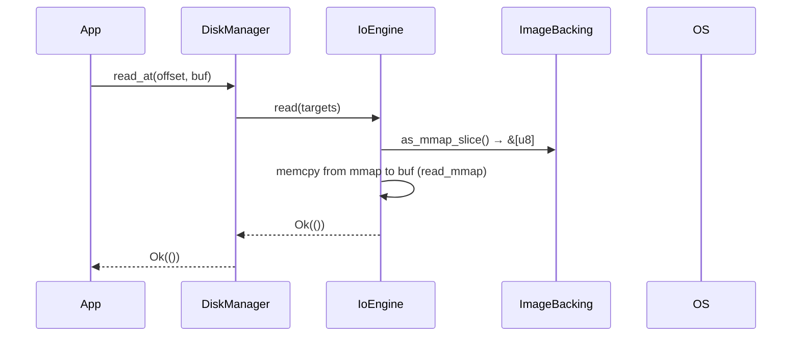
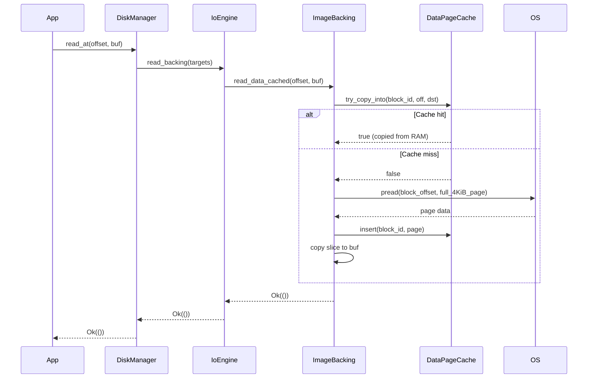
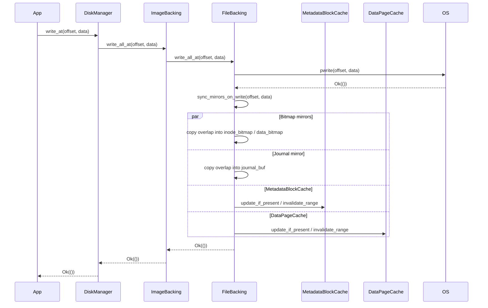

# Dual Storage Engine: Mmap and FileIo

OIFS provides two distinct storage backends that operate over the **exact same on-disk format**. The choice of backend is made at mount time and affects performance characteristics, failure modes, and operational constraints—but not the on-disk layout.

## Storage Mode Selection

### CLI and Environment

| Method | Flag / Variable | Values | Default |
|--------|-----------------|--------|---------|
| CLI (global) | `--no-mmap` | boolean | `false` |
| Environment | `OIFS_STORAGE_MODE` | `mmap`, `pread`, `file`, `file_io`, `no-mmap` | `mmap` |
| API | `DiskManager::open_with_storage_mode()` | `StorageMode::Mmap` / `StorageMode::FileIo` | — |

The `--no-mmap` flag sets a process-wide default to `StorageMode::FileIo`:

```rust
// src/bin/oifs.rs:190
#[arg(long = "no-mmap", global = true)]
no_mmap: bool,

// src/bin/oifs.rs:547
if cli.no_mmap {
    oifs::storage::set_default_storage_mode(oifs::StorageMode::FileIo);
}
```

### Read-Only Auto-Selection

When opening an image read-only (`open_read_only*` APIs), the backing is **always** memory-mapped with `PROT_READ` (`MmapReadOnly`) when `StorageMode::Mmap` is selected, regardless of the file's permissions. This works on `0444` images and provides true zero-copy slicing.

```rust
// src/storage.rs:1003-1012
StorageMode::Mmap => {
    // SAFETY: caller holds shared advisory lock (F_RDLCK) on file
    let mmap = unsafe { MmapOptions::new().map(file)? };
    Ok(Self::MmapReadOnly(mmap))
}
```

## Architecture Overview

```
┌─────────────────────────────────────────────────────────────────────┐
│                        DiskManager (public API)                     │
└─────────────────────────────────┬───────────────────────────────────┘
                                  │
                    ┌─────────────┴─────────────┐
                    ▼                           ▼
            ┌───────────────┐             ┌───────────────┐
            │  Mmap Backend │             │  FileIo Backend│
            │ (StorageMode::│             │ (StorageMode::│
            │    Mmap)      │             │    FileIo)    │
            └───────┬───────┘             └───────┬───────┘
                    │                           │
        ┌───────────┼───────────┐       ┌───────┼───────┐
        ▼           ▼           ▼       ▼       ▼       ▼
    MmapMut    MmapReadOnly   -   FileBacking  BlockCache DataCache
    (RW)       (RO)                (pwrite)   (16 shard) (64 shard)
        │           │                │         4 MiB      Config
        └───────────┴────────────────┴────────────────────┘
                              │
                    ┌─────────┴─────────┐
                    ▼                   ▼
            ┌───────────┐         ┌───────────┐
            │  Metadata │         │  Payload  │
            │ (bitmaps, │         │  (file    │
            │  inodes,  │         │  blocks)  │
            │  journal) │         │           │
            └───────────┘         └───────────┘
```

---

## ImageBacking Trait and Implementations

The unified abstraction is `ImageBacking` (src/storage.rs:964), an enum with three variants:

```rust
pub(crate) enum ImageBacking {
    Mmap(MmapMut),           // read-write, MAP_SHARED
    MmapReadOnly(Mmap),      // read-only, PROT_READ
    File(Box<FileBacking>),  // pread/pwrite, zero mmap
}
```

### StorageMode::Mmap — Zero-Copy Memory Mapping

**Implementation**: `MmapMut` (read-write) and `Mmap` (read-only) via `memmap2`.

| Property | Value |
|----------|-------|
| System call | `mmap(2)` with `MAP_SHARED` (RW) or `PROT_READ` (RO) |
| Page fault behavior | Synchronous, on-demand |
| Read path | `memcpy` from mapped region (`read_mmap`) |
| Write path | `memcpy` into mapped region |
| Flush | `msync(MS_SYNC)` via `MmapMut::flush()` |
| Metadata mirrors | None (direct mapping) |
| SIGBUS risk | **Yes** — truncated file, disk I/O error, NFS stale handle |

**Performance**: 40–58 GB/s on resident pages (memcpy speed).

**Read-write open**:
```rust
// src/storage.rs:981-987
StorageMode::Mmap => {
    let mmap = unsafe { MmapOptions::new().map_mut(file)? };
    Ok(Self::Mmap(mmap))
}
```

**Read-only open**:
```rust
// src/storage.rs:1005-1009
StorageMode::Mmap => {
    let mmap = unsafe { MmapOptions::new().map(file)? };
    Ok(Self::MmapReadOnly(mmap))
}
```

### StorageMode::FileIo — Pure pread/pwrite

**Implementation**: `FileBacking` (src/storage.rs:197) — 100% `mmap`-free, all Safe Rust.

| Property | Value |
|----------|-------|
| System calls | `pread(2)` / `pwrite(2)` (Unix), `ReadFile`/`WriteFile` with offset (Windows) |
| Page fault behavior | None — explicit syscalls |
| Read path | `pread` per extent, with **64-shard DataPageCache** for ≤64 KiB reads |
| Write path | `pwrite` + write-through mirror updates |
| Flush | `fsync`/`fdatasync` via `File::sync_data()` |
| Metadata mirrors | In-memory write-through bitmaps + WAL buffer |
| SIGBUS risk | **None** — no memory mapping |

#### FileBacking Structure

```rust
// src/storage.rs:197-214
struct FileBacking {
    file: File,                           // cloned handle
    len: usize,                           // image size
    read_only: bool,
    inode_bitmap_off: u64,
    inode_bitmap: Vec<u8>,                // write-through mirror
    data_bitmap_off: u64,
    data_bitmap: Vec<u8>,                 // write-through mirror
    journal_off: u64,
    journal_buf: Vec<u8>,                 // WAL mirror
    block_cache: MetadataBlockCache,      // 16-shard, 4 MiB
    data_cache: DataPageCache,            // 64-shard, configurable
}
```

---

## FileIo DataPageCache: 64 Shards, LRU/Second-Chance Eviction

The **user-space data page cache** is the heart of FileIo read performance. It caches 4 KiB payload blocks to avoid `pread` syscalls for hot random and small-file reads.

### Configuration

| Parameter | Constant / Env | Default | Max |
|-----------|----------------|---------|-----|
| Total cache size | `OIFS_FILE_IO_CACHE_MB` | 32 MiB | 4 GiB |
| Shard count | `DataPageCache::NUM_SHARDS` | 64 | fixed |
| Block size | `BLOCK_SIZE` | 4 KiB | fixed |
| Max cached extent | `MAX_CACHED_EXTENT` | 64 KiB | fixed |

```rust
// src/storage.rs:26-38
pub const FILE_IO_CACHE_MB_ENV: &str = "OIFS_FILE_IO_CACHE_MB";
pub const DEFAULT_FILE_IO_CACHE_BYTES: usize = 32 * 1024 * 1024;
pub const MAX_FILE_IO_CACHE_BYTES: usize = 4 * 1024 * 1024 * 1024;
pub(crate) const MAX_CACHED_EXTENT: usize = 64 * 1024;
```

### Sharding and Hashing

```rust
// src/storage.rs:288-290
const NUM_SHARDS: usize = 64;

#[inline]
fn shard_idx(block_id: u64) -> usize {
    ((block_id.wrapping_mul(0x9E37_79B9_7F4A_7C15)) >> 58) as usize
}
```

Fibonacci multiplicative hash distributes blocks uniformly across 64 shards.

### Eviction: Second-Chance Clock Algorithm

Each shard maintains a **circular ring** of block IDs and a `referenced` bit per entry:



**Key properties**:
- **Scan-resistant**: streaming reads >64 KiB bypass cache entirely (`MAX_CACHED_EXTENT`)
- **Lock-free read path**: `try_copy_into()` takes shard **read lock**, updates `referenced` atomically
- **Write coherence**: every `pwrite` invalidates overlapping blocks in both `MetadataBlockCache` and `DataPageCache`

### Read Path with Cache

```rust
// src/storage.rs:1148-1186
Self::File(fb) => {
    if !fb.data_cache.is_enabled() || dst.len() > DataPageCache::MAX_CACHED_EXTENT {
        return file_read_exact_at(&fb.file, offset, dst); // bypass
    }
    // per-block cache lookup
    while written < dst.len() {
        let blk_id = cur_off / BLOCK_SIZE as u64;
        if !fb.data_cache.try_copy_into(blk_id, in_blk, dst_slice) {
            // miss: pread full block, insert into cache, copy slice
        }
    }
}
```

### Cache Statistics API

```rust
// src/disk.rs:1425-1460
pub fn set_file_io_cache_bytes(&self, bytes: usize);   // 0 = disable
pub fn file_io_cache_bytes(&self) -> usize;            // configured capacity
pub fn file_io_cache_used_bytes(&self) -> usize;       // current residency
```

---

## MetadataBlockCache: 16 Shards, 4 MiB

Caches **indirect pointer blocks** and **directory blocks** (metadata, not payload). Critical for double-indirect traversal and directory scans without repeated `pread`.

| Property | Value |
|----------|-------|
| Shards | 16 |
| Max per shard | 64 blocks |
| Total capacity | 16 × 64 × 4 KiB = 4 MiB |
| Entry type | `Arc<[u8; 4096]>` (shared ownership) |
| Read path | `get()` releases shard lock before returning `Arc` |
| Deadlock-free | Nested `with_block` calls safe (lock released before callback) |

```rust
// src/storage.rs:108-164
struct MetadataBlockCache {
    shards: [RwLock<FxHashMap<u64, Arc<[u8; BLOCK_SIZE]>>>; 16],
}
```

---

## MmapReadOnly (PROT_READ) for Read-Only Mounts

When `StorageMode::Mmap` + read-only mount:



- Works on `0444` files (no write permission needed)
- Zero-copy slicing via `as_mmap_slice()` → `&[u8]`
- All mutating operations return `PermissionDenied`
- Journal recovery check is **read-only** (`is_journal_clean_read_only`)

---

## SIGBUS Hazards with Mmap and How FileIo Avoids Them

### The SIGBUS Problem

Memory-mapped files can raise `SIGBUS` when:

| Scenario | Cause |
|----------|-------|
| Truncated image | File shrunk after `mmap`; access beyond EOF |
| Disk I/O error | Bad sector, media failure |
| NFS/SMB stale handle | Server restarted, lease expired |
| Hole punching | `fallocate(FALLOC_FL_PUNCH_HOLE)` on mapped range |
| Overlay/union FS | Lower layer modified |

**Result**: Process crashes unless `SIGBUS` handler installed (complex, unsafe).

### FileIo Elimination

`StorageMode::FileIo` **never calls `mmap()`** — uses only `pread`/`pwrite`:

```rust
// src/storage.rs:7-9
//! - [`StorageMode::FileIo`]: 100% `mmap`-free positional `pread(2)` / `pwrite(2)` I/O backed
//!   by in-memory write-through bitmaps, an in-memory WAL mirror (when journaled), and a
//!   bounded 16-shard 4 KiB metadata block cache. Eliminates `SIGBUS` crashes and `unsafe`
//!   memory-mapping hazards while keeping all I/O strictly in Safe Rust.
```

| Hazard | Mmap | FileIo |
|--------|------|--------|
| Truncated file | SIGBUS on access | `pread` returns `EINVAL`/`UnexpectedEof` |
| Disk I/O error | SIGBUS | `pread`/`pwrite` returns `io::Error` |
| NFS stale handle | SIGBUS | `pread`/`pwrite` returns `ESTALE` |
| Hole punching | SIGBUS | Reads return zeros / writes succeed |
| Unsafe code | `unsafe { mmap }` | 100% Safe Rust |

---

## Storage Engine Comparison Table

| Dimension | StorageMode::Mmap | StorageMode::FileIo |
|-----------|-------------------|---------------------|
| **System calls** | `mmap`, `msync`, `munmap` | `pread`, `pwrite`, `fsync` |
| **Unsafe code** | Yes (`memmap2` internals) | No (100% Safe Rust) |
| **SIGBUS risk** | Yes | None |
| **Read latency (hot)** | ~memcpy (40–58 GB/s) | Cache hit: memcpy; miss: 1 `pread` |
| **Read latency (cold)** | Page fault per 4 KiB | 1 `pread` per extent (coalesced) |
| **Write path** | Dirty page in page cache | `pwrite` + mirror update |
| **Flush control** | `msync` (range or full) | `fsync`/`fdatasync` (full file) |
| **Read-only support** | `PROT_READ` mapping | `pread` on RO fd |
| **Metadata caching** | OS page cache | 4 MiB `MetadataBlockCache` |
| **Payload caching** | OS page cache | Configurable `DataPageCache` (default 32 MiB) |
| **Large sequential reads** | Kernel readahead | Single `pread` (bypass cache >64 KiB) |
| **Memory overhead** | Page tables + page cache | User-space caches only |
| **Container-friendly** | Requires `MAP_SHARED` support | Works everywhere |
| **Encryption compatible** | Yes (via encryption layer) | Yes (via encryption layer) |
| **Journaling compatible** | Yes | Yes (WAL mirror in RAM) |

---

## Data Flow Diagrams

### Mmap Read Path



### FileIo Read Path (Cached)



### FileIo Write Path



---

## Configuration Quick Reference

### Environment Variables

```bash
# Storage backend selection
export OIFS_STORAGE_MODE=mmap      # default
export OIFS_STORAGE_MODE=pread     # alias for FileIo
export OIFS_STORAGE_MODE=file_io   # explicit FileIo
export OIFS_STORAGE_MODE=no-mmap   # CLI --no-mmap equivalent

# FileIo data page cache (MiB)
export OIFS_FILE_IO_CACHE_MB=64    # 64 MiB cache (default 32 MiB, max 4096 MiB)
export OIFS_FILE_IO_CACHE_MB=0     # disable cache
```

### CLI

```bash
# Force FileIo backend
oifs --no-mmap -i image.img ls

# Read-only mount (auto-selects MmapReadOnly for Mmap mode)
oifs --read-only -i image.img ls
```

### API

```rust
use oifs::{DiskManager, StorageMode};

// Explicit FileIo
let dm = DiskManager::open_file_io("image.img", 100_000_000)?;

// Explicit Mmap (default)
let dm = DiskManager::open_with_storage_mode("image.img", 100_000_000, StorageMode::Mmap)?;

// Read-only
let dm = DiskManager::open_read_only_with_storage_mode("image.img", None, StorageMode::FileIo)?;

// Adjust FileIo cache at runtime
dm.set_file_io_cache_bytes(64 * 1024 * 1024); // 64 MiB
println!("Cache used: {} MiB", dm.file_io_cache_used_bytes() / 1_048_576);
```

---

## Operational Guidance

### Choose Mmap When

- Maximum read throughput on hot data (memcpy speed)
- Simple deployment, no SIGBUS concerns (local SSD, no NFS)
- Read-write workloads with `DurabilityMode::Lazy` (dirty pages visible to readers immediately)
- Container environments with `MAP_SHARED` support

### Choose FileIo When

- **NFS / network filesystems** (eliminates SIGBUS on stale handles)
- **Read-only media** or `0444` images (works without `mmap` write permission)
- **Containers with seccomp** blocking `mmap`/`munmap`
- **Deterministic latency** desired (no page faults)
- **Memory-constrained** environments (user-space cache bounded, no page table overhead)
- **Formal verification** / safety-critical (100% Safe Rust, no `unsafe` blocks)

### Cache Tuning

```bash
# High random-read workload: increase cache
export OIFS_FILE_IO_CACHE_MB=256

# Sequential scan workload: disable to avoid pollution
export OIFS_FILE_IO_CACHE_MB=0
```

The cache is **scan-resistant by design**: any read >64 KiB bypasses it entirely, preserving sequential throughput.

---

## Related Pages

- [Async I/O and Engines](../architecture/async_io_and_engines.md) — `IoBackend` (Mmap/Pread/IoUring) for payload reads
- [Disk Manager and Persistence](../architecture/disk_manager_and_persistence.md) — `DiskManager` API, durability modes, journaling
- [Architecture Overview](../architecture/overview.md) — System-wide component diagram
