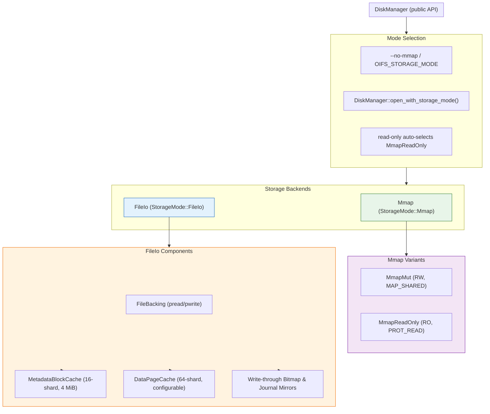

# Dual Storage Engine: Mmap and FileIo

OIFS provides two distinct storage backends that operate over the **exact same on-disk format**. The choice of backend is made at mount time and affects performance characteristics, failure modes, and operational constraints—but not the on-disk layout.

## Storage Mode Selection

### CLI and Environment

| Method | Flag / Variable | Values | Default |
|--------|-----------------|--------|---------|
| CLI (global) | `--no-mmap` | boolean | `false` |
| Environment | `OIFS_STORAGE_MODE` | `mmap`, `pread`, `file`, `file_io`, `no-mmap` | `mmap` |
| API | `DiskManager::open_with_storage_mode()` | `StorageMode::Mmap` / `StorageMode::FileIo` | — |

The `--no-mmap` flag sets a process-wide default to `StorageMode::FileIo`:

```rust
// src/bin/oifs.rs:190
#[arg(long = "no-mmap", global = true)]
no_mmap: bool,

// src/bin/oifs.rs:547
if cli.no_mmap {
    oifs::storage::set_default_storage_mode(oifs::StorageMode::FileIo);
}
```

### Read-Only Auto-Selection

When opening an image read-only (`open_read_only*` APIs), the backing is **always** memory-mapped with `PROT_READ` (`MmapReadOnly`) when `StorageMode::Mmap` is selected, regardless of the file's permissions. This works on `0444` images and provides true zero-copy slicing.

```rust
// src/storage.rs:1003-1012
StorageMode::Mmap => {
    // SAFETY: caller holds shared advisory lock (F_RDLCK) on file
    let mmap = unsafe { MmapOptions::new().map(file)? };
    Ok(Self::MmapReadOnly(mmap))
}
```

## Architecture Overview



---

## ImageBacking Trait and Implementations

The unified abstraction is `ImageBacking` ([src/storage.rs:1043](repo://src/storage.rs#L1043)), an enum with three variants:

```rust
pub(crate) enum ImageBacking {
    Mmap(MmapMut),           // read-write, MAP_SHARED
    MmapReadOnly(Mmap),      // read-only, PROT_READ
    File(Box<FileBacking>),  // pread/pwrite + caches + mirrors
}
```

### Mmap (StorageMode::Mmap)

- **Read-write**: `MmapMut` via `memmap2::MmapMut` with `MAP_SHARED`, providing zero-copy access to the entire container. Typical throughput: **40–58 GB/s** on resident pages.
- **Read-only**: `MmapReadOnly` via `memmap2::Mmap` with `PROT_READ`. Works on `0444` image files. Also zero-copy—no syscalls for reads.
- **Mutations**: Direct memory writes (`m[start..end].copy_from_slice(src)`). The kernel flushes dirty pages asynchronously; `flush()` calls `msync(MS_SYNC)`.
- **Hazards**: `SIGBUS` if the underlying file is truncated while mapped. OIFS prevents this by remapping after growth and dropping the mapping before `set_len()` during truncation.

### MmapReadOnly (StorageMode::Mmap + read-only)

- Selected automatically when opening an image read-only with `StorageMode::Mmap`.
- Uses `PROT_READ` mapping—**no `SIGBUS` risk** from external truncation (the file cannot be truncated by writers while read-locked).
- All read paths (`read_exact_at`, `read_data_cached`, `with_block`) are zero-copy slices from the mapping.

### FileIo (StorageMode::FileIo)

- **Pure positional I/O**: Uses `pread(2)`/`pwrite(2)` (or `ReadFile`/`WriteFile` with `OVERLAPPED` on Windows) via `file_read_exact_at` / `file_write_all_at` ([src/storage.rs:83-123](repo://src/storage.rs#L83-L123)).
- **No `mmap()` calls ever**—eliminates `SIGBUS` hazards and `unsafe` memory-mapping code entirely.
- **100% Safe Rust** in the `FileBacking` implementation.
- **Write-through mirrors**: Maintains in-memory copies of the inode bitmap, data bitmap, and journal region. Every `pwrite` updates the corresponding mirror via `sync_mirrors_on_write()` ([src/storage.rs:728-775](repo://src/storage.rs#L728-L775)).
- **Two cache layers**:
  1. **MetadataBlockCache** – 16-shard, 4 MiB bounded cache for indirect pointer blocks and directory blocks.
  2. **DataPageCache** – 64-shard, configurable (default 32 MiB, max 4 GiB) Second-Chance Clock cache for file payload blocks.

---

## FileIo Deep Dive

### MetadataBlockCache

**Purpose**: Cache 4 KiB metadata blocks (indirect pointer blocks, directory blocks) accessed via `with_block`, allowing concurrent readers to resolve block pointers and scan directories without repeated `pread` syscalls or cross-thread lock contention.

**Structure** ([src/storage.rs:153-224](repo://src/storage.rs#L153-L224)):

| Property | Value |
|----------|-------|
| Shards | 16 (`NUM_SHARDS`) |
| Max entries per shard | 64 (`MAX_PER_SHARD`) |
| Total capacity | 16 × 64 × 4 KiB = **4 MiB** |
| Entry type | `Arc<[u8; BLOCK_SIZE]>` (4096-byte array) |
| Eviction | Simple LRU-ish: drops one arbitrary entry when full |
| Shard index | Fibonacci hash: `(block_id * 0x9E37_79B9_7F4A_7C15) >> 60` |

**Key design points**:

- `Arc<[u8; BLOCK_SIZE]>` storage: `get()` clones the `Arc` under a **shared** shard read lock, then releases the lock before returning. This makes **nested `with_block` calls strictly deadlock-free** even when two blocks (e.g., double-indirect traversal) hash to the same shard.
- `read_u64_le()`: Reads an 8-byte pointer directly under the shard read lock **without cloning the `Arc`**, eliminating atomic refcount contention on hot indirect pointer blocks.
- Write path coherence: `update_if_present()` mutates the cached block in-place via `Arc::make_mut()` when a `pwrite` overlaps a cached metadata block.
- Invalidation: `invalidate()` and `invalidate_block_range()` remove entries; used on `zero_block`, `copy_block`, and truncation.

### DataPageCache

**Purpose**: Serve hot random and small-file reads straight from RAM without `pread` syscalls while staying scan-resistant and strictly coherent on every write, zero, copy, and WAL replay.

**Structure** ([src/storage.rs:226-455](repo://src/storage.rs#L226-L455)):

| Property | Value |
|----------|-------|
| Shards | 64 (`NUM_SHARDS`) |
| Entry type | `DataCacheEntry { data: Box<[u8; BLOCK_SIZE]>, referenced: AtomicBool }` |
| Eviction | **Second-Chance Clock** per shard |
| Max cached extent | **64 KiB** (`MAX_CACHED_EXTENT`) — larger streaming reads bypass the cache |
| Default capacity | **32 MiB** (configurable via `OIFS_FILE_IO_CACHE_MB`, 0 = disabled) |
| Maximum capacity | **4 GiB** (`MAX_FILE_IO_CACHE_BYTES`) |
| Shard index | Fibonacci hash: `(block_id * 0x9E37_79B9_7F4A_7C15) >> 58` |

**Capacity calculation** ([src/storage.rs:266-282](repo://src/storage.rs#L266-L282)):

```rust
fn default_capacity_bytes() -> usize {
    if let Ok(val) = std::env::var(FILE_IO_CACHE_MB_ENV)
        && let Ok(mb) = val.trim().parse::<usize>()
    {
        return mb.saturating_mul(1024 * 1024).min(MAX_FILE_IO_CACHE_BYTES);
    }
    DEFAULT_FILE_IO_CACHE_BYTES  // 32 MiB
}

fn blocks_per_shard_for_bytes(bytes: usize) -> usize {
    let clamped = bytes.min(MAX_FILE_IO_CACHE_BYTES);
    if clamped == 0 { return 0; }
    let total_blocks = clamped / BLOCK_SIZE;
    if total_blocks == 0 { 0 } else { total_blocks.div_ceil(NUM_SHARDS) }
}
```

**Second-Chance Clock eviction** ([src/storage.rs:312-349](repo://src/storage.rs#L312-L349)):

Each shard maintains a `ring: Vec<u64>` of block IDs and a `hand` index. On eviction:
1. Skip stale ring entries (keys no longer in the map).
2. Check the `referenced` flag of the entry at `hand`.
3. If `false`, evict it; if `true`, clear the flag and advance `hand`.
4. Fallback: if the ring empties while the map is non-empty, evict an arbitrary key.

This provides **scan resistance**: a large streaming read touches each block once (setting `referenced = true`), but a subsequent scan will clear those flags and evict them, preserving hot random-access pages.

**Read path** (`try_copy_into` / `read_data_cached`) ([src/storage.rs:351-370](repo://src/storage.rs#L351-L370), [src/storage.rs:1312-1355](repo://src/storage.rs#L1312-L1355)):

```rust
// Try cache-only read (non-blocking)
fn try_read_data_cached_only(&self, offset: u64, dst: &mut [u8]) -> Option<io::Result<()>> {
    // Mmap: direct copy
    // FileIo: iterate blocks, try_copy_into each; return None if any miss
}

// Read with cache population
fn read_data_cached(&self, offset: u64, dst: &mut [u8]) -> io::Result<()> {
    // Mmap: direct copy
    // FileIo: if cache disabled or len > 64 KiB -> single pread
    //         else: per-block try_copy_into; on miss, pread whole block, insert, copy
}
```

**Write path coherence** (`sync_mirrors_on_write`) ([src/storage.rs:728-775](repo://src/storage.rs#L728-L775)):

Every `pwrite` (via `write_all_at`, `zero_block`, `copy_block`, `write_block_ptr`, `apply_journal_op`) calls `sync_mirrors_on_write(offset, src)` which:

1. **Updates bitmap mirrors**: Copies overlapping bytes into `inode_bitmap`, `data_bitmap`, `journal_buf`.
2. **Updates caches**: For the affected block range `[first_blk..last_blk]`:
   - If span ≤ 64 blocks: per-block `update_if_present()` on both `MetadataBlockCache` and `DataPageCache`.
   - If span > 64 blocks (large streaming write): `invalidate_block_range()` on both caches to avoid O(blocks) shard lock traffic.

This guarantees **strict coherence**: a subsequent `read_data_cached` or `with_block` will never see stale data.

### Write-Through Bitmap & Journal Mirrors

`FileBacking` holds in-memory copies of three on-disk regions loaded at `configure_regions()` ([src/storage.rs:517-700](repo://src/storage.rs#L517-L700)):

| Mirror | Source | Size | Updated by |
|--------|--------|------|------------|
| `inode_bitmap` | SuperBlock `inode_bitmap_block` × `inode_bitmap_blocks()` | Variable | `write_all_at` (overlapping), `apply_journal_op(SetInodeBitmap)` |
| `data_bitmap` | SuperBlock `data_bitmap_block` × `data_bitmap_blocks()` | Variable | `write_all_at`, `apply_journal_op(SetDataBitmap/Range)` |
| `journal_buf` | SuperBlock `journal_header_block()` × `JOURNAL_RESERVED_BLOCKS` | 132 KiB (33 × 4 KiB) | `write_all_at`, `apply_journal_op`, `JournalRegionMut::flush_writeback()` |

**Mutability guards**: `BitmapSliceMut` and `JournalRegionMut` are `Deref`/`DerefMut` wrappers that carry optional `file_writeback: Option<(&File, u64)>`. On `Drop`, they `pwrite` the dirty range (or narrowed range via `set_dirty_bits`/`mark_append_written`). Under `Mmap`, these are zero-cost wrappers with `file_writeback = None`.

---

## Coherence & Invalidation Summary

| Operation | Mmap / MmapReadOnly | FileIo |
|-----------|---------------------|--------|
| `read_exact_at` | `memcpy` from mapping | `pread` |
| `read_data_cached` | `memcpy` from mapping | Cache lookup → `pread` on miss → insert (≤64 KiB); direct `pread` (>64 KiB) |
| `try_read_data_cached_only` | `memcpy` | Cache-only; `None` on any miss |
| `write_all_at` | `memcpy` to mapping | `pwrite` + `sync_mirrors_on_write` |
| `zero_block` | `fill(0)` | `pwrite(ZERO_BLOCK)` + invalidate both caches |
| `copy_block` | `copy_within` | `pread` + `pwrite` + invalidate dst in both caches |
| `with_block` | Zero-copy slice | Cache hit: `Arc` clone; miss: `pread` → insert `Arc` → return slice |
| `with_block_mut` | Direct `&mut [u8]` | Load (cache or `pread`) → mutate → `pwrite` → update metadata cache + invalidate data cache |
| `read_block_ptr` | Direct from mapping | `MetadataBlockCache::read_u64_le` (lock-free) or `with_block` fallback |
| `write_block_ptr` | Direct to mapping | `pwrite` 8 bytes + `update_if_present` on both caches |
| `flush` | `msync(MS_SYNC)` | `sync_data()` |
| `truncate_and_remap` | Drop mapping → `set_len` → remap | Invalidate truncated blocks in both caches → `set_len` + `sync_data` |

---

## Configuration Reference

| Environment Variable | Purpose | Default | Range |
|----------------------|---------|---------|-------|
| `OIFS_STORAGE_MODE` | Select backend: `mmap`, `pread`, `file`, `file_io`, `no-mmap` | `mmap` | Enum |
| `OIFS_FILE_IO_CACHE_MB` | FileIo DataPageCache capacity in MiB (0 = disabled) | `32` | `0` – `4096` |

**API**:

```rust
use oifs::{DiskManager, StorageMode, IoBackend};

// Storage mode at open time
let dm = DiskManager::open_with_storage_mode("data.oifs", 10 * 1024 * 1024, StorageMode::FileIo)?;

// Or change default for subsequent opens
oifs::storage::set_default_storage_mode(StorageMode::FileIo);

// DataPageCache capacity at runtime (FileIo only)
dm.image_backing().set_data_cache_capacity_bytes(64 * 1024 * 1024); // 64 MiB
let cap = dm.image_backing().data_cache_capacity_bytes();
let used = dm.image_backing().data_cache_used_bytes();
```

---

## Trade-off Matrix

| Dimension | Mmap (default) | FileIo |
|-----------|----------------|--------|
| **Read throughput (hot)** | 40–58 GB/s (zero-copy) | ~memory bandwidth (cache hit) |
| **Read throughput (cold)** | Page fault per 4 KiB | `pread` syscall per 4 KiB (or 64 KiB extent) |
| **Write throughput** | Async dirty page writeback | Synchronous `pwrite` + mirror update |
| **Latency predictability** | Variable (page faults) | Predictable (explicit syscalls) |
| **SIGBUS risk** | Yes (external truncation) | **None** |
| **Unsafe code** | `mmap`/`munmap` | **None** (100% Safe Rust) |
| **Memory usage** | Page cache only | Page cache + 4 MiB metadata cache + configurable data cache (default 32 MiB) |
| **Read-only `0444` support** | Yes (`MmapReadOnly`, `PROT_READ`) | Yes (`pread` on read-only FD) |
| **Coherence model** | Kernel page cache | User-space mirrors + caches (strict) |
| **Best for** | General purpose, large working sets, read-heavy | Containers, read-only media, SIGBUS-sensitive envs, deterministic latency |

---

## Extension Points

- **Custom `StorageMode`**: Not currently extensible; the enum is closed.
- **Cache tuning**: `OIFS_FILE_IO_CACHE_MB` and `ImageBacking::set_data_cache_capacity_bytes()`.
- **Invalidation hook**: `ImageBacking::invalidate_block_range_caches()` for external FD-level writes (`FICLONERANGE`, `copy_file_range`, raw `pwrite`) that bypass `ImageBacking`.
- **Testing**: Kani proofs cover shard index bounds, eviction clamping, read-only policy invariants, and `BitmapSliceMut` dirty range computation ([src/storage.rs:2350-2483](repo://src/storage.rs#L2350-L2483)).

---

## Related Pages

- [Async I/O & Pluggable Engines](./async_io_and_engines.md) — io_uring, Pread, and Mmap data-block read engines
- [Compression & Filters](./compression_and_filters.md) — chunked/encrypted payloads and their caches
- [Disk Manager & Persistence](./disk_manager_and_persistence.md) — higher-level DiskManager API, durability modes, journal replay
<!-- openwiki: broken internal link [../overview.md] file "../overview.md" does not exist. Fix the href or restore the target, then delete this comment. -->
- [Architecture Overview](../overview.md) — system-wide component diagram
