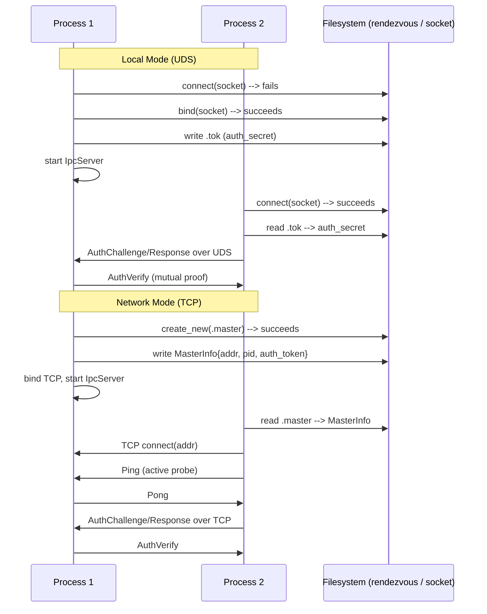

# OIFS FFI Integration Guide

This guide explains how to embed the OIFS shared library (`liboifs.so` / `liboifs.dylib` / `oifs.dll`) into applications via the stable C ABI ([`include/oifs.h`](repo://include/oifs.h), [`src/ffi.rs`](repo://src/ffi.rs)) and the header-only C++17/20 RAII wrapper ([`include/oifs.hpp`](repo://include/oifs.hpp)). It covers building the cdylib, opaque handle lifecycle, multi-process IPC (Master-Proxy), synchronous and asynchronous I/O, zero-copy `PinnableSlice` reads, encryption, and common pitfalls.

## 1. Building and Linking

### Build the Shared Library

OIFS is a `cdylib` crate built with Cargo:

```bash
# Release build (optimized, no debug symbols)
cargo build --release

# Output:
#   target/release/liboifs.so     (Linux)
#   target/release/liboifs.dylib  (macOS)
#   target/release/oifs.dll       (Windows)
```

### C/C++ Include Path

```bash
# GCC / Clang
-I/path/to/oifs/include

# MSVC
/I"C:\path\to\oifs\include"
```

### Linking

```bash
# Linux (requires -ldl for oifs_loaded_path)
-L/path/to/oifs/target/release -loifs -ldl

# macOS
-L/path/to/oifs/target/release -loifs

# Windows (MSVC)
/LIBPATH:C:\path\to\oifs\target\release oifs.lib
```

### Runtime Library Path

Set the runtime library search path so the dynamic loader finds `liboifs`:

```bash
# Linux
export LD_LIBRARY_PATH=/path/to/oifs/target/release:$LD_LIBRARY_PATH

# macOS
export DYLD_LIBRARY_PATH=/path/to/oifs/target/release:$DYLD_LIBRARY_PATH

# Windows: place oifs.dll next to the executable or in PATH
```

## 2. Header Inclusion

### C

```c
#include <oifs.h>
```

### C++ (Recommended: RAII Wrapper)

```cpp
#include <oifs.hpp>
// namespace oifs provides FileSystem, ReadSession, FileReadHandle, PinnableSlice, AsyncFuture
```

## 3. Version Handshake (Required at Startup)

**Always check version compatibility immediately after loading the library**. The header embeds compile-time constants (`OIFS_VERSION_MAJOR`, `OIFS_VERSION_MINOR`, `OIFS_VERSION_PATCH`, `OIFS_VERSION_STRING`). The runtime library exposes matching getters.

```c
int v_status = OIFS_CHECK_VERSION();  // macro expands to oifs_check_version(...)
if (v_status == OIFS_VERSION_COMPAT_ERR) {  // -1: loaded lib is OLDER → BLOCK
    char path[512] = {0};
    oifs_loaded_path(path, sizeof(path));
    fprintf(stderr, "FATAL: Outdated liboifs at '%s' (v%s), need >= v%s\n",
            path, oifs_version_string(), OIFS_VERSION_STRING);
    return 1;
} else if (v_status == OIFS_VERSION_COMPAT_WARN) {  // 1: loaded lib is NEWER → WARN only
    fprintf(stderr, "WARN: Newer liboifs (v%s) than headers (v%s)\n",
            oifs_version_string(), OIFS_VERSION_STRING);
}
// v_status == OIFS_VERSION_COMPAT_OK (0): exact match
```

**Compatibility Policy** ([`include/oifs.h#L170-L195`](repo://include/oifs.h#L170-L195), [`src/ffi.rs#L821-L850`](repo://src/ffi.rs#L821-L850)):
- `OIFS_VERSION_COMPAT_OK` (0): exact match
- `OIFS_VERSION_COMPAT_WARN` (1): newer library loaded (permitted)
- `OIFS_VERSION_COMPAT_ERR` (-1): older library loaded (blocked)

C++ equivalent:
```cpp
int v = oifs::check_version();  // uses header defaults
if (v == OIFS_VERSION_COMPAT_ERR) { /* ... */ }
```

## 4. Opaque Handle Types and Ownership

All public API functions operate on opaque pointers. The Rust definitions are in [`src/ffi.rs#L11-L25`](repo://src/ffi.rs#L11-L25).

| Handle | Purpose | Lifetime Notes |
|--------|---------|----------------|
| `OIFSHandle` | Filesystem instance (wraps `DiskManager`) | Owned by caller; close with `oifs_close` / `FileSystem::close()` |
| `OIFSReadSession` | Amortized read lock + inode cache for batch reads | Created by `oifs_begin_read`; released by `oifs_end_read` |
| `OIFSFileHandle` | Pinned file within a read session (zero `RwLock` overhead) | Created by `oifs_session_open_file` / `oifs_session_open_inode`; closed by `oifs_file_close` |
| `OIFSAsyncFuture` | In-flight async operation (inline fast-path or background) | Created by `*_async` functions; waited with `oifs_async_wait`; freed with `oifs_async_free` |

### Handle-Isolated Error State

Each `OIFSHandle` maintains its own `last_error: Mutex<Option<String>>`. Successful calls clear it; failures populate it. Retrieve with `oifs_last_error` / `FileSystem::last_error()`. This avoids global `errno` races in multithreaded hosts.

## 5. Session Lifecycle: Open → Operate → Close

### 5.1 Opening a Filesystem (Standalone Direct Mode)

```c
// Create new or open existing unencrypted image (size used only on create)
OIFSHandle* fs = oifs_open("./mydisk.oifs", 10 * 1024 * 1024);
if (!fs) { /* handle error via oifs_last_error */ }

// Open encrypted image (passphrase → Argon2id → 256-bit AEAD key)
OIFSHandle* enc_fs = oifs_open_with_password("./secret.oifs", 10 * 1024 * 1024, "passphrase");
if (!enc_fs) { /* handle error */ }

// Open with explicit storage mode and journaled WAL
OIFSHandle* fs2 = oifs_open_with_options("./data.oifs", 100 * 1024 * 1024, NULL,
                                         OIFS_STORAGE_MODE_FILE_IO, 1 /* journaled */);

// Open existing image read-only (shared F_RDLCK, multiple processes allowed on 0444 files)
OIFSHandle* ro_fs = oifs_open_read_only("./readonly.oifs", NULL, OIFS_STORAGE_MODE_MMAP);
```

```cpp
// C++ RAII (auto-closes on destruction)
oifs::FileSystem fs = oifs::FileSystem::open("./mydisk.oifs", 10 * 1024 * 1024);
oifs::FileSystem enc = oifs::FileSystem::open_with_password("./secret.oifs", 10_MiB, "passphrase");
oifs::FileSystem ro = oifs::FileSystem::open_read_only("./readonly.oifs");
```

### 5.2 Multi-Process IPC: Master-Proxy (Local / Network Modes)

OIFS supports **multi-process access** via a Master-Proxy architecture. The FFI `oifs_get_or_open*` family automatically joins or creates a session registry.

#### Session Modes ([`src/ipc.rs#L39-L52`](repo://src/ipc.rs#L39-L52))

| Mode | Transport | Use Case |
|------|-----------|----------|
| **Standalone** (default) | None — direct `mmap` | Single-process, CLI, embedded |
| **Local** | Unix Domain Socket (`$XDG_RUNTIME_DIR/oifs/...`) | Multi-process on one machine, containers |
| **Network** | TCP + rendezvous `.image.master` file | NFS/Lustre, multi-node clusters |

#### Master Election (`bind_or_connect`, [`src/ipc.rs#L887-L1010`](repo://src/ipc.rs#L887-L1010))



#### Opening via Session Registry (C)

```c
// Local mode: joins/creates UDS master at $XDG_RUNTIME_DIR/oifs/...
OIFSHandle* fs = oifs_get_or_open_local("./shared.oifs", 50 * 1024 * 1024);

// Network mode: joins/creates TCP master via .master rendezvous file
OIFSHandle* fs_net = oifs_get_or_open_network("./cluster.oifs", 100 * 1024 * 1024);

// With password
OIFSHandle* enc = oifs_get_or_open_local_with_password("./enc.oifs", 50_MiB, "secret");
```

#### C++ Equivalents

```cpp
// Not directly wrapped; use C FFI for IPC modes, then wrap the returned handle
OIFSHandle* raw = oifs_get_or_open_local("./shared.oifs", 50_MiB);
oifs::FileSystem fs(raw);  // takes ownership
```

> **Important**: Only the Master process performs physical I/O. Proxies forward requests over IPC. All handles returned by `oifs_get_or_open*` behave identically from the caller's perspective.

### 5.3 Basic Operations (C)

```c
// Directory
oifs_mkdir(fs, "docs");

// Write (auto-creates file if missing)
const char* data = "Hello OIFS";
oifs_write_file(fs, "docs/readme.txt", (const uint8_t*)data, strlen(data));

// Read sequential
uint8_t buf[256];
int64_t n = oifs_read_file(fs, "docs/readme.txt", buf, sizeof(buf));

// Chunked read at arbitrary offset
int64_t m = oifs_read_at(fs, "docs/readme.txt", 5, buf, 4);  // reads "OIFS"

// List directory (callback)
struct Ctx { int count; } ctx = {0};
oifs_ls(fs, [](const char* name, uint64_t sz, uint64_t mt, void* u) {
    ((struct Ctx*)u)->count++;
}, &ctx);

// Delete
oifs_delete_file(fs, "docs/readme.txt");

// Stat
OIFSFileStat st;
oifs_stat(fs, "docs", &st);

// Flush (durability depends on mode)
oifs_flush(fs);

// Close
oifs_close(fs);
```

### 5.4 C++ RAII Operations

```cpp
oifs::FileSystem fs = oifs::FileSystem::open("./mydisk.oifs", 10_MiB);

fs.mkdir("docs");
fs.write_file("docs/readme.txt", oifs::ByteView("Hello OIFS"));

auto entries = fs.ls();  // returns vector<DirEntry>
for (auto& e : entries) { /* ... */ }

auto st = fs.stat("docs/readme.txt");
std::vector<uint8_t> data = fs.read_file("docs/readme.txt");

fs.delete_file("docs/readme.txt");
fs.flush();  // throws on error
// auto-close on scope exit
```

## 6. Error Handling

### C: `oifs_last_error`

```c
char err[512];
if (oifs_write_file(fs, "x", data, len) != 0) {
    oifs_last_error(fs, err, sizeof(err));
    fprintf(stderr, "Write failed: %s\n", err);
}
```

- Returns 0 on success, -1 on failure (invalid handle or buffer).
- Each `OIFSHandle` has isolated error state; no global `errno`.

### C++: Exceptions

All C++ methods throw `oifs::Error` (derives from `std::runtime_error`) on failure:

```cpp
try {
    fs.write_file("x", data);
} catch (const oifs::Error& e) {
    std::cerr << "Write failed: " << e.what() << "\n";
}
```

### Async Future Errors

```c
OIFSAsyncFuture* fut = oifs_read_at_async(fs, inode, 0, buf, len);
int64_t res = oifs_async_wait(fut);
if (res < 0) {
    char err[512];
    oifs_async_last_error(fut, err, sizeof(err));
    fprintf(stderr, "Async read failed: %s\n", err);
}
oifs_async_free(fut);
```

```cpp
oifs::AsyncFuture fut = fs.read_at_async(inode, 0, oifs::MutableByteSpan(buf, len));
try {
    int64_t n = fut.wait();  // throws on error
} catch (const oifs::Error& e) { /* ... */ }
// auto-free on scope exit
```

## 7. Zero-Copy Reads with PinnableSlice

`PinnableSlice` ([`include/oifs.hpp#L447-L600`](repo://include/oifs.hpp#L447-L600)) provides a RocksDB-style zero-copy / 1-copy fallback abstraction:

- **Zero-copy** (`is_pinned() == true`): On `StorageMode::Mmap` for uncompressed, contiguous extents, the slice points directly into the memory-mapped image. No `memcpy`, no heap allocation.
- **1-copy fallback** (`is_pinned() == false`): On `FileIo`, compressed, encrypted, sparse, or non-contiguous ranges, data is read into an internal reusable buffer.

### C FFI: `oifs_file_mmap_slice` ([`include/oifs.h#L255-L274`](repo://include/oifs.h#L255-L274))

```c
// Requires an OIFSReadSession + OIFSFileHandle
OIFSReadSession* sess = oifs_begin_read(fs);
OIFSFileHandle* fh = oifs_session_open_file(sess, "large.bin");

const uint8_t* ptr = NULL;
uint64_t len = 0;
int32_t rc = oifs_file_mmap_slice(fh, 0, SIZE_MAX, &ptr, &len);
if (rc == 0) {
    // Zero-copy: ptr/len valid while fh or sess stays open
    process_data(ptr, len);
} else if (rc == 1) {
    // Fallback: use oifs_file_read_at
    uint8_t buf[4096];
    oifs_file_read_at(fh, 0, buf, sizeof(buf));
}
// rc == -1: error

oifs_file_close(fh);
oifs_end_read(sess);
```

### C++: `FileReadHandle::read_pinnable` ([`include/oifs.hpp#L560-L620`](repo://include/oifs.hpp#L560-L620))

```cpp
oifs::FileSystem fs = oifs::FileSystem::open("./data.oifs", 100_MiB);
auto sess = fs.begin_read();
auto fh = sess.open_file("large.bin");

oifs::PinnableSlice slice;
size_t n = fh.read_pinnable(0, SIZE_MAX, slice);

if (slice.is_zero_copy()) {
    // Zero-copy mmap view
    process_data(slice.data(), slice.size());
} else {
    // 1-copy fallback into slice's internal buffer
    process_data(slice.data(), slice.size());
}
// slice destructor releases pin; fh/sess destructors close handles
```

### Lifetime Safety (Critical)

The C++ `PinnableSlice` holds a `shared_ptr<OIFSFileHandle>` internally (`pin_holder_`). The C FFI `OIFSFileHandle` holds an `Arc<FfiSharedSession>` ([`src/ffi.rs#L1365-L1380`](repo://src/ffi.rs#L1365-L1380)). **This guarantees the mmap remains valid even if the caller destroys `OIFSReadSession` before `OIFSFileHandle` or a pinned slice** — out-of-order destruction cannot cause use-after-free.

## 8. Asynchronous I/O

OIFS async uses an **Inline Fast-Path + Background Pool** architecture ([`docs/cpp_and_async_api_design.md#2.2`](repo://docs/cpp_and_async_api_design.md#2.2)):

- **Fast-Path** (cache/mmap hits): completes immediately on calling thread (`oifs_async_poll == 1`, zero thread hop, ~50 ns).
- **Slow-Path** (cold reads, compression, encryption): dispatched to persistent background worker pool.
- **Write Group Commit**: concurrent async writes under `DurabilityMode::Strict` share a single physical `fsync` per batch.

### C: Future + Callback APIs

```c
// Future-based (poll/wait/free)
OIFSAsyncFuture* fut = oifs_read_at_async(fs, inode_id, offset, buf, len);
while (oifs_async_poll(fut) == 0) { /* do other work */ }
int64_t n = oifs_async_wait(fut);  // blocks until ready
if (n < 0) { /* handle error via oifs_async_last_error */ }
oifs_async_free(fut);

// Callback-based (completion callback)
oifs_read_at_async_cb(fs, inode_id, offset, len,
    [](int64_t status, const uint8_t* data, size_t data_len, void* user) {
        if (status >= 0) handle_data(data, data_len);
        else handle_error();
    }, user_ctx);

// Async write with Group Commit
OIFSAsyncFuture* wfut = oifs_create_file_with_data_async(fs, "new.bin", data, len, 0, 0);
// ... wait / free same as above
```

**Drop Barrier (UAF Protection)**: If `oifs_async_free` is called while a background read is still writing into the caller's `buf`, it **blocks until the write finishes** ([`src/ffi.rs#L2000-L2020`](repo://src/ffi.rs#L2000-L2020)). The caller's buffer is never accessed after `oifs_async_free` returns.

### C++: `AsyncFuture` with `co_await` ([`include/oifs.hpp#L650-L720`](repo://include/oifs.hpp#L650-L720))

```cpp
// Requires C++20 coroutines (clang++ -std=c++20 or g++ -std=c++20)
oifs::AsyncFuture fut = fs.read_at_async(inode_id, offset, oifs::MutableByteSpan(buf, len));

// Synchronous wait (throws on error)
int64_t n = fut.wait();

// Non-blocking poll
if (fut.is_ready()) { /* ... */ }

// C++20 coroutine: zero-suspension on Fast-Path hits
int64_t n = co_await fs.read_at_async(inode_id, offset, oifs::MutableByteSpan(buf, len));

// Async write with Group Commit
oifs::AsyncFuture wfut = fs.create_file_with_data_async("new.bin", oifs::ByteView(data, len));
co_await wfut;  // suspends until Group Commit batch flushes
```

### Callback Adapters (C++)

```cpp
// Lambda callback for async read
fs.read_at_async_cb(inode_id, offset, len, [](int64_t status, oifs::ByteView data) {
    if (status >= 0) process(data);
    else handle_error();
});

// Lambda callback for async create
fs.create_file_with_data_async_cb("new.bin", data, [](int64_t status_or_inode) {
    if (status_or_inode >= 0) created_inode = status_or_inode;
});
```

## 9. Encryption

OIFS uses **XChaCha20-Poly1305** with Argon2id key derivation. The passphrase is never stored.

```c
// Create new encrypted image
OIFSHandle* enc = oifs_open_with_password("./secret.oifs", 50_MiB, "strong_passphrase");
// Write/read works transparently
oifs_write_file(enc, "key.bin", key_data, key_len);
// Reopen requires same passphrase
OIFSHandle* enc2 = oifs_open_with_password("./secret.oifs", 0, "strong_passphrase");
// Wrong passphrase → read fails with auth error
OIFSHandle* bad = oifs_open_with_password("./secret.oifs", 0, "wrong");
oifs_read_file(bad, "key.bin", buf, sizeof(buf));  // returns -1
```

```cpp
auto enc = oifs::FileSystem::open_with_password("./secret.oifs", 50_MiB, "passphrase");
enc.write_file("key.bin", oifs::ByteView(key_data, key_len));
// Reopen
auto enc2 = oifs::FileSystem::open_with_password("./secret.oifs", {}, "passphrase");
```

## 10. I/O Backend & Durability Configuration

```c
// Query current backend
int backend = oifs_get_io_backend(fs);  // OIFS_IO_BACKEND_MMAP / PREAD / IO_URING

// Set backend (returns effective backend)
oifs_set_io_backend(fs, OIFS_IO_BACKEND_IO_URING);

// Durability modes
oifs_set_durability_mode(fs, OIFS_DURABILITY_LAZY);        // OS page-cache writeback
oifs_set_durability_mode(fs, OIFS_DURABILITY_RANGE_ASYNC); // Batched dirty-range async flush
oifs_set_durability_mode(fs, OIFS_DURABILITY_STRICT);      // Sync msync / sync_data barriers

// FileIo cache size
oifs_set_file_io_cache_bytes(fs, 64 * 1024 * 1024);  // 64 MiB
```

```cpp
fs.set_io_backend(oifs::IoBackend::IoUring);
fs.set_durability_mode(oifs::DurabilityMode::Strict);
fs.set_file_io_cache_bytes(64 * 1024 * 1024);
```

## 11. Advanced: Batch Read, Direct Inode I/O, Cross-Image Ops

### Scatter-Gather Batch Read (`oifs_read_at_batch`)

```c
OIFSReadBatchItem items[3] = {
    { .inode_id = 100, .offset = 0,     .buf = buf1, .buf_size = 4096 },
    { .inode_id = 100, .offset = 4096,  .buf = buf2, .buf_size = 4096 },
    { .inode_id = 200, .offset = 0,     .buf = buf3, .buf_size = 8192 },
};
oifs_read_at_batch(fs, items, 3);
// Check items[i].result for bytes read or -1
```

### Direct Inode Read (bypasses path resolution)

```c
int64_t inode = oifs_resolve_path(fs, "deep/nested/file.bin");
oifs_read_at_inode(fs, inode, offset, buf, len);
```

### Cross-Image CoW Clone & Transfer

```c
// Whole-image CoW clone (APFS clonefile / Linux FICLONE / copy fallback)
uint8_t method;
oifs_clone_image("./src.img", "./dst.img", &method);

// Transfer file between images (Reflink → CopyFileRange → RawBlockCopy → LogicalReencode)
OIFSTransferStats stats;
oifs_transfer_file_to(fs1, "file.bin", fs2, "copy.bin", 0, &stats);
```

## 12. FUSE Kernel Protocol Integration

OIFS can serve as a FUSE filesystem via `oifs_fuse_dispatch_frame` ([`include/oifs.h#L310-L340`](repo://include/oifs.h#L310-L340)):

```c
// Dispatch raw FUSE ABI v7.28 request frame
uint8_t req[4096], resp[65536];
int64_t resp_len = oifs_fuse_dispatch_frame(fs, req, req_len, resp, sizeof(resp));
// resp contains fuse_out_header + payload
```

The C++ wrapper provides `FileSystem::fuse_dispatch_frame(ByteView, MutableByteSpan)`.

## 13. Common Pitfalls

| Pitfall | Consequence | Prevention |
|---------|-------------|------------|
| **Skipping version handshake** | Silent ABI mismatch, crashes | Always call `OIFS_CHECK_VERSION()` at startup |
| **Using `OIFSHandle` across threads** | Data races (handle is **not thread-safe**) | Each thread opens its own handle, or use external mutex |
| **Destroying `OIFSReadSession` before `OIFSFileHandle`** | Use-after-free on mmap (C) | C++ `PinnableSlice`/`FileReadHandle` use `shared_ptr`/`Arc` to prevent this; in C, keep session alive until all file handles closed |
| **Freeing async buffer before `oifs_async_free`** | Use-after-free on background write | Never free `buf` until after `oifs_async_wait` + `oifs_async_free`; the drop barrier in `oifs_async_free` waits for in-flight writes |
| **Ignoring `oifs_async_poll` Fast-Path** | Unnecessary thread wakeups | Poll first; Fast-Path hits are already ready |
| **Not checking `oifs_file_mmap_slice` return code** | Treating fallback as zero-copy | Check `rc`: 0=zero-copy, 1=fallback, -1=error |
| **Forgetting `oifs_last_error` after failure** | Silent failures | Always retrieve error string on non-zero return |
| **Using `size` parameter incorrectly** | Confusion on open | `size` only used when **creating** new image; ignored on open existing |
| **Blocking in async callback** | Deadlocks / thread pool starvation | Callbacks must return quickly; offload heavy work |
| **Mixing Standalone and IPC handles on same image** | Corruption / lock conflicts | Use `oifs_get_or_open*` for multi-process; `oifs_open*` for single-process only |

### Thread Safety Detail

> **The `OIFSHandle` is not thread-safe** ([`src/ffi.rs#L10-L33`](repo://src/ffi.rs#L10-L33), [`src/ffi.rs#L49-L183`](repo://src/ffi.rs#L49-L183)). Each thread requiring filesystem access should either:
> - Open its own handle via `oifs_open` / `oifs_get_or_open` (handles are cheap; underlying `DiskManager` is `Arc`-shared)
> - Or protect all operations with an external mutex

The `DiskManager` internally uses `RwLock` for readers and a dedicated `sync_mutex` for writers, but the FFI handle's `last_error` mutex and method sequences are not atomic across calls.

## 14. Minimal Complete Examples

### C: Create → Write → Read → Close

```c
#include <oifs.h>
#include <stdio.h>
#include <string.h>

int main(void) {
    int v = OIFS_CHECK_VERSION();
    if (v == OIFS_VERSION_COMPAT_ERR) return 1;

    OIFSHandle* fs = oifs_open("./demo.oifs", 10 * 1024 * 1024);
    if (!fs) {
        char err[256]; oifs_last_error(fs, err, sizeof(err));
        fprintf(stderr, "open failed: %s\n", err); return 1;
    }

    const char* msg = "Hello from C FFI";
    if (oifs_write_file(fs, "greeting.txt", (const uint8_t*)msg, strlen(msg)) != 0) {
        char err[256]; oifs_last_error(fs, err, sizeof(err));
        fprintf(stderr, "write failed: %s\n", err);
    }

    uint8_t buf[128];
    int64_t n = oifs_read_file(fs, "greeting.txt", buf, sizeof(buf));
    if (n > 0) {
        fwrite(buf, 1, n, stdout);
        putchar('\n');
    }

    oifs_close(fs);
    return 0;
}
```

### C++: RAII + Zero-Copy + Async

```cpp
#include <oifs.hpp>
#include <iostream>
#include <vector>

int main() {
    // Version check
    if (oifs::check_version() == OIFS_VERSION_COMPAT_ERR) return 1;

    // RAII filesystem
    oifs::FileSystem fs = oifs::FileSystem::open("./demo.oifs", 10_MiB);

    // Write
    std::string msg = "Hello from C++ RAII";
    fs.write_file("greeting.txt", oifs::ByteView(msg));

    // Zero-copy read via PinnableSlice
    auto sess = fs.begin_read();
    auto fh = sess.open_file("greeting.txt");
    oifs::PinnableSlice slice;
    fh.read_pinnable(0, SIZE_MAX, slice);
    std::cout.write(reinterpret_cast<const char*>(slice.data()), slice.size()) << '\n';
    std::cout << (slice.is_zero_copy() ? "zero-copy" : "1-copy fallback") << '\n';

    // Async read with coroutine (C++20)
#if defined(OIFS_HAS_CPP20_COROUTINE)
    auto read_async = [&]() -> oifs::AsyncFuture {
        std::vector<uint8_t> buf(128);
        co_return co_await fs.read_at_async(fh.inode_id(), 0, oifs::MutableByteSpan(buf));
    };
    // Note: co_await requires coroutine context
#endif

    return 0;  // auto-close via destructors
}
```

## 15. Related Pages

- [Concurrency and Session](../architecture/concurrency_and_session.md) — Master-Proxy IPC, session modes, master election
- [C FFI and C++ API Surface](../architecture/ffi_interface.md) — Complete API reference, handle ownership diagrams
- [FFI Usage Workflow](../workflows/ffi_workflow.md) — Step-by-step integration checklist
