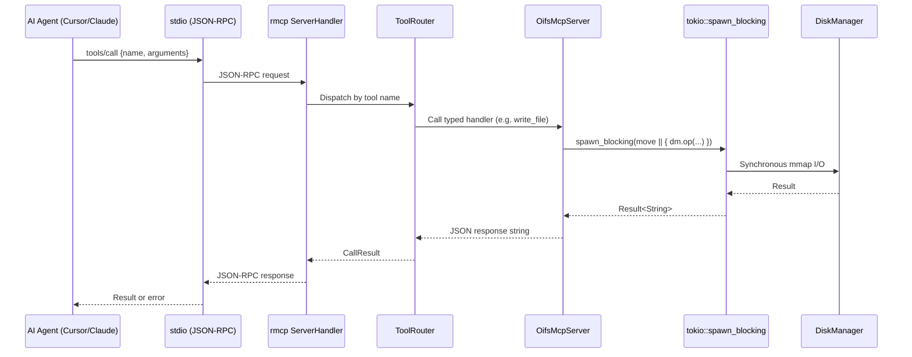

# MCP Integration Guide

This guide explains how to integrate AI agents and IDEs with the OIFS filesystem using the Model Context Protocol (MCP) server. The MCP server exposes OIFS as a set of tools that AI agents can use to read, write, and manage files within a sandboxed disk image.

## Running the MCP Server

The MCP server is provided as a standalone binary: `oifs_mcp`. It can be run directly with Cargo or installed via `cargo install`.

### Basic Usage

```bash
cargo run --bin oifs_mcp [IMAGE_PATH]
```

### Options

- `--size <MB>`: Set the initial size of the disk image when creating a new image (default: 10 MB).
- `-h, --help`: Show help message.

### Environment Variables

- `OIFS_PASSWORD`: If set, the disk image is opened (or created) as encrypted using this password. Required to open an existing encrypted image.

### Example

```bash
# Run with default image (agent_memory.img) and size (10 MB)
cargo run --bin oifs_mcp

# Run with custom image and size
cargo run --bin oifs_mcp -- --size 20 my_agent.img

# Run with encryption (requires OIFS_PASSWORD set)
OIFS_PASSWORD="secret" cargo run --bin oifs_mcp -- encrypted.img
```

The server communicates via stdio (standard input/output) and expects JSON-RPC 2.0 messages, making it compatible with any MCP client.

### Startup Behavior

1. **Image creation**: If the image file doesn't exist and `OIFS_PASSWORD` is set, `DiskManager::create_encrypted` is called. Otherwise `DiskManager::open_with_password` auto-creates a plain image.
2. **Size handling**: The `--size` value (megabytes) is multiplied by `1024 * 1024` with checked arithmetic to prevent silent overflow.
3. **Single image per process**: The CLI accepts exactly one positional image argument. All tools operate exclusively inside that image.
4. **Logging**: On startup the server logs to **stderr**: `[oifs-mcp] image=agent_memory.img size=10MB encrypted=false`.

### MCP Protocol Handshake

When an MCP client spawns the server, the following sequence occurs over stdio:

1. Client sends `initialize` request with protocol version and client info
2. Client sends `notifications/initialized` notification
3. Client calls `tools/list` to discover available tools
4. Subsequent `tools/call` invocations perform file operations

The server implements the MCP `ServerHandler` interface and advertises tool capabilities during initialization.

## Sandbox Isolation Model

Each `oifs_mcp` server instance operates on **exactly one disk image**. This creates a strong isolation boundary:

- **One image per server process** — All file operations are confined to the single `.img` file specified at startup.
- **No cross-image access** — An agent connected to one MCP server cannot access files in another agent's image.
- **Persistent state** — The disk image persists on disk. Reusing the same image path across sessions preserves agent memory.
- **Encryption per image** — When `OIFS_PASSWORD` is set, the entire image is encrypted with AES-256-XTS (with Argon2id key derivation). The same password must be provided to reopen it.

This model maps naturally to "one sandbox per agent session" or "one sandbox per project."

### Session Isolation for Multi-Tenant Use

The underlying `OifsSession` abstraction (in `src/session.rs`) provides three session modes that affect how multiple processes share an image:

| Mode | Transport | Use Case |
|------|-----------|----------|
| **Standalone** | Direct `mmap` — zero sockets, zero background threads | Single-process use (default for MCP server) |
| **Local IPC** | Unix Domain Socket in `/tmp` | Multi-process on the same machine |
| **Network** | TCP + rendezvous file (`.img.master`) | NFS/Lustre/shared storage, multi-node clusters |

The MCP server currently operates exclusively in **Standalone mode** (direct `mmap` access, zero IPC overhead). Each MCP server process gets its own `DiskManager` instance. For multi-tenant scenarios where multiple agents need isolated sandboxes, run separate `oifs_mcp` processes with different image paths. The process-wide session registry in `OifsSession` ensures that within a single process, multiple handles to the same canonicalized image path share one `DiskManager`.

**Authentication** for encrypted images is handled entirely via the `OIFS_PASSWORD` environment variable. The MCP server forwards this to `DiskManager`; it has no independent key-management logic. In IPC/Network modes, the Master process holds the encryption credentials and Proxies authenticate via a session secret or the password.

## Connecting from IDEs and AI Agents

The MCP server uses the **stdio transport** with **JSON-RPC 2.0**. Any MCP-compatible client can spawn the binary and communicate over stdin/stdout.

### Claude Desktop

1. Install Claude Desktop.
2. Open **Settings → Developer → MCP Servers**.
3. Click **Add New Server**.
4. Configure:

```json
{
  "name": "OIFS Memory Sandbox",
  "command": "cargo",
  "args": ["run", "--bin", "oifs_mcp", "--", "--size", "20", "agent_memory.img"],
  "env": {
    "OIFS_PASSWORD": "your-secret-password"
  }
}
```

### Cursor

1. Open Cursor Settings → MCP.
2. Add a new server with:

```json
{
  "name": "OIFS Memory",
  "command": "cargo",
  "args": ["run", "--bin", "oifs_mcp", "--", "--size", "50", "cursor_agent.img"]
}
```

For a release binary, replace `cargo run --bin oifs_mcp` with the full path to the compiled binary (e.g., `/path/to/target/release/oifs_mcp`).

### Custom Agent Loop

Any program that can spawn a subprocess and speak JSON-RPC 2.0 over stdio can drive the server. See `tests/mcp_server_test.rs` for a minimal working example of the initialize → tools/list → tools/call sequence.

## Available MCP Tools

The server registers **eight tools** via the `#[tool_router]` macro. Each tool clones the `DiskManager`, executes the operation inside `tokio::task::spawn_blocking` (to bridge async MCP runtime with synchronous mmap I/O), and returns a JSON string built with `serde_json` (never hand-rolled `format!`) to guarantee correct escaping.

### Tool Response Convention

- **Success**: `{"ok": true, ...}` with tool-specific fields.
- **Error**: `{"ok": false, "error": "..."}`.
- **Exceptions**: `read_file` returns raw UTF-8 content on success (not JSON-wrapped). `list_dir` returns **JSONL** (newline-delimited JSON objects), one per entry.

### write_file

Create or overwrite a file. Parent directories must already exist (no auto-mkdir).

```json
{
  "name": "write_file",
  "description": "Write (create or overwrite) a file inside the OIFS sandbox image. Parent directories must already exist.",
  "parameters": {
    "type": "object",
    "properties": {
      "path": { "type": "string", "description": "Path inside the OIFS image (e.g. \"notes/todo.txt\")" },
      "content": { "type": "string", "description": "UTF-8 content to write" }
    },
    "required": ["path", "content"]
  }
}
```

**Behavior**: Resolves parent directory via `resolve_parent`, creates file if missing via `create_file`, then writes content via `write_data_truncated` with `CompressionMode::Auto`.

**Success response**: `{"ok": true, "inode": <u64>, "bytes": <usize>}`

### read_file

Read a file's contents as UTF-8 text.

```json
{
  "name": "read_file",
  "description": "Read the contents of a file inside the OIFS sandbox image. Returns UTF-8 text content.",
  "parameters": {
    "type": "object",
    "properties": {
      "path": { "type": "string", "description": "Path inside the OIFS image (e.g. \"notes/todo.txt\")" }
    },
    "required": ["path"]
  }
}
```

**Behavior**: Resolves path via `resolve_path`, reads data via `read_data`, validates UTF-8.

**Success response**: Raw UTF-8 string content (not JSON).

**Error response**: JSON `{"ok": false, "error": "..."}`.

### list_dir

List files and directories at a given path. Returns JSONL.

```json
{
  "name": "list_dir",
  "description": "List files and directories at a given path inside the OIFS sandbox image. Returns one JSON object per line (JSONL).",
  "parameters": {
    "type": "object",
    "properties": {
      "path": { "type": "string", "description": "Path inside the OIFS image (e.g. \".\" for root, \"notes\" for a subdirectory)" }
    },
    "required": ["path"]
  }
}
```

**Behavior**: Resolves directory inode via `resolve_path`, reads entries via `list_dir`, reads each child inode for type and size.

**Success response**: JSONL lines, each `{"name": "...", "kind": "file|dir", "size": <u64>}`. Empty directory returns `{"entries":0}` (single JSON object, not JSONL).

**Error response**: JSON `{"ok": false, "error": "..."}`.

### mkdir

Create a directory. Parent directories must exist (no `mkdir -p` semantics).

```json
{
  "name": "mkdir",
  "description": "Create a directory inside the OIFS sandbox image. Parent directories must exist.",
  "parameters": {
    "type": "object",
    "properties": {
      "path": { "type": "string", "description": "Path of the new directory (e.g. \"notes/drafts\")" }
    },
    "required": ["path"]
  }
}
```

**Behavior**: Resolves parent via `resolve_parent`, creates directory via `create_directory`.

**Success response**: `{"ok": true, "inode": <u64>}`

### delete_file

Delete a file from the sandbox image.

```json
{
  "name": "delete_file",
  "description": "Delete a file from the OIFS sandbox image.",
  "parameters": {
    "type": "object",
    "properties": {
      "path": { "type": "string", "description": "Path of the file to delete (e.g. \"notes/old.txt\")" }
    },
    "required": ["path"]
  }
}
```

**Behavior**: Resolves parent via `resolve_parent`, deletes via `delete_file`.

**Success response**: `{"ok": true}`

### truncate_file

Truncate or extend a file to a specific byte size.

```json
{
  "name": "truncate_file",
  "description": "Truncate or extend a file in the OIFS sandbox image to the specified size in bytes.",
  "parameters": {
    "type": "object",
    "properties": {
      "path": { "type": "string", "description": "Path inside the OIFS image (e.g. \"notes/todo.txt\")" },
      "size": { "type": "integer", "description": "Target file size in bytes" }
    },
    "required": ["path", "size"]
  }
}
```

**Behavior**: Truncates via `truncate_path`.

**Success response**: `{"ok": true, "size": <u64>}`

### append_file

Append a line to a file (creates file if missing). Auto-adds trailing newline. Ideal for JSONL memory logs.

```json
{
  "name": "append_file",
  "description": "Append a line to a file inside the OIFS sandbox image. Creates the file if it does not exist. Ideal for JSONL memory logs.",
  "parameters": {
    "type": "object",
    "properties": {
      "path": { "type": "string", "description": "Path inside the OIFS image (e.g. \"logs/memory.jsonl\")" },
      "content": { "type": "string", "description": "UTF-8 content to append (a newline is auto-added if missing)" }
    },
    "required": ["path", "content"]
  }
}
```

**Behavior**: Acquires process-wide `append_lock` (`Arc<Mutex<()>>`) to serialize concurrent appends. Resolves parent via `resolve_parent`, creates file if missing via `create_file`, then appends via `write_data` at current file size with `CompressionMode::Never`. Ensures trailing newline.

**Success response**: `{"ok": true, "inode": <u64>, "total_bytes": <u64>}`

### status

Show filesystem status: image path, total/used/free blocks, and fragmentation ratio.

```json
{
  "name": "status",
  "description": "Show filesystem status: image path, total/used/free blocks, and fragmentation ratio.",
  "parameters": { "type": "object", "properties": {} }
}
```

**Behavior**: Calls `analyze_fragmentation`.

**Success response**: `{"image": "...", "total_blocks": <u64>, "used_blocks": <u64>, "free_blocks": <u64>, "fragmentation": <f64>}`

## MCP Tool Invocation Flow



## What the MCP Server Does NOT Expose

- **No MCP resources**: The server does not implement `resources/list`, `resources/read`, or resource templates. All filesystem access is mediated exclusively through the eight registered tools.
- **No prompts**: No prompt templates are registered.
- **No sampling**: No `sampling/createMessage` support.
- **No cross-process session sharing**: Each `oifs_mcp` process has its own independent `DiskManager` handle. For shared access across processes, use the IPC/daemon path (`src/ipc.rs`) or FUSE mount (`src/fuse.rs`) instead.

## Testing and Validation

The MCP server is validated by `tests/mcp_server_test.rs`, which exercises:

- CLI help and argument parsing
- JSON-RPC initialize handshake and `tools/list` discovery
- Tool invocation with hostile file names (quotes, backslashes, control characters) to verify `serde_json` escaping
- Response validation ensuring all tool outputs are valid JSON

Run the tests with:

```bash
cargo test --features mcp mcp_server_test
```

## Related Pages

- [MCP Server Architecture](../architecture/mcp_server.md) — Internal architecture, DiskManager integration, and tool implementation details.
- [MCP Workflow](../workflows/mcp_workflow.md) — End-to-end agent memory workflows using the MCP server.
- [CLI Reference](../operations/cli_reference.md) — Full CLI options for `oifs_mcp` and other binaries.
