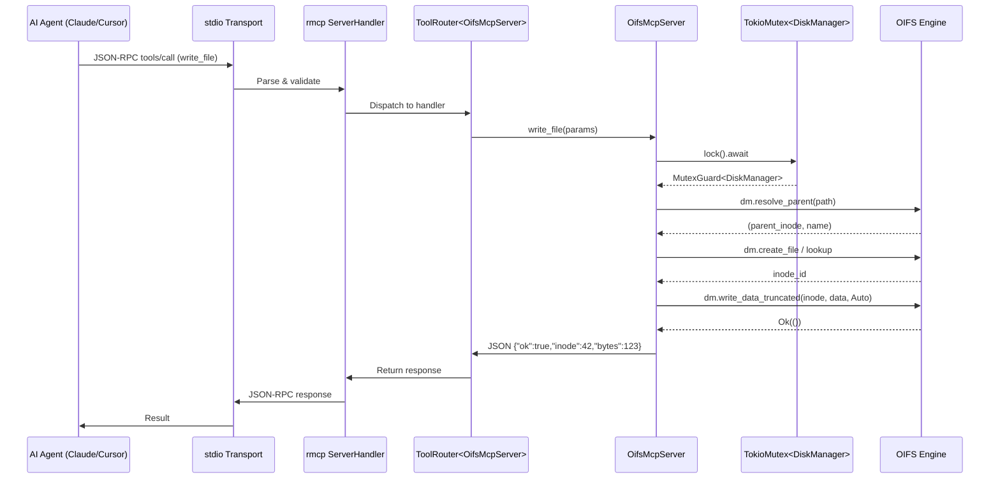

# MCP Integration Guide

This guide explains how to integrate AI agents and IDEs with the OIFS filesystem using the Model Context Protocol (MCP) server. The MCP server exposes OIFS as a set of tools that AI agents can use to read, write, and manage files within a sandboxed disk image.

## Running the MCP Server

The MCP server is provided as a standalone binary: `oifs_mcp`. It can be run directly with Cargo or installed via `cargo install`.

### Basic Usage

```bash
cargo run --bin oifs_mcp [IMAGE_PATH]
```

### Options

- `--size <MB>`: Set the initial size of the disk image when creating a new image (default: 10 MB).
- `-h, --help`: Show help message.

### Environment Variables

- `OIFS_PASSWORD`: If set, the disk image is opened (or created) as encrypted using this password. Required to open an existing encrypted image.

### Example

```bash
# Run with default image (agent_memory.img) and size (10 MB)
cargo run --bin oifs_mcp

# Run with custom image and size
cargo run --bin oifs_mcp -- --size 20 my_agent.img

# Run with encryption (requires OIFS_PASSWORD set)
OIFS_PASSWORD="secret" cargo run --bin oifs_mcp -- encrypted.img
```

The server communicates via stdio (standard input/output) and expects JSON-RPC 2.0 messages, making it compatible with any MCP client.

### Startup Behavior

1. **Image creation**: If the image file doesn't exist and `OIFS_PASSWORD` is set, `DiskManager::create_encrypted` is called. Otherwise `DiskManager::open_with_password` auto-creates a plain image.
2. **Size handling**: The `--size` value (megabytes) is multiplied by `1024 * 1024` with checked arithmetic to prevent silent overflow.
3. **Single image per process**: The CLI accepts exactly one positional image argument. All tools operate exclusively inside that image.
4. **Logging**: On startup the server logs to **stderr**: `[oifs-mcp] image=agent_memory.img size=10MB encrypted=false`.

## Sandbox Isolation Model

Each `oifs_mcp` server instance operates on **exactly one disk image**. This creates a strong isolation boundary:

- **One image per server process** — All file operations are confined to the single `.img` file specified at startup.
- **No cross-image access** — An agent connected to one MCP server cannot access files in another agent's image.
- **Persistent state** — The disk image persists on disk. Reusing the same image path across sessions preserves agent memory.
- **Encryption per image** — When `OIFS_PASSWORD` is set, the entire image is encrypted with AES-256-XTS (with Argon2id key derivation). The same password must be provided to reopen it.

This model maps naturally to "one sandbox per agent session" or "one sandbox per project."

### Session Isolation for Multi-Tenant Use

The underlying `OifsSession` abstraction (in `src/session.rs`) provides three session modes that affect how multiple processes share an image:

| Mode | Transport | Use Case |
|------|-----------|----------|
| **Standalone** | Direct `mmap` — zero sockets, zero background threads | Single-process use (default for MCP server) |
| **Local IPC** | Unix Domain Socket in `/tmp` | Multi-process on the same machine |
| **Network** | TCP + rendezvous file (`.img.master`) | NFS/Lustre/shared storage, multi-node clusters |

The MCP server currently operates exclusively in **Standalone mode** (direct `mmap` access, zero IPC overhead). Each MCP server process gets its own `DiskManager` instance. For multi-tenant scenarios where multiple agents need isolated sandboxes, run separate `oifs_mcp` processes with different image paths. The process-wide session registry in `OifsSession` ensures that within a single process, multiple handles to the same canonicalized image path share one `DiskManager`.

**Authentication** for encrypted images is handled entirely via the `OIFS_PASSWORD` environment variable. The MCP server forwards this to `DiskManager`; it has no independent key-management logic. In IPC/Network modes, the Master process holds the encryption credentials and Proxies authenticate via a session secret or the password.

## Connecting from IDEs and AI Agents

The MCP server uses the **stdio transport** with **JSON-RPC 2.0**. Any MCP-compatible client can spawn the binary and communicate over stdin/stdout.

### Claude Desktop

1. Install Claude Desktop.
2. Open **Settings → Developer → MCP Servers**.
3. Click **Add New Server**.
4. Configure:

   ```json
   {
     "name": "OIFS Memory Sandbox",
     "command": "cargo",
     "args": ["run", "--bin", "oifs_mcp", "--", "agent_memory.img"],
     "env": {
       "OIFS_PASSWORD": "your-encryption-password"
     }
   }
   ```

   - Use the full path to `cargo` if it's not on the system PATH (e.g., `/home/user/.cargo/bin/cargo`).
   - Omit `env.OIFS_PASSWORD` if you don't need encryption.
   - Replace `agent_memory.img` with your desired image path (relative to the working directory or absolute).

5. Save and restart Claude Desktop.

### Cursor

1. Install Cursor.
2. Open **Settings → MCP Servers** (or `Ctrl+Shift+P` → "MCP: Open Configuration").
3. Add a new server entry in `mcp.json`:

   ```json
   {
     "mcpServers": {
       "oifs-memory": {
         "command": "cargo",
         "args": ["run", "--bin", "oifs_mcp", "--", "agent_memory.img"],
         "env": {
           "OIFS_PASSWORD": "your-encryption-password"
         }
       }
     }
   }
   ```

4. Restart Cursor or reload the MCP configuration.

### Using a Pre-built Binary

For production use, build the release binary and reference it directly:

```bash
cargo build --release --bin oifs_mcp
```

Then use the absolute path to `target/release/oifs_mcp` in the client configuration instead of `cargo run`.

## Available MCP Tools

The server registers eight tools via the `#[tool_router]` macro. Every tool acquires `self.dm.lock().await` (a `TokioMutex<DiskManager>`), executes the operation, and returns a **JSON string** built with `serde_json` (never hand-rolled `format!`) to guarantee correct escaping of quotes, backslashes, and control characters.

### Response Convention

- **Success**: `{"ok": true, ...}` with tool-specific fields.
- **Failure**: `{"ok": false, "error": "..."}` — a single JSON object with a human-readable error message.

### Tool Reference

#### `write_file`

Creates or overwrites a file. Parent directories must already exist.

```json
{
  "name": "write_file",
  "description": "Write (create or overwrite) a file inside the OIFS sandbox image. Parent directories must already exist.",
  "parameters": {
    "type": "object",
    "properties": {
      "path": { "type": "string", "description": "Path inside the OIFS image (e.g. \"notes/todo.txt\")" },
      "content": { "type": "string", "description": "UTF-8 content to write" }
    },
    "required": ["path", "content"]
  }
}
```

**Behavior**: Resolves parent directory via `DiskManager::resolve_parent`, creates file if missing via `create_file`, writes content with `CompressionMode::Auto`. Returns `inode` ID and `bytes` written.

#### `read_file`

Reads a file's contents as UTF-8 text.

```json
{
  "name": "read_file",
  "description": "Read the contents of a file inside the OIFS sandbox image. Returns UTF-8 text content.",
  "parameters": {
    "type": "object",
    "properties": {
      "path": { "type": "string", "description": "Path inside the OIFS image (e.g. \"notes/todo.txt\")" }
    },
    "required": ["path"]
  }
}
```

**Behavior**: Resolves path to inode via `DiskManager::resolve_path`, reads data, validates UTF-8. Returns raw file content (not JSON-wrapped) on success.

#### `list_dir`

Lists entries at a path. Emits **JSON Lines (JSONL)** — one JSON object per line.

```json
{
  "name": "list_dir",
  "description": "List files and directories at a given path inside the OIFS sandbox image. Returns one JSON object per line (JSONL).",
  "parameters": {
    "type": "object",
    "properties": {
      "path": { "type": "string", "description": "Path inside the OIFS image (e.g. \".\" for root, \"notes\" for a subdirectory)" }
    },
    "required": ["path"]
  }
}
```

**Behavior**: Resolves path to directory inode, lists entries. Each line: `{"name": "...", "kind": "file|dir", "size": N}`. Empty directory returns `{"entries":0}`.

#### `mkdir`

Creates a directory. Parent directories must exist (no `mkdir -p` semantics).

```json
{
  "name": "mkdir",
  "description": "Create a directory inside the OIFS sandbox image. Parent directories must exist.",
  "parameters": {
    "type": "object",
    "properties": {
      "path": { "type": "string", "description": "Path of the new directory (e.g. \"notes/drafts\")" }
    },
    "required": ["path"]
  }
}
```

**Behavior**: Resolves parent directory, creates new directory inode. Returns `inode` ID.

#### `delete_file`

Deletes a file.

```json
{
  "name": "delete_file",
  "description": "Delete a file from the OIFS sandbox image.",
  "parameters": {
    "type": "object",
    "properties": {
      "path": { "type": "string", "description": "Path of the file to delete (e.g. \"notes/old.txt\")" }
    },
    "required": ["path"]
  }
}
```

**Behavior**: Resolves parent directory, removes file entry. Returns `{"ok": true}`.

#### `truncate_file`

Truncates or extends a file to a specific byte size.

```json
{
  "name": "truncate_file",
  "description": "Truncate or extend a file in the OIFS sandbox image to the specified size in bytes.",
  "parameters": {
    "type": "object",
    "properties": {
      "path": { "type": "string", "description": "Path inside the OIFS image (e.g. \"notes/todo.txt\")" },
      "size": { "type": "integer", "description": "Target file size in bytes" }
    },
    "required": ["path", "size"]
  }
}
```

**Behavior**: Resolves path, truncates/extends file to exact byte size. Returns `size`.

#### `append_file`

Appends a line to a file (creates file if missing). Auto-adds trailing newline. Ideal for **JSONL memory logs**.

```json
{
  "name": "append_file",
  "description": "Append a line to a file inside the OIFS sandbox image. Creates the file if it does not exist. Ideal for JSONL memory logs.",
  "parameters": {
    "type": "object",
    "properties": {
      "path": { "type": "string", "description": "Path inside the OIFS image (e.g. \"logs/memory.jsonl\")" },
      "content": { "type": "string", "description": "UTF-8 content to append (a newline is auto-added if missing)" }
    },
    "required": ["path", "content"]
  }
}
```

**Behavior**: Resolves parent, creates file if missing, reads existing content, appends new content + newline, writes back with `CompressionMode::Never` (critical for append-only logs). Returns `inode` and `total_bytes`.

#### `status`

Shows filesystem statistics.

```json
{
  "name": "status",
  "description": "Show filesystem status: image path, total/used/free blocks, and fragmentation ratio.",
  "parameters": { "type": "object", "properties": {} }
}
```

**Behavior**: Runs `DiskManager::analyze_fragmentation()`. Returns `image`, `total_blocks`, `used_blocks`, `free_blocks`, `fragmentation` ratio.

## Tool Invocation Flow



## Sandboxing Patterns

### Read-Only Mounts

While the MCP server itself does not expose a read-only mode, you can achieve read-only access by:

1. Creating the image with the desired content using a separate process.
2. Setting the image file permissions to read-only at the OS level (`chmod 444 agent_memory.img`).
3. Running the MCP server without `OIFS_PASSWORD` (for plain images) or with the password (for encrypted images).

The server will fail on write operations if the underlying file is not writable.

### Encrypted Images

Encryption is the primary sandboxing mechanism for sensitive agent memory:

```bash
# Create new encrypted image
OIFS_PASSWORD="strong-passphrase" cargo run --bin oifs_mcp -- secure_agent.img

# Reopen existing encrypted image (same password required)
OIFS_PASSWORD="strong-passphrase" cargo run --bin oifs_mcp -- secure_agent.img
```

- **Algorithm**: AES-256-XTS with Argon2id key derivation (see `src/encryption.rs`).
- **Scope**: Entire image is encrypted. No partial encryption.
- **Key management**: Password is never stored; derived on each open. The `OIFS_PASSWORD` environment variable is the only input.
- **Multi-tenant**: Each agent gets its own encrypted image with a unique password.

### Process Isolation

Because each `oifs_mcp` process operates on a single image file:

- **No cross-contamination**: Agent A's writes cannot affect Agent B's image.
- **Crash isolation**: A crash in one MCP server process does not affect others.
- **Resource limits**: Apply OS-level limits (cgroups, `ulimit`) per process.

## Path Resolution and Conventions

- **All paths are relative to the image root**: Paths like `"notes/todo.txt"` or `"."` are resolved by `DiskManager::resolve_path` starting from the root inode (inode 1).
- **No "current working directory"**: Every path is absolute within the sandbox.
- **Parent directories must exist**: `write_file`, `mkdir`, and `append_file` use `resolve_parent` to locate the parent directory inode, then create the child. They do **not** auto-create intermediate directories. The agent must create the directory hierarchy first with `mkdir` calls.
- **Case sensitivity**: Paths are case-sensitive (matches the underlying filesystem semantics).

## Testing and Verification

The test suite (`tests/mcp_server_test.rs`) verifies:

1. **CLI argument parsing** — Help output, invalid size handling.
2. **MCP handshake** — `initialize`, `notifications/initialized`, `tools/list` sequence.
3. **JSON escaping** — Tool responses remain valid JSON even when file names or error messages contain quotes, backslashes, or control characters.
4. **Tool execution** — End-to-end file operations via JSON-RPC.

Run tests with:

```bash
cargo test --test mcp_server_test
```

## Troubleshooting

### Server Fails to Start

- **Image locked by another process**: Ensure no other `oifs_mcp` or `oifs` process is using the same image.
- **Invalid password for encrypted image**: Verify `OIFS_PASSWORD` matches the one used at creation.
- **Size overflow**: The `--size` value must not exceed what fits in a `u64` after multiplying by `1024*1024`.

### Tools Return Errors

- `"Parent directory does not exist"`: Create parent directories with `mkdir` first.
- `"File contains non-UTF-8 data"`: `read_file` only supports UTF-8. Use the CLI for binary data.
- `"Not a directory"`: `list_dir` requires a directory path.

### Client Connection Issues

- **Claude Desktop**: Check `~/Library/Logs/Claude/mcp.log` (macOS) or `%APPDATA%\Claude\logs\mcp.log` (Windows) for spawn errors.
- **Cursor**: Open Developer Tools (View → Developer Tools) and check the console for MCP connection logs.
- **Binary not found**: Use absolute path to `oifs_mcp` binary in configuration.

## Related Documentation

- [MCP Server Architecture](../architecture/mcp_server.md) — Internal architecture, tool router, DiskManager integration.
- [Quickstart](../quickstart.md) — Build instructions, session modes, basic CLI usage.
- [MCP Workflow](../workflows/mcp_workflow.md) — End-to-end workflow examples and tool usage patterns.
