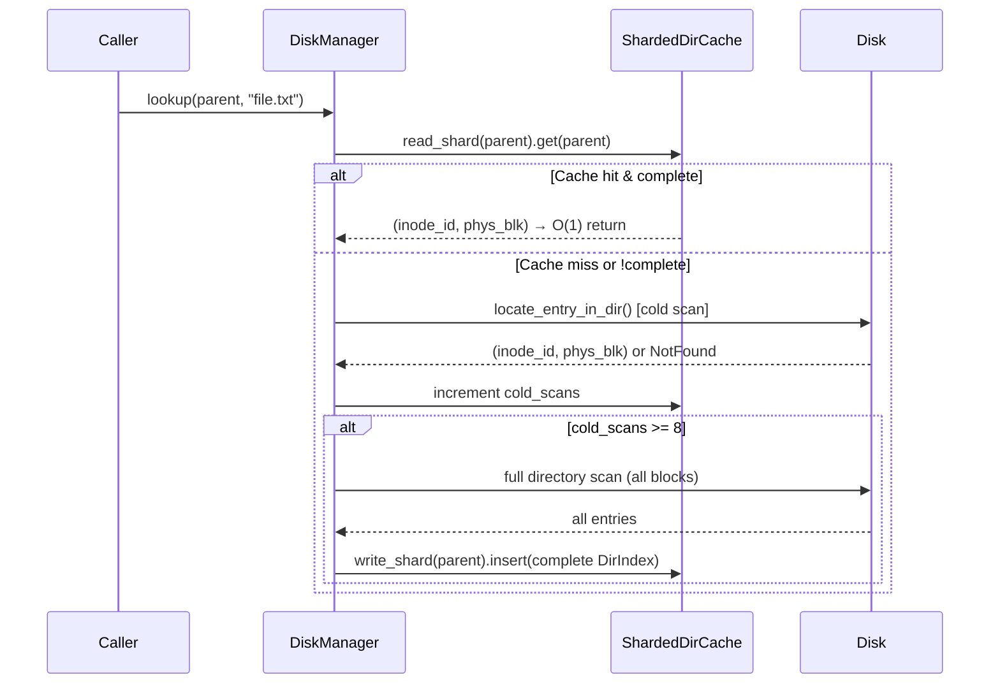
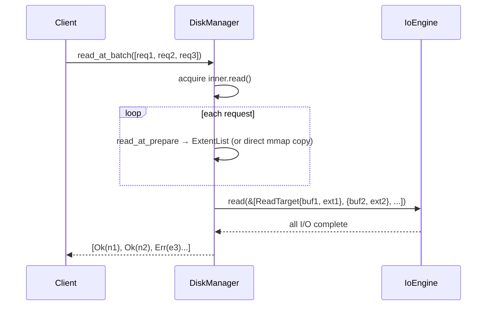
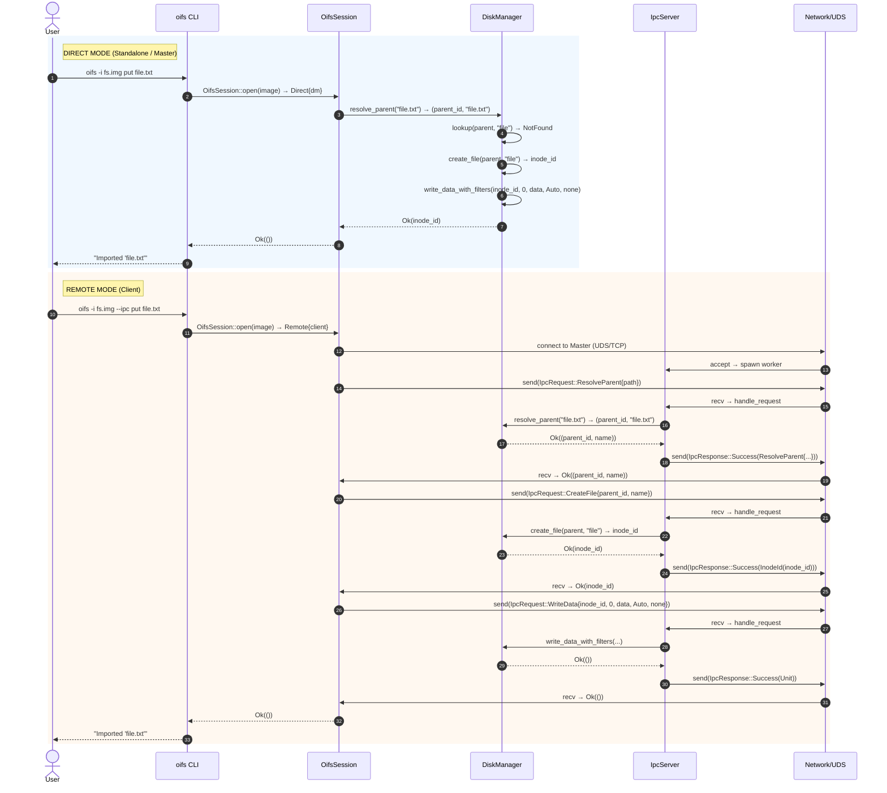

# Basic File/Directory Operations

This guide documents the end-to-end flows for core filesystem operations in OIFS, covering both **Direct** mode (single-process `DiskManager` with `mmap`) and **Remote** mode (transparent IPC proxy to a Master process). The same high-level API is provided by `OifsSession`; the implementation path is selected at session creation time.

> **Related pages:** [Concurrency & Session](../architecture/concurrency_and_session.md), [Disk Manager & Persistence](../architecture/disk_manager_and_persistence.md), [Inode & Directory](../architecture/inode_and_directory.md), [CLI Reference](../operations/cli_reference.md)

---

## Session Modes

| Mode | Entry Point | Transport | Use Case |
|------|-------------|-----------|----------|
| **Standalone** | `OifsSession::open` / `oifs` CLI without `--ipc`/`--network` | None (direct `mmap`) | Single process, zero overhead |
| **Local (Master)** | `OifsSession::open_local` / `oifs --ipc` | Unix Domain Socket (`/tmp/oifs-<hash>.sock`) | Multi-process on same host |
| **Network (Master)** | `OifsSession::open_network` / `oifs --network` | TCP via rendezvous file (`.<image>.master`) | Multi-node / NFS / Lustre clusters |
| **Remote (Client)** | Same entry points; auto-detects existing Master | UDS or TCP | Additional processes attaching to an already-open image |

`OifsSession` is an enum (`Direct { dm, server?, … }` | `Remote { client, … }`) that implements the full operation set by delegating either to the local `Arc<DiskManager>` or by sending framed `IpcRequest` messages to the Master.

---

## Directory Index Caching (`DirIndex` Promotion on Cold Scans)

OIFS maintains a **sharded, thread-safe directory index cache** (`ShardedDirCache`) that maps `dir_inode_id → DirIndex`. Each `DirIndex` stores:

| Field | Purpose |
|-------|---------|
| `complete: bool` | `true` once every on-disk entry is present in `stored` (and `plain` on encrypted FS). When `complete`, **hits and misses are O(1)**. |
| `plain_complete: bool` | `true` when plaintext map covers all stored entries (encrypted FS only). |
| `cold_scans: u32` | Count of targeted scans that missed the cache. After `DIR_INDEX_BUILD_AFTER_SCANS` (8) cold scans, a **full directory scan promotes the index to `complete`**. |
| `may_have_holes: bool` | Set when deletions create free space in earlier blocks; affects `create_file` tail-block fast path. |
| `tail_offset: Option<(phys_blk, next_insert_off)>` | Cached location for appending new entries without re-scanning. |
| `stored: FxHashMap<String, (inode_id, phys_blk, stored_hash)>` | On-disk name → location. Ciphertext on encrypted FS. |
| `plain: FxHashMap<String, (inode_id, plain_hash)>` | Plaintext name → location (encrypted FS only; avoids re-encryption on lookup). |

### Promotion Flow



- **Positive lookups** are cached immediately.
- **Negative lookups** (NotFound) also trigger promotion after the first scan, because the scan already paid the cost.
- `list_dir` promotes the index to `complete` on the first call if it isn't already.
- `create_file` / `delete_file` invalidate the parent's cache (`may_have_holes`, `tail_offset`, `stored`/`plain` entries) and remove the target's own index (its inode may be reused).

---

## Write Data Decision Tree

`DiskManager::write_data_with_filters` selects one of four **write cases** based on file state and write parameters. The decision is made **during a read-lock inspection (Stage 1)**, then CPU-heavy filtering/compression/encryption runs **lock-free (Stage 2)**, and finally an exclusive lock commits blocks and metadata (Stage 3).

### WriteCase Enum

```rust
enum WriteCase {
    FullOverwrite,      // Replace entire payload from offset 0
    CompressedAppend,   // Append a fresh Zstd frame to a compressed stream
    Recompress,         // Read-modify-rebuild: decode, splice, re-encode from 0
    Raw,                // Direct memcpy into existing/allocated blocks
}
```

### Decision Logic (simplified from `plan_write_prepared`)

<!-- openwiki: mermaid parse failed and this diagram was converted to a text fence so it does not break rendering. Fix the diagram source and restore the mermaid fence. Parser error: Parse error on line 2: ...te_data_with_filters(inode_id, offset, d Expecting 'SQE', 'DOUBLECIRCLEEND', 'PE', '-)', 'STADIUMEND', 'SUBROUTINEEND', 'PIPE', 'CYLINDEREND', 'DIAMOND_STOP', 'TAGEND', 'TRAPEND', 'INVTRAPEND', 'UNICODE_TEXT', 'TEXT', 'TAGSTART', got 'PS' -->
```text
flowchart TD
    A[write_data_with_filters(inode_id, offset, data, mode, filter)] --> B{is_full_overwrite?}
    B -->|offset==0 AND (size==0 OR data.len>=size OR transformed)| C[FullOverwrite]
    B -->|NO| D{transformed?}
    D -->|compressed OR encrypted OR filtered| E{may_append_zstd_frame?}
    E -->|offset==size AND unencrypted AND no filter| F[CompressedAppend]
    E -->|otherwise| G[Recompress]
    D -->|plain uncompressed| H[Raw]
```

#### Case Details

| Case | When | Behavior |
|------|------|----------|
| **FullOverwrite** | `offset == 0` and (empty file, new data ≥ old size, or payload is transformed) | Build new payload (filter → compress → encrypt) from `data`; free all old blocks; write new blocks from 0. |
| **CompressedAppend** | Appending at EOF (`offset == size`) to a **compressed, unencrypted, unfiltered** file with reasonable frame overhead (`compressed_size ≤ size + size/4 + 4KB`) | Compress `data` as independent Zstd frame; append to physical stream; **no decompression of existing data**. |
| **Recompress** | Transformed file (compressed/encrypted/filtered) but not eligible for `CompressedAppend` | Read full decoded content (via `read_data_internal`), splice `data` at `offset`, rebuild full payload (filter → compress → encrypt), rewrite from 0. |
| **Raw** | Uncompressed, unencrypted, unfiltered file | Direct `memcpy` into existing/allocated blocks (sparse holes zero-filled). Borrows caller's slice (`Cow::Borrowed`). |

> **Key invariant:** A transformed payload (compressed, encrypted, or filtered) is **always a single contiguous blob covering the entire logical file**. It can never be patched in-place — any write that isn't a pure raw append must rebuild the whole payload (`Recompress` or `FullOverwrite`).

---

## Read Operations

### `read_data(inode_id) → Vec<u8>`

Returns the **fully decoded** file contents (decrypted, decompressed, unfiltered). Used by `get`, `append`, `truncate` on transformed files, and internal rebuild paths.

**Fast paths:**
- **Zero-copy mmap** for unencrypted, compressed, contiguous files on `IoBackend::Mmap` (memcpy single slice → Zstd decompress in-place).
- **Decoded blob cache** (≤ 16 MiB): caches fully decoded content keyed by `(inode_id, inode_version)`. Subsequent `read_at` on the same file hit the cache instead of full-file decode.

### `read_at(inode_id, file_offset, buf) → usize`

Positional read into caller-provided buffer. **Coalesces physically contiguous block runs** into extents.

<!-- openwiki: mermaid parse failed and this diagram was converted to a text fence so it does not break rendering. Fix the diagram source and restore the mermaid fence. Parser error: Parse error on line 5: ...-> E[io_engine.read(ReadTarget{buf, ext Expecting 'SQE', 'DOUBLECIRCLEEND', 'PE', '-)', 'STADIUMEND', 'SUBROUTINEEND', 'PIPE', 'CYLINDEREND', 'DIAMOND_STOP', 'TAGEND', 'TRAPEND', 'INVTRAPEND', 'UNICODE_TEXT', 'TEXT', 'TAGSTART', got 'PS' -->
```text
flowchart LR
    A[read_at] --> B{IoBackend?}
    B -->|Mmap| C[walk_payload_blocks → memcpy from mmap]
    B -->|Pread/IoUring| D[walk_payload_blocks → build ExtentList]
    D --> E[io_engine.read(ReadTarget{buf, extents})]
```

- For **transformed files** (compressed/encrypted): falls back to decoded blob cache (≤ 16 MiB) or full `read_data_internal` decode.
- For **seekable 64K chunked files**: decompresses only the affected 64 KiB chunks.
- Sparse holes are zero-filled immediately.

### `read_at_batch(requests: &mut [ReadRequest]) → Vec<Result<usize, Error>>`

**Batched positional reads under a single read lock.** Critical for `IoBackend::IoUring`: all extents from all requests are submitted in **one ring submission**, letting the device reorder and execute them concurrently.



- Compressed/encrypted requests are decoded individually (cannot be batched at payload level).
- If the batched engine call fails, **all requests that depended on it** receive the same I/O error.

---

## Operation Reference

All operations are methods on `OifsSession` (and `DiskManager`). The table shows the Direct implementation; Remote mode sends the corresponding `IpcRequest` and awaits `IpcResponseData`.

| Operation | Direct Path (`DiskManager`) | Remote IPC Request | Key Behaviors |
|-----------|-----------------------------|---------------------|---------------|
| **create_file(parent, name)** | `create_entry_internal(parent, name, File)` | `CreateFile { parent_inode_id, name }` | Validates name; allocates inode + 0 blocks; inserts dir entry; updates parent mtime. |
| **create_directory(parent, name)** | `create_entry_internal(parent, name, Directory)` | `CreateDirectory { parent_inode_id, name }` | Allocates inode; initializes empty dir block; inserts dir entry. |
| **lookup(parent, name)** | `dir_lookup` (uses `DirIndex` cache) | `Lookup { parent_inode_id, name }` | O(1) when cache `complete`; otherwise cold scan + cache promotion. |
| **open_file(parent, name, mode)** | Dispatches to `lookup` / `create_file` / `create_or_open_file` | Same as above per mode | `OpenExisting`/`CreateNew`/`CreateOrOpen` (POSIX-like). |
| **read_data(inode_id)** | `read_data_internal` (full decode) | `ReadData { inode_id }` | Returns decoded `Vec<u8>`; uses blob cache for transformed files. |
| **read_at(inode_id, offset, buf)** | `read_at_prepare` + `io_engine.read` | `ReadAt { inode_id, file_offset, len }` | Coalesced extents; sparse holes zeroed; chunked for 64K seekable. |
| **read_at_batch(requests)** | Single lock, single engine submission | N/A (batched locally on Master) | See batch flow above. |
| **write_data(inode_id, offset, data, mode)** | `write_data_with_filters(..., FilterConfig::none())` | `WriteData { inode_id, file_offset, data, compression_mode, filter_config }` | Three-stage pipeline (inspect → CPU → commit). |
| **write_data_with_filters(...)** | Full pipeline with custom `FilterConfig` | Same | Delta/shuffle/bitshuffle pre-filters + Zstd + XChaCha20-Poly1305. |
| **truncate(inode_id, new_size)** | `truncate_internal` (cases: chunked, transformed, raw expand/shrink) | `Truncate { inode_id, new_size }` | Shrinks: frees blocks + zeroes slack. Expands: sparse (raw) or zero-padded (transformed). |
| **delete_file(parent, name)** | Two-stage: read-lock resolve → write-lock commit (WAL or in-place) | `DeleteFile { parent_inode_id, name }` | Validates non-empty dir; compacts dir block; frees inode + blocks; invalidates caches. |
| **list_dir(dir_inode_id)** | Returns `DirIndex` entries if `complete`; else scans blocks + promotes | `ListDir { dir_inode_id }` | Decrypts filenames on encrypted FS; promotes cache to `complete`. |
| **resolve_path(path)** | Iterative `lookup` from root | `ResolvePath { path }` | Splits on `/`; validates each component. |
| **resolve_parent(path)** | `resolve_path` on parent component | `ResolveParent { path }` | Returns `(parent_inode_id, filename)`. |
| **flush()** | `sync_mutation_ranges` (range-based) or full `msync`; drains WAL | `Flush` | Single-flusher mutex; snapshots journal head before flush; reclaims WAL up to snapshot. |

---

## Mermaid Sequence: `create_file` (Direct vs Remote)



---

## Error Handling & Invariants

| Invariant | Enforced By |
|-----------|-------------|
| **No partial payload on crash** | Journaled images: payload staged in free blocks → `msync` payload → commit metadata transaction → apply. Non-journaled: range-based `msync` on bitmap + inode + data blocks. |
| **Transformed payload = whole file** | `payload_is_transformed` check in `plan_write_prepared`; any write to compressed/encrypted/filtered file takes `FullOverwrite` or `Recompress` path. |
| **Directory index consistency** | `create_file`/`delete_file` invalidate parent cache (`may_have_holes`, `tail_offset`, remove `stored`/`plain` entry) and `dir_cache.remove(target_inode_id)`. |
| **Encrypted FS: no plaintext injection** | `read_data_internal` / `read_at_with_inode` reject non-empty file with `!inode.encrypted` on encrypted superblock. |
| **Inode ID bounds** | `inode_slot_range` validates `inode_id < usable_inode_count` before any slot access. |
| **Single flusher** | `sync_mutex` ensures only one `flush()` runs `msync` at a time. |

---

## Example Workflow (CLI)

```bash
# 1. Create encrypted image (Master starts automatically with --ipc)
oifs -i project.img create --size 20 --encrypt --ipc

# 2. In another terminal, attach as client (auto-detects Master)
oifs -i project.img --ipc mkdir src docs

# 3. Import with auto filter selection
oifs -i project.img --ipc put --filter auto ./data.bin src/data.bin

# 4. Positional read (uses read_at_batch internally for parallel cold reads)
oifs -i project.img --ipc get src/data.bin /tmp/out.bin

# 5. Append to compressed file (CompressedAppend fast path)
oifs -i project.img --ipc append src/data.bin "extra"

# 6. Defragment & verify
oifs -i project.img --ipc defrag
oifs -i project.img --ipc fsck
```

---

*This workflow covers the core responsibilities, data/control flow, and invariants for basic file/directory operations. For advanced features (filter analysis, migration, background auto-defrag), see the CLI reference and architecture pages.*
