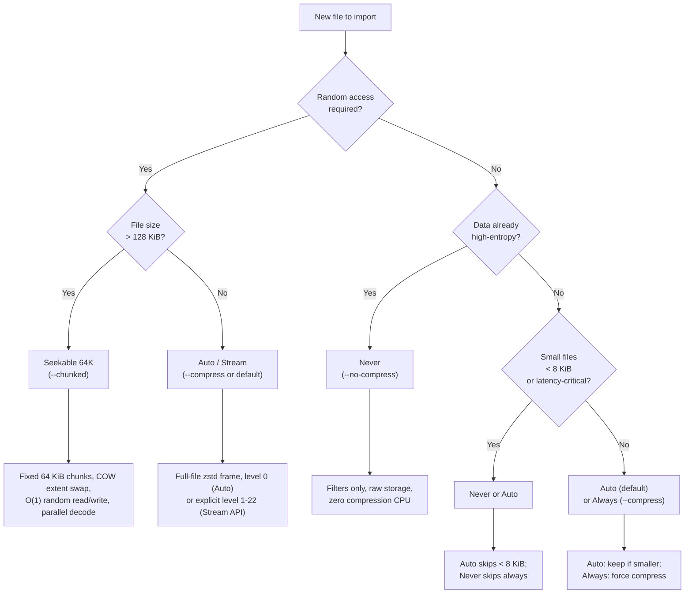
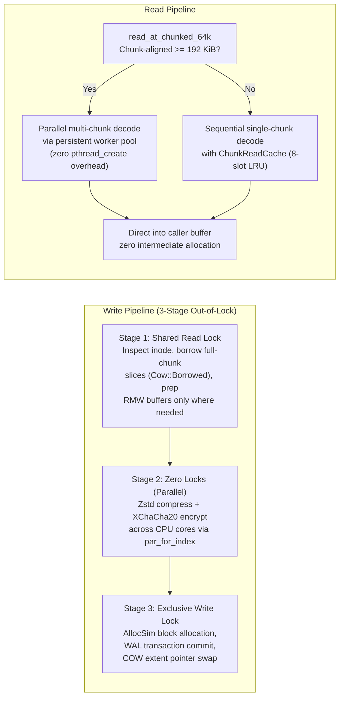

# Compression Workflows

OIFS integrates **zstd** compression with **Blosc2-style pre-compression filters** to achieve optimal space savings for diverse data patterns. The system supports **five compression modes**, a **flexible filter pipeline**, a **persistent scoped worker pool** for parallel chunk (de)compression, and two **read-acceleration caches** (`DecodedBlobCache` for stream files, `ChunkReadCache` for seekable chunked files).

This guide covers:
- Compression mode selection and CLI usage
- Filter pipeline design and the `filter-analyze` recommendation tool
- Read-path cache interaction (`read_at` fast paths)
- Decision flowchart: file size + access pattern → compression mode + filters
- Numerical data patterns: delta, shuffle, bitshuffle for telemetry/ML
- Zstd level tuning and context pool sizing

---

## Compression Modes

Compression mode determines **when** and **how** zstd compression is applied during write operations. The mode is stored in the inode metadata and automatically honored on read.

| Mode | CLI Flag | Internal Variant | Behavior | Typical Use Case |
|------|----------|------------------|----------|------------------|
| **Auto** (default) | *(none)* | `Auto` | Compress only when filtered data ≥ 8 KiB **and** compressed result is strictly smaller. | General-purpose cold/warm storage |
| **Always** | `--compress` | `Always` | Force zstd compression regardless of size or ratio (stream mode, level 0). | Archival / cold storage where CPU is available |
| **Never** | `--no-compress` | `Never` | Store raw bytes; filters still run but output is kept uncompressed. | High-entropy data (already compressed, encrypted) or latency-critical writes |
| **Stream** | *(API only)* | `Stream { level }` | Full-file stream compression with explicit Zstd level (1–22). | Tuned compression for known data profiles |
| **Seekable 64K** | `--chunked` / `--seekable` / `--chunked-64k` | `Seekable { chunk_size: 65536, level }` | Fixed 64 KiB logical chunks, each independently compressed/encrypted with COW extent swap. | Random-access large files (databases, VM images, scientific arrays) |

### Mode Selection Flowchart



### Auto Mode Threshold

The 8 KiB threshold is evaluated **after** filters run. If the filtered payload is < 8 KiB, or if zstd does not shrink it, the file is stored as `FLAG_RAW` (uncompressed). This avoids negative compression overhead on small or incompressible data.

**Source**: [`src/disk.rs` lines 881–1057](repo://src/disk.rs#L881-L1057) — `plan_write_prepared` evaluates `CompressionMode::Auto` with the 8 KiB post-filter check.

---

## Pre-compression Filters

Before zstd compression, data can be processed through a **filter pipeline** to increase compressibility. Filters are **lossless** (except `TruncPrecision`) and are recorded in the inode so the read path can reverse them automatically.

### Filter Types

| Filter | `FilterType` Variant | Best For | Notes |
|--------|----------------------|----------|-------|
| **Delta Encoding** | `Delta` | Sequential data, timestamps, sensor readings, monotonic sequences | Computes first-order differences per typed element (`typesize` ∈ {1,2,4,8}) |
| **Byte Shuffle** | `ByteShuffle` | Structured records / Array-of-Structures (AoS), integer/float data with limited range | Transposes bytes across adjacent elements (MSBs together, then next bytes, …) |
| **Bit Shuffle** | `BitShuffle` | Sparse bitmasks, boolean arrays, bitfields, binary data | 8×8 bit-matrix transposition per 64-bit word (symmetric Delta-Swap) |
| **Truncation Precision** | `TruncPrecision { prec_bits }` | Floating-point sensor data where controlled precision loss is acceptable | **Lossy**: zeros least-significant mantissa bits of f32/f64; inverse is identity |

### Filter Configuration

`FilterConfig` (stored compactly on the inode) specifies:
- `typesize`: element size in bytes (1, 2, 4, or 8) — required for shuffle/delta/bitshuffle
- Boolean flags: `delta`, `shuffle`, `bitshuffle`
- `TruncPrecision` is expressed via `FilterPipeline::then(FilterType::TruncPrecision { prec_bits })` directly

**Preset helpers** (`src/filters.rs`):
```rust
FilterConfig::none()                    // No filters
FilterConfig::numeric(typesize)         // Delta + ByteShuffle (standard for numeric data)
FilterConfig::delta_only(typesize)
FilterConfig::shuffle_only(typesize)
FilterConfig::bitshuffle_only(typesize)
FilterConfig::custom(typesize, delta, shuffle) // custom combination
```

### Filter Pipeline

Multiple filters chain into a `FilterPipeline`:
- **Forward** (compression): applies filters in declared order
- **Reverse** (decompression): applies inverses in reverse order
- `TruncPrecision` is **lossy** — only runs forward; reverse is a no-op

```rust
let pipeline = FilterPipeline::new(4)   // 4-byte typesize (u32/f32)
    .then(FilterType::Delta)
    .then(FilterType::ByteShuffle);
```

**Source**: [`src/filters.rs` lines 1–100](repo://src/filters.rs#L1-L100) — `FilterPipeline::apply` / `unapply` implementations; [`src/filters.rs` lines 500–600](repo://src/filters.rs#L500-L600) — `FilterConfig` presets.

---

## Numerical Data Patterns

For telemetry, scientific computing, and ML workloads, specific filter combinations dramatically improve compression ratios:

### 1. Time-Series / Sensor Data (Monotonic Sequences)
**Use**: `FilterConfig::delta_only(typesize)` or `numeric(typesize)`

- **Why**: Delta encoding collapses the dynamic range of monotonically increasing values (timestamps, counters, cumulative metrics)
- **Typesize**: Match the element width (e.g., 8 for u64 timestamps, 4 for f32 sensor readings)
- **Result**: Post-delta entropy drops significantly; zstd then compresses the small differences efficiently

### 2. Structured Records / Array-of-Structures (AoS)
**Use**: `FilterConfig::numeric(typesize)` (Delta + ByteShuffle)

- **Why**: ByteShuffle groups identical-significance bytes across adjacent records, creating long runs of identical bytes that zstd's RLE/LZ77 exploits
- **Example**: `struct { u32 timestamp; f32 temperature; f32 pressure; }` → use typesize=4
- **Result**: Often 2–5× better ratio than zstd alone

### 3. Sparse Bitmasks / Boolean Arrays / Bitfields
**Use**: `FilterConfig::bitshuffle_only(typesize)` or `bitshuffle_only(1)` for bit-packed data

- **Why**: BitShuffle transposes 8×8 bit matrices, aggregating identical bit positions across 64 values — sparse bits become dense runs
- **Typesize**: 1 for bit-packed; 8 for u64 bitfields
- **Result**: Dramatic compression for boolean telemetry, feature flags, bloom filters

### 4. Floating-Point Sensor Data (Controlled Lossy)
**Use**: `FilterPipeline::new(4).then(FilterType::Delta).then(FilterType::TruncPrecision { prec_bits: 16 })`

- **Why**: Zeros least-significant mantissa bits (e.g., keep 16 of 23 bits for f32) before Delta+Shuffle
- **Result**: 20–30% additional size reduction with bounded precision loss

**Source**: [`src/filters.rs` lines 200–400](repo://src/filters.rs#L200-L400) — `delta_encode_inplace`, `shuffle_encode`, `transpose_bit_blocks_inplace`, `trunc_precision_encode_inplace` implementations with SIMD fast paths for aligned little-endian data.

---

## Filter Recommendation: `oifs filter-analyze`

The `filter-analyze` subcommand (and `--filter auto` in `put`) **analyzes Shannon entropy** and evaluates **14 candidate pipelines** in parallel to recommend the optimal configuration.

### CLI Usage

```bash
# Analyze a host file (no image required)
oifs filter-analyze ./data.bin

# Import with auto-selected filter
oifs -i disk.img put ./data.bin --filter auto
```

### What It Evaluates

The analyzer tests these 14 candidate configurations in parallel using the persistent worker pool:

| Candidate | Config | Label |
|-----------|--------|-------|
| 1 | No filters | `none` |
| 2 | Delta only (typesize=1) | `delta(t=1)` |
| 3 | Delta only (typesize=2) | `delta(t=2)` |
| 4 | Delta only (typesize=4) | `delta(t=4)` |
| 5 | Delta only (typesize=8) | `delta(t=8)` |
| 6 | ByteShuffle only (typesize=2) | `shuffle(t=2)` |
| 7 | ByteShuffle only (typesize=4) | `shuffle(t=4)` |
| 8 | ByteShuffle only (typesize=8) | `shuffle(t=8)` |
| 9 | Delta + ByteShuffle (typesize=2) | `delta+shuffle(t=2)` |
| 10 | Delta + ByteShuffle (typesize=4) | `delta+shuffle(t=4)` |
| 11 | Delta + ByteShuffle (typesize=8) | `delta+shuffle(t=8)` |
| 12 | BitShuffle (typesize=1) | `bitshuffle(t=1)` |
| 13 | BitShuffle (typesize=2) | `bitshuffle(t=2)` |
| 14 | BitShuffle (typesize=4) | `bitshuffle(t=4)` |

For each candidate it reports:
- **Entropy** (bits/byte) after filter
- **Zstd compressed size** (level 0)
- **Compression ratio** (original / compressed)
- **Space savings %**

The best candidate is marked `[*RECOMMENDED*]`.

### Output Example

```
=== OIFS Filter Recommendation Report for ./sensor_data.bin ===
Original Size:        1048576 bytes
Baseline Zstd Size:   262144 bytes (Entropy: 5.234 bits/byte)
--------------------------------------------------------------------------------
Filter Pipeline               Entropy  Zstd Size    Ratio  Savings
--------------------------------------------------------------------------------
none                          5.234    262144      4.00x   75.0%
delta(t=1)                    4.123    180224      5.82x   82.8%
delta(t=4)                    3.456    142336      7.37x   86.4%
delta+shuffle(t=4)            2.891    110592      9.48x   89.5% [*RECOMMENDED*]
bitshuffle(t=1)               4.890    245760      4.27x   76.5%
...
--------------------------------------------------------------------------------
Recommendation Rationale: Data displays strong linear/temporal correlation; first-order delta collapses dynamic range, shrinking entropy.
Recommended Blosc2 Filter(s): ["blosc2::Filter::Delta", "blosc2::Filter::ByteShuffle"]
Command to import with recommended filter:
  oifs -i <image.img> put ./sensor_data.bin --filter both --typesize 4
```

**Source**: [`src/bin/oifs.rs` lines 1000–1150](repo://src/bin/oifs.rs#L1000-L1150) — `FilterAnalyze` command implementation; [`src/filters.rs` lines 850–950](repo://src/filters.rs#L850-L950) — `recommend_filters` parallel evaluation logic.

---

## Seekable 64K Chunked Compression

For random-access workloads (databases, VM images, scientific arrays), **Seekable 64K** mode splits files into independent 64 KiB chunks with copy-on-write extent swap.

### Architecture



### Key Properties

| Property | Detail |
|----------|--------|
| **Chunk size** | Fixed 64 KiB (65,536 bytes) logical chunks |
| **Random read** | O(1) — decode only the needed chunk(s) |
| **Random write** | COW — allocate new blocks, write compressed/encrypted payload, atomically swap extent pointer |
| **Parallelism** | `par_for_index` uses persistent `oifs-chunk-w{N}` workers (num_cpus - 1, clamped 1..15) |
| **Caching** | `ChunkReadCache`: 8-slot LRU per inode, stores `Arc<[u8]>` decoded chunks |
| **Encryption** | Per-chunk XChaCha20-Poly1305 with chunk-index-bound AAD |
| **Upgrade path** | Transparent one-time upgrade from legacy whole-file blob to chunked format |

### When to Use Seekable 64K

- Files > 128 KiB with random read/write access patterns
- Database files (SQLite, LMDB, etc.)
- Virtual machine disk images
- Scientific array formats (Zarr, HDF5 chunks)
- Memory-mapped file replacements

### CLI Usage

```bash
# Import as seekable chunked (level 3 default)
oifs -i disk.img put ./large.db --chunked

# Seekable with explicit filter
oifs -i disk.img put ./array.zarr --chunked --filter both --typesize 8
```

**Source**: [`src/disk/chunked.rs` lines 1–100](repo://src/disk/chunked.rs#L1-L100) — module overview; [`src/disk/chunked.rs` lines 900–1200](repo://src/disk/chunked.rs#L900-L1200) — 3-stage pipeline `write_chunked_64k_pipeline_with_mode`; [`src/disk/chunked.rs` lines 1200–1400](repo://src/disk/chunked.rs#L1200-L1400) — `read_at_chunked_64k` with parallel fast path and `ChunkReadCache`.

---

## Zstd Level Tuning and Context Pool Sizing

### Compression Levels

| Level Range | Speed | Ratio | Use Case |
|-------------|-------|-------|----------|
| 0 (default) | Fastest | Baseline | Auto/Always stream mode default |
| 1–3 | Fast | Good | Seekable 64K default (level 3); general purpose |
| 4–9 | Balanced | Better | Archival storage, network transfer |
| 10–15 | Slow | High | Cold storage, maximum ratio |
| 16–22 | Very slow | Maximum | Extreme compression, offline processing |

**Stream mode** (Auto/Always/Stream): Single zstd frame for entire file. Level configurable via `Stream { level }` API variant (CLI only exposes `Always` at level 0).

**Seekable mode**: Per-chunk compression. CLI `--chunked` uses level 3. API accepts explicit level.

### Thread-Local Context Pool (`zstd_pool.rs`)

Eliminates per-call `CCtx`/`DCtx` allocation overhead (hundreds of KB internal tables):

- **Compressors**: Thread-local `HashMap<i32, Compressor>` + global pool (32 per level)
- **Decompressors**: Thread-local `Option<Decompressor>` + global pool (32 total)
- **Hot path**: `compress_frame(data, level)` / `decompress_frame_into(source, dest)` borrow thread-local first, then global, then allocate

**Pool limits** (constants in `src/zstd_pool.rs`):
```rust
const MAX_GLOBAL_DECOMPRESSORS: usize = 32;
const MAX_GLOBAL_COMPRESSORS_PER_LEVEL: usize = 32;
```

### Persistent Scoped Worker Pool

`par_for_index(total, f)` executes work in parallel using persistent `oifs-chunk-w{N}` threads:

- **Worker count**: `num_cpus - 1`, clamped to 1..15
- **Wake strategy**: Exact `workers_to_wake(total, num_workers)` — caller participates inline, wakes only needed workers
- **Zero oversubscription**: `try_lock` on dispatch mutex; falls back to inline sequential if pool busy
- **Work stealing**: Dynamic `AtomicUsize::fetch_add` across workers + caller

**Source**: [`src/zstd_pool.rs` lines 1–150](repo://src/zstd_pool.rs#L1-L150) — thread-local/global context pools; [`src/zstd_pool.rs` lines 150–425](repo://src/zstd_pool.rs#L150-L425) — `par_for_index`, `WorkerPool`, `workers_to_wake` with Kani proof.

---

## Read-Path Caches

### DecodedBlobCache (Stream Files)

- **Purpose**: Caches fully-decoded plaintext of compressed/encrypted stream files
- **Capacity**: Bounded by `MAX_CACHED_DECODED_BLOBS` and `MAX_CACHED_DECODED_BYTES`
- **Eviction**: LRU by access time
- **Hit path**: `read_data` / `read_at` copies directly from cached `Arc<[u8]>`

### ChunkReadCache (Seekable Files)

- **Purpose**: Caches individual decoded 64 KiB chunks
- **Capacity**: 8 slots per inode (fixed)
- **Eviction**: LRU
- **Hit path**: `read_at_chunked_64k` copies slice directly from cached `Arc<[u8]>`
- **Prefetch**: Sequential access triggers 4-chunk read-ahead via `par_for_index`

**Source**: [`src/disk/caches.rs`](repo://src/disk/caches.rs) — `DecodedBlobCache` and `ChunkReadCache` implementations.

---

## Decision Guide: File Size + Access Pattern → Mode + Filters

| Scenario | Recommended Mode | Filter | Rationale |
|----------|------------------|--------|-----------|
| Small config files (< 8 KiB) | `Auto` (default) | `none` | Auto skips compression; no filter overhead |
| Large log files (append-only) | `Auto` / `Always` | `delta(t=4)` + `shuffle` | Timestamps + structured fields |
| Time-series DB (InfluxDB, Timescale) | `Seekable 64K` | `delta(t=8)` + `shuffle` | Random reads, monotonic timestamps |
| ML training data (float32 arrays) | `Seekable 64K` | `numeric(t=4)` or `TruncPrecision` | AoS layout, controlled lossy OK |
| Boolean feature matrices | `Seekable 64K` | `bitshuffle(t=1)` | Sparse bitmaps |
| VM disk images | `Seekable 64K` | `none` / `shuffle(t=4)` | High entropy, random access |
| Already compressed (zip, gz, png) | `Never` | `none` | Zero gain, wastes CPU |
| Encrypted blobs | `Never` | `none` | High entropy, incompressible |
| Archival (write once, read rarely) | `Stream { level: 10-15 }` | `auto` | Maximum ratio, CPU available |

---

## CLI Quick Reference

| Command | Flags | Effect |
|---------|-------|--------|
| `put` | `--compress` | `CompressionMode::Always` (stream, level 0) |
| `put` | `--no-compress` | `CompressionMode::Never` |
| `put` | `--chunked` / `--seekable` / `--chunked-64k` | `CompressionMode::Seekable { chunk_size: 65536, level: 3 }` |
| `put` | `--filter auto` | Run `recommend_filters`, apply best config |
| `put` | `--filter delta\|shuffle\|bitshuffle\|both\|none` | Preset `FilterConfig` |
| `put` | `--typesize 1\|2\|4\|8` | Element size for filter (default 4) |
| `filter-analyze` | `<file>` | Print recommendation report (no image needed) |

**Source**: [`src/bin/oifs.rs` lines 350–500](repo://src/bin/oifs.rs#L350-L500) — `Put` command flag parsing and mode selection; [`src/bin/oifs.rs` lines 1000–1150](repo://src/bin/oifs.rs#L1000-L1150) — `FilterAnalyze` command.

---

## Performance Tuning Checklist

1. **Profile first**: Run `oifs filter-analyze` on representative data
2. **Match typesize**: Use the actual element width (u8=1, u16/i16/f16=2, u32/i32/f32=4, u64/i64/f64=8)
3. **Choose mode by access pattern**: Seekable for random access, Stream for sequential
4. **Tune Zstd level**: Level 3 for seekable (default); 1–3 for streaming hot data; 10+ for cold archival
5. **Monitor pool contention**: If `par_for_index` falls back to inline often, consider reducing concurrent operations
6. **Cache sizing**: `ChunkReadCache` is fixed at 8 slots; `DecodedBlobCache` bounded by memory budget
7. **Avoid double compression**: Don't compress already-compressed/encrypted data — use `--no-compress`

---

## Related Pages

- [Compression Pipeline and SIMD Filters](../architecture/compression_and_filters.md) — Architecture deep-dive
- [Configuration](../concepts/configuration.md) — All runtime knobs and environment variables
- [CLI Reference](../operations/cli_reference.md) — Complete command reference
