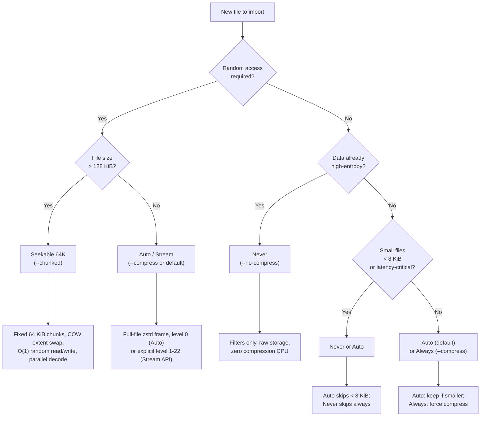

# Compression Workflows

OIFS integrates **zstd** compression with **Blosc2-style pre-compression filters** to achieve optimal space savings for diverse data patterns. The system supports **five compression modes**, a **flexible filter pipeline**, a **persistent scoped worker pool** for parallel chunk (de)compression, and two **read-acceleration caches** (`DecodedBlobCache` for stream files, `ChunkReadCache` for seekable chunked files).

This guide covers:
- Compression mode selection and CLI usage
- Filter pipeline design and the `filter-analyze` recommendation tool
- Read-path cache interaction (`read_at` fast paths)
- Decision flowchart: file size + access pattern → compression mode + filters
- Numerical data patterns: delta, shuffle, bitshuffle for telemetry/ML
- Zstd level tuning and context pool sizing

---

## Compression Modes

Compression mode determines **when** and **how** zstd compression is applied during write operations. The mode is stored in the inode metadata and automatically honored on read.

| Mode | CLI Flag | Internal Variant | Behavior | Typical Use Case |
|------|----------|------------------|----------|------------------|
| **Auto** (default) | *(none)* | `Auto` | Compress only when filtered data ≥ 8 KiB **and** compressed result is strictly smaller. | General-purpose cold/warm storage |
| **Always** | `--compress` | `Always` | Force zstd compression regardless of size or ratio (stream mode, level 0). | Archival / cold storage where CPU is available |
| **Never** | `--no-compress` | `Never` | Store raw bytes; filters still run but output is kept uncompressed. | High-entropy data (already compressed, encrypted) or latency-critical writes |
| **Stream** | *(API only)* | `Stream { level }` | Full-file stream compression with explicit Zstd level (1–22). | Tuned compression for known data profiles |
| **Seekable 64K** | `--chunked` / `--seekable` / `--chunked-64k` | `Seekable { chunk_size: 65536, level }` | Fixed 64 KiB logical chunks, each independently compressed/encrypted with COW extent swap. | Random-access large files (databases, VM images, scientific arrays) |

### Mode Selection Flowchart



### Auto Mode Threshold

The 8 KiB threshold is evaluated **after** filters run. If the filtered payload is < 8 KiB, or if zstd does not shrink it, the file is stored as `FLAG_RAW` (uncompressed). This avoids negative compression overhead on small or incompressible data.

**Source**: [`src/disk.rs` lines 881–1057](repo://src/disk.rs#L881-L1057) — `plan_write_prepared` evaluates `CompressionMode::Auto` with the 8 KiB post-filter check.

---

## Pre-compression Filters

Before zstd compression, data can be processed through a **filter pipeline** to increase compressibility. Filters are **lossless** (except `TruncPrecision`) and are recorded in the inode so the read path can reverse them automatically.

### Filter Types

| Filter | `FilterType` Variant | Best For | Notes |
|--------|----------------------|----------|-------|
| **Delta Encoding** | `Delta` | Sequential data, timestamps, sensor readings, monotonic sequences | Computes first-order differences per typed element (`typesize` ∈ {1,2,4,8}) |
| **Byte Shuffle** | `ByteShuffle` | Structured records / Array-of-Structures (AoS), integer/float data with limited range | Transposes bytes across adjacent elements (MSBs together, then next bytes, …) |
| **Bit Shuffle** | `BitShuffle` | Sparse bitmasks, boolean arrays, bitfields, binary data | 8×8 bit-matrix transposition per 64-bit word (symmetric Delta-Swap) |
| **Truncation Precision** | `TruncPrecision { prec_bits }` | Floating-point sensor data where controlled precision loss is acceptable | **Lossy**: zeros least-significant mantissa bits of f32/f64; inverse is identity |

### Filter Configuration

`FilterConfig` (stored compactly on the inode) specifies:
- `typesize`: element size in bytes (1, 2, 4, or 8) — required for shuffle/delta/bitshuffle
- Boolean flags: `delta`, `shuffle`, `bitshuffle`
- `TruncPrecision` is expressed via `FilterPipeline::then(FilterType::TruncPrecision { prec_bits })` directly

**Preset helpers** (`src/filters.rs`):
```rust
FilterConfig::none()                    // No filters
FilterConfig::numeric(typesize)         // Delta + ByteShuffle (standard for numeric data)
FilterConfig::delta_only(typesize)
FilterConfig::shuffle_only(typesize)
FilterConfig::bitshuffle_only(typesize)
FilterConfig::custom(typesize, delta, shuffle) // custom combination
```

### Filter Pipeline Execution Order

Filters are applied **in sequence** during write and reversed **in reverse order** during read:

```
Write:  [Data] → Delta → ByteShuffle → BitShuffle → TruncPrecision → zstd → [Compressed]
Read:   [Compressed] → zstd → TruncPrecision(identity) → BitShuffle⁻¹ → Shuffle⁻¹ → Delta⁻¹ → [Data]
```

The `typesize` parameter must match the logical element width of your data (e.g., 4 for `f32`/`u32`, 8 for `f64`/`u64`). Mismatched `typesize` corrupts filter output.

---

## Filter Analysis & Auto-selection

### `filter-analyze` Command

The `filter-analyze` subcommand examines a host file (no image required) and recommends the optimal filter configuration by simulating all candidate pipelines against a sampled representation of the data.

```bash
# Human-readable report
oifs filter-analyze /path/to/data.bin

# JSON output for automation
oifs filter-analyze /path/to/data.bin --json
```

**Example output:**
```
=== OIFS Filter Recommendation Report for /path/to/data.bin ===
Original Size:        1048576 bytes
Baseline Zstd Size:   445123 bytes (Entropy: 3.39 bits/byte)
--------------------------------------------------------------------------------
Filter Pipeline              Entropy   Zstd Size   Ratio   Savings
--------------------------------------------------------------------------------
None (Raw Zstd)               3.390     445123     2.35x   57.6%
Delta (typesize=4, u32/f32)   2.120     210445     4.98x   79.9%
Shuffle (typesize=4, u32/f32) 2.890     320112     3.27x   69.5%
Delta+Shuffle (typesize=4)    1.580     145234     7.22x   86.1%  [*RECOMMENDED*]
BitShuffle (typesize=4)       3.110     389021     2.69x   62.9%
--------------------------------------------------------------------------------
Recommendation Rationale: Data displays strong linear/temporal correlation; first-order delta collapses dynamic range, shrinking entropy.
Recommended Blosc2 Filter(s): ["blosc2::Filter::Delta", "blosc2::Filter::ByteShuffle"]
Command to import with recommended filter:
  oifs -i <image.img> put /path/to/data.bin --filter both --typesize 4
```

### Recommendation Algorithm

1. **Multi-window sampling** (for files > 256 KB): Head 64 KB + middle 64 KB + tail 64 KB (each 8-byte aligned for filter integrity)
2. **Candidate evaluation**: 13 standard filter combinations (None, Delta 1/2/4/8, Shuffle 2/4/8, BitShuffle 2/4/8, Delta+Shuffle 2/4/8)
3. **Parallel simulation**: Each candidate runs on the persistent worker pool with pooled Zstd contexts (zero allocation churn)
4. **Selection criterion**: Minimum estimated compressed size (scaled from sample if sampled)

**Source**: [`src/filters.rs` lines 897–1098](repo://src/filters.rs#L897-L1098) — `recommend_filters()` and `FilterRecommendation` struct.

### Using Recommended Filters with `put`

The report prints the exact `oifs put` command. Filter argument mapping:

| Report `filter_arg` | CLI `--filter` value | Meaning |
|---------------------|----------------------|---------|
| `none` | `none` | No pre-compression filter |
| `delta` | `delta` | Delta encoding only |
| `shuffle` | `shuffle` | Byte shuffle only |
| `both` | `both` | Delta + Byte Shuffle (numeric) |
| `bitshuffle` | `bitshuffle` | Bit shuffle only |

```bash
# Apply recommended filters
oifs -i disk.img put data.bin --filter both --typesize 4

# Explicit delta only for u16 time series
oifs -i disk.img put sensors.bin --filter delta --typesize 2

# Bit shuffle for boolean bitmasks
oifs -i disk.img put bitmask.bin --filter bitshuffle --typesize 1
```

---

## Seekable 64 KiB Chunked Mode (`--chunked`)

### Overview

Seekable mode writes files as **independent 64 KiB chunks**, each compressed and encrypted separately. This enables:
- **O(1) random read/write**: No need to decompress preceding data
- **Copy-on-Write (COW) extent swap**: Partial overwrites rewrite only affected chunks
- **Parallel (de)compression**: Worker pool processes chunks concurrently
- **Atomic chunk commits**: WAL-atomic or legacy chunked write paths

### CLI Usage

```bash
# Import as seekable chunked (level defaults to 1)
oifs -i disk.img put large.db --chunked

# Explicit zstd level (1-22, higher = more compression, slower)
oifs -i disk.img put large.db --chunked --compress-level 3

# With filters (e.g., numeric data)
oifs -i disk.img put telemetry.bin --chunked --filter both --typesize 8
```

### Architecture

- **Chunk size**: Fixed 65,536 bytes (logical); physical size varies by compression ratio
- **Chunk metadata**: Stored as packed `ChunkEntry` in inode's block pointer array
- **COW on overwrite**: `write_data()` at arbitrary offset reads affected chunks, modifies in memory, recompresses, writes new blocks, atomically swaps extent pointers
- **Anti-inflation fallback**: If a compressed chunk is ≥ original 64 KB, it is stored uncompressed (`FLAG_RAW`)

**Source**: [`src/disk/chunked.rs`](repo://src/disk/chunked.rs) — `write_chunked_64k`, `write_chunked_64k_pipeline`, `read_at_chunked_64k`, `truncate_chunked_64k`.

### When to Use Seekable Mode

| Scenario | Recommendation |
|----------|----------------|
| Database files (SQLite, LMDB, RocksDB) | ✅ `--chunked` — random page access |
| VM disk images (qcow2, raw) | ✅ `--chunked` — block-level reads |
| Scientific arrays (HDF5, Zarr, NumPy .npy) | ✅ `--chunked` — slicing along dimensions |
| Log files (append-only, sequential read) | ❌ Use `Auto` or `Always` |
| Small config files (< 128 KB) | ❌ Use `Auto` (overhead not justified) |

---

## Benchmarking & Tuning

### Zstd Compression Levels

| Level | Speed | Ratio | Use Case |
|-------|-------|-------|----------|
| 0 (default for Auto/Always) | Fastest | Baseline | Real-time / high-throughput writes |
| 1–3 | Fast | Good | General purpose, seekable chunks |
| 4–9 | Moderate | Better | Archival, cold storage |
| 10–15 | Slow | High | Maximum ratio, offline processing |
| 16–22 | Very slow | Highest | Extreme compression, one-time writes |

**Seekable mode default**: Level 1 (balance of speed/ratio for random access)
**Stream mode default**: Level 3 (when explicitly set via API)

### Context Pool Sizing

The persistent scoped worker pool (`zstd_pool::par_for_index`) uses:
- **Thread-local Zstd contexts**: One compressor per level + one decompressor per thread (avoids `ZSTD_createCCtx`/`DCtx` churn)
- **Global context pools**: Up to 32 pooled compressors per level, 32 pooled decompressors
- **Worker count**: `workers_to_wake(total_chunks, num_pool_threads)` — calling thread always participates inline

**Tuning knobs** (compile-time constants in `src/zstd_pool.rs`):
```rust
const MAX_GLOBAL_DECOMPRESSORS: usize = 32;
const MAX_GLOBAL_COMPRESSORS_PER_LEVEL: usize = 32;
```

Increase if:
- Many concurrent multi-chunk operations
- High core count machines (> 32 cores)

### Performance Measurement

#### Seekable Chunked Throughput Test

```bash
# Create test data (1 GB)
dd if=/dev/urandom of=/tmp/testdata bs=1M count=1024

# Write benchmark (seekable, level 1)
time oifs -i bench.img put /tmp/testdata --chunked --filter none

# Read benchmark (random access pattern)
time oifs -i bench.img cat testdata > /dev/null

# Compare with stream mode
time oifs -i bench_stream.img put /tmp/testdata --compress
```

#### Filter Impact Test

```bash
# Numeric data (telemetry: timestamps + sensor readings)
generate_telemetry > /tmp/telemetry.bin

oifs filter-analyze /tmp/telemetry.bin --json | jq '.best_config'
# → {"delta": true, "shuffle": true, "typesize": 8, ...}

# Import with and without filters
oifs -i nofilter.img put /tmp/telemetry.bin --chunked
oifs -i withfilter.img put /tmp/telemetry.bin --chunked --filter both --typesize 8

# Compare sizes
ls -lh nofilter.img withfilter.img
```

### Dictionary Compression

For repeated data patterns across files, train and register a Zstd dictionary:

```bash
# Train from sample files
oifs dict train samples/*.bin --max-size 112640 --output dict.zst

# Register as default for new writes
oifs -i disk.img dict register dict.zst

# Subsequent writes use dictionary automatically
oifs -i disk.img put data.bin --chunked
```

**API**: `ZstdDictRegistry::register()`, `ZstdDictRegistry::set_default()`, `compress_frame_with_cdict()`.

---

## Numerical Data Patterns

### Delta + ByteShuffle (Standard Numeric)

**Best for**: Time series, sensor arrays, financial ticks, simulation output (f32/f64/u32/u64)

```bash
# 64-bit float time series
oifs -i data.img put sensors.f64 --filter both --typesize 8

# 32-bit integer counters
oifs -i data.img put counters.u32 --filter both --typesize 4
```

**Why it works**: Delta collapses monotonic/trending sequences to small residuals; ByteShuffle groups same-significance bytes into runs (exponents together, mantissas together).

### BitShuffle

**Best for**: Boolean arrays, bitmasks, sparse bitsets, bitmap indexes

```bash
# Bitmap index (1 bit per record)
oifs -i data.img put bitmap.bin --filter bitshuffle --typesize 1
```

**Why it works**: 8×8 bit-matrix transpose collects identical bit positions across 8 consecutive 64-bit words, creating long runs of 0s or 1s.

### Truncation Precision (Lossy)

**Best for**: Sensor data where low-order mantissa bits are noise

```bash
# Keep 16 bits of precision in f32 (zero lower 7 mantissa bits)
# Note: Requires API; CLI uses FilterPipeline::then(TruncPrecision)
```

```rust
use oifs::filters::{FilterPipeline, FilterType};

let pipeline = FilterPipeline::new(4)
    .then(FilterType::Delta)
    .then(FilterType::ByteShuffle)
    .then(FilterType::TruncPrecision { prec_bits: 16 });

let compressed = pipeline.apply(&data);
// zstd compress...
```

---

## Read-Path Cache Interaction

### DecodedBlobCache (Stream Files)

- Caches fully decompressed frames for stream-compressed files
- Keyed by inode ID + frame offset
- Used by `read_at` for sequential or repeated access patterns
- Configurable via `DiskManager::set_decoded_cache_capacity(bytes)`

### ChunkReadCache (Seekable Chunked Files)

- Caches decompressed 64 KiB chunks
- Keyed by inode ID + chunk index
- Enables fast `read_at` for random access within chunked files
- Configurable via `DiskManager::set_chunk_cache_capacity(bytes)`

Both caches are **per-`DiskManager` instance** and participate in the Master's memory budget.

---

## Summary: Decision Checklist

| Question | Answer → Action |
|----------|-----------------|
| Need random access to large file (> 128 KB)? | `--chunked` (Seekable 64K) |
| Data already compressed/encrypted? | `--no-compress` (Never) |
| Small file (< 8 KB) or latency-critical write? | `--no-compress` or default Auto |
| Numerical time series / sensor data? | `--filter both --typesize {4,8}` |
| Boolean bitmasks / sparse bits? | `--filter bitshuffle --typesize 1` |
| Unknown data profile? | Run `filter-analyze` first |
| Maximum compression ratio (offline)? | `--compress` (Always) or Stream API level 10+ |
| Repeated patterns across files? | Train + register Zstd dictionary |

---

## Related Pages

- [CLI Reference](../operations/cli_reference.md) — Full `oifs` command documentation
- [Basic Operations](../workflows/basic_operations.md) — Session modes and core workflows
- [Compression & Filters Architecture](../architecture/compression_and_filters.md) — Internal design details
