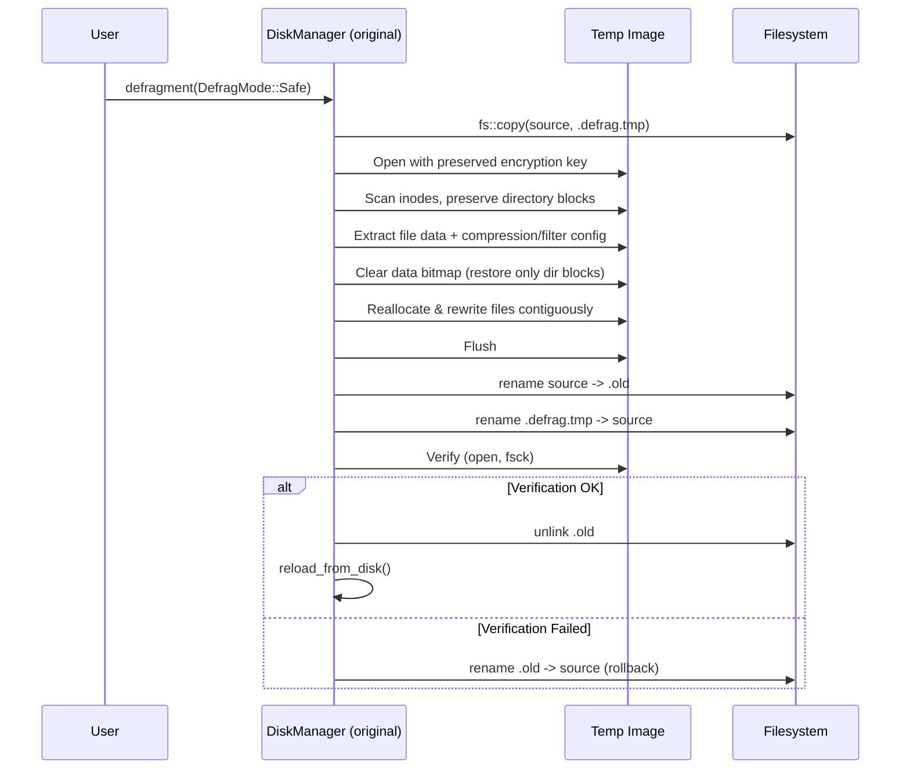

## Fragmentation Analysis

Before defragmentation, analyze the current layout to quantify fragmentation and determine if action is needed.

### Running Analysis

Analysis is performed via the `analyze_fragmentation` method on a `DiskManager` instance. This method scans the data bitmap in 64-bit word chunks to compute free-block statistics without modifying the filesystem.

**Programmatic (Rust):**
```rust
use oifs::disk::DiskManager;

let dm = DiskManager::open("/path/to/image.img", 0)?;
let stats = dm.analyze_fragmentation()?;
println!(
    "Free runs: {}, Largest free run: {}, Fragmentation ratio: {:.2}",
    stats.free_runs, stats.largest_free_run, stats.fragmentation_ratio
);
```

**Command-line (via `oifs`):**
```bash
oifs --image /path/to/image.img analyze
```
The `analyze` subcommand outputs fragmentation metrics including the fragmentation ratio (0.0 = optimal, 1.0 = maximally fragmented).

### Interpreting Results

The `FragmentationStats` structure provides:
- `total_blocks`: Total data blocks in the filesystem
- `used_blocks`: Number of allocated data blocks
- `free_blocks`: Number of free data blocks
- `free_runs`: Number of contiguous free block sequences. Higher values indicate more scattered free space.
- `largest_free_run`: Size of the largest contiguous free block chunk (in blocks).
- `avg_gap_size`: Average size of free runs (total gap size / free_runs).
- `fragmentation_ratio`: Computed as `(free_runs - 1) / max(free_blocks - 1, 1)`. A ratio > 0.25 typically warrants defragmentation (this is the default auto-defrag threshold).

**Evidence:** [`analyze_fragmentation_internal`](repo://src/disk/maintenance.rs#L150-L255) performs the 64-bit word scanning and ratio calculation.

---

## Safe Defragmentation Execution (Out-of-Place Rebuild)

OIFS performs defragmentation via an out-of-place rebuild to guarantee safety against crashes or power loss. The default `DefragMode::Safe` creates a temporary copy, rewrites files contiguously, and uses an atomic rename to swap images.

### Command-line Execution

Initiate safe defragmentation with the `defrag` subcommand:
```bash
oifs --image /path/to/image.img defrag
```
To explicitly specify safe mode:
```bash
oifs --image /path/to/image.img defrag --mode safe
```
Progress and results are printed to stdout, including:
- Files processed
- Fragmentation ratio before/after
- Bytes moved

### Programmatic Execution

```rust
use oifs::disk::{DefragMode, DiskManager};

let dm = DiskManager::open("/path/to/image.img", 0)?;
let stats = dm.defragment("/path/to/image.img", DefragMode::Safe, None)?;
println!(
    "Defragged {} files. Fragmentation: {:.2} -> {:.2}",
    stats.files_processed, stats.frag_before, stats.frag_after
);
```

The `defragment` method returns a `DefragStats` struct containing:
- `files_processed`: Number of regular files defragmented
- `bytes_moved`: Total bytes rewritten
- `blocks_freed`: Approximate free runs eliminated (`frag_before.free_runs - frag_after.free_runs`)
- `frag_before`: Fragmentation ratio prior to defragmentation
- `frag_after`: Fragmentation ratio after defragmentation

**Evidence:** [`DefragStats`](repo://src/disk.rs#L157-L174) and [`defragment`](repo://src/disk/maintenance.rs#L460-L480).

### Safe Defragmentation Pipeline

The `defragment_safe` method executes a six-stage out-of-place rebuild:



#### Stage 1: Snapshot Creation

The entire active image file is copied via `std::fs::copy(source_path, &temp_path)` ([`defragment_safe`](repo://src/disk/maintenance.rs#L498)). The destination defaults to `{source_path}.defrag.tmp` when no output path is provided. This guarantees that if the defragmentation process is killed mid-stream, the original image file remains untouched and uncorrupted.

#### Stage 2: Inode Scan and Metadata Preservation

The temporary image is opened via `DiskManager::open_with_key_and_storage_mode(&temp_path, 0, enc_key, storage_mode)` ([`defragment_safe`](repo://src/disk/maintenance.rs#L501)), preserving the encryption key and storage mode from the original image. Using [`BitmapRef::for_each_set_bit`](repo://src/bitmap.rs#L94-L108), all allocated inode indices are collected from `inode_bitmap_block` ([`defragment_safe`](repo://src/disk/maintenance.rs#L507-L512)):

- **Directories**: Directory blocks cannot simply be moved without updating parent pointer graphs, so directory block addresses are harvested via `collect_inode_block_layout` and staged in `directory_blocks` ([`defragment_safe`](repo://src/disk/maintenance.rs#L514-L517)).
- **Regular Files**: For each file with `size > 0` or any allocated blocks, the file's exact compression status (`CompressionMode::Always`, `CompressionMode::Never`, or `CompressionMode::Seekable`) and pre-compression filter configuration ([`FilterConfig`]: `typesize`, `delta`, `shuffle`, `bitshuffle`) are recorded ([`defragment_safe`](repo://src/disk/maintenance.rs#L519-L526)). **Seekable 64K chunked files** are detected by `INODE_FLAG_SEEKABLE_64K` and their `CompressionMode::Seekable` config is preserved.
- **Inode Reset**: The inode on disk is zeroed out (`size = 0`, `compressed_size = 0`, `blocks = [0; 12]`, `triple_indirect = 0`) via `write_inode` ([`defragment_safe`](repo://src/disk/maintenance.rs#L528-L534)), freeing the blocks for contiguous reassignment.

#### Stage 3: Bitmap Reset

The entire data bitmap of the temporary image is wiped using `bitmap_slice.fill(0)` ([`defragment_safe`](repo://src/disk/maintenance.rs#L537)). Then, only the preserved directory block IDs (`directory_blocks`) are re-marked as allocated ([`defragment_safe`](repo://src/disk/maintenance.rs#L539-L545)). All other data blocks become completely free and unallocated.

#### Stage 4: Contiguous File Rewrite

Files are streamed **one by one** from the original image into the temporary image using `read_data` and `write_data_with_filters` ([`defragment_safe`](repo://src/disk/maintenance.rs#L548-L557)). This streaming approach bounds memory usage and prevents OOM on large files. The sequential allocator (`write_data` → `allocate_contiguous_blocks`) places each file's payload blocks contiguously starting at the current `free_block_hint`.

#### Stage 5: Flush and Verification

The temporary image is flushed (`temp_dm.flush()`) and dropped ([`defragment_safe`](repo://src/disk/maintenance.rs#L559-L560)). The original image is renamed to `{source_path}.old`, then the temporary image is renamed to the original path ([`defragment_safe`](repo://src/disk/maintenance.rs#L563-L567)). The new image is opened and verified via `verify_integrity()` (fsck) ([`defragment_safe`](repo://src/disk/maintenance.rs#L570-L578)).

#### Stage 6: Atomic Commit or Rollback

On success: the `.old` backup is deleted and the active `DiskManager` handle **live-reloads** via `reload_from_disk()` ([`defragment_safe`](repo://src/disk/maintenance.rs#L580-L586)), synchronizing its in-memory state (superblock, bitmaps, caches, hints) with the new file. On any failure: the `.old` backup is renamed back to the original path, restoring the pre-defrag state ([`defragment_safe`](repo://src/disk/maintenance.rs#L588-L597)).

---

## In-Place Defragmentation (WAL-Atomic)

`DefragMode::InPlace` performs direct reorganization within the existing image file without allocating a duplicate temporary file. This mode is exposed via both the CLI and the background auto-defrag coordinator.

### Command-line Execution

```bash
oifs --image /path/to/image.img defrag --mode inplace
```

⚠️ **WARNING**: In-place mode directly modifies the image. The CLI displays a warning and waits 3 seconds before proceeding. Data loss may occur if interrupted (power loss, kill -9, kernel panic).

### Programmatic Execution

```rust
use oifs::disk::{DefragMode, DiskManager};

let dm = DiskManager::open("/path/to/image.img", 0)?;
let stats = dm.defragment("/path/to/image.img", DefragMode::InPlace, None)?;
```

### Two Implementation Paths

The in-place defragmentation selects its algorithm based on whether the image has a WAL journal layout:

#### Legacy Non-Journaled Path (`defragment_inplace_legacy`)

Used when the image has no journal. Employs a cycle-aware block permutation algorithm:

1. **Collect inodes**: Scans inode bitmap, categorizes directories, regular files, and others.
2. **Compute target layout**: Assigns contiguous target block numbers starting from `data_block_start`. Directories placed first, then file payload blocks, then indirect blocks.
3. **Filter moves**: Builds `old_to_new` map, filters only blocks where source ≠ destination.
4. **Cycle-aware permutation**: Uses a scratch buffer to resolve cycles in the block permutation graph, copying blocks into their target positions without overwriting unprocessed source blocks.
5. **Update metadata**: Rewrites inode block pointers, indirect block pointers, and the data bitmap.
6. **Flush**: Syncs according to the active durability mode.

**Evidence:** [`defragment_inplace_legacy`](repo://src/disk/maintenance.rs#L820-L1034)

#### WAL-Atomic Journaled COW Path (`defragment_inplace_journaled_cow`)

Used when the image has a WAL journal layout and `allow_journaled` is true (default). Performs round-based copy-on-write with journal transactions:

1. **Quiesce**: Drains pending async ranges, flushes dirty pages, checkpoints WAL to head.
2. **Collect inodes**: Same as legacy path.
3. **Round-based COW**: Each round:
   - Copies a batch of blocks exclusively into currently free blocks
   - Flushes destination blocks
   - Commits a single bounded WAL transaction (metadata updates: inode pointers, indirect blocks, bitmap)
   - Checkpoints WAL before next round reuses freed source blocks
4. **Verify**: Runs fsck on the modified image.

This ensures that at any point, the filesystem is either in its pre-defrag state or a fully consistent post-defrag state—the WAL provides atomicity.

**Evidence:** [`defragment_inplace_journaled_cow`](repo://src/disk/maintenance.rs#L1035-L1300+)

---

## Background Auto-Defrag Coordinator

OIFS includes a background coordinator that periodically measures fragmentation and runs in-place defragmentation passes when thresholds are exceeded. The coordinator runs as a daemon thread tied to the `DiskManager` lifetime.

### Configuration

The coordinator is configured via [`AutoDefragConfig`](repo://src/auto_defrag.rs#L38-L75):

| Parameter | Type | Default | Description |
|-----------|------|---------|-------------|
| `enabled` | `bool` | `false` | Whether the background coordinator runs |
| `fragmentation_threshold` | `f64` | `0.25` | Ratio `(free_runs - 1) / (free_blocks - 1)` above which a pass triggers. Clamped to `0.0..=1.0`. NaN falls back to default. |
| `check_interval` | `Duration` | `300s` | How often to measure fragmentation. Minimum `10ms` to prevent hot loops. |
| `min_free_blocks` | `u64` | `0` | Minimum free data blocks required before a pass runs. |
| `allow_journaled` | `bool` | `true` | Whether to defrag WAL-enabled images. When false, journaled images are skipped. |

**Normalization:** [`AutoDefragConfig::sanitized`](repo://src/auto_defrag.rs#L83-L98) clamps the threshold to `0.0..=1.0`, replaces `NaN` with `0.25`, and raises intervals below `10ms` to `10ms`.

### Enabling via CLI

```bash
# Enable with default threshold (0.25) and interval (300s)
oifs --image /path/to/image.img --auto-defrag ls

# Enable with custom threshold
oifs --image /path/to/image.img --auto-defrag 0.3 ls

# Custom interval (seconds between checks)
oifs --image /path/to/image.img --auto-defrag --defrag-interval 60 ls

# Disable auto-defrag for a specific run
oifs --image /path/to/image.img ls
```

### Enabling Programmatically

```rust
use oifs::auto_defrag::AutoDefragConfig;
use std::time::Duration;

let dm = DiskManager::open("/path/to/image.img", 0)?;

// Enable with custom config
let config = AutoDefragConfig::new(0.3)
    .with_check_interval(Duration::from_secs(60))
    .with_min_free_blocks(1000)
    .with_allow_journaled(true);
dm.set_auto_defrag(config);

// Query current config
let current = dm.auto_defrag_config();

// Get statistics
let stats = dm.auto_defrag_stats();
println!("Checks: {}, Passes: {}, Skipped: {}, Errors: {}",
    stats.checks, stats.passes, stats.skipped, stats.errors);

// Stop the coordinator
dm.stop_auto_defrag();
```

### AutoDefragStats

The coordinator tracks runtime statistics via [`AutoDefragStats`](repo://src/auto_defrag.rs#L101-L114):

- `checks`: Number of fragmentation measurements performed
- `passes`: Number of defragmentation passes that ran
- `skipped`: Passes skipped (below threshold, too full, or journaled with `allow_journaled=false`)
- `errors`: Passes that failed
- `last_fragmentation_ratio`: Most recent measured ratio
- `last_pass`: `DefragStats` of most recent successful pass
- `last_error`: Description of most recent skip or failure

### Pass Execution Logic

Each cycle (`run_worker` → `run_once`):

1. **Sleep** for `check_interval` (or until reconfigured/shutdown)
2. **Upgrade** `Weak<InnerLock>` — exits if `DiskManager` was dropped
3. **Measure** fragmentation via `analyze_fragmentation_on`
4. **Skip evaluation** (`skip_reason`):
   - Ratio below `fragmentation_threshold` → skip
   - Free blocks below `min_free_blocks` → skip
   - Journaled image but `allow_journaled=false` → skip
5. **Execute** `defragment_inplace_on` (in-place WAL-atomic or legacy)
6. **Record** stats (pass/skip/error with details)

**Evidence:** [`run_worker`](repo://src/auto_defrag.rs#L330-L380), [`skip_reason`](repo://src/auto_defrag.rs#L307-L329)

### Safety Guarantees

- **No lifetime extension**: The worker holds only a `Weak<InnerLock>`. When the last `DiskManager` clone drops, the upgrade fails and the thread exits — it never keeps an image mapped indefinitely.
- **Serialization**: Every pass takes the inner **write lock**, serializing against all metadata mutations exactly like any other writer. No two defrag passes can overlap.
- **Journaled atomicity**: On WAL-enabled images, the in-place pass uses `defragment_inplace_journaled_cow` with round-based COW and bounded WAL transactions.
- **Config sanitization**: Prevents `NaN` thresholds (which would defrag every tick) and zero intervals (which would hot-loop).

---

## Choosing a Mode

| Scenario | Recommended Mode |
|----------|------------------|
| Production data, cannot tolerate any risk | `safe` (default) |
| Large images where copy time is prohibitive | `inplace` (with WAL) |
| Automated background maintenance | Auto-defrag coordinator (uses `inplace`) |
| Encrypted images | Both modes supported — `safe` preserves encryption key |
| Network filesystems (NFS, SMB) | `safe` with `--no-mmap` or auto-defrag with `allow_journaled=true` |

---

## Related Commands Reference

| Command | Description |
|---------|-------------|
| `oifs analyze` | Print fragmentation statistics |
| `oifs defrag [--mode safe\|inplace]` | Run defragmentation |
| `oifs --auto-defrag [THRESHOLD] <subcommand>` | Enable background coordinator for session |
| `oifs --defrag-interval <SECONDS>` | Set check interval for auto-defrag |

**Evidence:** CLI definitions in [`src/bin/oifs.rs`](repo://src/bin/oifs.rs#L251-L255) and [`Commands::Analyze`/`Commands::Defrag`](repo://src/bin/oifs.rs#L1420-L1520).

---

## Related Pages

- [Defragmentation Architecture](../architecture/defragmentation.md) — deep dive on algorithms and data structures
- [CLI Reference](../operations/cli_reference.md) — complete flag and subcommand documentation
- [FSCK Workflow](fsck_workflow.md) — integrity verification used after defragmentation
