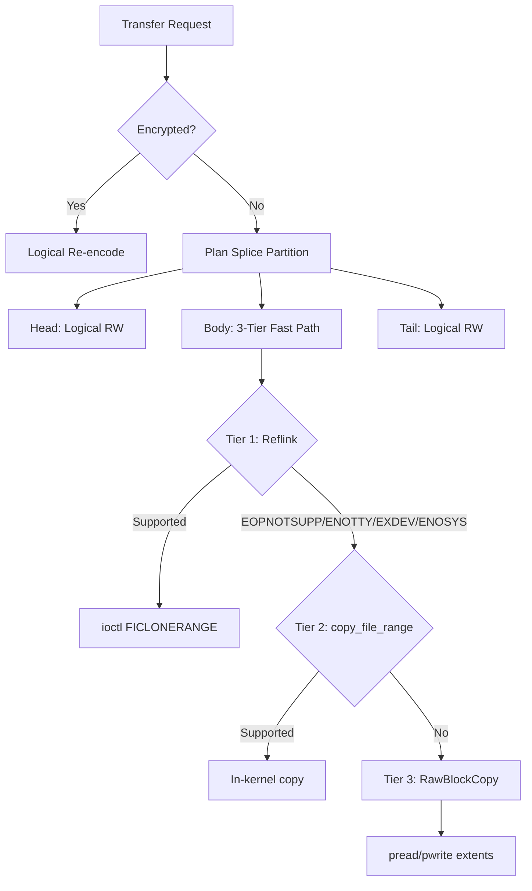

## Fragmentation Analysis

Before defragmentation, analyze the current layout to quantify fragmentation and determine if action is needed.

### Running Analysis

Analysis is performed via the `analyze_fragmentation` method on a `DiskManager` instance. This method scans the data bitmap in 64-bit word chunks to compute free-block statistics without modifying the filesystem.

**Programmatic (Rust):**
```rust
use oifs::disk::DiskManager;

let dm = DiskManager::open("/path/to/image.img", 0)?;
let stats = dm.analyze_fragmentation()?;
println!(
    "Free runs: {}, Largest free run: {}, Fragmentation ratio: {:.2}",
    stats.free_runs, stats.largest_free_run, stats.fragmentation_ratio
);
```

**Command-line (via `oifs`):**
```bash
oifs --image /path/to/image.img analyze
```
The `analyze` subcommand outputs fragmentation metrics including the fragmentation ratio (0.0 = optimal, 1.0 = maximally fragmented).

### Interpreting Results

The `FragmentationStats` structure provides:
- `total_blocks`: Total data blocks in the filesystem
- `used_blocks`: Number of allocated data blocks
- `free_blocks`: Number of free data blocks
- `free_runs`: Number of contiguous free block sequences. Higher values indicate more scattered free space.
- `largest_free_run`: Size of the largest contiguous free block chunk (in blocks).
- `avg_gap_size`: Average size of free runs (total gap size / free_runs).
- `fragmentation_ratio`: Computed as `(free_runs - 1) / max(free_blocks - 1, 1)`. A ratio > 0.25 typically warrants defragmentation (this is the default auto-defrag threshold).

**Evidence:** [`analyze_fragmentation_internal`](repo://src/disk/maintenance.rs#L150-L255) performs the 64-bit word scanning and ratio calculation.

---

## Safe Defragmentation Execution (Out-of-Place Rebuild)

OIFS performs defragmentation via an out-of-place rebuild to guarantee safety against crashes or power loss. The default `DefragMode::Safe` creates a temporary copy, rewrites files contiguously, and uses an atomic rename to swap images.

### Command-line Execution

Initiate safe defragmentation with the `defrag` subcommand:
```bash
oifs --image /path/to/image.img defrag
```
To explicitly specify safe mode:
```bash
oifs --image /path/to/image.img defrag --mode safe
```
Progress and results are printed to stdout, including:
- Files processed
- Fragmentation ratio before/after
- Bytes moved

### Programmatic Execution

```rust
use oifs::disk::{DefragMode, DiskManager};

let dm = DiskManager::open("/path/to/image.img", 0)?;
let stats = dm.defragment("/path/to/image.img", DefragMode::Safe, None)?;
println!(
    "Defragged {} files. Fragmentation: {:.2} -> {:.2}",
    stats.files_processed, stats.frag_before, stats.frag_after
);
```

The `defragment` method returns a `DefragStats` struct containing:
- `files_processed`: Number of regular files defragmented
- `bytes_moved`: Total bytes rewritten
- `blocks_freed`: Approximate free runs eliminated (`frag_before.free_runs - frag_after.free_runs`)
- `frag_before`: Fragmentation ratio prior to defragmentation
- `frag_after`: Fragmentation ratio after defragmentation

**Evidence:** [`DefragStats`](repo://src/disk.rs#L157-L174) and [`defragment`](repo://src/disk/maintenance.rs#L460-L480).

### Safe Mode Pipeline

The safe defragmentation pipeline (`defragment_safe`) executes in six stages:

1. **Snapshot creation** — `std::fs::copy` duplicates the entire image to `{source}.defrag.tmp`
2. **Inode scan & metadata preservation** — Opens temp image with preserved encryption key; collects directory blocks and file compression/filter configs; zeros inodes on disk to free blocks
3. **Bitmap reset** — Clears data bitmap, re-marks only preserved directory blocks
4. **Contiguous file rewrite** — Streams files one-by-one from original into temp using `read_data`/`write_data_with_filters` (bounded memory, no OOM)
5. **Flush and atomic 3-step rename** —
   - `rename(source, source.old)` — original becomes backup
   - `rename(temp, source)` — defragged image takes canonical name
   - Verification: opens new image, runs `verify_integrity()` (fsck), removes backup on success; rolls back on failure
6. **Live handle reload** — Calls `reload_from_disk()` to re-mmap the new file and clear all caches

This design guarantees the original image remains untouched until the defragmented image passes full integrity verification.

---

## In-Place WAL-Atomic Defragmentation (COW)

For scenarios where a full image copy is impractical, OIFS provides `DefragMode::InPlace` which reorganizes blocks directly within the live image using **WAL-atomic round-based copy-on-write**.

### Command-line Execution

```bash
oifs --image /path/to/image.img defrag --mode inplace
```
⚠️ **Warning**: In-place mode directly modifies the image. The CLI prints a warning and waits 3 seconds before proceeding to allow cancellation.

### Programmatic Execution

```rust
use oifs::disk::{DefragMode, DiskManager};

let dm = DiskManager::open("/path/to/image.img", 0)?;
let stats = dm.defragment("/path/to/image.img", DefragMode::InPlace, None)?;
```

### How In-Place COW Defragmentation Works

**Entry point:** [`defragment_inplace_on`](repo://src/disk/maintenance.rs#L707-L812) — shared by manual invocation and the auto-defrag coordinator.

**On journaled images** (WAL-enabled):
1. **Quiesce journal** — drains pending async ranges, flushes dirty pages, checkpoints WAL ring to `used() == 0`
2. **Collect all inodes** in one pass (directories, regular files, others) without thrashing `inode_cache`
3. **Assign contiguous targets** sequentially from `data_block_start`:
   - Directory blocks first (payloads → indirect)
   - File blocks next (including seekable 64K chunk runs)
   - Builds `old_to_new` mapping for every block
4. **Round-based COW passes** ([`defragment_inplace_journaled_cow`](repo://src/disk/maintenance.rs#L1028-L1580)):
   - Each **RelocUnit** represents a contiguous run (single block or seekable chunk run)
   - Selects units whose targets are **currently free** in an in-memory bitmap mirror
   - Limits batch by WAL payload budget (half the journal ring)
   - If all targets occupied (cycle), moves smallest unit to a high-address **scratch run** to break the cycle
   - Copies payload blocks to free destinations, flushes (Strict mode)
   - Stages metadata ops: pointer updates (`WriteInode`/`WriteBlockSlice`), bitmap flips (`SetDataBitmapRange`)
   - Commits single bounded WAL transaction, applies via `apply_journal_ops`
   - Updates in-memory bitmap mirror, checkpoints WAL, repeats until all units placed
5. **Final verification** — runs `verify_integrity()` (fsck) before returning

**On non-journaled images**:
- Falls back to **cycle-aware block permutation** ([`defragment_inplace_legacy`](repo://src/disk/maintenance.rs#L819-L1026))
- Directly copies blocks using a scratch buffer to rotate cycles
- Rebuilds data bitmap as contiguous prefix
- **No crash safety** — a mid-permutation crash can leave the image inconsistent

### Seekable 64K Chunked Files

Both paths preserve seekable chunk structure:
- **Collection** expands `ChunkEntry` runs into constituent blocks
- **Target assignment** allocates new contiguous run of equal length
- **Rebase** constructs new `ChunkEntry` with `start_block = target_start`, preserving `block_count`, `flags`, `compressed_len`
- Verified by `defrag_seekable_chunk_test.rs` for both safe and in-place modes

---

## Auto-Defragmentation Coordinator

The background coordinator periodically measures fragmentation and triggers in-place passes when warranted.

### Configuration (`AutoDefragConfig`)

| Field | Default | Purpose |
|-------|---------|---------|
| `enabled` | `false` | Master switch; `set_auto_defrag` starts/stops the worker |
| `fragmentation_threshold` | `0.25` | Trigger ratio. NaN → default; clamped to `[0.0, 1.0]` |
| `check_interval` | `300s` | Period between measurements. Raised to `10ms` minimum (`MIN_CHECK_INTERVAL`) |
| `min_free_blocks` | `0` | Skip pass if free blocks < this (avoids stalling on near-full images) |
| `allow_journaled` | `true` | If `false`, skips passes on WAL-enabled images |

### Enabling Auto-Defrag

**CLI (global flag):**
```bash
oifs --image disk.img --auto-defrag 0.30 --defrag-interval 600 ls
```
This starts the coordinator with a 0.30 fragmentation threshold and 10-minute check interval.

**Programmatic:**
```rust
use oifs::auto_defrag::AutoDefragConfig;
use oifs::disk::DiskManager;

let dm = DiskManager::open("disk.img", 0)?;
dm.set_auto_defrag(AutoDefragConfig::new(0.30)
    .with_check_interval(std::time::Duration::from_secs(600))
    .with_min_free_blocks(16384)  // ~64 MiB at 4 KiB blocks
);
```

### Disabling Auto-Defrag

```rust
dm.set_auto_defrag(AutoDefragConfig::default());  // enabled = false
// or
dm.stop_auto_defrag();
```

### Monitoring Auto-Defrag

```rust
let stats = dm.auto_defrag_stats();
println!(
    "Checks: {}, Passes: {}, Skipped: {}, Errors: {}",
    stats.checks, stats.passes, stats.skipped, stats.errors
);
if let Some(last_pass) = stats.last_pass {
    println!("Last pass: {} files, {:.2} -> {:.2} frag",
        last_pass.files_processed, last_pass.frag_before, last_pass.frag_after);
}
if let Some(err) = stats.last_error {
    println!("Last skip/error: {}", err);
}
```

### Worker Behavior

The daemon thread (`run_worker` in [`auto_defrag.rs`](repo://src/auto_defrag.rs#L323-L368)):
1. Holds only `Weak<InnerLock>` — exits cleanly when last `DiskManager` drops
2. Waits on `Condvar` with timeout = `check_interval` (wakes on config change)
3. On each tick:
   - Measures fragmentation via `analyze_fragmentation_on`
   - Skips if ratio < threshold, free blocks < `min_free_blocks`, or journaled + `!allow_journaled`
   - Runs `defragment_inplace_on` (WAL-atomic COW on journaled images)
   - Records stats: `checks`, `passes`, `skipped`, `errors`, `last_fragmentation_ratio`, `last_pass`, `last_error`

### Threshold Guidance

| Threshold | Behavior |
|-----------|----------|
| 0.10–0.15 | Aggressive; keeps free space highly contiguous for seekable 64K workloads |
| **0.25 (default)** | Balanced; triggers before fragmentation impacts allocation latency |
| 0.40+ | Conservative; only defragments when free space severely scattered |

### Scheduling Considerations

- Worker takes the **inner write lock** for the entire pass, serializing against all metadata mutations
- On journaled images, each round commits a WAL transaction; pass duration scales with `used_blocks` but is broken into bounded transactions
- Set `min_free_blocks` to at least the largest file expected to be written contiguously (e.g., `16384` for 64 MiB files at 4 KiB blocks)
- Auto-defrag is **automatically disabled** on read-only mounts

---

## Cross-Image CoW Extent Migration (Reflink Tier)

While defragmentation rewrites blocks within a single image, the **transfer/splice subsystem** ([`src/disk/transfer.rs`](repo://src/disk/transfer.rs)) provides a 3-tier **zero-copy CoW extent cloning** pipeline used by `transfer_file_to`, `splice_range_to`, and `clone_image`:



### Three Tiers

1. **Tier 1 — Reflink** (`TransferMethod::Reflink`): Linux `ioctl(FICLONERANGE)` clones extents between two `.img` files on Btrfs, XFS (`reflink=1`), bcachefs, NFSv4.2, Lustre Lreflink. Zero-copy, zero-space, CoW semantics.

2. **Tier 2 — CopyFileRange** (`TransferMethod::CopyFileRange`): Linux `copy_file_range(2)` copies data in-kernel without userspace bounce buffers (ext4, cross-OST Lustre).

3. **Tier 3 — RawBlockCopy** (`TransferMethod::RawBlockCopy`): Portable `pread`/`pwrite` of raw compressed extents, skipping Zstd decompression, inverse SIMD filters, and re-compression.

### Encryption Boundary

If either source or destination image is encrypted (independent Argon2id salts, inode-bound AEAD AAD), the pipeline forces `TransferMethod::LogicalReencode` (decrypt + re-encrypt) because raw extents are bound to the source inode's encryption context.

### Negative Device-Pair Cache

`FICLONERANGE` returning `EOPNOTSUPP`, `ENOTTY`, `EXDEV`, `ENOSYS` caches the `(src_dev, dst_dev)` pair so subsequent extents skip the failing ioctl immediately. Transient `EINVAL`/`EPERM`/`ETXTBSY` falls back per-extent without poisoning the cache.

### Splice Partition (Head/Body/Tail)

`plan_splice_partition` aligns sub-range copies to 4 KiB (uncompressed) or 64 KiB (seekable) boundaries. The aligned `Body` uses the 3-tier fast path; unaligned `Head`/`Tail` use logical read-modify-write. `shift_table_collapse` and `punch_table_slot` implement `CollapseRange` / `PunchHole` trim modes by shifting logical pointer/chunk tables left and freeing removed extents.

### Relevance to Defragmentation

Although the in-place defragmenter copies blocks via `copy_block` (not reflink), the same `ChunkEntry` rebase logic, logical run coalescing (`coalesce_logical_runs`), and indirect block pointer rewriting are shared. A future optimization could use `FICLONERANGE` to clone a file's extents into a temporary image during safe defrag, but the current bounded-memory stream-rewrite is simpler and works on all storage backends.

---

## CLI Reference Summary

| Command | Description |
|---------|-------------|
| `oifs -i img analyze` | Output fragmentation metrics (total/used/free blocks, free runs, largest run, avg gap, fragmentation ratio) |
| `oifs -i img defrag` | Safe defragmentation (default) |
| `oifs -i img defrag --mode safe` | Explicit safe mode |
| `oifs -i img defrag --mode inplace` | In-place WAL-atomic COW defragmentation |
| `oifs -i img --auto-defrag 0.25 --defrag-interval 300 cmd` | Enable background auto-defrag with threshold 0.25, 5-min interval |

**JSON output** (`--json`):
- `analyze`: `{"ok": true, "total_blocks": ..., "fragmentation_ratio": ...}`
- `defrag`: `{"ok": true, "files_processed": ..., "bytes_moved": ..., "frag_before": ..., "frag_after": ...}`

---

## Invariants and Failure Semantics

| Invariant | Enforced by |
|-----------|-------------|
| Original image unmodified until atomic rename succeeds | Safe defrag copies to temp first; rollback on any failure |
| Journaled in-place defrag never loses data on crash | WAL orders payload copies before metadata commits; checkpoint retires each round |
| Seekable `ChunkEntry` runs stay contiguous | `allocate_contiguous` for new runs; `RelocUnit.block_count` moves whole run atomically |
| Auto-defrag never keeps a `DiskManager` alive | Worker holds `Weak<InnerLock>`; exits on upgrade failure |
| No hot loop regardless of config | `MIN_CHECK_INTERVAL = 10ms` enforced in `sanitized()` |
| `NaN` threshold never reaches worker | Replaced by `DEFAULT_FRAGMENTATION_THRESHOLD` in `sanitized()` |

### Failure Modes

- **Safe defrag**: Any I/O error, verification failure, or rename error triggers rollback (`.old` → original). Active handle is **not** reloaded.
- **In-place COW**: Crash mid-round leaves WAL with committed transaction for that round only. On replay, round's updates are reapplied (idempotent) and next round starts from new state.
- **Legacy in-place**: Crash mid-permutation can leave image inconsistent. Only used on non-journaled images.
- **Auto-defrag**: Errors increment `errors` and store `last_error`; worker continues on next tick.
