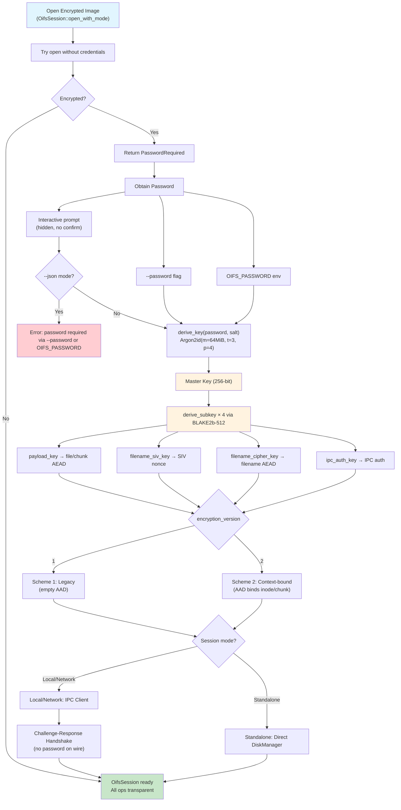

# Encrypted Filesystem Workflows

This guide covers the complete workflow for working with encrypted OIFS (Optimized Image File System) images, from initial creation through daily operations and advanced features.

## Creating an Encrypted Filesystem

To create a new encrypted OIFS image, use the `create` command with the `--encrypt` flag:

```bash
# Basic encrypted image (100 MB)
oifs -i myimage.img create --size 100 --encrypt

# Encrypted image with metadata journaling (crash-safe metadata)
oifs -i myimage.img create --size 100 --encrypt --journal
```

### What Happens During Creation

When you create an encrypted image with `--encrypt`:

1. **Salt Generation**: A cryptographically secure 16-byte random salt is generated via `OsRng` and stored in the superblock (`SuperBlock::encryption_salt`).
2. **Password Acquisition**: The system obtains the password in this precedence order:
   - `--password` command-line argument
   - `OIFS_PASSWORD` environment variable
   - Interactive prompt (with confirmation; suppressed in `--json` mode)
3. **Key Derivation**: The password is hashed using **Argon2id** with OWASP/RFC 9106 hardened parameters:
   - Memory cost: **64 MiB** (`m = 65,536 KiB`)
   - Time cost: **3 iterations** (`t = 3`)
   - Parallelism: **4 lanes** (`p = 4`)
   - Output: 256-bit master key
4. **Subkey Derivation**: The 256-bit master key is immediately split into **four domain-separated 256-bit subkeys** via BLAKE2b-512:
   - `payload_key` → file/chunk XChaCha20-Poly1305 AEAD
   - `filename_siv_key` → BLAKE2b-512 synthetic nonce for filename SIV
   - `filename_cipher_key` → filename XChaCha20-Poly1305 AEAD
   - `ipc_auth_key` → IPC challenge-response authentication
5. **Scheme Selection**: New images always use **context-bound AEAD** (`encryption_version = 2`) which binds ciphertext to inode ID and chunk metadata via Associated Data (AAD).
6. **Filesystem Initialization**: The image is created with the derived keys and encryption enabled.

### Password Requirements

- **Cannot be empty** — rejected at creation time
- **Warning issued** if shorter than 8 characters (interactive mode only; not in `--json` mode)
- **JSON mode** (`--json`): password **must** be provided via `--password` or `OIFS_PASSWORD` (no interactive prompt)
- Password confirmation required during interactive creation

### Two Creation Variants

| Command | Function | Journaling |
|---------|----------|------------|
| `DiskManager::create_encrypted` | Standard encrypted image | No |
| `DiskManager::create_encrypted_journaled` | Encrypted + metadata journaling | Yes (metadata WAL) |

Journaling provides crash-safe metadata updates (inode table, bitmaps) but adds a small write overhead.

---

## Opening an Encrypted Filesystem

When opening an existing encrypted image, the system automatically detects encryption by attempting to open without credentials. If a password is required, it returns `DiskManagerError::PasswordRequired`, and the CLI follows this precedence:

1. **`--password`** command-line argument
2. **`OIFS_PASSWORD`** environment variable
3. **Interactive prompt** (hidden input) — *disabled in `--json` mode*

```bash
# Interactive password prompt
oifs -i myimage.img ls

# Using password flag
oifs -i myimage.img --password mysecret put hostfile.txt

# Using environment variable
export OIFS_PASSWORD=mysecret
oifs -i myimage.img get remote.txt

# JSON mode (requires explicit password)
oifs -i myimage.img --json --password mysecret ls
```

### IPC Authentication Handshake (Client Mode)

When running in **Local** or **Network** session mode (not Standalone), the client authenticates with the master process via a **challenge-response protocol** — the password **never travels over the wire**:

1. Client generates random `client_nonce`, sends `AuthChallenge { client_nonce, has_password }`
2. Master responds with `AuthChallenge { server_nonce, salt, encrypted }` indicating whether it expects a password (`encrypted = true`) or session secret (`encrypted = false`)
3. Client derives the appropriate subkey:
   - If `has_password = true`: derives `ipc_auth_key` from password + salt via Argon2id
   - If `has_password = false`: uses the published session secret directly
4. Client computes `client_mac = BLAKE2b(ipc_auth_key, transcript(0, client_nonce, server_nonce, salt))` and sends `AuthResponse { client_mac }`
5. Master verifies `client_mac`, computes its own `server_mac = BLAKE2b(ipc_auth_key, transcript(1, ...))`, and responds with `AuthVerify { server_mac }`
6. Client verifies `server_mac` — mutual authentication complete

**Critical properties**:
- **Mutual authentication**: Client verifies it talks to the genuine master; master verifies client knows the credential
- **No password exposure**: Only MACs transit; the password stays client-side
- **Encrypted vs plain images**: Master rejects password for unencrypted images, rejects session secret for encrypted images

---

## Using Encrypted Filesystems

Once successfully opened, all filesystem operations work transparently:

- **Data Encryption**: File contents encrypted/decrypted on-the-fly using **XChaCha20-Poly1305** with unique 192-bit (24-byte) nonces per file/chunk
- **Filename Encryption**: Filenames encrypted deterministically using **SIV (Synthetic IV) + XChaCha20-Poly1305**, parent inode as tweak, producing `_e_` prefixed Base64URL names
- **Directory Operations**: Listings show decrypted filenames while maintaining encrypted storage
- **All Commands Work**: `put`, `get`, `ls`, `mkdir`, `append`, `analyze`, `defrag`, `fsck`, `migrate` function identically to unencrypted filesystems

---

## Encryption Schemes: Legacy vs Context-Bound

OIFS supports two encryption scheme versions stored in `SuperBlock::encryption_version`:

| Scheme | Constant | Value | AAD Behavior | Use Case |
|--------|----------|-------|--------------|----------|
| **Legacy** | `ENCRYPTION_SCHEME_LEGACY` | `1` | Empty AAD (`Vec::new()`) — no binding | Pre-v2 images; readable but not created |
| **Context-Bound** | `ENCRYPTION_SCHEME_CONTEXT_BOUND` | `2` | Structured AAD binding `inode_id` (file) or `inode_id`, `chunk_idx`, `flags` (chunk) | Default for new images |

### Context-Bound AAD Structure

The Associated Data binds ciphertext to its context, preventing chunk reordering, rollback, or cross-file injection:

```text
File AAD (20 bytes):
  [0]     = 0x01 (AAD_KIND_FILE)
  [1..12] = "OIFS-AAD-v1" (11-byte domain separator)
  [12..20]= inode_id (u64, little-endian)

Chunk AAD (29 bytes):
  [0]     = 0x02 (AAD_KIND_CHUNK)
  [1..12] = "OIFS-AAD-v1"
  [12..20]= inode_id (u64, little-endian)
  [20..28]= chunk_idx (u64, little-endian)
  [28]    = flags (u8: FLAG_EMPTY=0, FLAG_COMPRESSED=1, FLAG_RAW=2)

Filename AAD (20 bytes):
  [0]     = 0x03 (AAD_KIND_FILENAME)
  [1..12] = "OIFS-AAD-v1"
  [12..20]= parent_inode (u64, little-endian)
```

Stack-allocated helpers (`file_aad_for_scheme_stack`, `chunk_aad_for_scheme_stack`) avoid heap allocations on the hot path.

**Legacy images remain readable** because `file_aad_for_scheme` / `chunk_aad_for_scheme` return empty AAD for `scheme < ENCRYPTION_SCHEME_CONTEXT_BOUND`.

---

## Filename Encryption (SIV)

Plain directory entries expose filename patterns, extensions, and directory topology. OIFS uses **deterministic SIV encryption** for filenames:

### Encryption Process (`encrypt_filename`)

1. **SIV Nonce Derivation** (24 bytes / 192 bits):
   ```
   nonce = BLAKE2b-512(
     "OIFS_SIV_FILENAME_V2_XCHACHA20" || filename_siv_key || parent_inode || plaintext_name
   )[0..24]
   ```
   - Parent inode mixed in → same filename in different directories produces **unrelated ciphertexts**
   - Domain-separated `filename_siv_key` isolates from other subkeys

2. **AAD Binding**: `filename_aad_stack(parent_inode)` binds ciphertext to its parent directory

3. **AEAD Encryption**: XChaCha20-Poly1305 with `filename_cipher_key`, 24-byte SIV nonce, and AAD

4. **Encoding**: `[24-byte nonce | ciphertext | 16-byte tag]` → unpadded Base64URL → prefix `_e_`

**Output format**: `_e_` + Base64URLUnpadded(`nonce || ciphertext || tag`)

### Decryption & Verification (`decrypt_filename`)

1. Strip `_e_` prefix, decode Base64URL
2. Split into `nonce (24)`, `ciphertext`, `tag (16)`
3. Decrypt with `filename_cipher_key`, SIV nonce, and parent-inode-bound AAD
4. **SIV Verification**: Re-compute synthetic nonce from candidate plaintext; compare in constant time (`ct_eq_slice`)
   - Prevents ciphertext manipulation even if AEAD key were compromised
5. **Legacy Fallback**: If v2 decryption fails, tries legacy 12-byte `ChaCha20Poly1305` format (`OIFS_SIV_FILENAME_V1`) for backward compatibility

### Security Properties

- **Deterministic**: Same `(parent_inode, filename)` → same ciphertext → enables $O(1)$ directory lookups
- **Directory isolation**: Parent inode in both SIV nonce and AAD prevents cross-directory correlation
- **Authentication**: Poly1305 tag + SIV verification ensures integrity and origin authentication
- **Prefix identification**: `_e_` prefix allows instant recognition during directory traversal
- **Already-encrypted names** (starting with `_e_`) pass through unchanged for compatibility

---

## Key Hierarchy

```
Password
   │
   ▼
Argon2id (m=64MiB, t=3, p=4) + 16-byte salt (from superblock)
   │
   ▼
┌─────────────────────────────────────────────────────────────┐
│                    MASTER KEY (256-bit)                     │
│  (never used directly for any cryptographic operation)      │
└─────────────────────────────────────────────────────────────┘
   │
   ├─── derive_subkey(master, "oifs.kdf.v2.payload.xchacha20poly1305") ──▶ payload_key (256-bit)
   │                                                                         │
   │                                                                         ├─── XChaCha20-Poly1305 file payloads
   │                                                                         └─── XChaCha20-Poly1305 chunk payloads
   │
   ├─── derive_subkey(master, "oifs.kdf.v2.filename.siv.blake2b") ──────▶ filename_siv_key (256-bit)
   │                                                                         │
   │                                                                         └─── BLAKE2b-512 synthetic nonce for SIV
   │
   ├─── derive_subkey(master, "oifs.kdf.v2.filename.aead.xchacha20poly1305") ─▶ filename_cipher_key (256-bit)
   │                                                                         │
   │                                                                         └─── XChaCha20-Poly1305 filename AEAD
   │
   └─── derive_subkey(master, "oifs.kdf.v2.ipc.auth.blake2b") ──────────▶ ipc_auth_key (256-bit)
                                                                             │
                                                                             └─── BLAKE2b IPC challenge-response
```

### Key Derivation Function

```rust
fn derive_subkey(master_key: &[u8; 32], context: &[u8]) -> [u8; 32] {
    let mut hasher = Blake2b512::new();
    hasher.update(b"OIFS-BLAKE2B-SUBKEY-KDF-V2");
    hasher.update([context.len() as u8]);
    hasher.update(context);
    hasher.update(master_key);
    let digest = hasher.finalize();
    let mut subkey = [0u8; 32];
    subkey.copy_from_slice(&digest[..32]);
    subkey
}
```

### Memory Hygiene

- `EncryptionKey` struct wraps all five keys with `Zeroize` + `ZeroizeOnDrop`
- All keys zeroized on drop (volatile memory erase)
- `Debug` implementation shows `EncryptionKey([REDACTED])` — no secrets in logs/panics
- `Zeroizing` wrapper used for temporary password/derived key handling in CLI/IPC

---

## Password Management

### Sources (Precedence Order)

| Source | CLI Flag | Env Var | Interactive | JSON Mode |
|--------|----------|---------|-------------|-----------|
| Create | `--password` | `OIFS_PASSWORD` | Prompt + confirm | Required explicit |
| Open | `--password` | `OIFS_PASSWORD` | Prompt (no confirm) | Required explicit |

### Best Practices

- **Avoid `--password` in scripts** — appears in process lists (`ps aux`)
- **Prefer `OIFS_PASSWORD`** or interactive prompt for manual use
- **Automation**: Use `--password` with secure credential injection (e.g., from vault)
- **JSON integrations**: Must provide explicit password (no interactive fallback)
- **Backup your password** — no recovery mechanism exists

---

## Inode Format Migration (Legacy Images)

Encrypted images created with older OIFS versions use the **legacy inode format (v1)**. They are fully functional but slower. The CLI warns once on open:

```
⚠️  This image uses the legacy inode format (v1). It is fully supported, but \
     run `oifs -i myimage.img migrate` to upgrade to v2.
```

### Migration Command

```bash
oifs -i myimage.img migrate
```

**Properties**:
- **Idempotent**: Safe to run on already-migrated images (reports zero work)
- **Resumable**: Interrupted migration resumes from `SuperBlock::migration_cursor`
- **Crash-safe**: Journal checkpointed first; inodes rewritten one at a time
- **No re-encryption**: Only inode record format changes; encryption keys/scheme unchanged

---

## Mermaid Diagram: Encrypted Open Flow



---

## Workflow Examples

### Creating and Populating

```bash
# Create 1GB encrypted image with journaling
oifs -i secure.img create --size 1024 --encrypt --journal
# Enter password when prompted (confirmed)

# Add files (password prompted again unless using OIFS_PASSWORD)
oifs -i secure.img put document.pdf
oifs -i secure.img put --compress photo.png

# Create directory structure
oifs -i secure.img mkdir projects
oifs -i secure.img put --remote-name projects/source.zip source.zip
```

### Daily Usage

```bash
# List contents (password prompt)
oifs -i secure.img ls

# Retrieve file
oifs -i secure.img get projects/source.zip ./source.zip

# Append to log
oifs -i secure.img append log.txt "$(date): Backup completed"

# Verify integrity
oifs -i secure.img fsck

# Migrate legacy inode format (if warned)
oifs -i secure.img migrate
```

### Automated Backup Script

```bash
#!/bin/bash
# Secure password injection (example: from file readable only by this user)
export OIFS_PASSWORD=$(cat /secure/backup_password)
oifs -i backup.img --password "$OIFS_PASSWORD" put --compress database.sql
oifs -i backup.img --password "$OIFS_PASSWORD" put --compress logs.tar.gz
unset OIFS_PASSWORD
```

---

## Related Information

- **Architectural details**: [Encryption Architecture](../architecture/encryption.md) — key hierarchy, AEAD schemes, SIV, NEON optimizations
- **Concurrency & Sessions**: [Concurrency & Session](../architecture/concurrency_and_session.md) — IPC auth, session modes
- **Inode & Directory**: [Inode & Directory](../architecture/inode_and_directory.md) — inode encryption fields, seekable chunks, directory entry encryption
- **Basic operations**: [Basic Operations Workflow](../workflows/basic_operations.md)
- **Compression workflows**: [Compression Workflows](../workflows/compression_workflows.md) — pipeline: filter → compress → encrypt

> **Note**: Encrypted filesystems cannot be converted to/from unencrypted format. The encryption scheme version (legacy vs context-bound) is fixed at creation. Backup your password securely — there is **no recovery mechanism**.
